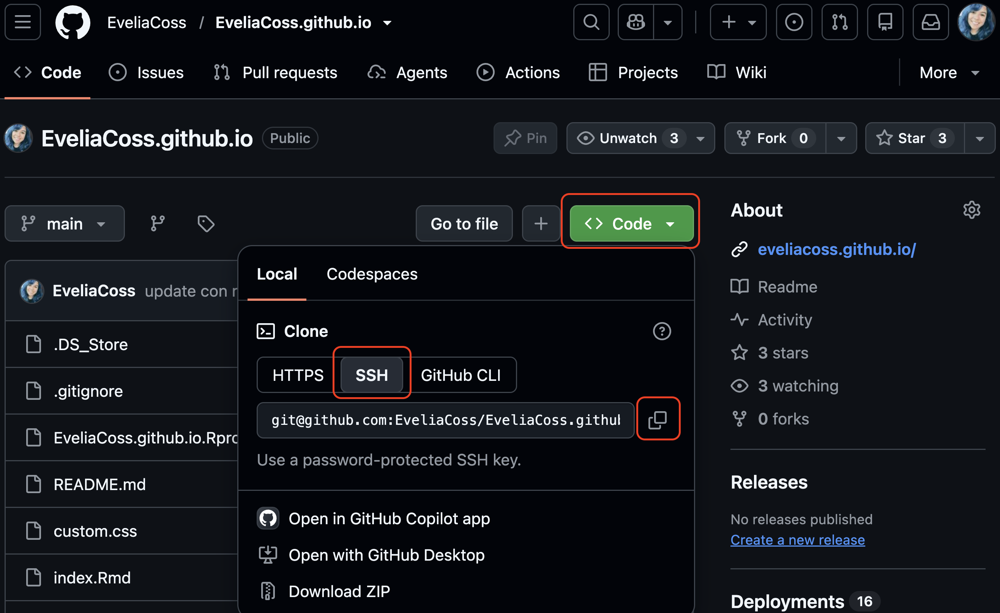

# Conectar a GitHub con SSH

> **Fecha:** 22 de octubre, 2026

El valor del control de versiones se hace evidente al comenzar a colaborar con otros. Contamos con la mayor parte de las herramientas necesarias para ello; lo único que resta es transferir cambios de un repositorio a otro.

Sistemas como Git posibilitan el traslado de trabajo entre cualquier par de repositorios. No obstante, en la práctica, resulta más conveniente utilizar una copia como punto central y mantenerla en la web en lugar de en la computadora portátil de alguien.

Vamos a comenzar por crear un repositorio remoto, pero para eso necesitamos configurar nuestra cuenta de Github también.

## Paso 1: Crear un repositorio remoto

Lo primero que vamos a hacer es crear un repositorio remoto. Entra a tu cuenta de Github y dale click en Nuevo.

[{width="120%"}](https://haydeeperuyero.github.io/Computo_Cientifico/git-y-github.html#github)

Ponle de nombre `Mi_primer_repo` (o el nombre que hayas usado en las secciones anteriores). Deja marcada la opción de público y no añadas un README ni una licencia.

[{width="120%"}](https://haydeeperuyero.github.io/Computo_Cientifico/git-y-github.html#github)

Al darle click en crear repositorio, la página nos mostrará la siguiente información que es la que usaremos para configurar nuestro local con el remoto.

[{width="120%"}](https://haydeeperuyero.github.io/Computo_Cientifico/git-y-github.html#github)

Lo que acabamos de hacer es como si en nuestra terminal hubiéramos realizado lo siguiente:

``` bash
mkdir Mi_primer_repo
cd Mi_primer_repo
git init
```

## Paso 2: Conectar local a remoto

La página principal del repositorio remoto muestra una serie de información que necesitamos usar para conectar el repositorio remoto en Github con el repositorio local de nuestra computadora. Vamos a usar el protocolo de conexión SSH, da click en donde dice SSH y a continuación en el icono de copiar.

[{width="120%"}](https://haydeeperuyero.github.io/Computo_Cientifico/git-y-github.html#github)

Si ya tienen archivos como README.md, entonces lo encontrarás en el botón CODE.

{fig-align="center"}

Ahora, dentro de nuestra carpeta del repositorio local, abrir una terminal y correr lo siguiente:

``` bash
git remote add origin git@github.com:User/Mi_primer_repo.git
```

Para revisar que si se haya realizado correctamente procedemos a usar lo siguiente:

``` bash
git remote -v
```

## Paso 3: Conexión mediante SSH

Primero verificamos si ya tenemos algún par de llaves:

``` bash
ls -al ~/.ssh
```

Si ya tienen algún par de llaves configuradas las van a ver listadas, si no tiene ninguna les saldrá una leyenda como la siguiente:

``` output
ls: cannot access '/c/Users/User/.ssh': No such file or directory
```

### Paso 3.1: Crear un par de llaves SSH (opción A)

Para crear el par de llaves usamos el siguiente comando, la opción `-t` se refiere al tipo de algoritmo usado y la opción `-C` indica un comentario para la llave, en este caso el comentario es nuestro correo.

``` bash
ssh-keygen -t ed25519 -C "email@dominio.com"
```

Si tu sistema operativo no lo permite, usa `ssh-keygen -t rsa -b 4096 -C "your_email@example.com"`.

**Nota:** Si no cuentas con `ssh-keygen` instalado, primero corre el código:

``` bash
sudo apt-get install ssh-keygen
```

Como queremos usar el archivo default, solo damos <kbd>Enter</kbd>. Ahora nos pedirá una contraseña, tecleala, no vas a ver nada en la pantalla. Una vez creada verás en pantalla algo como lo siguiente:

``` bash
Your identification has been saved in /c/Users/user/.ssh/id_ed25519
Your public key has been saved in /c/Users/user/.ssh/id_ed25519.pub
The key fingerprint is:
SHA256:SMSPIStNyA10KPxuYu94KpZg9AYjgt9g46A4kFy3g1o user@domain
The keys randomart image is:
+--[ED25519 256]--+
|^B== o.          |
|%*= *.+          |
|+=.E =.+         |
| .=.+.o..        |
|...   . S        |
|.+ o             |
|+ =              |
|.o.o             |
|oo+.             |
+----[SHA256]-----+
```

Lo que dice `identification` ser refiere a la llave privada la cual no debes compartir nunca y la cadena de caracteres que dice `fingerprint` se refiere a parte de tu llave pública.

Si repetimos el comando siguiente, verán ahora ya sus dos claves pública y privada.

``` bash
ls -al ~/.ssh
```

### Paso 3.1 Generar una llave pública exclusiva para Github (opción B)

En caso de que ya cuentes con una llave con ese nombre, puedes crear una nueva llave con otro nombre especifico para Github:

``` bash
ssh-keygen -t ed25519 -C "your_email@example.com" -f ~/.ssh/id_ed25519_github
```

[{width="300"}](https://eveliacoss.github.io/Workshop_GitGithub2025/Parte1.html)

Ahora que ya tenemos las claves, debemos decirle a GitHub cuales son.

``` bash
cat ~/.ssh/id_ed25519_github.pub
```

Copia la cadena de caracteres, ve a la configuración de tu perfil de GitHub y da clic en "SSH and GPG Keys".

[{width="62%"}](https://haydeeperuyero.github.io/Computo_Cientifico/git-y-github.html#github)

Una vez ahí da clic en "**Nueva llave SSH**".

[{width="120%"}](https://haydeeperuyero.github.io/Computo_Cientifico/git-y-github.html#github)

Después coloca un título que te permita identificar que será la clave con la que usarás la computadora y pega tu llave pública.

[{width="120%"}](https://haydeeperuyero.github.io/Computo_Cientifico/git-y-github.html#github)

Ahora solo falta revisar la conexión desde la **terminal de Rstudio**.

``` bash
ssh -T git@github.com
```

Si vez un mensaje similar al siguiente, significa que quedo completa la autenticación.

``` bash
Hi Name! Youve successfully authenticated, but GitHub does not provide shell access.
```

### Paso 3.2 Solución a Error con la llave

A mi paso que la llave esta bien pero no tenia acceso a usar github, mostrando este mensaje:

``` bash
# ssh -i .ssh/id_ed25519_github -T git@github.com # En tu computadora desde Home
ssh -i /home/r2358984/.ssh/id_ed25519_github -T git@github.com # En posit Cloud
```

El mensaje de salida será:

```         
Hi EveliaCoss! You've successfully authenticated, but GitHub does not provide shell access.
```

### Paso 3.3 Crear un archivo de configuración

Como Posit Cloud no tiene instalado `nano`, podemos crear el archivo directamente desde la terminal.

Copia y ejecuta este bloque completo:

``` bash
cat > ~/.ssh/config << 'EOF'
Host github.com
    HostName github.com
    User git
    IdentityFile ~/.ssh/id_ed25519_github
    IdentitiesOnly yes
EOF
```

Esto le indica a SSH que utilice automáticamente tu clave `id_ed25519_github` cuando te conectes a GitHub.

Ahora establece los permisos adecuados:

``` bash
chmod 600 ~/.ssh/config
```

Comprueba que se guardó:

``` bash
cat ~/.ssh/config
```

## Paso 4: Push and pull

Una vez que ya tenemos configurado todo, solo falta enviar todo lo que tenemos en el repo local al remoto. Si se establecio la contraseña nos la va a pedir en la terminal o una ventana aparte.

``` bash
git add .
git commit -m "Mi primera página web"
git push -u origin main
```

En esa instrucción, `origin` se refiere al repositorio remoto y `main` al local (las ramas que estamos intentando poner en el mismo contenido).

La situación en la que estamos es la siguiente:

[{width="120%"}](https://swcarpentry.github.io/git-novice-es/07-github.html)

Para actualizar nuestro repositorio local, lo que debemos hacer es lo siguiente:

``` bash
git pull origin main
```

Como no hemos realizado ningún cambio en el remoto, no veremos nada nuevo en el local. En el remoto también podemos añadir archivos directamente.

## ¿Por qué aparecían tantos errores?

| Error | Causa | Solución |
|----|----|----|
| `Permission denied (publickey)` | SSH no seleccionaba tu clave correcta. | Crear `~/.ssh/config`. |
| `nano: command not found` | El editor no está instalado. | Crear el archivo con `cat`. |
| `Could not open a connection to your authentication agent` | El agente SSH no estaba activo. | No necesitas el agente si SSH utiliza directamente tu clave. |
| `could not read Username for https` | Git estaba usando HTTPS. | Cambiar `origin` a SSH. |
| `main has no upstream branch` | La rama local no tiene seguimiento remoto. | Ejecutar `git push -u origin main`. |

Una aclaración: `git config --global user.email` solo configura el correo que aparece en tus commits. No autentica tu cuenta con GitHub.

Con esta configuración podrás utilizar tu clave SSH de Posit Cloud para trabajar con GitHub.
