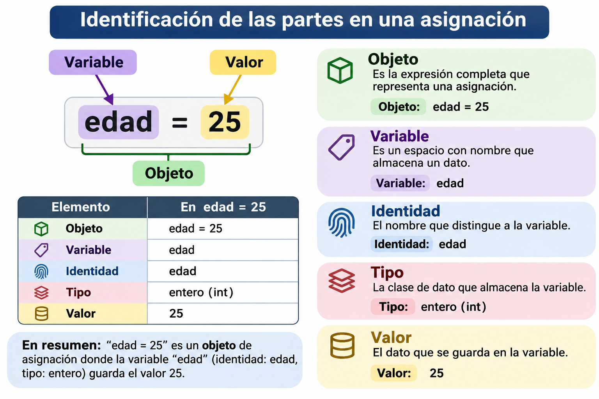

> **Fecha:** 03 de noviembre, 2026

**Objetivo**: Comprender cómo Python trabaja con variables y objetos, identificar el **tipo**, el **valor** y la **identidad** de un objeto, acceder a elementos mediante índices y diferenciar los objetos mutables de los inmutables.

**Nivel: Básico.**

**Instrucciones:** Resuelve cada ejercicio completando su código. Antes de ejecutar cada programa, analiza qué resultado esperas obtener. **No utilices atributos ni métodos** de los objetos (los veremos en el siguiente capítulo); solo puedes emplear funciones integradas como `print()`, `type()`, `id()`, `len()`, `int()`, `float()`, `str()` y `bool()`.

Esta es la versión para **RStudio** de la actividad del [libro del curso](https://eveliacoss.github.io/Mt2026_Taller_Computo_libro/python_ejercicio1.html). Es **tu propio archivo**: escribe tus respuestas aquí y guárdalo.

**Antes de empezar:**

1. Cambia `Tu nombre` por tu nombre en el encabezado (YAML) del archivo.
2. Ejecuta los bloques **en orden**, de arriba hacia abajo, con el botón ▶ de cada bloque (o `Cmd/Ctrl + Shift + Enter`).
3. Completa los espacios `______` de cada ejercicio.
4. Da clic en **💡 Pista** o **✔️ Solución** para desplegarlas.
5. En los ejercicios con **✅ Verificar**, ejecuta primero tu solución y después la celda de verificación.
6. Al terminar, presiona **Render** para generar tu documento HTML con todos tus resultados.

## ¿Y si quiero empezar mi propio `.qmd` desde cero?

También puedes crear un documento nuevo con **File \> New File \> Quarto Document...**, poner el YAML de arriba y copiar ahí los ejercicios que quieras. Así practicas lo que aprendiste en el [Paso 7](https://eveliacoss.github.io/Mt2026_Taller_Computo_libro/quarto_python.html#paso-7.-mi-primer-documento-de-quarto-con-python) del capítulo de configuración.
:::


> **⚠️ Advertencia**
>
> Si al ejecutar un bloque aparece `ModuleNotFoundError` o `NameError: name '______' is not defined`:
>
> - `NameError` con `______` significa que **todavía no completaste** ese espacio: es normal.
> - `ModuleNotFoundError` indica un problema de configuración: consulta la [solución de problemas](https://eveliacoss.github.io/Mt2026_Taller_Computo_libro/quarto_python.html#solución-de-problemas) del capítulo de configuración.

## Repaso: objeto y variable

### ¿Qué es un objeto?

En Python, **todo es un objeto**: un número, un texto, una lista. Un **objeto** es un dato guardado en la memoria de la computadora, y siempre tiene tres características:

| Característica | Pregunta que responde | ¿Cómo se consulta? | ¿Puede cambiar? |
|----|----|----|----|
| **Tipo** | ¿Qué clase de dato es? | `type(x)` | Nunca. |
| **Valor** | ¿Qué información contiene? | `print(x)` | Solo si el objeto es **mutable**. |
| **Identidad** | ¿Cuál objeto es, de todos los que hay en memoria? | `id(x)` | Nunca, mientras el objeto exista. |

```{python}
edad = 20

print(type(edad))  # Tipo
print(edad)        # Valor
print(id(edad))    # Identidad
```

La **identidad** es un número único que Python asigna a cada objeto mientras existe (en la práctica, su dirección en la memoria). Tu número será diferente al de esta página y puede cambiar cada vez que ejecutes el programa; lo importante es **comparar** identidades, no memorizarlas.

### ¿Qué es una variable?

Una **variable** es un **nombre** que hace referencia a un objeto. La variable no "contiene" el dato: es como una **etiqueta** pegada a una caja. La caja es el objeto.



Cuando escribimos:

```{python}
x = 25
```

Python hace dos cosas:

1.  Crea un **objeto** de tipo `int` con valor `25`.
2.  Crea el **nombre** `x` y lo hace referenciar a ese objeto.

|   | Objeto | Variable |
|----|----|----|
| ¿Qué es? | El dato guardado en memoria. | Un nombre que apunta al objeto. |
| ¿Tiene tipo? | **Sí**, el tipo pertenece al objeto. | No, la variable solo apunta. |
| ¿Tiene identidad? | **Sí**, `id()` es la del objeto. | No, `id(x)` regresa la identidad del objeto al que apunta `x`. |
| Ejemplo | `25` | `x` |

Por eso una misma variable puede apuntar a objetos de distinto tipo (**tipado dinámico**):

```{python}
x = 25
print(type(x))

x = "veinticinco"   # x ahora apunta a otro objeto
print(type(x))
```

Y un mismo objeto puede tener **varios nombres**:

```{python}
a = [1, 2, 3]
b = a          # b NO es una copia: es otra etiqueta para el mismo objeto

print(id(a))
print(id(b))
print(a is b)  # ¿Son el mismo objeto?
```

### Comparar valor e identidad: `==` vs `is`

| Operador | ¿Qué compara? | Ejemplo |
|----|----|----|
| `==` | Si dos objetos tienen el **mismo valor**. | `a == b` |
| `is` | Si dos nombres apuntan al **mismo objeto** (misma identidad). | `a is b` |

```{python}
lista1 = [1, 2, 3]
lista2 = [1, 2, 3]

print(lista1 == lista2)  # Mismo valor
print(lista1 is lista2)  # Pero son objetos distintos
```

> **📝 Nota**
>
> Para comparar números y textos usa siempre `==`. Por optimización, Python a veces reutiliza el mismo objeto para números pequeños o textos cortos, así que `is` puede dar resultados que parecen sorprendentes.

### Índices

En las cadenas, listas y tuplas cada elemento tiene una **posición** llamada **índice**. En Python los índices **empiezan en 0**, y los índices negativos cuentan desde el final.

```
 Cadena:      P   y   t   h   o   n
 Índice:      0   1   2   3   4   5
 Negativo:   -6  -5  -4  -3  -2  -1
```

```{python}
palabra = "Python"

print(palabra[0])    # Primer elemento
print(palabra[-1])   # Último elemento
print(palabra[0:3])  # Del índice 0 al 2 (el 3 no se incluye)
print(len(palabra))  # Número de elementos
```

### Mutables e inmutables

- **Mutable**: su valor puede cambiar sin crear un objeto nuevo (la identidad se conserva). Ejemplos: `list`, `dict`, `set`.
- **Inmutable**: su valor no puede cambiar. Si "modificamos" la variable, en realidad se crea un **objeto nuevo**. Ejemplos: `int`, `float`, `str`, `tuple`, `bool`.

```{python}
numeros = [10, 20, 30]
print(id(numeros))

numeros[0] = 100       # Modificamos el objeto
print(numeros)
print(id(numeros))     # Misma identidad: es el mismo objeto
```

```{python}
x = 25
print(id(x))

x = x + 1              # Se crea un objeto nuevo con valor 26
print(id(x))           # Identidad distinta
```

## Parte I. Tipo y valor

### Ejercicio 1. Mi primera colección de variables

Crea un programa que almacene la siguiente información:

- Nombre de un estudiante.
- Edad.
- Estatura en metros.
- Si está inscrito en la universidad (`True` o `False`).

Después, muestra cada variable junto con su tipo de dato utilizando `type()`.

```{python}
nombre = "Ana"
edad = 19
estatura = 1.65
inscrito = True

# Muestra el valor y el tipo de cada variable
```

<details>
<summary><b>💡 Pista</b> (da clic para ver)</summary>


Puedes mostrar varios elementos en un mismo `print()` separándolos con comas: `print(nombre, "es:", type(nombre))`.

</details>

<details>
<summary><b>✔️ Solución</b> (da clic para ver)</summary>


``` python
nombre = "Ana"
edad = 19
estatura = 1.65
inscrito = True

print(nombre, "es:", type(nombre))
print(edad, "es:", type(edad))
print(estatura, "es:", type(estatura))
print(inscrito, "es:", type(inscrito))
```

</details>

### Ejercicio 2. Cadenas de caracteres

A partir de las variables `nombre` y `apellido`:

1.  Crea la variable `completo` uniendo ambas cadenas con un espacio en medio (usa `+`).
2.  Muestra la primera letra del nombre y la última letra del apellido usando índices.
3.  Muestra el número de caracteres de `completo` con `len()`.

```{python}
nombre = "Ana"
apellido = "López"

completo = ______
print(completo)
print(______)   # Primera letra del nombre
print(______)   # Última letra del apellido
print(______)   # Número de caracteres
```

<details>
<summary><b>💡 Pista</b> (da clic para ver)</summary>


El espacio también es una cadena: `" "`. Recuerda que el primer índice es `0` y el último es `-1`.

</details>

<details>
<summary><b>✔️ Solución</b> (da clic para ver)</summary>


``` python
nombre = "Ana"
apellido = "López"

completo = nombre + " " + apellido
print(completo)
print(nombre[0])
print(apellido[-1])
print(len(completo))  # 9: el espacio también cuenta
```

</details>

### Ejercicio 3. ¿Mismo valor, distinto tipo?

Observa estas dos variables. Ejecuta el código y responde: ¿por qué `a + a` y `b + b` dan resultados diferentes?

Después, convierte `b` a número entero con `int()` y calcula `b + 5`. El resultado debe ser `25`.

```{python}
a = 20
b = "20"

print(type(a), a + a)
print(type(b), b + b)

numero = ______
respuesta = numero + 5
respuesta
```

```{python}
# ✅ Verificar el ejercicio 3
# Ejecuta esta celda después de ejecutar tu solución
result = respuesta
if result == 25:
    feedback = {"correct": True, "message": "¡Correcto! int() creó un nuevo objeto de tipo int a partir del texto."}
elif result == "205":
    feedback = {"correct": False, "message": "Obtuviste el texto '205'. Convierte b a número antes de sumar."}
else:
    feedback = {"correct": False, "message": "El resultado debe ser 25. Revisa la conversión con int()."}
feedback
print(("✅ " if feedback["correct"] else "❌ ") + feedback["message"])
```

<details>
<summary><b>💡 Pista</b> (da clic para ver)</summary>


Con números, `+` **suma**; con cadenas, `+` **une** (concatena). El tipo del objeto determina qué hace la operación. Para convertir usa `int(b)`.

</details>

<details>
<summary><b>✔️ Solución</b> (da clic para ver)</summary>


``` python
a = 20
b = "20"

print(type(a), a + a)   # <class 'int'> 40
print(type(b), b + b)   # <class 'str'> 2020

numero = int(b)
respuesta = numero + 5              # 25
respuesta
```

`a` y `b` "se ven" iguales, pero son objetos de **tipos distintos**, por lo que la misma operación se comporta diferente.

</details>

### Ejercicio 4. Conversión de tipos

Predice el resultado de cada conversión y después ejecuta el código para comprobarlo. ¿Cuál produce un error y por qué?

```{python}
print(float(7))
print(int(3.99))
print(str(2026))
print(bool(0))
print(bool("hola"))
print(int("tres"))
```

<details>
<summary><b>💡 Pista</b> (da clic para ver)</summary>


`int()` no redondea: elimina la parte decimal. `bool()` regresa `False` para `0` y para la cadena vacía `""`.

</details>

<details>
<summary><b>✔️ Solución</b> (da clic para ver)</summary>


``` python
print(float(7))         # 7.0
print(int(3.99))        # 3, se elimina la parte decimal
print(str(2026))        # '2026', ahora es texto
print(bool(0))          # False
print(bool("hola"))     # True
print(int("tres"))      # ValueError
```

`int("tres")` produce un `ValueError`: Python solo puede convertir a número un texto que contenga dígitos, como `"3"`.

</details>

## Parte II. Identidad: objeto y variable

### Ejercicio 5. La identidad de un objeto

1.  Crea la variable `x` con valor `100` y muestra su identidad con `id()`.
2.  Reasigna `x = 200` y muestra de nuevo su identidad.
3.  Responde: ¿cambió el objeto `100` o cambió la variable `x`?

```{python}
x = 100
print("Identidad 1:", ______)

x = 200
print("Identidad 2:", ______)
```

<details>
<summary><b>💡 Pista</b> (da clic para ver)</summary>


`id(x)` regresa la identidad del objeto al que apunta `x` **en ese momento**.

</details>

<details>
<summary><b>✔️ Solución</b> (da clic para ver)</summary>


``` python
x = 100
print("Identidad 1:", id(x))

x = 200
print("Identidad 2:", id(x))
```

Las identidades son diferentes. El objeto `100` **no cambió**: la variable `x` dejó de apuntar al objeto `100` y ahora apunta a un objeto nuevo, `200`.

</details>

### Ejercicio 6. Dos nombres, un objeto

Ejecuta el código. ¿Por qué cambió también `original` si solo modificamos `otra`? Compruébalo comparando sus identidades con `id()` y con `is`.

```{python}
original = [1, 2, 3]
otra = original
otra[0] = 99

print("original:", original)
print("otra:", otra)

# Compara sus identidades
```

<details>
<summary><b>💡 Pista</b> (da clic para ver)</summary>


`otra = original` no crea una lista nueva. Compara `id(original) == id(otra)` u `original is otra`.

</details>

<details>
<summary><b>✔️ Solución</b> (da clic para ver)</summary>


``` python
original = [1, 2, 3]
otra = original
otra[0] = 99

print("original:", original)
print("otra:", otra)

print(id(original) == id(otra))  # True
print(original is otra)          # True
```

Hay **un solo objeto** con **dos nombres**. Al modificar el objeto a través de `otra`, el cambio también se ve desde `original`.

</details>

### Ejercicio 7. ¿Mismo valor o mismo objeto?

Completa el código usando `==` e `is` para responder:

- ¿`lista_a` y `lista_b` tienen el mismo valor?
- ¿`lista_a` y `lista_b` son el mismo objeto?
- ¿`lista_a` y `lista_c` son el mismo objeto?

```{python}
lista_a = [5, 10, 15]
lista_b = [5, 10, 15]
lista_c = lista_a

print("¿a y b tienen el mismo valor?", ______)
print("¿a y b son el mismo objeto?", ______)
print("¿a y c son el mismo objeto?", ______)
```

<details>
<summary><b>💡 Pista</b> (da clic para ver)</summary>


`==` compara el **valor**; `is` compara la **identidad**.

</details>

<details>
<summary><b>✔️ Solución</b> (da clic para ver)</summary>


``` python
lista_a = [5, 10, 15]
lista_b = [5, 10, 15]
lista_c = lista_a

print("¿a y b tienen el mismo valor?", lista_a == lista_b)  # True
print("¿a y b son el mismo objeto?", lista_a is lista_b)    # False
print("¿a y c son el mismo objeto?", lista_a is lista_c)    # True
```

</details>

## Parte III. Índices, objetos mutables e inmutables

### Ejercicio 8. Índices en listas y tuplas

A partir de la lista `primos` y la tupla `punto`:

1.  Muestra el primer y el último elemento de `primos`.
2.  Muestra los elementos de `primos` del índice 1 al 3 (incluido).
3.  Muestra la segunda coordenada de `punto`.
4.  En la última línea escribe la expresión que obtiene el **último** elemento de `primos` (debe ser `11`).

```{python}
primos = [2, 3, 5, 7, 11]
punto = (3, -2)

print(______)   # Primer elemento de primos
print(______)   # Elementos del índice 1 al 3
print(______)   # Segunda coordenada de punto

respuesta = ______          # Último elemento de primos
respuesta
```

```{python}
# ✅ Verificar el ejercicio 8
# Ejecuta esta celda después de ejecutar tu solución
result = respuesta
if result == 11:
    feedback = {"correct": True, "message": "¡Correcto! El índice -1 siempre corresponde al último elemento."}
else:
    feedback = {"correct": False, "message": "La última línea debe regresar el último elemento de primos."}
feedback
print(("✅ " if feedback["correct"] else "❌ ") + feedback["message"])
```

<details>
<summary><b>💡 Pista</b> (da clic para ver)</summary>


Para incluir el índice 3 en un rango, el final debe ser `4`: `primos[1:4]`. El último elemento es `primos[-1]`.

</details>

<details>
<summary><b>✔️ Solución</b> (da clic para ver)</summary>


``` python
primos = [2, 3, 5, 7, 11]
punto = (3, -2)

print(primos[0])        # 2
print(primos[1:4])      # [3, 5, 7]
print(punto[1])         # -2

respuesta = primos[-1]              # 11
respuesta
```

Una tupla es ideal para guardar un punto $(x, y)$: sus coordenadas no deberían cambiar por accidente, porque las tuplas son inmutables.

</details>

### Ejercicio 9. Modificar un objeto mutable

1.  Muestra la identidad de la lista `calificaciones`.
2.  Cambia la segunda calificación por `10` usando su índice.
3.  Muestra la lista y su identidad otra vez. ¿Es el mismo objeto?

```{python}
calificaciones = [8, 6, 9]
print("Antes:", calificaciones, id(calificaciones))

# Cambia la segunda calificación

print("Después:", calificaciones, id(calificaciones))
```

<details>
<summary><b>💡 Pista</b> (da clic para ver)</summary>


La segunda calificación está en el índice `1`: `calificaciones[1] = 10`.

</details>

<details>
<summary><b>✔️ Solución</b> (da clic para ver)</summary>


``` python
calificaciones = [8, 6, 9]
print("Antes:", calificaciones, id(calificaciones))

calificaciones[1] = 10

print("Después:", calificaciones, id(calificaciones))
```

La identidad es la misma: modificamos el **valor** del objeto sin crear uno nuevo, porque las listas son **mutables**.

</details>

### Ejercicio 10. Intentar modificar un objeto inmutable

1.  Ejecuta el código: intenta cambiar la primera letra de `animal` por `"g"`. ¿Qué error obtienes?
2.  Comenta la línea del error (agrega `#` al inicio) y, en su lugar, crea una cadena **nueva** `"gato"` uniendo `"g"` con `animal[1:]`, y guárdala en la misma variable.
3.  Compara la identidad antes y después. ¿Es el mismo objeto?

```{python}
animal = "pato"
print("Antes:", animal, id(animal))

animal[0] = "g"

print("Después:", animal, id(animal))
```

<details>
<summary><b>💡 Pista</b> (da clic para ver)</summary>


`animal[1:]` regresa `"ato"`. Puedes escribir `animal = "g" + animal[1:]`.

</details>

<details>
<summary><b>✔️ Solución</b> (da clic para ver)</summary>


``` python
animal = "pato"
print("Antes:", animal, id(animal))

# animal[0] = "g"   # TypeError: 'str' object does not support item assignment
animal = "g" + animal[1:]

print("Después:", animal, id(animal))
```

Las cadenas son **inmutables**: no podemos cambiar una letra. Lo que sí podemos hacer es crear un **objeto nuevo** (`"gato"`) y hacer que la variable `animal` apunte a él. Por eso la identidad cambia.

</details>

## Resumen

| Concepto | Descripción | Función u operador |
|----|----|----|
| Objeto | Dato guardado en memoria, con tipo, valor e identidad. |  |
| Variable | Nombre que hace referencia a un objeto. | `=` |
| Tipo | Qué clase de dato es el objeto. | `type()` |
| Valor | La información que contiene el objeto. | `print()` |
| Identidad | Número único del objeto mientras existe. | `id()` |
| Mismo valor | Compara valores. | `==` |
| Mismo objeto | Compara identidades. | `is` |
| Mutable | Su valor puede cambiar, conserva su identidad. | `list`, `dict`, `set` |
| Inmutable | Su valor no cambia; "modificarlo" crea un objeto nuevo. | `int`, `float`, `str`, `tuple`, `bool` |

## Referencias

- [Documentación de Python: Modelo de datos (objetos, valores y tipos)](https://docs.python.org/es/3/reference/datamodel.html#objects-values-and-types)
- [Documentación de Python: Funciones integradas](https://docs.python.org/es/3/library/functions.html)
- [Quarto Live: ejercicios interactivos](https://r-wasm.github.io/quarto-live/exercises/exercises.html)
