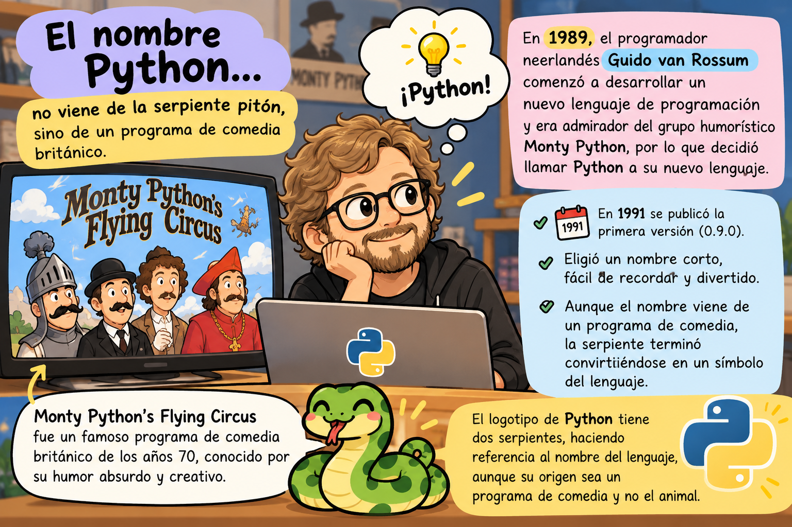
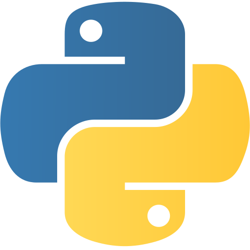
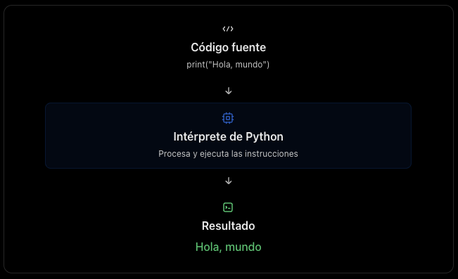
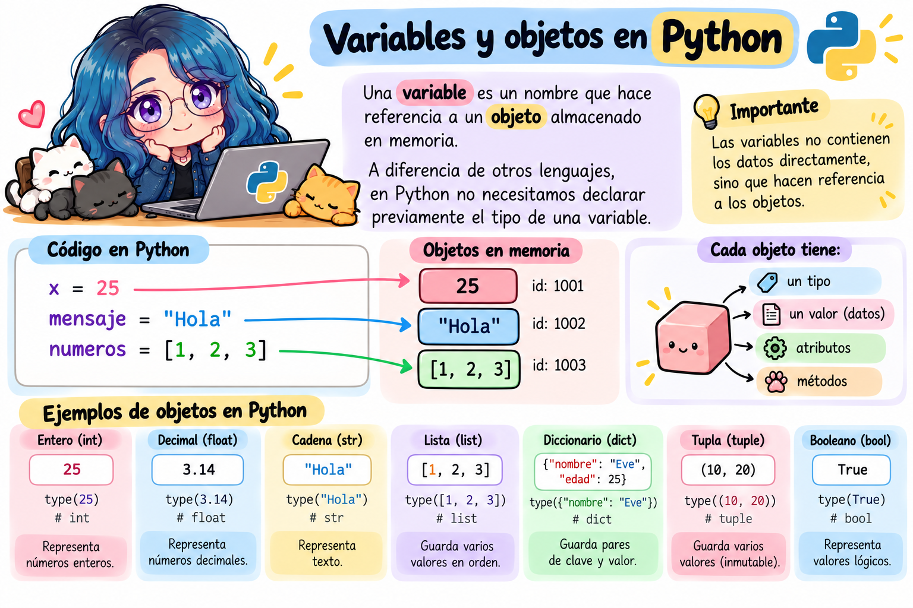
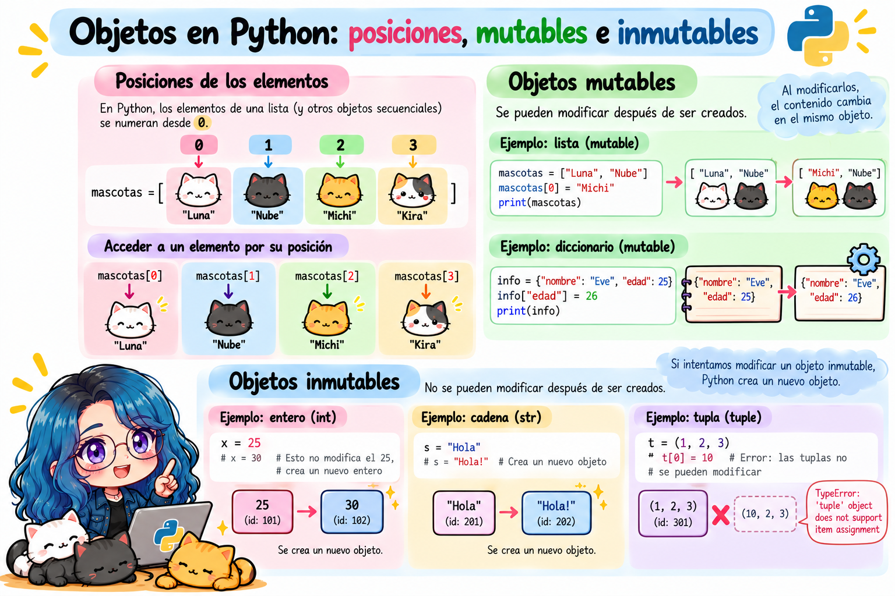

# Introducción a Python en Rstudio usando `reticulate`

> **Fecha:** 26 de octubre, 2026

## ¿Qué es Python?

Python es un lenguaje de programación de alto nivel, interpretado, de propósito general y con una sintaxis clara y legible.

Fue creado por **Guido van Rossum** y publicado por primera vez en 1991.

Actualmente, Python es uno de los lenguajes más utilizados en el mundo debido a su versatilidad y facilidad de lectura.

### ¿Cuál es la historia del nombre?

En 1989, el programador neerlandés **Guido van Rossum** comenzó a desarrollar un nuevo lenguaje de programación mientras trabajaba en el centro de investigación CWI, en los Países Bajos.

Guido era admirador del grupo humorístico británico **Monty Python's Flying Circus**, por lo que decidió llamar Python a su nuevo lenguaje.

Su intención era elegir un nombre que fuera corto, fácil de recordar y un poco divertido.

{fig-align="center"}

::::: columns
::: {.column width="60%"}
**¿Por qué utilizar Python?**

Permite desarrollar programas que realizan tareas de manera automática, procesan información, resuelven problemas y construyen aplicaciones.
:::

::: {.column width="40%"}
{fig-align="right" width="253"}
:::
:::::

## ¿Qué es un lenguaje interpretado?

Un lenguaje interpretado es un lenguaje de programación cuyo código se ejecuta mediante un programa llamado intérprete, que se encarga de leer las instrucciones y ejecutarlas sin necesidad de generar previamente un archivo ejecutable independiente.

Python es un ejemplo de lenguaje interpretado.

### ¿Cómo funciona?

{fig-align="center"}

## Diferencia entre un lenguaje interpretado y uno compilado

| Lenguaje interpretado | Lenguaje compilado |
|------------------------------------|------------------------------------|
| Utiliza un intérprete para ejecutar el programa. | Generalmente utiliza un compilador para generar código ejecutable. |
| Normalmente no requiere generar un ejecutable independiente. | Habitualmente necesita una etapa de compilación previa. |
| Ejemplo: Python. | Ejemplo: C. |

## ¿Qué es `reticulate`?

`reticulate` es un paquete de R que permite ejecutar código de Python directamente desde R, facilitando la integración de ambos lenguajes de programación en un mismo proyecto.

Con `reticulate` podemos aprovechar las herramientas de R y Python sin necesidad de cambiar constantemente entre programas.

### ¿Para qué sirve `reticulate`?

Entre sus principales aplicaciones se encuentran:

- **Ejecutar código Python desde R:** escribir y ejecutar instrucciones de Python dentro de una sesión de R.
- **Utilizar bibliotecas de Python:** acceder a herramientas como NumPy, pandas y scikit-learn.
- **Compartir datos entre R y Python:** transferir variables, vectores, listas y tablas de datos.
- **Integrar ambos lenguajes:** desarrollar proyectos que aprovechen las funcionalidades de R y Python.
- **Trabajar en Quarto y R Markdown:** combinar fragmentos de código de ambos lenguajes en un documento reproducible.

## Opción A: Ejecutar Python desde la consola de R

Una de las funciones más importantes es `repl_python()`, que permite acceder a una consola interactiva de Python sin salir de RStudio.

**Paso 1. Abrir la consola de Python desde R:**

```{r}
library(reticulate)
repl_python()
```

O también podemos usar:

```{r}
reticulate::repl_python()
```

El indicador de la consola cambiará de `>` (R) a `>>>` (Python). Para salir usa `exit` o `quit`.

**Paso 2. Escribir instrucciones de Python:**

```{python}
print("Hello world")
```

**Paso 3. Regresar a R:**

```{python}
exit
```

Esto cierra la consola interactiva de Python y permite continuar trabajando con R.

## Opción B: Ejecutar instrucciones de Python desde R

También podemos ejecutar código de Python directamente desde un script de R utilizando `py_run_string()`.

```{r}
library(reticulate)
py_run_string("print('Hola desde Python')")
```

Para ejecutar varias instrucciones:

```{r}
py_run_string("
a = 10
b = 20
suma = a + b
print('La suma es:', suma)
")
```

## Compartir variables entre R y Python

Una característica importante de `reticulate` es que podemos utilizar variables creadas en Python desde R y viceversa.

**Ejemplo 1. Crear una variable en Python y utilizarla en R.**

```{r}
library(reticulate)
py_run_string("resultado = 5 * 8")
py$resultado
```

**Ejemplo 2. Crear una variable en R y utilizarla en Python.**

```{r}
numeros <- c(10, 20, 30, 40)
py$numeros <- numeros
py_run_string("print(sum(numeros))")
```

## Utilizar bibliotecas de Python desde R

Podemos utilizar bibliotecas como NumPy, pandas o scikit-learn.

En versiones recientes de `reticulate`, se recomienda declarar las dependencias con `py_require()`, que puede gestionar automáticamente un entorno de Python compatible.

```{r}
library(reticulate)

py_require("numpy")

np <- import("numpy")

numeros <- np$array(c(10, 20, 30, 40))

np$mean(numeros)
```

Este ejemplo utiliza NumPy, una biblioteca de Python especializada en operaciones numéricas.

## Principales funciones de `reticulate`

| Función           | Descripción                              |
|-------------------|------------------------------------------|
| `py_config()`     | Muestra la configuración de Python.      |
| `repl_python()`   | Abre una consola interactiva de Python.  |
| `py_run_string()` | Ejecuta instrucciones de Python desde R. |
| `py_run_file()`   | Ejecuta un archivo `.py`.                |
| `import()`        | Importa bibliotecas de Python.           |
| `py_require()`    | Declara las dependencias de Python.      |
| `py$variable`     | Accede a variables de Python desde R.    |
| `r_to_py()`       | Convierte objetos de R a Python.         |
| `py_to_r()`       | Convierte objetos de Python a R.         |

## Cómo instalar paquetes de Python desde RStudio

Podemos instalar bibliotecas de Python directamente desde RStudio utilizando el paquete `reticulate`, sin necesidad de abrir otra aplicación.

### Utilizar `py_require()` (recomendado)

En versiones recientes de `reticulate`, la función `py_require()` permite declarar las bibliotecas de Python que necesitamos y gestionar automáticamente sus dependencias.

**Paso 1. Declarar las bibliotecas de Python:**

```{r}
library(reticulate)
py_require("numpy")
py_require("pandas")
py_require("matplotlib")
py_require("sympy")
```

También podemos declararlas juntas:

```{r}
py_require(c("numpy", "pandas", "matplotlib", "sympy"))
```

`py_require()` no necesariamente instala los paquetes en el momento de llamarla; declara las dependencias y permite que `reticulate` las resuelva al inicializar Python.

**Paso 2. Importar una biblioteca y utilizarla:**

Opción A:

```{r}
np <- import("numpy")
numeros <- np$array(c(10, 20, 30, 40))
np$mean(numeros)
```

Opción B:

```{r}
repl_python()
```

```{python}
import numpy as np

numeros = np.array([10, 20, 30, 40])

np.mean(numeros)
```

Una vez dentro de Python, observarás que el indicador de la consola cambia de `>` a `>>>`.

### Comparación entre R y Python

| Desde R con `reticulate` | Desde `repl_python()` |
|------------------------------------|------------------------------------|
| `np <- import("numpy")` | `import numpy as np` |
| `numeros <- np$array(c(10, 20, 30, 40))` | `numeros = np.array([10, 20, 30, 40])` |
| `np$mean(numeros)` | `np.mean(numeros)` |

Observa las diferencias:

- En R utilizamos `<-` para asignar valores; en Python utilizamos `=`.
- En R utilizamos `$` para acceder a funciones de un objeto; en Python utilizamos `.`.
- En R utilizamos `c()` para crear un vector; en Python podemos utilizar `[]` para crear una lista.

## ¿Qué es un objeto en Python?

En Python, **un objeto es una entidad que contiene información (datos)** y tiene un tipo que determina las operaciones que podemos realizar con él.

Una característica fundamental de Python es que todo es un objeto, incluyendo números, cadenas de texto, listas, funciones y clases.

Cada objeto tiene tres características principales:

- **Identidad:** permite distinguir un objeto de otro.
- **Tipo:** determina qué clase de objeto es y qué operaciones admite.
- **Valor:** representa la información que contiene el objeto.
- **Atributos:** representan características o información asociada con un objeto.
- **Métodos:** son funciones asociadas con un objeto que permiten realizar operaciones.

## Variables y objetos en Python

Una variable es un nombre que hace referencia a un **objeto** almacenado en memoria.

A diferencia de otros lenguajes, en Python no necesitamos declarar previamente el tipo de una variable.

{fig-align="center"}

Podemos cambiar el objeto al que hace referencia una variable:

```{python}
numero = 10
numero = "Diez"
```

En este caso, `numero` primero hace referencia a un objeto entero y después a una cadena de texto.

Esto es posible porque Python utiliza tipado dinámico.

## Tipos de objetos en Python

Python dispone de diferentes tipos de datos integrados.

| Tipo            | Nombre en Python | Ejemplo             |
|-----------------|------------------|---------------------|
| Entero          | `int`            | `25`                |
| Decimal         | `float`          | `3.1416`            |
| Complejo        | `complex`        | `2 + 3j`            |
| Cadena de texto | `str`            | `"Python"`          |
| Booleano        | `bool`           | `True`, `False`     |
| Lista           | `list`           | `[10, 20, 30]`      |
| Tupla           | `tuple`          | `(10, 20, 30)`      |
| Diccionario     | `dict`           | `{"nombre": "Ana"}` |
| Conjunto        | `set`            | `{1, 2, 3}`         |

### ¿Cómo identificar el tipo de un objeto?

Utilizamos la función `type()`.

```{python}
edad = 20
nombre = "Carlos"
promedio = 9.5

print(type(edad))
print(type(nombre))
print(type(promedio))
```

## Objetos mutables e inmutables

Los objetos en Python pueden clasificarse en dos grandes grupos.

**Objetos mutables:** permiten modificar su contenido después de haber sido creados. Por ejemplo, las listas y los diccionarios.

```{python}
numeros = [10, 20, 30]

numeros[0] = 100 # Modificar el contenido de la posición 1

print(numeros)
```

**Objetos inmutables:** no permiten modificar su contenido una vez creados. Por ejemplo, los enteros, las cadenas de texto y las tuplas.

```{r}
nombre = "Ana"
nombre = "María"
```

Este código es válido, pero no modifica el objeto `"Ana"`: la variable `nombre` pasa a hacer referencia a otro objeto.

{fig-align="center"}

Por ejemplo:

```{python}
x = 25
x = 30
```

Cuando ejecutamos `x = 30`, no modificamos el objeto entero `25`. La variable `x` simplemente deja de referenciar al objeto `25` y comienza a referenciar al objeto `30`.

## Referencias

[Usar Python con R con reticulate : : GUÍA RÁPIDA](https://rstudio.github.io/cheatsheets/translations/spanish/reticulate_es.pdf)
