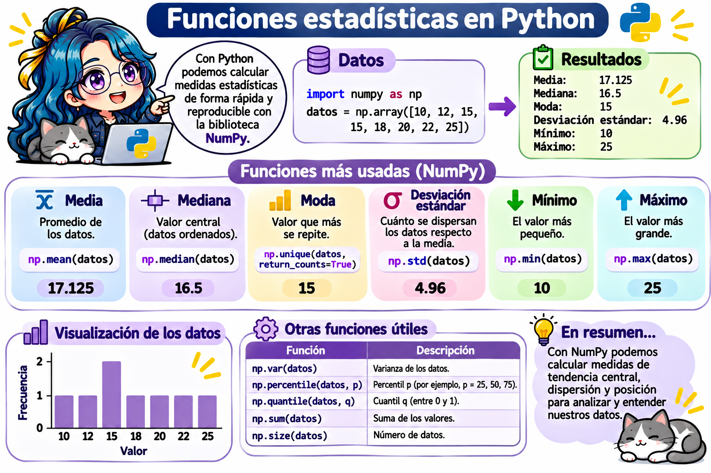

# Sintaxis de nombres, buenas prácticas y programación defensiva en Python



> **Fecha:** 03 de noviembre, 2026

En los capítulos anteriores creamos muchas variables. En este capítulo veremos:

- Las **reglas** que debe cumplir un nombre en Python y las **convenciones** para elegir buenos nombres.
- Las **buenas prácticas** para escribir código claro (retomando el capítulo de [Buenas prácticas en programación](cap3.qmd)).
- Qué es la **programación defensiva** y cómo usar `assert` y `try` / `except` para detectar y manejar errores.
- Las **estructuras de control de interrupción**: `raise`, `pass`, `break`, `continue`, `return` y `exit()`.

Este último tema prepara el capítulo de **condicionales** (`if`, `elif`, `else`).

## Palabras reservadas

Las **palabras reservadas** (*keywords*) tienen un significado especial en Python, por lo que **no podemos usarlas como nombres** de variables. Python 3 tiene 35:

|            |           |         |         |          |
|------------|-----------|---------|---------|----------|
| `False`    | `None`    | `True`  | `and`   | `as`     |
| `assert`   | `async`   | `await` | `break` | `class`  |
| `continue` | `def`     | `del`   | `elif`  | `else`   |
| `except`   | `finally` | `for`   | `from`  | `global` |
| `if`       | `import`  | `in`    | `is`    | `lambda` |
| `nonlocal` | `not`     | `or`    | `pass`  | `raise`  |
| `return`   | `try`     | `while` | `with`  | `yield`  |

Podemos consultarlas desde Python con el módulo `keyword`:

```{python}
import keyword

print(len(keyword.kwlist))
print(keyword.iskeyword("if"))
print(keyword.iskeyword("edad"))
```

Si intentamos usar una palabra reservada como nombre, obtenemos un `SyntaxError`:

```{python}
#| eval: false
class = "Taller de Cómputo"   # SyntaxError: invalid syntax
```

::: callout-note
Además existen palabras reservadas **suaves** (*soft keywords*): `match`, `case`, `type` y `_`. Solo son especiales en ciertos contextos, así que Python permite usarlas como nombres, pero es mejor evitarlas.
:::

## Reglas para nombrar variables

Un nombre válido en Python (también llamado **identificador**) debe cumplir estas reglas **obligatorias**:

| Regla | Válido | Inválido |
|----|----|----|
| Solo puede contener letras, dígitos y guion bajo (`_`). | `nota_final` | `nota-final`, `nota final`, `nota$` |
| No puede empezar con un dígito. | `lugar2` | `2lugar` |
| No puede ser una palabra reservada. | `clase` | `class` |
| Distingue mayúsculas de minúsculas. | `edad`, `Edad` y `EDAD` son **tres** variables distintas. |  |

```{python}
edad = 20
Edad = 30
EDAD = 40

print(edad, Edad, EDAD)
```

::: callout-tip
Python acepta letras con acentos y la `ñ` en los nombres (`año = 2026` es válido), pero se recomienda usar solo letras sin acentos (`anio`, `anno` o `year`) para evitar problemas al compartir tu código con otras computadoras o teclados.
:::

## Convenciones: cómo elegir buenos nombres

Las reglas dicen qué nombres **funcionan**; las convenciones dicen qué nombres son **buenos**. La comunidad de Python sigue la guía de estilo [PEP 8](https://peps.python.org/pep-0008/).

| Elemento | Convención | Ejemplo |
|----|----|----|
| Variables y funciones | `snake_case`: minúsculas separadas por guion bajo. | `promedio_final`, `calcular_area()` |
| Constantes | `MAYUSCULAS` con guion bajo. | `PI = 3.14159`, `CALIFICACION_MAXIMA = 10` |
| Clases | `PascalCase`: cada palabra inicia con mayúscula. | `Estudiante`, `MatrizCuadrada` |
| Módulos (archivos `.py`) | Nombres cortos en minúsculas. | `operaciones.py` |
| Uso "interno" | Empiezan con un guion bajo. | `_temporal` |

### Recomendaciones

- **Usa nombres descriptivos**: `area_triangulo` dice más que `a` o `x1`.
- **Sé consistente**: si usas español, usa español en todo el programa.
- **Evita nombres de una sola letra**, excepto en casos muy conocidos, como `i` en un ciclo o `x`, `y` en una fórmula matemática.
- **Evita `l` (ele minúscula), `O` (o mayúscula) e `I` (i mayúscula)** como nombres: se confunden con `1` y `0`.
- **No uses nombres de funciones integradas** como `list`, `sum`, `max`, `min`, `len`, `type`, `id`, `str` o `input` (ver más abajo).

| Poco claro                 | Mejor                                |
|----------------------------|--------------------------------------|
| `a = 5`                    | `base = 5`                           |
| `x = a * h / 2`            | `area_triangulo = base * altura / 2` |
| `l = [8, 9, 10]`           | `calificaciones = [8, 9, 10]`        |
| `numeroDeEstudiantes = 30` | `numero_estudiantes = 30`            |
| `t = 0.16`                 | `TASA_IVA = 0.16`                    |

### ¡Cuidado! No sobrescribas funciones integradas

Python no marca error si usas `sum` o `max` como nombre de variable, pero a partir de ese momento **pierdes la función original**:

```{python}
sum = 10                # Ahora "sum" apunta a un entero, no a la función
sum([1, 2, 3])          # TypeError: 'int' object is not callable
```

Para recuperar la función, elimina la variable con `del`:

```{python}
del sum
sum([1, 2, 3])
```

## Buenas prácticas de estilo

Un programa se escribe una vez, pero se **lee muchas veces** (por tus compañeros, tu profesora y tu "yo del futuro").

| Práctica | En lugar de | Escribe |
|----|----|----|
| Espacios alrededor de `=` y de los operadores. | `total=a+b*2` | `total = a + b * 2` |
| Un espacio después de cada coma. | `print(a,b,c)` | `print(a, b, c)` |
| Una instrucción por línea. | `a = 1; b = 2` | `a = 1` y en otra línea `b = 2` |
| Indentación de **4 espacios** (no tabuladores). |  | `····print("hola")` |
| Líneas cortas (máximo 79 caracteres). |  | Divide las líneas largas. |
| Constantes en lugar de "números mágicos". | `precio * 0.16` | `precio * TASA_IVA` |
| Comentarios que expliquen el **por qué**. | `x = x + 1  # suma 1` | `intentos = intentos + 1  # el usuario falló otra vez` |

### Comentarios y documentación

{fig-align="center"}

```{python}
# Programa: área y perímetro de un rectángulo
# Autora: Ana López
# Fecha: 03/11/2026

BASE = 5      # en centímetros
ALTURA = 3    # en centímetros

area = BASE * ALTURA
perimetro = 2 * (BASE + ALTURA)

print("Área:", area, "cm²")
print("Perímetro:", perimetro, "cm")
```

### El Zen de Python

Python incluye un "poema" con su filosofía de diseño. Ejecútalo:

```{pyodide}
import this
```

Algunas frases importantes: *"Bello es mejor que feo"*, *"Explícito es mejor que implícito"*, *"Simple es mejor que complejo"* y *"La legibilidad cuenta"*.

## Programación defensiva

La **programación defensiva** consiste en escribir código que **anticipa** lo que puede salir mal: datos incorrectos, listas vacías, divisiones entre cero o tipos inesperados.

Su objetivo es que, si algo falla, el programa **falle pronto y con un mensaje claro**, en lugar de continuar y producir un **resultado incorrecto en silencio**.

### Un error silencioso

Observa este programa. ¿Ves el problema?

```{python}
calificaciones = [9, 8.5, 95]   # Alguien escribió 95 en lugar de 9.5

promedio = sum(calificaciones) / len(calificaciones)
print("Promedio:", promedio)
```

Python **no marca ningún error**, pero el promedio de `37.5` no tiene sentido en una escala de 0 a 10. El resultado correcto, con `9.5`, sería `9.0`.

#### ¿Qué es un error silencioso?

Un **error silencioso** (también llamado **error lógico**) ocurre cuando el programa **se ejecuta sin problemas, pero produce un resultado incorrecto**. Python no muestra ningún mensaje porque, para él, todo está bien: sumar `9 + 8.5 + 95` y dividir entre 3 es una operación perfectamente válida. Python hace **lo que escribimos**, no **lo que queríamos** hacer.

|   | Error con mensaje | Error silencioso (lógico) |
|----|----|----|
| ¿El programa se detiene? | **Sí**, con un mensaje como `TypeError` o `NameError`. | **No**, termina con normalidad. |
| ¿Cómo nos enteramos? | Python nos avisa y señala la línea. | Solo si **revisamos** el resultado y notamos que no tiene sentido. |
| Ejemplo | `"Edad: " + 20` → `TypeError`. | Un promedio de `37.5` en una escala de 0 a 10. |
| ¿Qué tan peligroso es? | Poco: es fácil encontrarlo y corregirlo. | **Mucho**: el resultado incorrecto se puede usar sin que nadie lo note. |

¿Por qué es tan peligroso? Imagina que ese promedio se usa para decidir quién aprueba el curso, o que el resultado de un cálculo se usa en un reporte o en otro programa: el error se **propaga** y cada vez es más difícil saber de dónde vino.

#### Más ejemplos de errores silenciosos

Todos estos programas se ejecutan **sin mensajes de error**, pero dan un resultado incorrecto:

| Código | Resultado obtenido | Resultado esperado | ¿Qué salió mal? |
|----|----|----|----|
| `promedio = 6 + 10 / 2` | `11.0` | `8.0` | **Jerarquía de operaciones**: la división se hace antes que la suma. Faltan paréntesis: `(6 + 10) / 2`. |
| `mitad = 17 // 2` | `8` | `8.5` | `//` es la **división entera** (descarta los decimales); la división normal es `/`. |
| `math.sin(90)` | `0.894` | `1.0` | Las funciones trigonométricas usan **radianes**, no grados: `math.sin(math.radians(90))`. |
| `total = "8" + "9"` | `"89"` | `17` | Los datos son **texto**: `+` los une en lugar de sumarlos. Hay que convertirlos con `int()`. |
| `area = 3.14 * radio ** 2` (con `radio = 2`) | `12.56` | `12.566...` | Una **aproximación** de $\pi$ pierde precisión; usa `math.pi`. |
| `0.1 + 0.2 == 0.3` | `False` | `True` | Los decimales se guardan de forma **aproximada** en la computadora; para compararlos usa `math.isclose()`. |

Compruébalo tú: ejecuta el código y compara cada resultado con el esperado.

```{pyodide}
import math

print("6 + 10 / 2 =", 6 + 10 / 2)                  # ¿Es el promedio de 6 y 10?
print("17 // 2 =", 17 // 2)                        # ¿Es la mitad de 17?
print("sin(90) =", math.sin(90))                   # ¿Es el seno de 90 grados?
print('"8" + "9" =', "8" + "9")                    # ¿Es la suma de 8 y 9?
print("0.1 + 0.2 == 0.3:", 0.1 + 0.2 == 0.3)       # ¿Son iguales?
```

#### ¿Cómo descubrir un error silencioso?

Como Python no nos avisa, nosotros debemos **verificar** los resultados:

1.  **Estima el resultado antes de calcular.** Si las calificaciones van de 0 a 10, el promedio **no puede** ser `37.5`. Pregúntate siempre: "¿este número tiene sentido?".
2.  **Prueba con casos que ya conoces.** Antes de usar tu programa con datos nuevos, pruébalo con datos cuya respuesta sabes: el promedio de `[8, 10]` debe ser `9`; el seno de 90° debe ser `1`.
3.  **Muestra los valores intermedios** con `print()` para seguir el cálculo paso a paso.
4.  **Revisa los tipos** con `type()`: muchos errores silenciosos ocurren porque un número en realidad es texto (`"8"`).
5.  **Verifica los rangos** de los datos: ninguna calificación puede ser menor que 0 ni mayor que 10. Esto lo automatizaremos con `assert` en esta misma sección.

Aplicando el punto 5, el error del ejemplo se hace visible con una sola línea:

```{python}
calificaciones = [9, 8.5, 95]
print("Mayor calificación:", max(calificaciones))   # 95: ¡fuera del rango de 0 a 10!
```

La **programación defensiva** busca justamente esto: convertir los errores silenciosos en errores **con mensaje**, para que el programa nos avise en cuanto algo no tiene sentido.

### Principios de la programación defensiva

1.  **Valida los datos de entrada**: verifica el tipo y el rango antes de usarlos.
2.  **Falla pronto**: detén el programa en cuanto detectes un problema, no al final.
3.  **Usa mensajes claros**: explica **qué** salió mal y **cómo** corregirlo.
4.  **No confíes en supuestos**: "la lista nunca estará vacía" o "el usuario siempre escribirá un número".
5.  **Prueba los casos límite**: cero, números negativos, listas vacías, texto en lugar de números.

### Leer los mensajes de error {#leer-los-mensajes-de-error}

Antes de defendernos de los errores hay que saber **leerlos**. La última línea de un mensaje de error indica el **tipo** de error y una descripción:

| Error | ¿Cuándo ocurre? | Ejemplo |
|----|----|----|
| `SyntaxError` | El código está mal escrito. | `2lugar = "Luis"` |
| `IndentationError` | La indentación es incorrecta. | Un `print` con espacios de más. |
| `NameError` | Usas una variable que no existe. | `print(resultado)` sin haberla creado. |
| `TypeError` | La operación no es válida para ese tipo. | `"Edad: " + 20` |
| `ValueError` | El tipo es correcto, pero el valor no. | `int("diez")` |
| `ZeroDivisionError` | Divides entre cero. | `10 / 0` |
| `IndexError` | El índice no existe en la lista. | `[1, 2, 3][5]` |
| `KeyError` | La clave no existe en el diccionario. | `{"a": 1}["b"]` |
| `AttributeError` | El objeto no tiene ese atributo o método. | `(1, 2).append(3)` |
| `AssertionError` | Falló una verificación con `assert`. | `assert 5 < 3` |

### `assert`: verificar que algo sea verdadero

La instrucción `assert` verifica una expresión booleana. Si es `True`, el programa continúa sin hacer nada; si es `False`, el programa **se detiene** con un `AssertionError` y el mensaje que escribimos:

``` python
assert condicion, "Mensaje si la condición es falsa"
```

La **condición** es una pregunta cuya respuesta es `True` o `False`, por ejemplo `len(calificaciones) > 0` (¿la lista tiene elementos?) o `max(calificaciones) <= 10` (¿la mayor calificación es a lo más 10?). Estudiaremos estas preguntas, llamadas **expresiones booleanas**, en el capítulo de [Condicionales en Python](python_condicionales.qmd).

Apliquémoslo al ejemplo del error silencioso (este editor se ejecuta solo al cargar la página; observa que el `print()` final **nunca se ejecuta**):

```{pyodide}
#| autorun: true
CALIFICACION_MINIMA = 0
CALIFICACION_MAXIMA = 10

calificaciones = [9, 8.5, 95]

assert len(calificaciones) > 0, "La lista de calificaciones está vacía"
assert min(calificaciones) >= CALIFICACION_MINIMA, "Hay calificaciones menores que 0"
assert max(calificaciones) <= CALIFICACION_MAXIMA, "Hay calificaciones mayores que 10"

promedio = sum(calificaciones) / len(calificaciones)
print("Promedio:", promedio)
```

Ahora el programa **se detiene antes** de calcular un promedio incorrecto y nos dice exactamente qué revisar. Cambia `95` por `9.5` y presiona **Run Code**: las tres verificaciones pasan y se muestra el promedio.

::: callout-note
`assert` es ideal para detectar **errores de programación** mientras desarrollas. Para validar datos que escribe un usuario, lo recomendable es decidir qué hacer con un **condicional**, como veremos en el capítulo de condicionales.
:::

### `try` / `except`: capturar un error sin detener el programa

`assert` y los errores **detienen** el programa. A veces preferimos **atrapar** el error y decidir qué hacer. Para eso existe `try` / `except`:

``` python
try:
    # Código que podría fallar
except TipoDeError:
    # Qué hacer si ocurre ese error
```

Python intenta ejecutar el bloque `try`. Si ocurre el error indicado, en lugar de detenerse, ejecuta el bloque `except`:

```{python}
texto = "diez"

try:
    numero = int(texto)
    print("Número convertido:", numero)
except ValueError:
    print("Aviso: no se puede convertir", repr(texto), "en un número")

print("El programa continúa")
```

Podemos atrapar varios tipos de error y agregar un bloque `finally`, que se ejecuta **siempre**, haya o no error:

```{python}
dividendo = 10
divisor = 0

try:
    resultado = dividendo / divisor
    print("Resultado:", resultado)
except ZeroDivisionError:
    print("Error: no se puede dividir entre cero")
except TypeError:
    print("Error: los dos valores deben ser números")
finally:
    print("Fin del cálculo")
```

::: callout-tip
Atrapa siempre un **tipo de error específico** (`except ValueError:`). Si escribes solo `except:`, ocultarás también errores que no esperabas y será más difícil encontrar fallas en tu programa.
:::

## Estructuras de control de interrupción

Normalmente Python ejecuta las instrucciones de arriba hacia abajo. Las **estructuras de control de interrupción** cambian ese flujo: detienen el programa, salen de un bloque o saltan instrucciones. Todas son **palabras reservadas** (o funciones) de Python:

| Instrucción | ¿Qué hace? | ¿Dónde se usa? | Se estudia en... |
|----|----|----|----|
| `assert` | Detiene el programa si una condición es falsa. | En cualquier parte. | Este capítulo. |
| `raise` | Lanza (provoca) un error con un mensaje propio. | En cualquier parte. | Este capítulo y [condicionales](python_condicionales.qmd). |
| `try` / `except` / `finally` | Atrapa un error para que el programa no se detenga. | En cualquier parte. | Este capítulo. |
| `pass` | No hace nada; reserva el lugar de un bloque que aún no escribes. | Dentro de `if`, `for`, `while`, funciones... | Este capítulo. |
| `break` | **Sale** inmediatamente de un ciclo. | Solo dentro de `for` o `while`. | [Ciclos `for` y `while`](python_for.qmd). |
| `continue` | **Salta** al siguiente paso de un ciclo. | Solo dentro de `for` o `while`. | [Ciclos `for` y `while`](python_for.qmd). |
| `return` | Termina una **función** y regresa un valor. | Solo dentro de funciones (`def`). | Capítulo de funciones. |
| `exit()` / `sys.exit()` | Termina **todo** el programa. | Scripts de Python (`.py`). | Este capítulo. |

### `raise`: lanzar un error propio

`raise` produce un error del tipo que elijamos, con un mensaje claro para quien use el programa:

```{python}
raise ValueError("La calificación debe estar entre 0 y 10")
```

En el capítulo de condicionales lo combinaremos con `if` para lanzar el error **solo** cuando un dato sea incorrecto.

### `pass`: un bloque que todavía no escribes

Python no permite bloques vacíos. `pass` sirve para "apartar el lugar" mientras terminas tu programa:

``` python
try:
    resultado = 10 / 0
except ZeroDivisionError:
    pass          # Por ahora, ignorar el error (lo completaremos después)
```

### `break` y `continue`: interrumpir un ciclo

Estas dos instrucciones solo funcionan **dentro de un ciclo** (`for` o `while`), que veremos más adelante. Su idea es:

- `break` = "**ya terminé**, sal del ciclo aunque falten elementos". Por ejemplo, dejar de buscar en cuanto encuentras un divisor de un número.
- `continue` = "**sáltate este** y sigue con el siguiente". Por ejemplo, ignorar los datos vacíos de una lista.

Si escribes `break` fuera de un ciclo, Python marca un error:

```{pyodide}
print("Antes")
break
print("Después")
```

### `exit()`: terminar el programa

En un script (`.py`) que se ejecuta desde la Terminal, `exit()` o `sys.exit()` terminan el programa completo:

``` python
import sys

edad = -5
sys.exit("Error: la edad no puede ser negativa")   # El programa termina aquí
print("Esta línea nunca se ejecuta")
```

::: callout-warning
No uses `exit()` en Jupyter, Google Colab o Quarto: detiene el *kernel* (el programa que ejecuta tu código) y tendrás que reiniciarlo. En esos entornos es mejor usar `raise` o `assert`.
:::

## Lo que sigue: condicionales

`assert` siempre **detiene** el programa. ¿Y si queremos mostrar un aviso y continuar, o hacer algo distinto según el caso? Para eso existen los **condicionales** (`if`, `elif`, `else`), que veremos en el capítulo [Condicionales en Python](python_condicionales.qmd).

## Ejercicios

Resuelve los ejercicios en los editores interactivos. Recuerda que lo que escribas **no se guarda** al recargar la página.

### Ejercicio 1. Corrige los nombres inválidos

El siguiente programa no funciona porque **todos** los nombres de variables son inválidos. Corrígelos para que el programa se ejecute y muestre los cuatro valores.

```{pyodide}
#| exercise: bp1
2do_lugar = "Luis"
mi-calificacion = 9.5
class = "Taller de Cómputo"
nombre completo = "Ana López"

print(2do_lugar, mi-calificacion, class, nombre completo)
```

:::: {.hint exercise="bp1"}
::: {.callout-note collapse="false"}
## Pista

Hay cuatro errores distintos: un nombre que empieza con un dígito, uno con guion medio, una palabra reservada y uno con espacio. Recuerda cambiar también los nombres dentro del `print()`.
:::
::::

:::: {.solution exercise="bp1"}
::: {.callout-tip collapse="false"}
## Solución

``` python
segundo_lugar = "Luis"
mi_calificacion = 9.5
clase = "Taller de Cómputo"
nombre_completo = "Ana López"

print(segundo_lugar, mi_calificacion, clase, nombre_completo)
```
:::
::::

### Ejercicio 2. Nombres descriptivos

El programa funciona, pero es difícil saber qué calcula. Cambia los nombres de las variables por nombres descriptivos en `snake_case` y usa una constante para el valor que nunca cambia. ¿Qué calcula el programa?

```{pyodide}
#| exercise: bp2
a = 3.14159
b = 4
c = a * b ** 2
d = 2 * a * b
print(c, d)
```

:::: {.hint exercise="bp2"}
::: {.callout-note collapse="false"}
## Pista

`3.14159` es aproximadamente $\pi$. Las fórmulas $\pi r^2$ y $2 \pi r$ corresponden a una figura muy conocida.
:::
::::

:::: {.solution exercise="bp2"}
::: {.callout-tip collapse="false"}
## Solución

El programa calcula el **área** y el **perímetro** de un círculo de radio 4.

``` python
PI = 3.14159

radio = 4
area_circulo = PI * radio ** 2
perimetro_circulo = 2 * PI * radio

print("Área:", area_circulo)
print("Perímetro:", perimetro_circulo)
```
:::
::::

### Ejercicio 3. La función perdida

Ejecuta el código. ¿Por qué aparece `TypeError: 'int' object is not callable`? Corrígelo cambiando el nombre de la variable de la primera línea por una constante con un nombre adecuado. La última línea debe regresar la mejor calificación.

```{pyodide}
#| exercise: bp3
max = 10   # Calificación máxima posible

calificaciones = [8, 9.5, 7]
print("Escala de 0 a", max)

mejor = max(calificaciones)
mejor
```

```{pyodide}
#| exercise: bp3
#| check: true
if result == 9.5:
    feedback = {"correct": True, "message": "¡Correcto! Al no sobrescribir max, la función integrada vuelve a funcionar."}
else:
    feedback = {"correct": False, "message": "La última línea debe regresar la mejor calificación (9.5)."}
feedback
```

:::: {.hint exercise="bp3"}
::: {.callout-note collapse="false"}
## Pista

En la primera línea, `max` deja de ser la función y pasa a ser el número `10`. Cambia ese nombre (por ejemplo, `CALIFICACION_MAXIMA`) en las dos líneas donde aparece como número.
:::
::::

:::: {.solution exercise="bp3"}
::: {.callout-tip collapse="false"}
## Solución

``` python
CALIFICACION_MAXIMA = 10

calificaciones = [8, 9.5, 7]
print("Escala de 0 a", CALIFICACION_MAXIMA)

mejor = max(calificaciones)
mejor   # 9.5
```
:::
::::

### Ejercicio 4. Defiende tu promedio

1.  Agrega tres `assert` antes de calcular el promedio para verificar que:
    - La lista **no está vacía**.
    - Ninguna calificación es **menor que** `CALIFICACION_MINIMA`.
    - Ninguna calificación es **mayor que** `CALIFICACION_MAXIMA`.
2.  Ejecuta el código: debe detenerse con un mensaje claro.
3.  Corrige el dato erróneo (`95` debía ser `9.5`) y vuelve a ejecutar. La última línea debe regresar el promedio.

```{pyodide}
#| exercise: bp5
CALIFICACION_MINIMA = 0
CALIFICACION_MAXIMA = 10

calificaciones = [9, 8.5, 95]

# Agrega aquí tus tres assert


promedio = sum(calificaciones) / len(calificaciones)
promedio
```

```{pyodide}
#| exercise: bp5
#| check: true
if "assert" not in user_code:
    feedback = {"correct": False, "message": "Agrega las verificaciones con assert antes de calcular el promedio."}
elif result == 9.0:
    feedback = {"correct": True, "message": "¡Correcto! Tus assert protegen el cálculo y el promedio es 9.0."}
else:
    feedback = {"correct": False, "message": "Corrige el dato erróneo (95 debía ser 9.5); el promedio debe ser 9.0."}
feedback
```

:::: {.hint exercise="bp5"}
::: {.callout-note collapse="false"}
## Pista

Usa las funciones integradas `len()`, `min()` y `max()`: `assert min(calificaciones) >= CALIFICACION_MINIMA, "mensaje"`.
:::
::::

:::: {.solution exercise="bp5"}
::: {.callout-tip collapse="false"}
## Solución

``` python
CALIFICACION_MINIMA = 0
CALIFICACION_MAXIMA = 10

calificaciones = [9, 8.5, 9.5]

assert len(calificaciones) > 0, "La lista de calificaciones está vacía"
assert min(calificaciones) >= CALIFICACION_MINIMA, "Hay calificaciones menores que 0"
assert max(calificaciones) <= CALIFICACION_MAXIMA, "Hay calificaciones mayores que 10"

promedio = sum(calificaciones) / len(calificaciones)
promedio   # 9.0
```
:::
::::

### Ejercicio 5. Detective de errores

Cada línea del editor produce un error diferente. Quita el `#` de **una línea a la vez**, ejecuta y anota el **tipo de error**. Después escribe cómo lo evitarías.

```{pyodide}
#| exercise: bp6
# print(10 / 0)
# print(int("diez"))
# print([1, 2, 3][5])
# print({"a": 1}["b"])
# print("Edad: " + 20)
# print(resultado)
```

| Línea              | Tipo de error | ¿Cómo lo evitarías? |
|--------------------|---------------|---------------------|
| `10 / 0`           |               |                     |
| `int("diez")`      |               |                     |
| `[1, 2, 3][5]`     |               |                     |
| `{"a": 1}["b"]`    |               |                     |
| `"Edad: " + 20`    |               |                     |
| `print(resultado)` |               |                     |

:::: {.hint exercise="bp6"}
::: {.callout-note collapse="false"}
## Pista

El tipo de error aparece al inicio de la última línea del mensaje, por ejemplo `ZeroDivisionError: division by zero`. Revisa la tabla de la sección [Leer los mensajes de error](#leer-los-mensajes-de-error).
:::
::::

:::: {.solution exercise="bp6"}
::: {.callout-tip collapse="false"}
## Solución

| Línea | Tipo de error | ¿Cómo lo evitarías? |
|----|----|----|
| `10 / 0` | `ZeroDivisionError` | Verificar que el divisor sea distinto de cero: `assert divisor != 0`. |
| `int("diez")` | `ValueError` | Verificar que el texto contenga solo dígitos: `"diez".isdigit()`. |
| `[1, 2, 3][5]` | `IndexError` | Verificar que el índice sea menor que `len(lista)`. |
| `{"a": 1}["b"]` | `KeyError` | Verificar con `"b" in diccionario` o usar `diccionario.get("b")`. |
| `"Edad: " + 20` | `TypeError` | Convertir el número a texto: `"Edad: " + str(20)`. |
| `print(resultado)` | `NameError` | Crear la variable antes de usarla y revisar que el nombre esté bien escrito. |
:::
::::

### Ejercicio 6. Convertir texto a número sin que el programa se detenga

Completa el programa para que intente convertir `texto` en número entero. Si no es posible, debe mostrar un aviso y guardar `None` (ausencia de valor) en `numero`, **sin detener el programa**. Deja `numero` en la **última línea**.

Prueba con `"diez"`, `"10"` y `"3.5"`.

```{pyodide}
#| exercise: bp6
texto = "diez"

______:
    numero = int(texto)
______ ValueError:
    print("Aviso: no se puede convertir", repr(texto), "en un número entero")
    numero = None

print("El programa continúa")
numero
```

```{pyodide}
#| exercise: bp6
#| check: true
if "try" in user_code and "except" in user_code and result is None:
    feedback = {"correct": True, "message": "¡Correcto! El error se atrapó y el programa continuó. Prueba ahora con texto = \"10\"."}
elif "try" not in user_code or "except" not in user_code:
    feedback = {"correct": False, "message": "Usa try y except para atrapar el error."}
else:
    feedback = {"correct": False, "message": "Con texto = \"diez\", numero debe ser None."}
feedback
```

:::: {.hint exercise="bp6"}
::: {.callout-note collapse="false"}
## Pista

Los espacios en blanco son las palabras `try` y `except`. No olvides los dos puntos al final de cada una.
:::
::::

:::: {.solution exercise="bp6"}
::: {.callout-tip collapse="false"}
## Solución

``` python
texto = "diez"

try:
    numero = int(texto)
except ValueError:
    print("Aviso: no se puede convertir", repr(texto), "en un número entero")
    numero = None

print("El programa continúa")
numero   # None
```

Con `"3.5"` también obtienes el aviso: `int()` no convierte textos con punto decimal. Para eso usarías `float()`.
:::
::::

### Ejercicio 7. Caza de errores silenciosos

Cada línea de este programa se ejecuta sin errores, pero **las tres dan un resultado incorrecto**. Corrígelas para obtener:

- `promedio`: el promedio de 6 y 10, que es `8.0`.
- `seno`: el seno de 90 **grados**, que es `1.0`.
- `total`: la suma de las calificaciones que llegaron como texto, que es `17`.

Deja la tupla de la última línea sin cambios.

```{pyodide}
#| exercise: bp7
import math

promedio = 6 + 10 / 2
seno = math.sin(90)
total = "8" + "9"

print("Promedio:", promedio)
print("Seno de 90°:", seno)
print("Total:", total)
(promedio, seno, total)
```

```{pyodide}
#| exercise: bp7
#| check: true
import math
if not isinstance(result, tuple) or len(result) != 3:
    feedback = {"correct": False, "message": "No modifiques la última línea: debe regresar (promedio, seno, total)."}
else:
    p, s, t = result
    errores = []
    if not (isinstance(p, (int, float)) and math.isclose(p, 8.0)):
        errores.append("promedio (revisa los paréntesis)")
    if not (isinstance(s, float) and math.isclose(s, 1.0)):
        errores.append("seno (convierte los grados a radianes)")
    if not (isinstance(t, int) and t == 17):
        errores.append("total (convierte los textos a números)")
    if errores:
        feedback = {"correct": False, "message": "Todavía hay errores silenciosos en: " + ", ".join(errores) + "."}
    else:
        feedback = {"correct": True, "message": "¡Correcto! Encontraste los tres errores silenciosos."}
feedback
```

:::: {.hint exercise="bp7"}
::: {.callout-note collapse="false"}
## Pista

1.  ¿Qué operación hace Python primero, la suma o la división?
2.  `math.radians(90)` convierte 90 grados a radianes.
3.  `int("8")` convierte el texto `"8"` en el número `8`.
:::
::::

:::: {.solution exercise="bp7"}
::: {.callout-tip collapse="false"}
## Solución

``` python
import math

promedio = (6 + 10) / 2                 # 8.0
seno = math.sin(math.radians(90))       # 1.0
total = int("8") + int("9")             # 17

print("Promedio:", promedio)
print("Seno de 90°:", seno)
print("Total:", total)
(promedio, seno, total)
```
:::
::::

## Resumen

| Tema | Idea clave |
|----|----|
| Palabras reservadas | No se pueden usar como nombres (`class`, `if`, `for`...). |
| Reglas de nombres | Letras, dígitos y `_`; no empezar con dígito; distingue mayúsculas. |
| Convenciones (PEP 8) | `snake_case` para variables, `MAYUSCULAS` para constantes, `PascalCase` para clases. |
| Funciones integradas | No uses `sum`, `max`, `list`... como nombres de variables. |
| Estilo | Espacios alrededor de operadores, 4 espacios de indentación, comentarios útiles. |
| Error silencioso | El programa no falla, pero el resultado es incorrecto; se detecta verificando los resultados. |
| Programación defensiva | Anticipa errores, valida los datos y falla pronto con mensajes claros. |
| `assert` | Detiene el programa si una condición es falsa. |
| `try` / `except` | Atrapa un error para que el programa no se detenga. |
| Interrupción | `raise` (lanzar error), `pass` (bloque vacío), `break` / `continue` (ciclos), `exit()` (terminar el script). |
| Siguiente paso | Los **condicionales** (`if`, `elif`, `else`) permiten decidir qué hacer en lugar de detener el programa. |

## Referencias

- [PEP 8: Guía de estilo para código Python](https://peps.python.org/pep-0008/)
- [Documentación de Python: Palabras reservadas](https://docs.python.org/es/3/reference/lexical_analysis.html#keywords)
- [Documentación de Python: Excepciones integradas](https://docs.python.org/es/3/library/exceptions.html)
- [Documentación de Python: La instrucción `assert`](https://docs.python.org/es/3/reference/simple_stmts.html#the-assert-statement)
- [Sección 4 Python: Palabras reservadas y sintaxis de nombres](https://haydeeperuyero.github.io/Computo_Cientifico/python.html)
