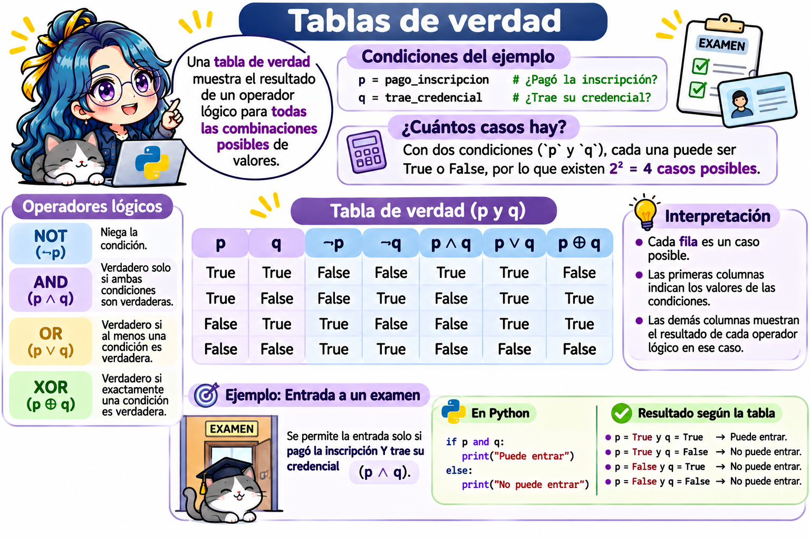

# Condicionales en Python



> **Fecha:** 05 de noviembre, 2026

Hasta ahora, nuestros programas ejecutan **todas** sus instrucciones, una tras otra. Los **condicionales** permiten que un programa **tome decisiones**: ejecutar ciertas instrucciones solo si se cumple una condición.

Ya usamos condicionales en Bash (capítulo de [Condicionales](cap13.qmd)); la idea es la misma, solo cambia la sintaxis. En este capítulo veremos:

- **Expresiones booleanas**: las preguntas que regresan `True` o `False`.
- Las instrucciones `if`, `else` y `elif`.
- Condicionales anidados y la expresión condicional en una línea.
- Cómo usar condicionales para la **programación defensiva** (continuación del capítulo de [buenas prácticas](python_buenas_practicas.qmd)).

## Expresiones booleanas: hacer preguntas

Para tomar decisiones necesitamos hacer **preguntas** cuya respuesta sea `True` (verdadero) o `False` (falso). A estas preguntas se les llama **expresiones booleanas**.

### Operadores de comparación

| Operador | Significado       | Ejemplo  | Resultado |
|----------|-------------------|----------|-----------|
| `==`     | Igual a           | `5 == 5` | `True`    |
| `!=`     | Diferente de      | `5 != 3` | `True`    |
| `>`      | Mayor que         | `5 > 8`  | `False`   |
| `<`      | Menor que         | `5 < 8`  | `True`    |
| `>=`     | Mayor o igual que | `5 >= 5` | `True`    |
| `<=`     | Menor o igual que | `4 <= 3` | `False`   |

::: callout-important
No confundas `=` con `==`. Un solo signo **asigna** un valor (`x = 5`); dos signos **comparan** (`x == 5`).
:::

### Operadores lógicos

Combinan varias preguntas.

| Operador | Regresa `True` si... | Ejemplo | Resultado |
|------------------|------------------|------------------|------------------|
| `and` | **Ambas** condiciones son verdaderas. | `5 > 3 and 2 > 4` | `False` |
| `or` | **Al menos una** condición es verdadera. | `5 > 3 or 2 > 4` | `True` |
| `not` | La condición es falsa (la invierte). | `not 5 > 3` | `False` |

### Otras preguntas útiles

| Expresión | Pregunta | Ejemplo | Resultado |
|------------------|------------------|------------------|------------------|
| `x in coleccion` | ¿`x` está en la colección? | `3 in [1, 2, 3]` | `True` |
| `isinstance(x, tipo)` | ¿`x` es de ese tipo? | `isinstance(8.5, (int, float))` | `True` |
| `a <= x <= b` | ¿`x` está entre `a` y `b`? | `0 <= 8.5 <= 10` | `True` |
| `len(x) > 0` | ¿La colección tiene elementos? | `len([]) > 0` | `False` |

Python permite **encadenar comparaciones**: `0 <= x <= 10` es lo mismo que `0 <= x and x <= 10`, como se escribe en matemáticas.

```{python}
calificacion = 8.5

print(isinstance(calificacion, (int, float)))   # ¿Es un número?
print(0 <= calificacion <= 10)                   # ¿Está en el rango?
print(calificacion in [6, 7, 8, 9, 10])          # ¿Es un entero entre 6 y 10?
```

### Tablas de verdad

Una **tabla de verdad** muestra el resultado de un operador lógico para **todas las combinaciones posibles** de valores. Igual que en lógica matemática ($\land$, $\lor$, $\neg$), usamos letras para representar condiciones:

- `p` y `q` son dos **condiciones** cualesquiera, cada una puede ser `True` o `False`.
- Cada **fila** es **un caso posible**. Como hay dos condiciones y cada una tiene dos valores, existen $2 \times 2 = 4$ casos.
- Las demás **columnas** dicen qué resultado da cada operador **en ese caso**.

{fig-align="center"}

Para entenderlo con un ejemplo concreto, imagina que para entrar a un examen se revisan dos condiciones:

``` python
p = pago_inscripcion      # ¿Pagó la inscripción?
q = trae_credencial       # ¿Trae su credencial?
```

**`and`: se necesitan las dos.** "Puede entrar si pagó **y** trae credencial".

| Caso | `p` (pagó) | `q` (credencial) | `p and q` (¿entra?) | ¿Por qué? |
|---------------|---------------|---------------|---------------|---------------|
| 1 | `True` | `True` | `True` | Cumple las dos condiciones. |
| 2 | `True` | `False` | `False` | Le falta la credencial. |
| 3 | `False` | `True` | `False` | Le falta pagar. |
| 4 | `False` | `False` | `False` | No cumple ninguna. |

`and` solo da `True` en **un** caso: cuando **ambas** condiciones son verdaderas.

**`or`: basta con una.** "Obtiene un descuento si es estudiante **o** si es docente".

| Caso | `p` (estudiante) | `q` (docente) | `p or q` (¿descuento?) | ¿Por qué? |
|---------------|---------------|---------------|---------------|---------------|
| 1 | `True` | `True` | `True` | Cumple las dos (con una bastaba). |
| 2 | `True` | `False` | `True` | Es estudiante. |
| 3 | `False` | `True` | `True` | Es docente. |
| 4 | `False` | `False` | `False` | No cumple ninguna. |

`or` solo da `False` en **un** caso: cuando **ninguna** condición es verdadera.

**`not`: invierte el valor.** Solo tiene una condición, así que hay dos casos:

| Caso | `p` (¿llueve?) | `not p` (¿no llueve?) |
|------|----------------|-----------------------|
| 1    | `True`         | `False`               |
| 2    | `False`        | `True`                |

**Tabla completa.** Así se resumen los tres operadores. Lee cada fila de izquierda a derecha: "si `p` vale ... y `q` vale ..., entonces `p and q` vale ..., `p or q` vale ... y `not p` vale ...".

| `p`     | `q`     | `p and q` | `p or q` | `not p` |
|---------|---------|-----------|----------|---------|
| `True`  | `True`  | `True`    | `True`   | `False` |
| `True`  | `False` | `False`   | `True`   | `False` |
| `False` | `True`  | `False`   | `True`   | `True`  |
| `False` | `False` | `False`   | `False`  | `True`  |

Compruébalo con Python: cambia los valores de `p` y `q` para reproducir cada fila de la tabla.

```{pyodide}
p = True
q = False

print("p and q =", p and q)
print("p or q  =", p or q)
print("not p   =", not p)
```

### Valores "verdaderos" y "falsos"

En una condición, Python también acepta objetos que no son booleanos. Estos valores se consideran **falsos**; cualquier otro valor se considera **verdadero**:

| Tipo              | Valor considerado falso            |
|-------------------|------------------------------------|
| Booleano          | `False`                            |
| Números           | `0`, `0.0`                         |
| Texto             | `""` (cadena vacía)                |
| Colecciones       | `[]`, `()`, `{}`, `set()` (vacías) |
| Ausencia de valor | `None`                             |

```{python}
print(bool(0), bool(-3))
print(bool(""), bool("hola"))
print(bool([]), bool([0]))
```

## La instrucción `if`

`if` ejecuta un bloque de código **solo si** la condición es verdadera:

``` python
if condicion:
    instruccion_1     # Se ejecutan solo si la condición es True
    instruccion_2

instruccion_3         # Se ejecuta siempre
```

Observa tres detalles de la sintaxis:

1.  La línea del `if` termina con **dos puntos** (`:`).
2.  Las instrucciones que dependen del `if` llevan **indentación de 4 espacios**. En Python, la indentación **no es opcional**: indica qué instrucciones pertenecen al bloque.
3.  No hay palabra de cierre (en Bash usábamos `fi`): el bloque termina cuando termina la indentación.

```{python}
edad = 20

if edad >= 18:
    print("Eres mayor de edad")

print("Fin del programa")
```

## `if` y `else`

`else` indica qué hacer cuando la condición es **falsa**:

```{python}
calificacion = 5.5

if calificacion >= 6:
    print("Aprobado")
else:
    print("Reprobado")
```

Ejemplo: saber si un número es par o impar con el operador módulo `%`, que regresa el **residuo** de una división:

```{python}
numero = 17

if numero % 2 == 0:
    print(numero, "es par")
else:
    print(numero, "es impar")
```

## `if`, `elif` y `else`

Cuando hay más de dos casos, usamos `elif` (abreviatura de *else if*). Python evalúa las condiciones **de arriba hacia abajo** y ejecuta **solo el primer bloque** cuya condición sea verdadera.

Por ejemplo, la escala de calificaciones de la UNAM:

| Calificación | Nivel              |
|--------------|--------------------|
| 9 a 10       | MB (Muy Bien)      |
| 8 a 8.9      | B (Bien)           |
| 6 a 7.9      | S (Suficiente)     |
| Menor que 6  | NA (No Acreditado) |

Modifica la calificación y presiona **Run Code**:

```{pyodide}
#| autorun: true
calificacion = 8.5

if calificacion >= 9:
    nivel = "MB"
elif calificacion >= 8:
    nivel = "B"
elif calificacion >= 6:
    nivel = "S"
else:
    nivel = "NA"

print("Calificación:", calificacion, "Nivel:", nivel)
```

::: callout-important
**El orden importa.** Si la primera condición fuera `calificacion >= 6`, una calificación de 9.5 también la cumpliría y obtendríamos `"S"`. Cuando las condiciones se traslapan, escribe primero la más restrictiva.
:::

### Diferencias con Bash

|   | Bash | Python |
|------------------------|------------------------|------------------------|
| Inicio | `if [ condición ]; then` | `if condición:` |
| Otra condición | `elif [ condición ]; then` | `elif condición:` |
| En otro caso | `else` | `else:` |
| Cierre | `fi` | No hay: termina la indentación. |
| Comparar números | `-eq`, `-ne`, `-gt`, `-lt`, `-ge`, `-le` | `==`, `!=`, `>`, `<`, `>=`, `<=` |
| Operadores lógicos | `&&`, <code>\|\|</code>, `!` | `and`, `or`, `not` |
| Mostrar texto | `echo "Aprobado"` | `print("Aprobado")` |

## Condicionales anidados

Un `if` puede ir dentro de otro. Cada nivel agrega 4 espacios de indentación:

```{python}
numero = -4

if numero != 0:
    if numero > 0:
        print("Positivo")
    else:
        print("Negativo")
else:
    print("Cero")
```

Muchas veces un condicional anidado se puede escribir de forma más clara con `elif`:

```{python}
numero = -4

if numero > 0:
    print("Positivo")
elif numero < 0:
    print("Negativo")
else:
    print("Cero")
```

## Expresión condicional en una línea

Cuando solo queremos elegir entre **dos valores**, podemos escribir el condicional en una sola línea:

``` python
variable = valor_si_verdadero if condicion else valor_si_falso
```

```{python}
calificacion = 7
estado = "Aprobado" if calificacion >= 6 else "Reprobado"
print(estado)
```

Úsala solo en casos sencillos; si la condición es larga, el `if` normal es más fácil de leer.

## Programación defensiva con condicionales

En el capítulo de [buenas prácticas](python_buenas_practicas.qmd) usamos `assert` para detener el programa cuando un dato era incorrecto. Con condicionales tenemos más opciones:

**Opción 1. Avisar y continuar:**

```{python}
calificacion = 95

if 0 <= calificacion <= 10:
    print("Calificación registrada:", calificacion)
else:
    print("Aviso: la calificación", calificacion, "no está entre 0 y 10 y no se registró")
```

**Opción 2. Detener el programa con un error claro (`raise`):**

La instrucción `raise` **lanza un error** del tipo que elijamos, con un mensaje propio. Es la forma recomendada de rechazar datos incorrectos:

```{python}
calificacion = 95

if not isinstance(calificacion, (int, float)):
    raise TypeError("La calificación debe ser un número")
elif not 0 <= calificacion <= 10:
    raise ValueError("La calificación debe estar entre 0 y 10; se recibió " + str(calificacion))
```

**Opción 3. Evitar el error antes de que ocurra:**

```{python}
total = 45
estudiantes = 0

if estudiantes > 0:
    promedio = total / estudiantes
    print("Promedio:", promedio)
else:
    print("No hay estudiantes: no se puede calcular el promedio")
```

| Herramienta | ¿Qué hace? | ¿Cuándo usarla? |
|------------------------|------------------------|------------------------|
| `assert` | Detiene el programa con `AssertionError`. | Verificar supuestos mientras programas. |
| `if` + `print()` | Muestra un aviso y continúa. | Cuando el programa puede seguir sin ese dato. |
| `if` + `raise` | Detiene el programa con el error que elijas. | Rechazar datos incorrectos con un mensaje claro. |
| `if` / `else` | Elige otro camino. | Evitar un error antes de que ocurra (por ejemplo, dividir entre cero). |

## Errores comunes

| Error | Ejemplo | Corrección |
|------------------------|------------------------|------------------------|
| Usar `=` en lugar de `==` | `if x = 5:` (`SyntaxError`) | `if x == 5:` |
| Olvidar los dos puntos | `if x > 5` (`SyntaxError`) | `if x > 5:` |
| Olvidar la indentación | `print()` alineado con el `if` (`IndentationError`) | Indenta 4 espacios. |
| Comparar con varios valores mal escritos | `if color == "rojo" or "azul":` (¡siempre es `True`!) | `if color == "rojo" or color == "azul":` o `if color in ["rojo", "azul"]:` |
| Condiciones en desorden en `elif` | `if c >= 6: ... elif c >= 9: ...` | Escribe primero la condición más restrictiva. |
| Comparar un texto con un número | `if "8" > 6:` (`TypeError`) | Convierte primero: `if int("8") > 6:` |

::: callout-note
¿Por qué `color == "rojo" or "azul"` siempre es verdadero? Python lo interpreta como `(color == "rojo") or ("azul")`, y una cadena no vacía como `"azul"` se considera **verdadera**.
:::

## Ejercicios

Resuelve los ejercicios en los editores interactivos. Recuerda que lo que escribas **no se guarda** al recargar la página.

### Ejercicio 1. Expresiones booleanas

**Parte A.** Antes de ejecutar, predice si cada línea muestra `True` o `False`. Después ejecuta el código para comprobarlo.

**Parte B.** En la última línea, escribe **una** expresión booleana que verifique que `calificacion` es un número (`int` o `float`) **y** que está entre 0 y 10. Con el valor `8.5` debe regresar `True`; prueba también con `11` y con `"8.5"` (texto), que deben regresar `False`.

```{pyodide}
#| exercise: cond1
# Parte A
print(7 > 3 and 10 < 5)
print(7 > 3 or 10 < 5)
print(not 4 == 4)
print(3 in [1, 2, 3])
print("a" in "Python")
print(2 <= 2 < 5)

# Parte B
calificacion = 8.5
______
```

```{pyodide}
#| exercise: cond1
#| check: true
uc = user_code.replace(" ", "")
if result is True and "isinstance" in uc and ("<=" in uc or ">=" in uc):
    feedback = {"correct": True, "message": "¡Correcto! Prueba ahora cambiando calificacion por 11 o por \"8.5\"."}
elif result is True:
    feedback = {"correct": False, "message": "Regresa True, pero tu expresión debe usar isinstance() y comparar con 0 y 10."}
else:
    feedback = {"correct": False, "message": "Con calificacion = 8.5 la expresión debe regresar True."}
feedback
```

:::: {.hint exercise="cond1"}
::: {.callout-note collapse="false"}
## Pista

Une dos preguntas con `and`: `isinstance(calificacion, (int, float))` y `0 <= calificacion <= 10`. Python evalúa de izquierda a derecha y, si la primera pregunta es `False`, ya no evalúa la segunda; por eso con `"8.5"` no aparece un error.
:::
::::

:::: {.solution exercise="cond1"}
::: {.callout-tip collapse="false"}
## Solución

``` python
# Parte A
print(7 > 3 and 10 < 5)   # False: la segunda es falsa
print(7 > 3 or 10 < 5)    # True: la primera es verdadera
print(not 4 == 4)         # False
print(3 in [1, 2, 3])     # True
print("a" in "Python")    # False: no hay "a" en "Python"
print(2 <= 2 < 5)         # True

# Parte B
calificacion = 8.5
isinstance(calificacion, (int, float)) and 0 <= calificacion <= 10
```
:::
::::

### Ejercicio 2. Par o impar

Completa el programa para que la variable `tipo` sea `"par"` si `numero` es par, o `"impar"` en otro caso. Prueba con varios números.

```{pyodide}
#| exercise: cond2
numero = 17

if ______:
    tipo = "par"
______
    tipo = "impar"

print(numero, "es", tipo)
tipo
```

```{pyodide}
#| exercise: cond2
#| check: true
if result == "impar":
    feedback = {"correct": True, "message": "¡Correcto! 17 % 2 es 1, así que 17 es impar. Prueba con otros números."}
elif result == "par":
    feedback = {"correct": False, "message": "17 no es par. Revisa tu condición: un número es par si el residuo de dividirlo entre 2 es 0."}
else:
    feedback = {"correct": False, "message": "La variable tipo debe ser \"par\" o \"impar\"."}
feedback
```

:::: {.hint exercise="cond2"}
::: {.callout-note collapse="false"}
## Pista

`numero % 2` es el residuo de dividir entre 2. No olvides los dos puntos después de `else`.
:::
::::

:::: {.solution exercise="cond2"}
::: {.callout-tip collapse="false"}
## Solución

``` python
numero = 17

if numero % 2 == 0:
    tipo = "par"
else:
    tipo = "impar"

print(numero, "es", tipo)
tipo
```
:::
::::

### Ejercicio 3. Escala de calificaciones con validación

Completa el programa para asignar el nivel según la escala de la UNAM (MB, B, S, NA). **Antes** de clasificar, verifica que la calificación esté entre 0 y 10; si no lo está, `nivel` debe ser `"Inválida"`.

Prueba con `8.5`, `9.5`, `6`, `4` y `11`.

```{pyodide}
#| exercise: cond3
calificacion = 8.5

if not 0 <= calificacion <= 10:
    nivel = "Inválida"
elif ______:
    nivel = "MB"
elif ______:
    nivel = "B"
elif ______:
    nivel = "S"
else:
    nivel = ______

print("Calificación:", calificacion, "Nivel:", nivel)
nivel
```

```{pyodide}
#| exercise: cond3
#| check: true
if result == "B":
    feedback = {"correct": True, "message": "¡Correcto! 8.5 corresponde a B. Prueba ahora con 9.5, 6, 4 y 11."}
elif result == "S":
    feedback = {"correct": False, "message": "Obtuviste S: revisa el orden de tus condiciones, primero la más alta."}
else:
    feedback = {"correct": False, "message": "Con calificacion = 8.5 el nivel debe ser B."}
feedback
```

:::: {.hint exercise="cond3"}
::: {.callout-note collapse="false"}
## Pista

Como la validación ya descartó los valores fuera de rango, basta con `calificacion >= 9`, `calificacion >= 8` y `calificacion >= 6`, en ese orden.
:::
::::

:::: {.solution exercise="cond3"}
::: {.callout-tip collapse="false"}
## Solución

``` python
calificacion = 8.5

if not 0 <= calificacion <= 10:
    nivel = "Inválida"
elif calificacion >= 9:
    nivel = "MB"
elif calificacion >= 8:
    nivel = "B"
elif calificacion >= 6:
    nivel = "S"
else:
    nivel = "NA"

print("Calificación:", calificacion, "Nivel:", nivel)
nivel
```
:::
::::

### Ejercicio 4. Año bisiesto

Un año es **bisiesto** si es divisible entre 4, **excepto** los que son divisibles entre 100, **a menos que** también sean divisibles entre 400. Por ejemplo: 2024 sí es bisiesto, 1900 no lo es y 2000 sí lo es.

1.  Escribe una expresión booleana y guárdala en `es_bisiesto`.
2.  Usa un `if` / `else` para mostrar si el año es bisiesto o no.
3.  Deja `es_bisiesto` en la última línea.

```{pyodide}
#| exercise: cond4
anio = 1900

es_bisiesto = ______

# Muestra un mensaje con if / else


es_bisiesto
```

```{pyodide}
#| exercise: cond4
#| check: true
if result is False and "%" in user_code:
    feedback = {"correct": True, "message": "¡Correcto! 1900 es divisible entre 100 pero no entre 400, así que no es bisiesto. Prueba con 2000 y 2024."}
elif result is True:
    feedback = {"correct": False, "message": "1900 NO es bisiesto: es divisible entre 100 pero no entre 400."}
else:
    feedback = {"correct": False, "message": "es_bisiesto debe ser una expresión booleana que use el operador %."}
feedback
```

:::: {.hint exercise="cond4"}
::: {.callout-note collapse="false"}
## Pista

"Divisible entre 4" se escribe `anio % 4 == 0`. La regla completa combina tres condiciones con `and` y `or`: (divisible entre 4 **y no** entre 100) **o** divisible entre 400.
:::
::::

:::: {.solution exercise="cond4"}
::: {.callout-tip collapse="false"}
## Solución

``` python
anio = 1900

es_bisiesto = (anio % 4 == 0 and anio % 100 != 0) or anio % 400 == 0

if es_bisiesto:
    print(anio, "es bisiesto")
else:
    print(anio, "no es bisiesto")

es_bisiesto
```

Observa que `if es_bisiesto:` es suficiente; no hace falta escribir `if es_bisiesto == True:`.
:::
::::

### Ejercicio 5. Raíces de una ecuación cuadrática

Para la ecuación $ax^2 + bx + c = 0$, el **discriminante** $\Delta = b^2 - 4ac$ indica cuántas raíces reales tiene:

| Discriminante | Raíces reales                               |
|---------------|---------------------------------------------|
| $\Delta > 0$  | Dos: $x = \dfrac{-b \pm \sqrt{\Delta}}{2a}$ |
| $\Delta = 0$  | Una: $x = \dfrac{-b}{2a}$                   |
| $\Delta < 0$  | Ninguna                                     |

Completa el programa para que la lista `raices` contenga las raíces reales. Como programación defensiva, si `a == 0` el programa debe lanzar un `ValueError`, porque la ecuación no es cuadrática.

Prueba con `(1, -3, 2)`, `(1, 2, 1)`, `(1, 0, 1)` y `(0, 2, 1)`.

```{pyodide}
#| exercise: cond5
a, b, c = 1, -3, 2

if a == 0:
    raise ValueError("a no puede ser 0: la ecuación no es cuadrática")

discriminante = ______

if ______:
    x1 = (-b + discriminante ** 0.5) / (2 * a)
    x2 = (-b - discriminante ** 0.5) / (2 * a)
    raices = [x1, x2]
elif ______:
    raices = [-b / (2 * a)]
else:
    raices = []

print("Discriminante:", discriminante)
print("Raíces reales:", raices)
raices
```

```{pyodide}
#| exercise: cond5
#| check: true
if isinstance(result, list) and sorted(result) == [1.0, 2.0]:
    feedback = {"correct": True, "message": "¡Correcto! x² - 3x + 2 = (x - 1)(x - 2), sus raíces son 1 y 2. Prueba con los otros coeficientes."}
else:
    feedback = {"correct": False, "message": "Para a=1, b=-3, c=2 las raíces deben ser 1 y 2. Revisa el discriminante b**2 - 4*a*c y las condiciones."}
feedback
```

:::: {.hint exercise="cond5"}
::: {.callout-note collapse="false"}
## Pista

El discriminante es `b ** 2 - 4 * a * c`. Las condiciones son `discriminante > 0` y `discriminante == 0`. Elevar a `0.5` es lo mismo que sacar raíz cuadrada.
:::
::::

:::: {.solution exercise="cond5"}
::: {.callout-tip collapse="false"}
## Solución

``` python
a, b, c = 1, -3, 2

if a == 0:
    raise ValueError("a no puede ser 0: la ecuación no es cuadrática")

discriminante = b ** 2 - 4 * a * c

if discriminante > 0:
    x1 = (-b + discriminante ** 0.5) / (2 * a)
    x2 = (-b - discriminante ** 0.5) / (2 * a)
    raices = [x1, x2]
elif discriminante == 0:
    raices = [-b / (2 * a)]
else:
    raices = []

print("Discriminante:", discriminante)
print("Raíces reales:", raices)
raices   # [2.0, 1.0]
```
:::
::::

### Ejercicio 6. Detective de condicionales

El programa tiene **dos errores de lógica**: no marca ningún error, pero los resultados son incorrectos.

1.  `"azul"` no es un color cálido, pero el programa dice que sí. ¿Por qué?
2.  Una calificación de `9.5` debería ser `"MB"`, pero el programa dice `"S"`. ¿Por qué?

Corrige ambos errores. La última línea debe regresar `"MB"`.

```{pyodide}
#| exercise: cond6
color = "azul"

if color == "rojo" or "naranja":
    print(color, "es un color cálido")
else:
    print(color, "es un color frío")

calificacion = 9.5

if calificacion >= 6:
    nivel = "S"
elif calificacion >= 8:
    nivel = "B"
elif calificacion >= 9:
    nivel = "MB"

nivel
```

```{pyodide}
#| exercise: cond6
#| check: true
uc = user_code.replace(" ", "")
if result == "MB" and 'or"naranja"' not in uc:
    feedback = {"correct": True, "message": "¡Correcto! Corregiste las dos condiciones."}
elif result == "MB":
    feedback = {"correct": False, "message": "La calificación ya funciona, pero falta corregir la condición del color."}
else:
    feedback = {"correct": False, "message": "La calificación 9.5 debe ser MB. Revisa el orden de las condiciones."}
feedback
```

:::: {.hint exercise="cond6"}
::: {.callout-note collapse="false"}
## Pista

1.  Python lee la condición como `(color == "rojo") or ("naranja")`, y una cadena no vacía siempre es verdadera.
2.  Con `9.5`, la primera condición `calificacion >= 6` ya es verdadera, así que Python no revisa las siguientes.
:::
::::

:::: {.solution exercise="cond6"}
::: {.callout-tip collapse="false"}
## Solución

``` python
color = "azul"

if color in ["rojo", "naranja"]:   # o: color == "rojo" or color == "naranja"
    print(color, "es un color cálido")
else:
    print(color, "es un color frío")

calificacion = 9.5

if calificacion >= 9:
    nivel = "MB"
elif calificacion >= 8:
    nivel = "B"
elif calificacion >= 6:
    nivel = "S"

nivel   # 'MB'
```
:::
::::

## Resumen

| Tema | Idea clave |
|------------------------------------|------------------------------------|
| Expresiones booleanas | Preguntas que regresan `True` o `False`: `==`, `!=`, `<`, `<=`, `and`, `or`, `not`, `in`, `isinstance()`. |
| `if` | Ejecuta un bloque solo si la condición es verdadera. Termina con `:` y usa 4 espacios de indentación. |
| `else` | Qué hacer si la condición es falsa. |
| `elif` | Revisa otra condición; solo se ejecuta el **primer** bloque verdadero. |
| Anidados | Un `if` dentro de otro; muchas veces se simplifican con `elif`. |
| En una línea | `valor_1 if condicion else valor_2`. |
| Programación defensiva | `if` + `print()` para avisar, `if` + `raise` para rechazar datos, `if` / `else` para evitar errores. |

## Referencias

- [Documentación de Python: La instrucción `if`](https://docs.python.org/es/3/tutorial/controlflow.html#if-statements)
- [Documentación de Python: Comparaciones](https://docs.python.org/es/3/library/stdtypes.html#comparisons)
- [Documentación de Python: Prueba de valor de verdad](https://docs.python.org/es/3/library/stdtypes.html#truth-value-testing)
- [Documentación de Python: La instrucción `raise`](https://docs.python.org/es/3/reference/simple_stmts.html#the-raise-statement)
