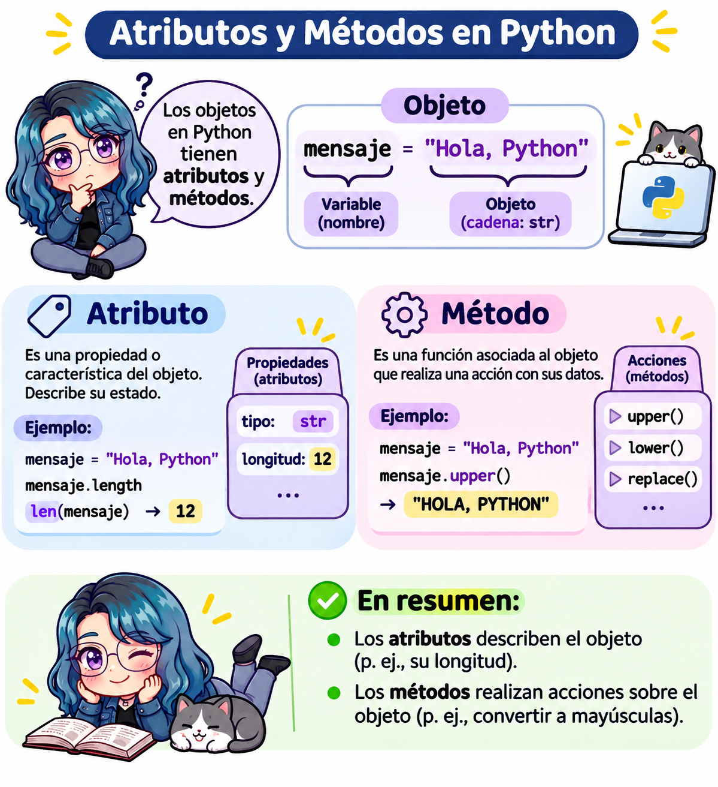

# 🐍 Actividad 2: atributos y métodos de los objetos



> **Fecha:** 03 de noviembre, 2026

**Objetivo**: Utilizar los atributos y métodos de los objetos de Python (cadenas, listas, tuplas, conjuntos y diccionarios) y comprender cómo se comportan los métodos en objetos mutables e inmutables.

**Nivel: Básico a intermedio.**

**Instrucciones:** Resuelve cada ejercicio completando su código. Antes de ejecutar cada programa, analiza qué resultado esperas obtener. Completa los espacios `______`; en algunos ejercicios se revisa tu respuesta automáticamente.

## ¿Cómo usar los editores de esta página?

Los editores de esta página funcionan igual que en la [🐍 Actividad 1](python_ejercicio1.qmd): presiona **Run Code** para ejecutar el código; en algunos ejercicios, **Run Code** también revisa tu respuesta. Usa **Show Hint** para ver una pista y, después, **Show Solution** para ver la solución.

::: callout-important
Lo que escribas en los editores **no se guarda** al recargar la página. Si quieres conservar tu código, usa las opciones B, C o D de la siguiente sección.
:::

Usa este editor libre para probar los ejemplos del recordatorio:

```{pyodide}
saludo = "hola"
print(saludo.upper())
print(dir(saludo))
```

## ¿Dónde hacer esta actividad?

Puedes resolver la actividad de cuatro formas. **El contenido y los ejercicios son los mismos**; elige la que prefieras. También encontrarás los enlaces a cada opción en la barra de la derecha, en **Haz esta actividad en...**

| | A: en este libro | B: en Google Colab | C: en Jupyter Notebook | D: en RStudio (tu `.qmd`) |
|----|----|----|----|----|
| ¿Dónde se ejecuta? | En tu navegador, en esta página. | En una computadora de Google. | En tu computadora. | En tu computadora. |
| ¿Qué necesitas? | Nada, solo el navegador. | Una cuenta de Google. | El entorno `quarto-python` con Jupyter. | RStudio y el entorno `quarto-python` configurado. |
| Archivo | Ninguno. | `actividad2.ipynb` (en tu Drive). | `actividad2.ipynb` | `actividad2.qmd` |
| ¿Se guarda tu trabajo? | **No**: se pierde al recargar la página. | **Sí**, si guardas una copia en tu Drive. | **Sí**, en tu computadora. | **Sí**, en tu computadora (y puedes subirlo a GitHub). |
| ¿Necesita internet? | Solo para cargar la página. | Sí, siempre. | No. | No. |
| Revisión de respuestas | Automática, con **Run Code**. | Celdas **✅ Verificar**. | Celdas **✅ Verificar**. | Bloques **✅ Verificar**. |
| Resultado final | — | Notebook en Drive. | Notebook `.ipynb`. | Documento HTML con **Render**. |

### Opción A. En este libro

Usa los editores interactivos de esta página, como se explica en la sección anterior, [¿Cómo usar los editores de esta página?](#cómo-usar-los-editores-de-esta-página). Es la opción más rápida, pero **tu código no se guarda**: si quieres conservarlo, cópialo en otro lugar antes de cerrar la página.

### Opción B. En Google Colab

[](https://colab.research.google.com/github/EveliaCoss/Mt2026_Taller_Computo_libro/blob/main/notebooks/actividad2.ipynb)

1.  Da clic en el botón **Open in Colab** e inicia sesión con tu cuenta de Google.
2.  **Guarda tu propia copia:** **Archivo \> Guardar una copia en Drive**. ¡No te saltes este paso! Si trabajas sin guardar una copia, tus cambios se perderán.
3.  Ejecuta las celdas **en orden**, de arriba hacia abajo, con el botón ▶ o con `Shift + Enter`.
4.  Completa los espacios `______` de cada ejercicio y ejecuta la celda.

**¿Qué cambia respecto al libro?**

| En el libro (Opción A) | En Google Colab (Opción B) |
|----|----|
| Editores con el botón **Run Code**. | Celdas de código con el botón ▶ (o `Shift + Enter`). |
| Botones **Show Hint** y **Show Solution**. | Bloques **💡 Pista** y **✔️ Solución**: da clic sobre ellos para desplegarlos. |
| **Run Code** revisa tu respuesta automáticamente. | Ejecuta tu solución y después la celda **✅ Verificar el ejercicio...** |
| **Start Over** regresa al código inicial. | No existe: si borras algo, consúltalo en el libro o vuelve a abrir el enlace original. |
| Cada editor es independiente. | Todas las celdas comparten las mismas variables: ejecútalas **en orden**. |
| El código se pierde al recargar la página. | El código se guarda en tu copia de Drive. |

::: callout-note
En los ejercicios con verificación, la última línea de tu código guarda el resultado en la variable `respuesta` (por ejemplo, `respuesta = porcentaje`). **No borres esa línea**: la celda **✅ Verificar** revisa esa variable. Si la sesión se desconecta, usa **Entorno de ejecución \> Ejecutar todas**.
:::

### Opción C. En Jupyter Notebook (en tu computadora)

1.  Descarga el notebook: [**📥 actividad2.ipynb**](notebooks/actividad2.ipynb){download="actividad2.ipynb"}. También puedes [verlo en GitHub](https://github.com/EveliaCoss/Mt2026_Taller_Computo_libro/blob/main/notebooks/actividad2.ipynb).
2.  Mueve el archivo a la carpeta donde guardas tus trabajos del curso.
3.  Abre la **Terminal**, activa tu entorno y abre Jupyter Notebook:

    ::: panel-tabset
    ## macOS y Linux

    ``` bash
    source ~/.venvs/quarto-python/bin/activate
    jupyter notebook
    ```

    ## Windows (Git Bash)

    ``` bash
    source ~/.venvs/quarto-python/Scripts/activate
    jupyter notebook
    ```
    :::

4.  Se abrirá el navegador. Navega hasta la carpeta del archivo y da doble clic en `actividad2.ipynb`.
5.  Ejecuta las celdas en orden con `Shift + Enter`. Tu trabajo se guarda con `Ctrl/Cmd + S`.

Las diferencias con el libro son las mismas que en Google Colab (tabla de la opción B). Además:

- La celda **✅ Verificar** muestra su código (en Colab aparece oculto); no necesitas leerlo, solo ejecutarlo.
- No cierres la Terminal mientras usas Jupyter: es el programa que ejecuta tu código. Para terminar, guarda el notebook y presiona `Ctrl + C` en la Terminal.
- Si `jupyter: command not found`, activa el entorno (paso 3) o consulta el capítulo [Configuraciones para usar Quarto con Python](quarto_python.qmd).

### Opción D. En RStudio, con tu propio archivo `.qmd`

Esta opción te da **tu propio documento de Quarto** con toda la actividad: escribes tus respuestas en él, lo guardas en tu carpeta del curso y, al final, lo conviertes en un documento HTML con **Render**. Es la mejor opción si quieres **entregar** tu actividad o guardarla en tu repositorio de GitHub.

**Requisito:** haber configurado tu entorno en el capítulo [Configuraciones para usar Quarto con Python](quarto_python.qmd) (pasos 1 a 6).

1.  Descarga el archivo: [**📥 actividad2.qmd**](notebooks/actividad2.qmd){download="actividad2.qmd"}.
2.  Muévelo a la carpeta de tu proyecto de RStudio del curso y ábrelo con **File \> Open File...**
3.  En el encabezado (YAML), cambia `Tu nombre` por tu nombre:

    ``` yaml
    ---
    title: "🐍 Actividad 2: atributos y métodos de los objetos"
    author: "Tu nombre"
    format: html
    jupyter: python3
    execute:
      error: true   # Muestra los errores sin detener el documento
    ---
    ```

4.  Ejecuta los bloques **en orden** con el botón ▶ de cada bloque (o `Cmd/Ctrl + Shift + Enter`). El resultado aparece debajo de cada bloque.
5.  Completa los espacios `______` y ejecuta los bloques **✅ Verificar** después de tu solución.
6.  Guarda tus cambios (`Cmd/Ctrl + S`) y, al terminar, presiona **Render** para generar `actividad2.html` con todas tus respuestas y resultados.

| Elemento del YAML | ¿Para qué sirve? |
|----|----|
| `jupyter: python3` | Usa el motor Jupyter con el Python de `QUARTO_PYTHON` al presionar **Render**. |
| `execute: error: true` | Si un bloque tiene un error (por ejemplo, un `______` sin completar), el documento **sí se genera** y muestra el error en lugar de detenerse. |

::: callout-tip
## ¿Y si quiero empezar mi propio `.qmd` desde cero?

También puedes crear un documento nuevo con **File \> New File \> Quarto Document...**, poner el YAML de arriba y copiar ahí los ejercicios que quieras. Así practicas lo que aprendiste en el [Paso 7](quarto_python.qmd#paso-7.-mi-primer-documento-de-quarto-con-python) del capítulo de configuración.
:::

::: callout-warning
Si al ejecutar un bloque aparece `ModuleNotFoundError` o `NameError: name '______' is not defined`:

- `NameError` con `______` significa que **todavía no completaste** ese espacio: es normal.
- `ModuleNotFoundError` indica un problema de configuración: consulta la [solución de problemas](quarto_python.qmd#solución-de-problemas) del capítulo de configuración.
:::

## Recordatorio: ¿cómo se usa un objeto?

En Python accedemos a los atributos y métodos de un objeto con un **punto** (`.`):

``` python
objeto.atributo      # Atributo: información del objeto (sin paréntesis)
objeto.metodo()      # Método: una acción que realiza el objeto (con paréntesis)
```

La diferencia principal:

|   | Atributo | Método |
|----|----|----|
| ¿Qué es? | Un **dato** guardado en el objeto. | Una **función** que pertenece al objeto. |
| ¿Lleva paréntesis? | No: `objeto.atributo` | Sí: `objeto.metodo()` |
| Ejemplo | `numero.real` | `saludo.upper()` |

{fig-align="center"}

### Atributos de los números: `real` e `imag`

Un **número complejo** tiene una parte real y una parte imaginaria: $a + bi$. En Python la unidad imaginaria se escribe con `j`, por ejemplo `3 + 4j`.

Los números en Python tienen dos atributos:

| Atributo | ¿Qué contiene?                               | Ejemplo con `3 + 4j` |
|----------|----------------------------------------------|----------------------|
| `real`   | La parte real del número.                    | `3.0`                |
| `imag`   | La parte imaginaria del número (sin la `j`). | `4.0`                |

```{python}
numero = 3 + 4j          # Número complejo

print(numero.real)       # Atributo: parte real
print(numero.imag)       # Atributo: parte imaginaria
print(type(numero.real)) # Ambas partes se guardan como float
```

Los enteros (`int`) y los decimales (`float`) también tienen estos atributos. Su parte imaginaria es `0`:

```{python}
edad = 20
print(edad.real)
print(edad.imag)
```

Compara con un **método** del mismo objeto. `conjugate()` regresa el conjugado del número ($3 - 4i$), y por ser método lleva paréntesis:

```{python}
print(numero.conjugate())

saludo = "hola"
print(saludo.upper())    # Método de las cadenas
```

Si escribes paréntesis en un atributo, Python marca un error, porque un atributo es un dato y no una función que se pueda llamar:

```{python}
numero.real()
```

### `dir()`: ¿qué atributos y métodos tiene un objeto?

La función `dir()` regresa una **lista con los nombres** de todos los atributos y métodos de un objeto:

```{python}
print(dir(numero))
```

Los nombres que empiezan y terminan con doble guion bajo, como `__add__`, son **métodos especiales** que Python usa internamente (por ejemplo, `__add__` se ejecuta cuando usamos `+`). Por ahora podemos ignorarlos y mostrar solo los demás (no te preocupes por la sintaxis de esta línea: la entenderás en el capítulo de [ciclos `for`](python_for.qmd)):

```{python}
print([nombre for nombre in dir(numero) if not nombre.startswith("_")])
```

Ahí aparecen `real` e `imag` (atributos) y `conjugate` (método). Hagamos lo mismo con una cadena de texto:

```{python}
print([nombre for nombre in dir("hola") if not nombre.startswith("_")])
```

::: callout-tip
`dir()` no indica cuál nombre es atributo y cuál es método. Para saberlo, consulta su documentación con `help()`.
:::

### `help()`: ¿cómo se usa un atributo o método?

La función `help()` muestra la **documentación** de un objeto, una función o un método: qué hace, qué argumentos recibe y qué regresa.

```{python}
help(str.upper)
```

```{python}
help(str.replace)
```

Para consultar un método escribimos el tipo, un punto y el nombre del método **sin paréntesis**: `help(str.replace)`, no `help(str.replace())`. También funciona con un objeto: `help(saludo.upper)`.

| Función  | ¿Qué hace?                                      | Ejemplo           |
|----------|-------------------------------------------------|-------------------|
| `type()` | Indica el tipo del objeto.                      | `type(numero)`    |
| `dir()`  | Lista los nombres de sus atributos y métodos.   | `dir(numero)`     |
| `help()` | Muestra la documentación de un objeto o método. | `help(str.upper)` |

::: callout-note
Si ejecutas `help(str)` en la consola, la documentación es muy larga y se muestra por páginas. Avanza con la barra espaciadora y sal con la tecla `q`. En Jupyter, Colab y Quarto se muestra completa debajo de la celda.
:::

### Funciones integradas y atributos más usados

Además de los métodos, Python tiene **funciones integradas** (*built-in functions*), como `len()`. Estas funciones **no se escriben con punto**: el objeto va dentro de los paréntesis.

|   | Función integrada | Método | Atributo |
|----|----|----|----|
| ¿Cómo se escribe? | `funcion(objeto)` | `objeto.metodo()` | `objeto.atributo` |
| Ejemplo | `len(lista)` | `lista.count(3)` | `numero.real` |
| ¿Funciona con...? | Muchos tipos de objetos. | Solo con el tipo al que pertenece. | Solo con el tipo al que pertenece. |

Por eso escribimos `len(lista)` y no `lista.len()`.

#### Funciones integradas más usadas

| Función | ¿Qué hace? | Ejemplo | Resultado |
|----|----|----|----|
| `print()` | Muestra uno o más valores. | `print("Hola", 5)` | `Hola 5` |
| `type()` | Regresa el tipo del objeto. | `type(3.5)` | `<class 'float'>` |
| `id()` | Regresa la identidad del objeto. | `id(x)` | `4371203472` |
| `len()` | Regresa el número de elementos. | `len([4, 7, 1])` | `3` |
| `sum()` | Suma los elementos. | `sum([4, 7, 1])` | `12` |
| `min()`, `max()` | Regresan el menor o el mayor elemento. | `max([4, 7, 1])` | `7` |
| `abs()` | Valor absoluto. | `abs(-8)` | `8` |
| `round()` | Redondea a cierto número de decimales. | `round(3.14159, 2)` | `3.14` |
| `pow()` | Potencia (igual que `**`). | `pow(2, 10)` | `1024` |
| `divmod()` | Cociente y residuo de una división entera. | `divmod(17, 5)` | `(3, 2)` |
| `sorted()` | Regresa una lista **nueva** ordenada. | `sorted([4, 7, 1])` | `[1, 4, 7]` |
| `range()` | Genera una secuencia de enteros. | `list(range(1, 6))` | `[1, 2, 3, 4, 5]` |
| `int()`, `float()`, `str()` | Convierten a entero, decimal o texto. | `int("42")` | `42` |
| `list()`, `tuple()`, `set()` | Convierten a lista, tupla o conjunto. | `set([1, 1, 2])` | `{1, 2}` |
| `isinstance()` | Indica si un objeto es de cierto tipo. | `isinstance(5, int)` | `True` |
| `dir()` | Lista los atributos y métodos de un objeto. | `dir(5)` | `['__abs__', ...]` |
| `help()` | Muestra la documentación. | `help(len)` | (documentación) |

Pruébalas: modifica la lista y presiona **Run Code**.

```{pyodide}
numeros = [4, 7, 1, 9, 4]

print("Elementos:", len(numeros))
print("Suma:", sum(numeros))
print("Mínimo:", min(numeros), "Máximo:", max(numeros))
print("Promedio:", round(sum(numeros) / len(numeros), 2))
print("Ordenada:", sorted(numeros))
print("Sin repetidos:", set(numeros))
print("Cociente y residuo de 17 / 5:", divmod(17, 5))
```

::: callout-warning
Si escribes una función integrada como si fuera un método, obtendrás un error: `numeros.len()` produce `AttributeError: 'list' object has no attribute 'len'`.
:::

#### Atributos más usados

Los atributos son menos comunes que los métodos en los tipos básicos de Python. Estos son los que más usarás:

| Tipo de objeto | Atributo | ¿Qué contiene? | Ejemplo | Resultado |
|----|----|----|----|----|
| `int`, `float`, `complex` | `real` | Parte real del número. | `(3 + 4j).real` | `3.0` |
| `int`, `float`, `complex` | `imag` | Parte imaginaria del número. | `(3 + 4j).imag` | `4.0` |
| `int` | `numerator` | Numerador (el propio entero). | `(7).numerator` | `7` |
| `int` | `denominator` | Denominador (siempre `1`). | `(7).denominator` | `1` |
| `range` | `start`, `stop`, `step` | Inicio, fin y paso del rango. | `range(0, 10, 2).step` | `2` |
| Cualquier objeto | `__class__` | El tipo del objeto (igual que `type()`). | `"hola".__class__` | `<class 'str'>` |
| Cualquier objeto | `__doc__` | El texto de su documentación. | `len.__doc__` | `'Return the number of items...'` |

```{pyodide}
numero = 3 + 4j
print(numero.real, numero.imag)

rango = range(0, 10, 2)
print(rango.start, rango.stop, rango.step)
print(list(rango))

print((7).numerator, (7).denominator)
```

::: callout-note
Para usar un atributo directamente sobre un número entero escribe el número entre paréntesis: `(7).numerator`. Si escribes `7.numerator`, Python cree que el punto es el punto decimal y marca un `SyntaxError`.
:::

Cuando trabajes con bibliotecas como **NumPy** y **pandas**, los atributos serán muy frecuentes:

| Biblioteca | Atributo | ¿Qué contiene? |
|----|----|----|
| NumPy (`array`) | `shape` | Dimensiones del arreglo, por ejemplo `(3, 4)`. |
| NumPy (`array`) | `ndim` | Número de dimensiones. |
| NumPy (`array`) | `size` | Número total de elementos. |
| NumPy (`array`) | `dtype` | Tipo de dato de los elementos. |
| NumPy (`array`) | `T` | La matriz transpuesta. |
| pandas (`DataFrame`) | `shape` | Número de filas y columnas. |
| pandas (`DataFrame`) | `columns` | Nombres de las columnas. |
| pandas (`DataFrame`) | `dtypes` | Tipo de dato de cada columna. |

### Principales métodos

| Tipo | Método | ¿Qué hace? | ¿Modifica el objeto? |
|----|----|----|----|
| `str` | `upper()`, `lower()` | Convierte a mayúsculas / minúsculas. | No, regresa una nueva cadena. |
| `str` | `replace(a, b)` | Reemplaza `a` por `b`. | No, regresa una nueva cadena. |
| `str` | `count(x)` | Cuenta cuántas veces aparece `x`. | No |
| `str` | `split(sep)` | Separa la cadena en una lista. | No |
| `str` | `strip()` | Elimina espacios al inicio y al final. | No |
| `list` | `append(x)` | Agrega `x` al final. | **Sí** |
| `list` | `extend(lista)` | Agrega varios elementos al final. | **Sí** |
| `list` | `insert(i, x)` | Inserta `x` en la posición `i`. | **Sí** |
| `list` | `remove(x)` | Elimina la primera aparición de `x`. | **Sí** |
| `list` | `pop()` | Elimina y regresa el último elemento. | **Sí** |
| `list` | `sort()`, `reverse()` | Ordena / invierte la lista. | **Sí** |
| `tuple` | `count(x)`, `index(x)` | Cuenta / busca la posición de `x`. | No |
| `set` | `add(x)` | Agrega `x` al conjunto. | **Sí** |
| `set` | `union()`, `intersection()`, `difference()` | Operaciones de conjuntos. | No, regresan un nuevo conjunto. |
| `dict` | `keys()`, `values()`, `items()` | Regresan las claves, valores o pares. | No |
| `dict` | `get(clave)` | Regresa el valor de una clave (o `None` si no existe). | No |
| `dict` | `update(dicc)` | Agrega o actualiza pares clave-valor. | **Sí** |
| `dict` | `pop(clave)` | Elimina una clave y regresa su valor. | **Sí** |

Observa el patrón: los métodos de los objetos **inmutables** (`str`, `tuple`) nunca modifican el objeto original, siempre **regresan un objeto nuevo**.

## Parte I. Cadenas de texto (`str`)

### Ejercicio 1. Transformar un nombre

Dada la variable `nombre`, muestra:

- El nombre en mayúsculas.
- El nombre en minúsculas.
- El nombre sin los espacios al inicio y al final.
- La variable `nombre` original. ¿Cambió?

```{pyodide}
#| exercise: ej1
nombre = "   Ana María López   "

print(______)   # Mayúsculas
print(______)   # Minúsculas
print(______)   # Sin espacios al inicio y al final
print(nombre)   # Original
```

:::: {.hint exercise="ej1"}
::: {.callout-note collapse="false"}
## Pista

Usa los métodos `upper()`, `lower()` y `strip()`. Recuerda escribir el punto y los paréntesis: `nombre.upper()`.
:::
::::

:::: {.solution exercise="ej1"}
::: {.callout-tip collapse="false"}
## Solución

``` python
nombre = "   Ana María López   "

print(nombre.upper())
print(nombre.lower())
print(nombre.strip())
print(nombre)  # No cambió: las cadenas son inmutables
```

Cada método regresa una **cadena nueva**; la original no cambia porque las cadenas son **inmutables**.
:::
::::

### Ejercicio 2. Los dígitos de $\pi$

La variable `pi` guarda las primeras cifras de $\pi$ como **texto**:

1.  Quita el punto decimal con `replace()` y guarda el resultado en `digitos`. Muestra cuántos dígitos son con `len()`.
2.  Cuenta cuántas veces aparecen los dígitos `"3"`, `"5"` y `"9"` con el método `count()`.
3.  Calcula el **porcentaje de dígitos impares** (`1`, `3`, `5`, `7` y `9`):

$$\% \text{impares} = \frac{\text{número de dígitos impares}}{\text{total de dígitos}} \times 100$$

Deja el resultado en la **última línea** para que se revise tu respuesta.

```{pyodide}
#| exercise: ej2
pi = "3.1415926535897932384"

digitos = ______
print("Dígitos:", digitos, "Total:", len(digitos))

print("3:", ______)
print("5:", ______)
print("9:", ______)

impares = ______
porcentaje = ______
porcentaje
```

```{pyodide}
#| exercise: ej2
#| check: true
if isinstance(result, (int, float)) and round(result, 2) == 65.0:
    feedback = {"correct": True, "message": "¡Correcto! 13 de los 20 dígitos son impares: 65%."}
elif isinstance(result, (int, float)) and round(result, 2) == 0.65:
    feedback = {"correct": False, "message": "Casi: obtuviste la proporción. Multiplica por 100 para obtener el porcentaje."}
elif isinstance(result, (int, float)) and round(result, 2) == 61.9:
    feedback = {"correct": False, "message": "Casi: dividiste entre len(pi), que incluye el punto. Divide entre len(digitos)."}
else:
    feedback = {"correct": False, "message": "El porcentaje no es correcto. Suma los conteos de 1, 3, 5, 7 y 9, divide entre len(digitos) y multiplica por 100."}
feedback
```

:::: {.hint exercise="ej2"}
::: {.callout-note collapse="false"}
## Pista

`pi.replace(".", "")` reemplaza el punto por una cadena vacía, es decir, lo elimina. `digitos.count("3")` regresa cuántos `3` hay. Para los impares suma cinco conteos: `digitos.count("1") + digitos.count("3") + ...`
:::
::::

:::: {.solution exercise="ej2"}
::: {.callout-tip collapse="false"}
## Solución

``` python
pi = "3.1415926535897932384"

digitos = pi.replace(".", "")
print("Dígitos:", digitos, "Total:", len(digitos))   # Total: 20

print("3:", digitos.count("3"))   # 4
print("5:", digitos.count("5"))   # 3
print("9:", digitos.count("9"))   # 3

impares = (digitos.count("1") + digitos.count("3") + digitos.count("5")
           + digitos.count("7") + digitos.count("9"))
porcentaje = impares / len(digitos) * 100
porcentaje   # 65.0
```

Observa que `count()` funciona porque `pi` es una cadena de texto (`str`). Si `pi` fuera un número (`float`), no tendría los métodos `replace()` ni `count()`.
:::
::::

### Ejercicio 3. Separar y unir texto

Separa la siguiente cadena en una lista de frutas con `split()` y después vuelve a unirlas en una sola cadena, separadas por `" | "`, con el método `join()`.

```{pyodide}
#| exercise: ej3
frutas = "manzana,pera,uva,mango"

lista_frutas = ______
print(lista_frutas)
print(type(lista_frutas))

unidas = ______
print(unidas)
```

:::: {.hint exercise="ej3"}
::: {.callout-note collapse="false"}
## Pista

`split(",")` separa la cadena cada vez que encuentra una coma. `join()` se escribe al revés de lo que esperarías: primero el separador y luego la lista, `" | ".join(lista)`.
:::
::::

:::: {.solution exercise="ej3"}
::: {.callout-tip collapse="false"}
## Solución

``` python
frutas = "manzana,pera,uva,mango"

lista_frutas = frutas.split(",")
print(lista_frutas)
print(type(lista_frutas))

unidas = " | ".join(lista_frutas)
print(unidas)
```

Observa que `split()` convierte una cadena (`str`) en una lista (`list`), y `join()` hace lo contrario.
:::
::::

## Parte II. Listas (`list`)

### Ejercicio 4. Mi lista de compras

A partir de la lista `compras`:

1.  Agrega `"café"` al final con `append()`.
2.  Agrega `"pan"` y `"queso"` con `extend()`.
3.  Inserta `"agua"` en la primera posición con `insert()`.
4.  Elimina `"leche"` con `remove()`.
5.  Elimina el último elemento con `pop()` y guárdalo en la variable `ultimo`.
6.  Muestra la lista final, el elemento eliminado y el número de elementos con `len()`.

```{pyodide}
#| exercise: ej4
compras = ["huevos", "leche", "tortillas"]

# Escribe aquí los pasos 1 a 5


print(compras)
print("Elemento eliminado:", ultimo)
print("Número de elementos:", len(compras))
```

:::: {.hint exercise="ej4"}
::: {.callout-note collapse="false"}
## Pista

`extend()` recibe una **lista**: `compras.extend(["pan", "queso"])`. `insert()` recibe la posición y el elemento: `compras.insert(0, "agua")`.
:::
::::

:::: {.solution exercise="ej4"}
::: {.callout-tip collapse="false"}
## Solución

``` python
compras = ["huevos", "leche", "tortillas"]

compras.append("café")
compras.extend(["pan", "queso"])
compras.insert(0, "agua")
compras.remove("leche")
ultimo = compras.pop()

print(compras)
print("Elemento eliminado:", ultimo)
print("Número de elementos:", len(compras))
```
:::
::::

### Ejercicio 5. Ordenar calificaciones

1.  Ordena las calificaciones de menor a mayor con `sort()`.
2.  Ordénalas de mayor a menor con `sort(reverse=True)`.
3.  ¿Cuántas veces aparece el `10`? Usa `count()`.
4.  Con la lista ordenada de mayor a menor, ¿en qué posición está el primer `6`? Usa `index()` y deja el resultado en la **última línea**.

```{pyodide}
#| exercise: ej5
calificaciones = [8, 10, 6, 9, 10, 7, 6]

______
print(calificaciones)

______
print(calificaciones)

print("Veces que aparece el 10:", ______)

______   # Posición del primer 6
```

```{pyodide}
#| exercise: ej5
#| check: true
if result == 5:
    feedback = {"correct": True, "message": "¡Correcto! En la lista [10, 10, 9, 8, 7, 6, 6] el primer 6 está en el índice 5."}
elif result == 0:
    feedback = {"correct": False, "message": "Obtuviste 0: parece que la lista está ordenada de menor a mayor. Ordénala con sort(reverse=True)."}
else:
    feedback = {"correct": False, "message": "La última línea debe regresar la posición del primer 6, usando index()."}
feedback
```

:::: {.hint exercise="ej5"}
::: {.callout-note collapse="false"}
## Pista

`sort()` no regresa nada, solo modifica la lista: escribe `calificaciones.sort()` en su propia línea. Para la posición: `calificaciones.index(6)`.
:::
::::

:::: {.solution exercise="ej5"}
::: {.callout-tip collapse="false"}
## Solución

``` python
calificaciones = [8, 10, 6, 9, 10, 7, 6]

calificaciones.sort()
print(calificaciones)

calificaciones.sort(reverse=True)
print(calificaciones)

print("Veces que aparece el 10:", calificaciones.count(10))

calificaciones.index(6)   # 5
```
:::
::::

### Ejercicio 6. ¿Por qué obtengo `None`?

Ejecuta el código y responde:

- ¿Qué valor tiene `ordenada`?
- ¿Qué valor tiene `numeros`?
- ¿Cómo lo corregirías para que `ordenada` tenga la lista ordenada **sin modificar** `numeros`?

```{pyodide}
#| exercise: ej6
numeros = [5, 2, 9, 1]
ordenada = numeros.sort()

print("ordenada:", ordenada)
print("numeros:", numeros)
```

:::: {.hint exercise="ej6"}
::: {.callout-note collapse="false"}
## Pista

Los métodos que modifican una lista, como `sort()`, regresan `None`. Existe una **función** llamada `sorted()` que regresa una lista nueva.
:::
::::

:::: {.solution exercise="ej6"}
::: {.callout-tip collapse="false"}
## Solución

El método `sort()` **modifica la lista original** (las listas son mutables) y **no regresa nada**, es decir, regresa `None`. Para obtener una lista nueva ordenada sin modificar la original utilizamos la función `sorted()`:

``` python
numeros = [5, 2, 9, 1]
ordenada = sorted(numeros)

print("ordenada:", ordenada)   # [1, 2, 5, 9]
print("numeros:", numeros)     # [5, 2, 9, 1]
```
:::
::::

### Ejercicio 7. Copia vs. referencia

Ejecuta el código. ¿Por qué cambió también `lista_a`? Compruébalo comparando las identidades con `id()` y después corrígelo con el método `copy()`, para que `lista_a` no cambie.

```{pyodide}
#| exercise: ej7
lista_a = [1, 2, 3]
lista_b = lista_a
lista_b.append(4)

print("lista_a:", lista_a)
print("lista_b:", lista_b)
print("¿Mismo objeto?", id(lista_a) == id(lista_b))
```

:::: {.hint exercise="ej7"}
::: {.callout-note collapse="false"}
## Pista

Cambia la segunda línea por `lista_b = lista_a.copy()`.
:::
::::

:::: {.solution exercise="ej7"}
::: {.callout-tip collapse="false"}
## Solución

`lista_b = lista_a` no crea una lista nueva: ambas variables hacen referencia **al mismo objeto**. Con `copy()` creamos un objeto nuevo:

``` python
lista_a = [1, 2, 3]
lista_b = lista_a.copy()
lista_b.append(4)

print("lista_a:", lista_a)   # [1, 2, 3]
print("lista_b:", lista_b)   # [1, 2, 3, 4]
print("¿Mismo objeto?", id(lista_a) == id(lista_b))   # False
```
:::
::::

## Parte III. Tuplas (`tuple`) y conjuntos (`set`)

### Ejercicio 8. Métodos de una tupla

Las tuplas son inmutables, por lo que solo tienen dos métodos: `count()` e `index()`.

1.  Cuenta cuántas veces aparece `"rojo"`.
2.  Encuentra la posición de `"azul"`.
3.  Ejecuta la última línea, que intenta agregar un color con `append()`. ¿Qué error obtienes y por qué?

```{pyodide}
#| exercise: ej8
colores = ("rojo", "verde", "azul", "rojo", "amarillo")

print("Veces que aparece rojo:", ______)
print("Posición de azul:", ______)

colores.append("negro")
```

:::: {.hint exercise="ej8"}
::: {.callout-note collapse="false"}
## Pista

`colores.count("rojo")` y `colores.index("azul")`. Usa `dir(colores)` para ver qué métodos tiene una tupla.
:::
::::

:::: {.solution exercise="ej8"}
::: {.callout-tip collapse="false"}
## Solución

``` python
colores = ("rojo", "verde", "azul", "rojo", "amarillo")

print("Veces que aparece rojo:", colores.count("rojo"))   # 2
print("Posición de azul:", colores.index("azul"))         # 2

colores.append("negro")   # AttributeError
```

Obtenemos un `AttributeError: 'tuple' object has no attribute 'append'`: las tuplas no tienen el método `append()` porque son inmutables.
:::
::::

### Ejercicio 9. Divisores comunes y máximo común divisor

Los conjuntos `divisores_12` y `divisores_18` deberían contener todos los divisores de 12 y de 18, pero **a uno le falta un elemento**:

1.  Agrega el divisor que le falta a `divisores_12` con `add()`.
2.  Obtén **todos** los números que dividen a 12 o a 18 con `union()`.
3.  Obtén los divisores de 12 que **no** dividen a 18 con `difference()`.
4.  Obtén los **divisores comunes** con `intersection()`.
5.  En la **última línea**, calcula el **máximo común divisor** (MCD) de 12 y 18 aplicando la función `max()` a los divisores comunes.

```{pyodide}
#| exercise: ej9
divisores_12 = {1, 2, 3, 4, 12}
divisores_18 = {1, 2, 3, 6, 9, 18}

______
print("Dividen a 12 o a 18:", ______)
print("Dividen a 12 pero no a 18:", ______)

comunes = ______
print("Divisores comunes:", comunes)

______   # MCD
```

```{pyodide}
#| exercise: ej9
#| check: true
if result == 6:
    feedback = {"correct": True, "message": "¡Correcto! Los divisores comunes son {1, 2, 3, 6}, así que MCD(12, 18) = 6."}
elif result == 3:
    feedback = {"correct": False, "message": "Obtuviste 3: a divisores_12 le falta el 6. Agrégalo con add() antes de calcular la intersección."}
elif result == {1, 2, 3, 6}:
    feedback = {"correct": False, "message": "Esos son los divisores comunes. Ahora aplica max() para obtener el MCD."}
else:
    feedback = {"correct": False, "message": "La última línea debe regresar el MCD: el máximo de los divisores comunes."}
feedback
```

:::: {.hint exercise="ej9"}
::: {.callout-note collapse="false"}
## Pista

12 = 2 × 6, así que el 6 divide a 12. `divisores_12.add(6)` modifica el conjunto; `divisores_12.intersection(divisores_18)` regresa un conjunto nuevo. `max()` es una **función** y no un método: `max(comunes)`.
:::
::::

:::: {.solution exercise="ej9"}
::: {.callout-tip collapse="false"}
## Solución

``` python
divisores_12 = {1, 2, 3, 4, 12}
divisores_18 = {1, 2, 3, 6, 9, 18}

divisores_12.add(6)
print("Dividen a 12 o a 18:", divisores_12.union(divisores_18))
print("Dividen a 12 pero no a 18:", divisores_12.difference(divisores_18))   # {4, 12}

comunes = divisores_12.intersection(divisores_18)
print("Divisores comunes:", comunes)   # {1, 2, 3, 6}

max(comunes)   # 6
```

Recuerda que los conjuntos no tienen orden, por lo que los elementos pueden aparecer en un orden distinto.
:::
::::

## Parte IV. Diccionarios (`dict`)

### Ejercicio 10. Ficha de un estudiante

A partir del diccionario `estudiante`:

1.  Muestra sus claves con `keys()` y sus valores con `values()`.
2.  Obtén la carrera con `get()`. ¿Qué pasa si pides una clave que no existe, como `"telefono"`?
3.  Agrega el semestre (`1`) y actualiza la edad a `20` con `update()`.
4.  Elimina la clave `"correo"` con `pop()`.
5.  Muestra los pares clave-valor con `items()`.

```{pyodide}
#| exercise: ej10
estudiante = {
    "nombre": "Ana",
    "edad": 19,
    "carrera": "Matemáticas para el Desarrollo",
    "correo": "ana@ejemplo.com"
}

print(______)   # Claves
print(______)   # Valores

print(______)   # Carrera
print(______)   # Teléfono

# Pasos 3 y 4


print(______)   # Pares clave-valor
```

:::: {.hint exercise="ej10"}
::: {.callout-note collapse="false"}
## Pista

`update()` recibe otro diccionario: `estudiante.update({"semestre": 1, "edad": 20})`. `pop()` recibe la clave que quieres eliminar.
:::
::::

:::: {.solution exercise="ej10"}
::: {.callout-tip collapse="false"}
## Solución

``` python
estudiante = {
    "nombre": "Ana",
    "edad": 19,
    "carrera": "Matemáticas para el Desarrollo",
    "correo": "ana@ejemplo.com"
}

print(estudiante.keys())
print(estudiante.values())

print(estudiante.get("carrera"))
print(estudiante.get("telefono"))  # Regresa None en lugar de un error

estudiante.update({"semestre": 1, "edad": 20})
correo = estudiante.pop("correo")

print(estudiante.items())
```
:::
::::

## Reto final: estadística sin ciclos

Con los métodos y las funciones integradas que conoces, calcula las principales medidas estadísticas de la lista `datos`, **sin modificar la lista original**:

1.  **Media**: la suma de los datos entre el número de datos, redondeada a 2 decimales.
2.  **Mediana**: el dato que queda en medio cuando la lista está **ordenada** (la lista tiene 9 datos, así que es el que está en el índice 4).
3.  **Moda**: el dato que más se repite.
4.  **Rango**: la diferencia entre el dato mayor y el menor.
5.  Guarda los resultados en el diccionario `resumen` y déjalo en la **última línea**.

```{pyodide}
#| exercise: reto
datos = [12, 7, 3, 7, 25, 12, 7, 9, 18]

media = ______
ordenados = ______
mediana = ______
moda = ______
rango = ______

print("Datos originales:", datos)
print("Datos ordenados:", ordenados)

resumen = {"media": media, "mediana": mediana, "moda": moda, "rango": rango}
resumen
```

```{pyodide}
#| exercise: reto
#| check: true
esperado = {"media": 11.11, "mediana": 9, "moda": 7, "rango": 22}
if not isinstance(result, dict):
    feedback = {"correct": False, "message": "La última línea debe regresar el diccionario resumen."}
elif envir_result["datos"] != [12, 7, 3, 7, 25, 12, 7, 9, 18]:
    feedback = {"correct": False, "message": "Modificaste la lista datos. Usa sorted(), que regresa una lista nueva, en lugar de sort()."}
elif result == esperado:
    feedback = {"correct": True, "message": "¡Excelente! Media 11.11, mediana 9, moda 7 y rango 22."}
else:
    incorrectos = [clave for clave in esperado if result.get(clave) != esperado[clave]]
    feedback = {"correct": False, "message": "Revisa: " + ", ".join(incorrectos)}
feedback
```

:::: {.hint exercise="reto"}
::: {.callout-note collapse="false"}
## Pista

- Media: `round(sum(datos) / len(datos), 2)`.
- Mediana: `sorted(datos)` regresa una lista **nueva** ordenada; el elemento de en medio está en el índice `len(ordenados) // 2` (el operador `//` divide y descarta los decimales).
- Moda: `max()` acepta el argumento `key`, que indica **qué comparar**. `max(set(datos), key=datos.count)` busca, entre los valores únicos, el que tiene el mayor `datos.count(...)`.
- Rango: usa `max()` y `min()`.
:::
::::

:::: {.solution exercise="reto"}
::: {.callout-tip collapse="false"}
## Solución

``` python
datos = [12, 7, 3, 7, 25, 12, 7, 9, 18]

media = round(sum(datos) / len(datos), 2)
ordenados = sorted(datos)
mediana = ordenados[len(ordenados) // 2]
moda = max(set(datos), key=datos.count)
rango = max(datos) - min(datos)

print("Datos originales:", datos)
print("Datos ordenados:", ordenados)

resumen = {"media": media, "mediana": mediana, "moda": moda, "rango": rango}
resumen   # {'media': 11.11, 'mediana': 9, 'moda': 7, 'rango': 22}
```

Si hubieras usado `datos.sort()`, la lista original se habría modificado (las listas son mutables). `sorted()` es una función que regresa un objeto nuevo y deja intacto el original.
:::
::::

## Referencias

- [Sección 4 Python: Tipos de datos](https://haydeeperuyero.github.io/Computo_Cientifico/python.html)
- [Documentación de Python: Estructuras de datos](https://docs.python.org/es/3/tutorial/datastructures.html)
- [Documentación de Python: Métodos de las cadenas](https://docs.python.org/es/3/library/stdtypes.html#string-methods)
