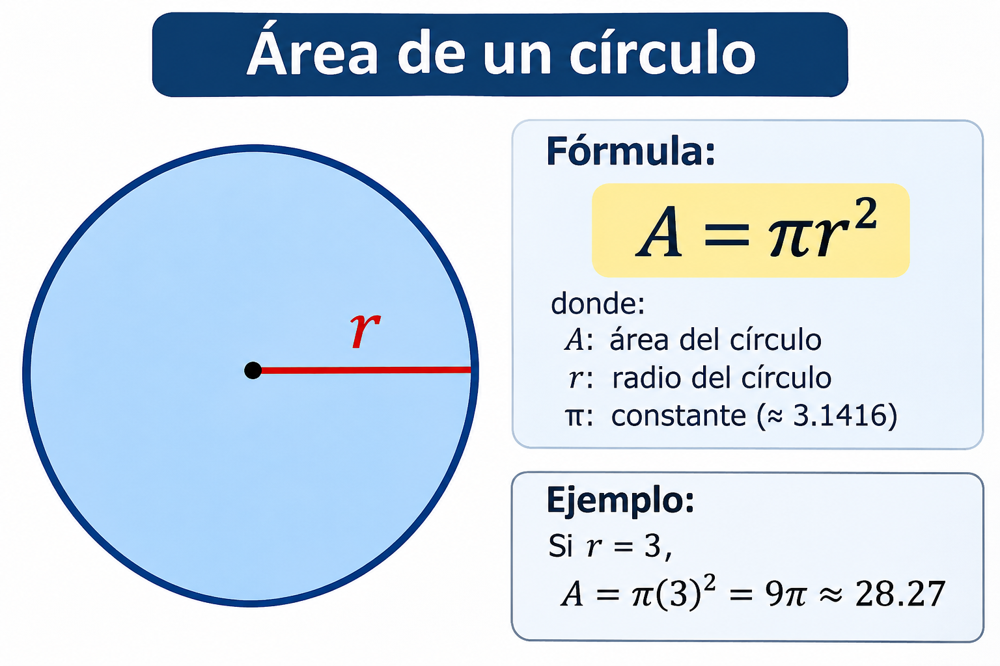
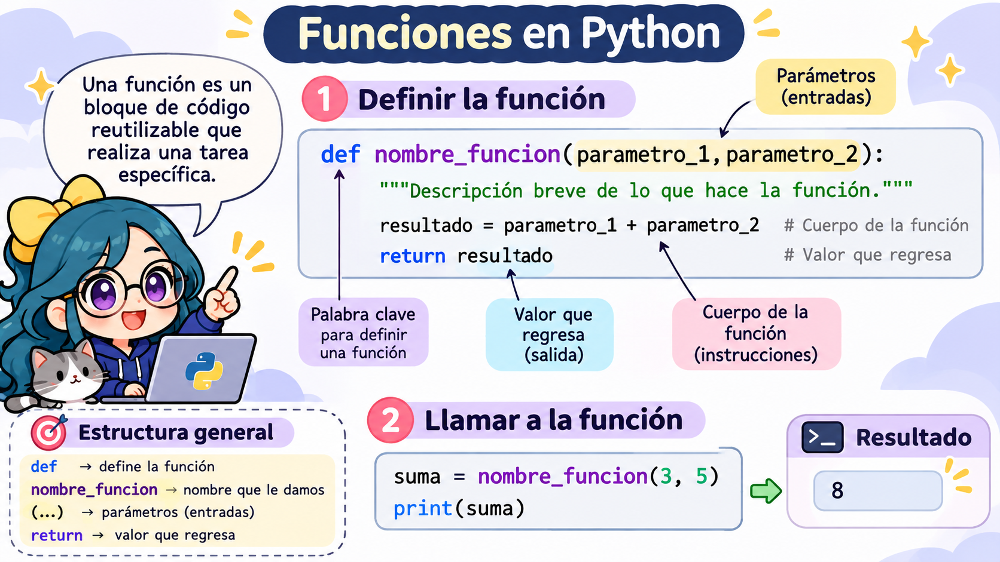
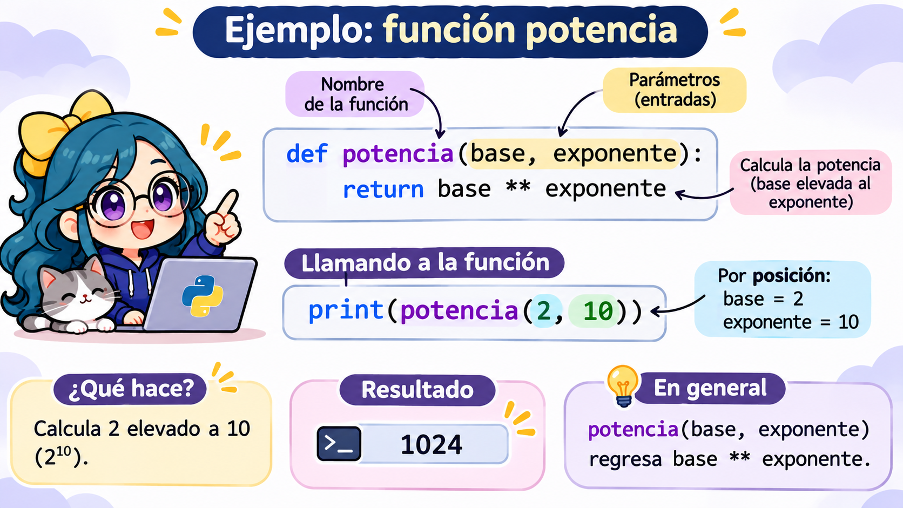
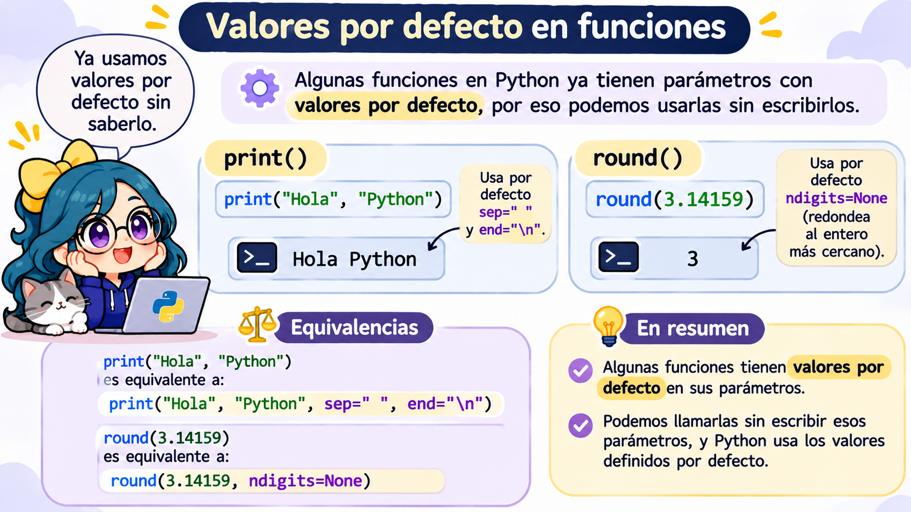
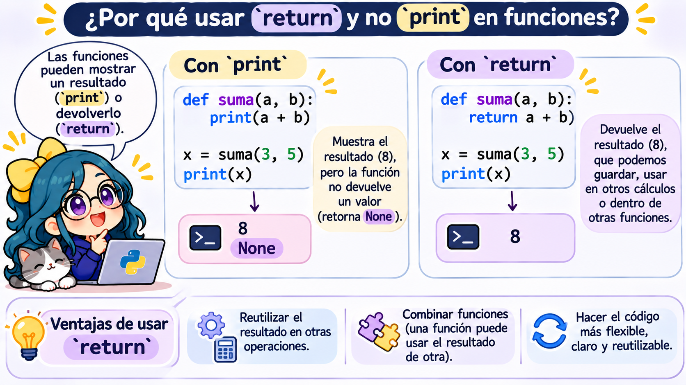
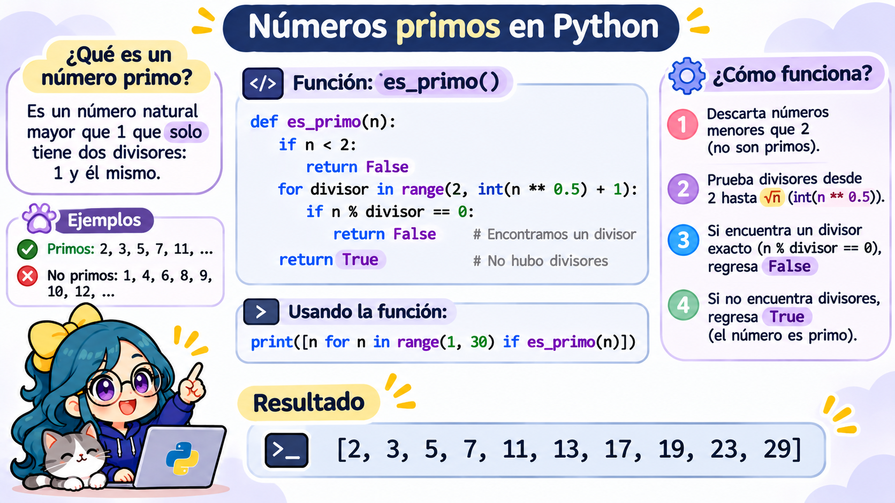
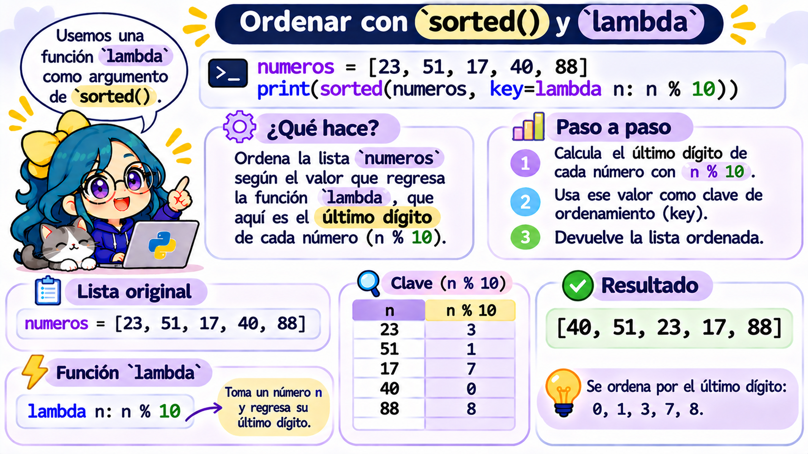
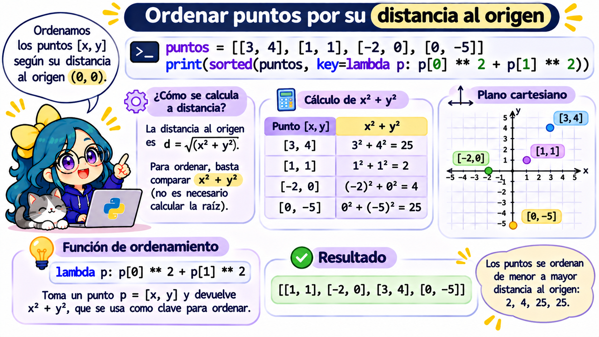
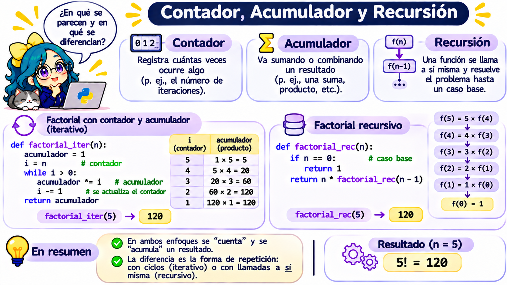

# Funciones en Python



> **Fecha:** 24 de noviembre, 2026

Desde el inicio del curso hemos usado **funciones**: `print()`, `len()`, `type()`, `sum()`, `max()`... Son bloques de código con un nombre que realizan una tarea. En este capítulo aprenderemos a **crear nuestras propias funciones** y a escribirlas siguiendo **buenas prácticas**.

En este capítulo veremos:

- Cómo **definir** y **llamar** una función con `def` y `return`.
- **Parámetros**, **argumentos** y **valores por defecto**.
- La diferencia entre `return` y `print()`.
- Cómo **documentar** una función con *docstrings* y anotaciones de tipo.
- El **alcance** de las variables (locales y globales).
- **Programación defensiva** dentro de las funciones y cómo **probarlas**.
- Funciones como argumentos, funciones `lambda` y recursión.

## ¿Por qué crear funciones?

Imagina que necesitas calcular el área de un círculo en varias partes de tu programa:

{fig-align="center" width="70%"}

``` python
area_1 = 3.141592653589793 * 2 ** 2
area_2 = 3.141592653589793 * 5 ** 2
area_3 = 3.141592653589793 * 7.5 ** 2
```

Si descubres un error en la fórmula, tendrás que corregirlo en **cada** línea. Con una función, la fórmula se escribe **una sola vez**:

```{python}
import math

def area_circulo(radio):
    return math.pi * radio ** 2

print(area_circulo(2))
print(area_circulo(5))
print(area_circulo(7.5))
```

| Ventaja | ¿Qué significa? |
|----|----|
| **Reutilizar** código | Escribes la lógica una vez y la usas muchas veces. |
| **No repetirte** | Principio *DRY* (*Don't Repeat Yourself*): si algo cambia, lo cambias en un solo lugar. |
| **Organizar** | Divides un problema grande en tareas pequeñas con nombres claros. |
| **Probar** | Puedes verificar cada función por separado. |
| **Leer** | `area_circulo(5)` dice **qué** hace; `math.pi * 5 ** 2` dice **cómo**. |

Es la misma idea que una función en matemáticas: $f(x) = x^2 + 1$ recibe un valor $x$ y **regresa** un resultado.

## Definir y llamar una función

{fig-align="center"}

``` python
def nombre_funcion(parametro_1, parametro_2):
    """Descripción breve de lo que hace la función."""
    resultado = parametro_1 + parametro_2      # Cuerpo de la función
    return resultado                            # Valor que regresa
```

| Parte | ¿Qué es? |
|----|----|
| `def` | Palabra reservada para **definir** una función. |
| `nombre_funcion` | El nombre de la función (en `snake_case`, como las variables). |
| `(parametro_1, parametro_2)` | Los **parámetros**: los datos que recibe. Puede no tener ninguno: `()`. |
| `:` | Los dos puntos, como en `if` y `for`. |
| `"""..."""` | El *docstring*: la documentación de la función (opcional, pero muy recomendable). |
| Cuerpo | Las instrucciones, con **4 espacios** de indentación. |
| `return` | Termina la función y **regresa** un valor a quien la llamó. |

Definir una función **no la ejecuta**: solo la guarda con ese nombre. Para ejecutarla hay que **llamarla**, escribiendo su nombre con paréntesis:

```{python}
def saludar(nombre):
    return "¡Hola, " + nombre + "!"

mensaje = saludar("Ana")     # Llamar a la función
print(mensaje)
print(saludar("Luis"))
```

Una función puede no recibir parámetros:

```{python}
def mostrar_bienvenida():
    print("Bienvenida al Taller de Cómputo")

mostrar_bienvenida()
```

::: callout-important
La función debe **definirse antes** de llamarla. Si la llamas antes de la línea `def`, obtendrás un `NameError`.
:::

## Parámetros y argumentos

- Los **parámetros** son los nombres que aparecen en la **definición**: `def potencia(base, exponente)`.
- Los **argumentos** son los valores que se envían al **llamarla**: `potencia(2, 10)`.

### Argumentos por posición y por nombre

{fig-align="center"}

```{python}
def potencia(base, exponente):
    return base ** exponente

print(potencia(2, 10))                     # Por posición: base=2, exponente=10
print(potencia(exponente=10, base=2))      # Por nombre: el orden no importa
print(potencia(10, 2))                     # ¡Cuidado! base=10, exponente=2
```

Pasar los argumentos **por nombre** hace el código más claro cuando hay varios parámetros.

### Valores por defecto

Un parámetro puede tener un **valor por defecto**, que se usa si no se envía ese argumento:

```{python}
def potencia(base, exponente=2):
    return base ** exponente

print(potencia(5))        # Usa exponente=2 -> 25
print(potencia(5, 3))     # Usa exponente=3 -> 125
```

Ya usamos valores por defecto sin saberlo: `print()` tiene `sep=" "` y `end="\n"`, y `round()` tiene `ndigits=None`.

{fig-align="center"}

::: callout-warning
Los parámetros con valor por defecto van **al final**: `def f(a, b=2)` es correcto, pero `def f(a=1, b)` produce un `SyntaxError`.
:::

## `return` vs. `print()`

Es la confusión más común al empezar:

|   | `print()` | `return` |
|----|----|----|
| ¿Qué hace? | **Muestra** un valor en la pantalla. | **Regresa** un valor a quien llamó la función. |
| ¿Se puede guardar el resultado? | **No**. | **Sí**: `x = funcion()`. |
| ¿Termina la función? | No. | **Sí**, inmediatamente. |

{fig-align="center"}

```{python}
def doble_con_print(x):
    print(x * 2)

def doble_con_return(x):
    return x * 2

a = doble_con_print(5)     # Muestra 10, pero no regresa nada
print("a =", a)            # None

b = doble_con_return(5)    # No muestra nada, regresa 10
print("b =", b)            # 10

print(b + 1)               # Podemos seguir usando el resultado
```

Una función **sin `return`** regresa `None`. Por eso, las funciones que **calculan** algo deben usar `return`, y dejar el `print()` para quien las llama.

### Regresar varios valores

Una función puede regresar varios valores separados por comas. Python los agrupa en una **tupla**, que podemos desempaquetar:

```{python}
def division_entera(dividendo, divisor):
    cociente = dividendo // divisor
    residuo = dividendo % divisor
    return cociente, residuo

cociente, residuo = division_entera(17, 5)
print("Cociente:", cociente, " Residuo:", residuo)
print(division_entera(17, 5))      # (3, 2): una tupla
```

### `return` termina la función

Después de `return`, la función **termina**, aunque haya más líneas. Esto permite salir en cuanto conocemos la respuesta:

```{python}
def es_primo(n):
    if n < 2:
        return False
    for divisor in range(2, int(n ** 0.5) + 1):
        if n % divisor == 0:
            return False          # Encontramos un divisor: ya no es primo
    return True                   # No hubo divisores

print([n for n in range(1, 30) if es_primo(n)])
```

{fig-align="center"}

Esta versión solo prueba divisores hasta $\sqrt{n}$. ¿Por qué basta? Si $n = a \times b$ con $a \le b$, entonces $a \le \sqrt{n}$: si $n$ tiene algún divisor, encontraremos uno antes de llegar a $\sqrt{n}$. Así, para $n = 97$ revisamos 8 divisores en lugar de 95.

Compara con el ejercicio de números primos del capítulo de [ciclos](python_for.qmd). Para que la comparación sea justa, en ambos casos probamos todos los divisores de 2 a $n - 1$:

:::::: columns
::: {.column width="48%"}
**Con ciclos** (capítulo de [ciclos](python_for.qmd))

``` python
n = 97

es_primo = n > 1

for divisor in range(2, n):
    if n % divisor == 0:
        es_primo = False
        break

print(n, "es primo:", es_primo)
```
:::

::: {.column width="4%"}
:::

::: {.column width="48%"}
**Con una función**

``` python
def es_primo(n):
    if n < 2:
        return False
    for divisor in range(2, n):
        if n % divisor == 0:
            return False
    return True

print(97, "es primo:", es_primo(97))
```
:::
::::::

Con la función ya no necesitamos la variable `es_primo` ni `break`: en cuanto encontramos un divisor, `return False` **termina** la función. Además, podemos reutilizarla con cualquier número sin copiar el ciclo.

::: {.callout-note collapse="false"}
## Código explicado: ¿cómo leer `es_primo()`?

Lee la función por **pasos**. Cada paso empieza en el comentario `# Paso` y termina justo antes del siguiente:

``` python
def es_primo(n):
    # Paso 1: descartar los números menores que 2
    if n < 2:
        return False                 # 0 y 1 no son primos: la función termina aquí

    # Paso 2: probar cada divisor, desde 2 hasta n - 1
    for divisor in range(2, n):

        # Paso 3: ¿el divisor es exacto?
        if n % divisor == 0:
            return False             # Encontramos un divisor: termina aquí

    # Paso 4: el ciclo terminó sin encontrar divisores
    return True                      # n es primo

print(97, "es primo:", es_primo(97))
```

1.  **Descartar `n < 2`.** Los números 0 y 1 no son primos. `return False` termina la función y **no se ejecuta nada más**.
2.  **Probar divisores.** El `for` recorre `divisor = 2, 3, 4, ..., n - 1`.
3.  **¿Divisor exacto?** Si `n % divisor == 0`, el residuo es 0 y `divisor` divide a `n`. `return False` termina la función **y el ciclo a la vez**: por eso ya no necesitamos `break`.
4.  **No hubo divisores.** Solo llegamos a `return True` si el ciclo terminó completo sin encontrar ningún divisor.

Por ejemplo, con `es_primo(91)`: el paso 1 no aplica, el ciclo prueba 2, 3, 4, 5, 6 y en el 7 encuentra que `91 % 7 == 0`, así que regresa `False`. Con `es_primo(97)` ningún divisor funciona, el ciclo termina y regresa `True`.
:::

## Documentar funciones

### *Docstrings*

Un ***docstring*** es un texto entre triples comillas justo debajo de la línea `def`. Explica **qué hace** la función, **qué recibe** y **qué regresa**. Es lo que muestra `help()`:

```{python}
def area_triangulo(base, altura):
    """Calcula el área de un triángulo.

    Parámetros:
        base (float): longitud de la base.
        altura (float): altura del triángulo.

    Regresa:
        float: el área, base * altura / 2.
    """
    return base * altura / 2

help(area_triangulo)
```

### Anotaciones de tipo

Las **anotaciones de tipo** (*type hints*) indican qué tipo de dato espera cada parámetro y qué tipo regresa la función. Python **no las verifica**, pero hacen el código más claro:

```{python}
def promedio(datos: list) -> float:
    """Regresa el promedio de una lista de números."""
    return sum(datos) / len(datos)

print(promedio([8, 9, 10]))
```

`datos: list` significa "se espera una lista" y `-> float` significa "regresa un decimal".

## Alcance de las variables

Las variables creadas **dentro** de una función son **locales**: solo existen mientras la función se ejecuta.

```{python}
def calcular_iva(precio):
    tasa = 0.16                 # Variable local
    return precio * tasa

print(calcular_iva(100))
print(tasa)                     # NameError: tasa solo existía dentro de la función
```

Una función **puede leer** una variable global (definida fuera de todas las funciones), pero depender de ella es una mala práctica: es mejor pasarla como **parámetro**.

```{python}
TASA_IVA = 0.16                 # Constante global

def calcular_iva(precio, tasa=TASA_IVA):
    return precio * tasa

print(calcular_iva(100))
print(calcular_iva(100, tasa=0.08))
```

|   | Variable local | Variable global |
|----|----|----|
| ¿Dónde se crea? | Dentro de una función. | Fuera de todas las funciones. |
| ¿Dónde existe? | Solo dentro de esa función. | En todo el programa. |
| Recomendación | Úsalas libremente. | Úsalas solo para **constantes** (`MAYUSCULAS`). |

## Programación defensiva en funciones

Una función no sabe con qué datos la llamarán. Siguiendo lo que vimos en el capítulo de [buenas prácticas](python_buenas_practicas.qmd), una buena función **valida sus argumentos** al inicio y lanza un error claro con `raise` si son incorrectos:

```{python}
def factorial(n):
    """Regresa n! para un entero n >= 0."""
    # Paso 1: validar el TIPO de n (debe ser un entero)
    if not isinstance(n, int):
        raise TypeError("n debe ser un número entero")   # Ej. factorial(2.5): la función se detiene aquí

    # Paso 2: validar el VALOR de n (no puede ser negativo)
    if n < 0:
        raise ValueError("n no puede ser negativo; se recibió " + str(n))   # Ej. factorial(-3)

    # Paso 3: calcular n! = 1 × 2 × 3 × ... × n
    resultado = 1                    # Empezamos en 1 (así 0! = 1 y 1! = 1)
    for i in range(2, n + 1):        # i toma los valores 2, 3, ..., n
        resultado *= i               # Equivale a: resultado = resultado * i

    # Paso 4: regresar el resultado
    return resultado

print(factorial(5))      # 1 × 2 × 3 × 4 × 5 = 120
print(factorial(-3))     # Lanza ValueError: n no puede ser negativo
```

Quien llama a la función puede **atrapar** el error con `try` / `except`:

```{python}
try:
    print(factorial(-3))
except ValueError as error:
    print("No se pudo calcular:", error)
```

## Probar funciones

Una función se **prueba** llamándola con valores cuya respuesta ya conocemos. Con `assert`, la prueba no muestra nada si todo está bien y se detiene si algo falla:

```{python}
assert factorial(0) == 1
assert factorial(1) == 1
assert factorial(5) == 120
assert es_primo(2) and es_primo(97)
assert not es_primo(1) and not es_primo(91)
print("Todas las pruebas pasaron ✅")
```

::: callout-tip
Escribe las pruebas **al mismo tiempo** que la función e incluye los **casos límite**: 0, 1, números negativos, listas vacías. Si más adelante modificas la función, vuelve a ejecutar las pruebas para verificar que no rompiste nada.
:::

## Funciones como argumentos y funciones `lambda`

En Python, las funciones también son **objetos**: se pueden guardar en variables y enviar como argumentos a otras funciones. Ya lo hicimos en la [🐍 Actividad 2](python_ejercicio2.qmd) con `max(set(datos), key=datos.count)`.

```{python}
def ultimo_digito(n):
    return n % 10

numeros = [23, 51, 17, 40, 88]
print(sorted(numeros, key=ultimo_digito))    # Ordenar por el último dígito
```

### ¿Qué es una función `lambda`?

Una función **`lambda`** es una forma **corta** de escribir una función **sin nombre**, en una sola línea. Estas dos funciones hacen exactamente lo mismo:

:::::: columns
::: {.column width="48%"}
**Con `def`**

``` python
def ultimo_digito(n):
    return n % 10
```
:::

::: {.column width="4%"}
:::

::: {.column width="48%"}
**Con `lambda`**

``` python
lambda n: n % 10
```
:::
::::::

| Parte | ¿Qué es? |
|----|----|
| `lambda` | Palabra reservada para crear una función (como `def`, pero sin nombre). |
| `n` | Los **parámetros**, antes de los dos puntos y **sin paréntesis**. Puede haber varios: `lambda a, b: a + b`. |
| `n % 10` | Una **sola expresión**, que es el valor que regresa. No se escribe `return`. |

### ¿Por qué usarla?

Muchas veces necesitamos una función **una sola vez**, solo para enviarla como argumento. Con `def` hay que inventarle un nombre y escribirla en otro lugar; con `lambda` la escribimos **justo donde se usa**:

```{python}
# Mismo resultado que sorted(numeros, key=ultimo_digito), sin definir ultimo_digito
print(sorted(numeros, key=lambda n: n % 10))
```

El argumento `key=` de `sorted()`, `max()` y `min()` recibe una **función** que se aplica a cada elemento: Python ordena (o compara) usando el valor que regresa esa función, pero muestra los elementos originales.

{fig-align="center"}

### ¿Cuándo usarla?

Cuando una función **corta** se usa **una sola vez como argumento**. Por ejemplo:

```{python}
# Ordenar puntos [x, y] por su distancia al origen (basta comparar x² + y²)
puntos = [[3, 4], [1, 1], [-2, 0], [0, -5]]
print(sorted(puntos, key=lambda p: p[0] ** 2 + p[1] ** 2))
```

{fig-align="center"}

También sirve con **nuestras propias funciones** que reciben otra función. Aquí `tabla()` evalúa **cualquier** función matemática $f(x)$, y con `lambda` le enviamos la función sin tener que definirla antes:

```{python}
def tabla(f, valores):
    """Muestra f(x) para cada x en valores."""
    for x in valores:
        print("f(", x, ") = ", f(x), sep="")

tabla(lambda x: x ** 2 - 1, [0, 1, 2, 3])     # f(x) = x² - 1
print()
tabla(lambda x: 2 ** x, [0, 1, 2, 3])         # f(x) = 2^x
```

### ¿Cuándo **no** usarla?

- **Si la función necesita más de una línea** (un `if` con varias ramas, un `for`, validaciones): `lambda` solo admite **una expresión**. Usa `def`.
- **Si la vas a usar varias veces o merece un nombre**: usa `def`, que además permite escribir un *docstring*.
- **Si ya existe una función que hace lo mismo**, pásala directamente: escribe `key=abs` en lugar de `key=lambda x: abs(x)`.

```{python}
cuadrado = lambda x: x ** 2       # Funciona, pero no es buena práctica
print(cuadrado(9))

def cuadrado(x):                  # Mejor: tiene un nombre claro y se puede documentar
    """Regresa x al cuadrado."""
    return x ** 2
print(cuadrado(9))

print(sorted([-7, 3, -1, 5], key=abs))      # abs ya existe: no hace falta lambda
```

::: callout-tip
**Regla práctica:** `lambda` es una función **desechable de una línea** que escribes justo donde la envías como argumento. Para todo lo demás, usa `def`.
:::

## Recursión

Una función **recursiva** se llama **a sí misma**. Es útil para definiciones matemáticas recursivas, como el factorial: $n! = n \cdot (n-1)!$ con $0! = 1$.

```{python}
def factorial_recursivo(n):
    if n == 0:                                # Caso base: detiene la recursión
        return 1
    return n * factorial_recursivo(n - 1)     # Caso recursivo

print(factorial_recursivo(5))   # 5 * 4 * 3 * 2 * 1 * 1 = 120
```

Toda función recursiva necesita un **caso base**; sin él, se llamaría a sí misma indefinidamente hasta producir un `RecursionError`.

### Recursión vs. acumuladores y contadores

En el capítulo de [ciclos](python_for.qmd#acumuladores-y-contadores) calculamos $5!$ con un **acumulador**. La recursión resuelve **el mismo problema** con las mismas ideas (un valor inicial, algo que cambia en cada repetición y una condición para parar), pero las organiza de otra forma:

:::::: columns
::: {.column width="48%"}
**Con un ciclo y un acumulador**

``` python
def factorial_ciclo(n):
    resultado = 1                 # ACUMULADOR: inicia en 1
    for i in range(2, n + 1):     # CONTADOR: i = 2, 3, ..., n
        resultado = resultado * i # ACUMULADOR: se actualiza
    return resultado              # Se usa el ACUMULADOR
```
:::

::: {.column width="4%"}
:::

::: {.column width="48%"}
**Con recursión**

``` python
def factorial_recursivo(n):       # n: CONTADOR (baja)
    if n == 0:                    # El CONTADOR llegó a 0
        return 1                  # Valor inicial (como
                                  # inicializar el ACUMULADOR)
    # No hay variable ACUMULADORA: n * ... queda pendiente
    # n - 1 actualiza el CONTADOR para la siguiente llamada
    return n * factorial_recursivo(n - 1)
```
:::
::::::

Cada parte del ciclo tiene su equivalente en la función recursiva:

| Papel | Ciclo con acumulador | Recursión |
|----|----|----|
| **Valor inicial** (el neutro del producto) | `resultado = 1`, **antes** del ciclo | `return 1` en el **caso base**, al **final** de las llamadas |
| **Lo que cambia** en cada repetición | El contador `i` **sube**: 2, 3, 4, 5 | El parámetro `n` **baja**: 5, 4, 3, 2, 1, 0 |
| **Cuándo parar** | Cuando `range()` se termina | Cuando `n == 0` (caso base) |
| **Dónde se acumula** | En la variable `resultado` | En las multiplicaciones **pendientes**, que se resuelven al regresar |
| **Cuándo se multiplica** | **De ida**: en cada vuelta del ciclo | **De regreso**: cuando cada llamada recibe su `return` |

#### ¿Dónde se guarda el resultado parcial?

Con el ciclo, el acumulador **guarda** el resultado parcial en cada vuelta:

```{python}
resultado = 1                      # ACUMULADOR: valor inicial (neutro del producto)
for i in range(2, 6):              # CONTADOR: i = 2, 3, 4, 5
    resultado = resultado * i      # ACUMULADOR: guarda el producto parcial
    print("i =", i, " resultado =", resultado)
```

Con la recursión **no hay variable acumuladora**. Cada llamada **se queda esperando** el resultado de la siguiente, y las multiplicaciones se hacen **al regresar**, cuando se llega al caso base. Agregamos `print()` para ver la ida y el regreso:

```{python}
def factorial_traza(n):                     # n: CONTADOR (5, 4, 3, 2, 1, 0)
    if n == 0:                              # El CONTADOR llegó a 0: caso base
        print("Caso base: factorial(0) regresa 1")
        return 1                            # Valor inicial (como inicializar el ACUMULADOR)
    print("Ida:     factorial(", n, ") espera a factorial(", n - 1, ")", sep="")
    # n - 1 actualiza el CONTADOR; la multiplicación queda pendiente hasta que regrese
    resultado = n * factorial_traza(n - 1)
    # Ojo: resultado NO es un ACUMULADOR; es una variable local de esta llamada
    print("Regreso: factorial(", n, ") = ", n, " * factorial(", n - 1, ") = ", resultado, sep="")
    return resultado                        # Entrega el producto parcial a quien llamó

print(factorial_traza(5))
```

Es decir, de ida Python **apila** las operaciones pendientes y de regreso las **resuelve**:

$$\begin{aligned}
5! &= 5 \cdot 4! \\
   &= 5 \cdot (4 \cdot 3!) \\
   &= 5 \cdot (4 \cdot (3 \cdot (2 \cdot (1 \cdot 1)))) \quad \leftarrow \text{caso base: } 0! = 1 \\
   &= 120 \quad \leftarrow \text{se multiplica al regresar}
\end{aligned}$$

{fig-align="center"}

La versión iterativa de la imagen usa un ciclo `while`: el **contador** empieza en `n` y **baja** hasta 1, mientras el **acumulador** guarda el producto parcial. Contar hacia arriba (`for i in range(2, n + 1)`) o hacia abajo da el mismo resultado:

```{python}
def factorial_iter(n):
    """Regresa n! usando un ciclo while con contador y acumulador."""
    acumulador = 1              # ACUMULADOR: inicia en 1 (neutro del producto)
    i = n                       # CONTADOR: empieza en n
    while i > 0:                # Repetir mientras el CONTADOR no llegue a 0
        acumulador *= i         # ACUMULADOR: acumulador = acumulador * i
        i -= 1                  # CONTADOR: se actualiza (baja 1)
    return acumulador           # Se usa el ACUMULADOR

# Al ejecutar factorial_iter(5):
#   i = 5 → acumulador = 1 × 5 = 5
#   i = 4 → acumulador = 5 × 4 = 20
#   i = 3 → acumulador = 20 × 3 = 60
#   i = 2 → acumulador = 60 × 2 = 120
#   i = 1 → acumulador = 120 × 1 = 120
#   i = 0 → el ciclo termina y regresa 120
print(factorial_iter(5))
```

#### Recursión con un acumulador explícito

Si queremos que la recursión se parezca aún más al ciclo, podemos enviar el **acumulador como parámetro**. Ahora `n` hace de **contador** y `acumulado` de **acumulador**, y la multiplicación se hace **de ida**, igual que en el ciclo:

```{python}
def factorial_acumulador(n, acumulado=1):   # n: CONTADOR; acumulado: ACUMULADOR (inicia en 1)
    """Regresa n! llevando el resultado parcial en el parámetro acumulado."""
    # Paso 1 (caso base): el CONTADOR llegó a 0, ya no quedan números por multiplicar
    if n == 0:
        return acumulado                    # Se usa el ACUMULADOR
    # Paso 2: multiplicar ahora y pasar el resultado parcial a la siguiente llamada
    #   n - 1          → actualiza el CONTADOR
    #   acumulado * n  → actualiza el ACUMULADOR
    return factorial_acumulador(n - 1, acumulado * n)

# Al ejecutar factorial_acumulador(5):
#   (n=5, acumulado=1) → (n=4, acumulado=5) → (n=3, acumulado=20)
#   → (n=2, acumulado=60) → (n=1, acumulado=120) → (n=0, acumulado=120): regresa 120
print(factorial_acumulador(5))
```

#### ¿Cuál conviene usar?

Las tres versiones calculan lo mismo, pero:

- **El ciclo** es la opción más directa en Python: no tiene límite de repeticiones y es más rápido.
- **La recursión** es útil cuando la **definición matemática ya es recursiva** ($n! = n \cdot (n-1)!$, la sucesión de Fibonacci, el algoritmo de Euclides para el máximo común divisor) o cuando un problema se divide en **subproblemas iguales pero más pequeños**. Su código se parece mucho a la fórmula.
- Python permite **alrededor de 1000 llamadas recursivas** anidadas: `factorial_recursivo(5000)` produce un `RecursionError`, mientras que `factorial_ciclo(5000)` funciona sin problema.

::: callout-tip
**Idea clave:** un ciclo **guarda** el resultado parcial en un acumulador; una función recursiva **deja pendientes** las operaciones y las resuelve al regresar del caso base. El caso base de la recursión cumple el papel de la **inicialización** del acumulador: por eso el factorial regresa `1` y una suma regresaría `0`.
:::

## Buenas prácticas al escribir funciones

| Práctica | Mal | Bien |
|----|----|----|
| Nombres con **verbos** en `snake_case`. | `def x(a):` | `def calcular_promedio(datos):` |
| **Una sola tarea** por función. | Una función que lee datos, calcula y grafica. | Tres funciones pequeñas. |
| **Regresar** valores en lugar de imprimirlos. | `print(resultado)` dentro de la función. | `return resultado` y que quien la llama decida. |
| **Documentar** con un *docstring*. | Sin explicación. | `"""Calcula el área de un círculo."""` |
| Pasar los datos como **parámetros**. | Usar variables globales dentro de la función. | `def calcular_iva(precio, tasa):` |
| **Validar** los argumentos. | Dejar que falle con un error confuso. | `raise ValueError("n no puede ser negativo")` |
| Funciones **cortas**. | 100 líneas en una función. | Si no cabe en la pantalla, divídela. |
| **Probar** con casos conocidos. | Confiar en que funciona. | `assert factorial(5) == 120` |
| No usar **listas** como valor por defecto. | `def agregar(x, lista=[]):` | `def agregar(x, lista=None):` (ver ejercicio 7). |

## Errores comunes

| Error | Ejemplo | Corrección |
|----|----|----|
| Olvidar los paréntesis al llamar | `area_circulo` (muestra `<function ...>`) | `area_circulo(5)` |
| Olvidar el `return` | La función regresa `None`. | Agrega `return resultado`. |
| Llamar antes de definir | `NameError: name 'f' is not defined` | Escribe el `def` antes de la llamada. |
| Número incorrecto de argumentos | `TypeError: potencia() missing 1 required positional argument` | Revisa cuántos parámetros recibe. |
| Usar una variable local afuera | `NameError` | Regrésala con `return`. |
| Olvidar los dos puntos o la indentación | `SyntaxError` / `IndentationError` | `def f(x):` y cuerpo con 4 espacios. |
| Llamar `sum`, `max`, `list`... a una función o variable | Se pierde la función integrada. | Usa nombres descriptivos. |

## Ejercicios

Resuelve los ejercicios en los editores interactivos. Recuerda que lo que escribas **no se guarda** al recargar la página. En estos ejercicios, **Run Code** prueba tu función con **varios valores**, no solo con los del ejemplo.

### Ejercicio 1. Área de un rectángulo

Completa la función `area_rectangulo(base, altura)` para que **regrese** el área del rectángulo.

```{pyodide}
#| exercise: fn1
def area_rectangulo(base, altura):
    """Regresa el área de un rectángulo."""
    # Paso 1: calcula el área (base × altura) y regrésala con return
    ______

# Llamamos a la función: base = 3, altura = 4
print(area_rectangulo(3, 4))   # Debe ser 12
```

```{pyodide}
#| exercise: fn1
#| check: true
try:
    f = envir_result["area_rectangulo"]
except Exception:
    f = None
if f is None:
    feedback = {"correct": False, "message": "No encontré la función area_rectangulo."}
elif f(3, 4) is None:
    feedback = {"correct": False, "message": "Tu función regresa None: usa return en lugar de print()."}
elif f(3, 4) == 12 and f(2.5, 2) == 5 and f(0, 7) == 0:
    feedback = {"correct": True, "message": "¡Correcto! Tu función funciona con todos los casos de prueba."}
else:
    feedback = {"correct": False, "message": "Revisa la fórmula: el área es base * altura."}
feedback
```

:::: {.hint exercise="fn1"}
::: {.callout-note collapse="false"}
## Pista

Escribe `return base * altura`. Si usas `print()`, la función mostrará el valor, pero regresará `None`.
:::
::::

:::: {.solution exercise="fn1"}
::: {.callout-tip collapse="false"}
## Solución

``` python
def area_rectangulo(base, altura):
    """Regresa el área de un rectángulo."""
    # Paso 1: calcular el área y regresarla
    return base * altura

# Al ejecutar area_rectangulo(3, 4):
#   1. Python asigna base = 3 y altura = 4
#   2. Calcula 3 * 4 = 12
#   3. return entrega 12 y print() lo muestra
print(area_rectangulo(3, 4))   # 12
```
:::
::::

### Ejercicio 2. De Celsius a Fahrenheit

Escribe la función `celsius_a_fahrenheit(celsius)` que convierta una temperatura con la fórmula $F = \frac{9}{5} C + 32$. Incluye un *docstring*.

```{pyodide}
#| exercise: fn2
def celsius_a_fahrenheit(celsius):
    # Paso 1: escribe un docstring que explique qué hace la función
    # Paso 2: aplica la fórmula F = 9/5 · C + 32 y regresa el resultado
    ______

# Llamamos a la función con dos temperaturas conocidas
print(celsius_a_fahrenheit(0))      # Debe ser 32
print(celsius_a_fahrenheit(100))    # Debe ser 212
```

```{pyodide}
#| exercise: fn2
#| check: true
import math
try:
    f = envir_result["celsius_a_fahrenheit"]
except Exception:
    f = None
correcta = f is not None and f(0) is not None
if correcta:
    for c, esperado in [(0, 32), (100, 212), (-40, -40), (37, 98.6)]:
        if not math.isclose(f(c), esperado):
            correcta = False
if f is None:
    feedback = {"correct": False, "message": "No encontré la función celsius_a_fahrenheit."}
elif f(0) is None:
    feedback = {"correct": False, "message": "Tu función regresa None: usa return."}
elif correcta:
    if f.__doc__:
        feedback = {"correct": True, "message": "¡Correcto! Además, documentaste tu función. Curiosidad: -40 °C = -40 °F."}
    else:
        feedback = {"correct": True, "message": "¡Correcto! Agrega un docstring para documentar tu función."}
else:
    feedback = {"correct": False, "message": "Revisa la fórmula: 9 / 5 * celsius + 32."}
feedback
```

:::: {.hint exercise="fn2"}
::: {.callout-note collapse="false"}
## Pista

El *docstring* va en la primera línea del cuerpo: `"""Convierte grados Celsius a Fahrenheit."""`. Después: `return 9 / 5 * celsius + 32`.
:::
::::

:::: {.solution exercise="fn2"}
::: {.callout-tip collapse="false"}
## Solución

``` python
def celsius_a_fahrenheit(celsius):
    """Convierte una temperatura de grados Celsius a grados Fahrenheit."""
    # Paso 1: el docstring (arriba) documenta qué hace la función
    # Paso 2: aplicar F = 9/5 · C + 32 y regresar el resultado
    return 9 / 5 * celsius + 32

# Al ejecutar celsius_a_fahrenheit(100):
#   1. Python asigna celsius = 100
#   2. Calcula 9 / 5 * 100 + 32 = 180.0 + 32 = 212.0
#   3. return entrega 212.0
print(celsius_a_fahrenheit(0))      # 32.0
print(celsius_a_fahrenheit(100))    # 212.0
```
:::
::::

### Ejercicio 3. ¿Es par?

Escribe la función `es_par(n)` que regrese `True` si `n` es par y `False` si es impar. Intenta escribirla en **una sola línea** de cuerpo, sin `if`.

```{pyodide}
#| exercise: fn3
def es_par(n):
    # Paso 1: calcula el residuo de dividir n entre 2
    # Paso 2: regresa True si el residuo es 0 (intenta hacerlo sin if)
    ______

# Llamamos a la función con un número par y uno impar
print(es_par(4), es_par(7))   # Debe ser True False
```

```{pyodide}
#| exercise: fn3
#| check: true
try:
    f = envir_result["es_par"]
except Exception:
    f = None
if f is None:
    feedback = {"correct": False, "message": "No encontré la función es_par."}
elif [f(0), f(2), f(10), f(-4), f(1), f(7), f(-3)] == [True, True, True, True, False, False, False]:
    feedback = {"correct": True, "message": "¡Correcto! Una expresión booleana como n % 2 == 0 ya regresa True o False."}
else:
    feedback = {"correct": False, "message": "La función debe regresar True para 0, 2, 10, -4 y False para 1, 7, -3."}
feedback
```

:::: {.hint exercise="fn3"}
::: {.callout-note collapse="false"}
## Pista

La expresión `n % 2 == 0` ya es `True` o `False`: puedes regresarla directamente con `return`.
:::
::::

:::: {.solution exercise="fn3"}
::: {.callout-tip collapse="false"}
## Solución

``` python
def es_par(n):
    """Regresa True si n es par."""
    # Paso 1: n % 2 es el residuo: 0 si n es par, 1 si es impar
    # Paso 2: n % 2 == 0 ya es True o False, así que lo regresamos directamente
    return n % 2 == 0

# Al ejecutar la función:
#   es_par(4): 4 % 2 = 0  →  0 == 0  →  True
#   es_par(7): 7 % 2 = 1  →  1 == 0  →  False
print(es_par(4), es_par(7))   # True False
```

Es mejor que escribir `if n % 2 == 0: return True` y `else: return False`: hace lo mismo con menos código.
:::
::::

### Ejercicio 4. Factorial con validación

Completa la función `factorial(n)` para que:

1.  Lance un `ValueError` si `n` es negativo.
2.  Calcule $n!$ con un ciclo `for` y lo regrese.

```{pyodide}
#| exercise: fn4
def factorial(n):
    """Regresa n! para un entero n >= 0."""
    # Paso 1: validar que n no sea negativo
    if ______:
        raise ValueError("n no puede ser negativo")

    # Paso 2: calcular n! = 1 × 2 × 3 × ... × n
    resultado = 1                  # Empezamos en 1 (así 0! = 1)
    for i in range(2, n + 1):      # i toma los valores 2, 3, ..., n
        ______                     # Multiplica resultado por i

    # Paso 3: regresar el resultado
    return resultado

print(factorial(5))   # Debe ser 120
```

```{pyodide}
#| exercise: fn4
#| check: true
try:
    f = envir_result["factorial"]
except Exception:
    f = None
if f is None:
    feedback = {"correct": False, "message": "No encontré la función factorial."}
elif not (f(0) == 1 and f(1) == 1 and f(5) == 120 and f(10) == 3628800):
    feedback = {"correct": False, "message": "Revisa el cálculo: factorial(0) = 1, factorial(5) = 120."}
else:
    try:
        f(-1)
        feedback = {"correct": False, "message": "El cálculo es correcto, pero factorial(-1) debería lanzar un ValueError."}
    except ValueError:
        feedback = {"correct": True, "message": "¡Correcto! Tu función calcula bien y rechaza los números negativos."}
feedback
```

:::: {.hint exercise="fn4"}
::: {.callout-note collapse="false"}
## Pista

La condición es `n < 0`. Dentro del ciclo, acumula el producto con `resultado *= i`.
:::
::::

:::: {.solution exercise="fn4"}
::: {.callout-tip collapse="false"}
## Solución

``` python
def factorial(n):
    """Regresa n! para un entero n >= 0."""
    # Paso 1: validar que n no sea negativo
    if n < 0:
        raise ValueError("n no puede ser negativo")

    # Paso 2: calcular n! = 1 × 2 × 3 × ... × n
    resultado = 1
    for i in range(2, n + 1):
        resultado *= i             # Equivale a: resultado = resultado * i

    # Paso 3: regresar el resultado
    return resultado

# Al ejecutar factorial(5):
#   Paso 1: 5 no es negativo, seguimos
#   Paso 2: resultado = 1 → ×2 = 2 → ×3 = 6 → ×4 = 24 → ×5 = 120
#   Paso 3: regresa 120
print(factorial(5))   # 120
```
:::
::::

### Ejercicio 5. Estadísticas de una lista

Escribe la función `estadisticas(datos)` que regrese **tres valores**: la media, el mínimo y el máximo de la lista. Después desempaqueta el resultado en tres variables.

```{pyodide}
#| exercise: fn5
def estadisticas(datos):
    """Regresa la media, el mínimo y el máximo de una lista de números."""
    # Paso 1: calcula la media (suma de los datos / cantidad de datos)
    # Paso 2: regresa los tres valores separados por comas: media, mínimo y máximo
    ______

# La función regresa una tupla; la desempaquetamos en tres variables
media, minimo, maximo = estadisticas([4, 8, 15, 16, 23, 42])
print("Media:", media, " Mínimo:", minimo, " Máximo:", maximo)
```

```{pyodide}
#| exercise: fn5
#| check: true
import math
try:
    f = envir_result["estadisticas"]
except Exception:
    f = None
if f is None:
    feedback = {"correct": False, "message": "No encontré la función estadisticas."}
else:
    r1 = f([4, 8, 15, 16, 23, 42])
    r2 = f([7])
    if not (isinstance(r1, tuple) and len(r1) == 3):
        feedback = {"correct": False, "message": "La función debe regresar tres valores separados por comas: return media, minimo, maximo."}
    elif math.isclose(r1[0], 18) and r1[1:] == (4, 42) and math.isclose(r2[0], 7) and r2[1:] == (7, 7):
        feedback = {"correct": True, "message": "¡Correcto! La función regresa una tupla con los tres valores."}
    else:
        feedback = {"correct": False, "message": "Para [4, 8, 15, 16, 23, 42] debe regresar (18.0, 4, 42)."}
feedback
```

:::: {.hint exercise="fn5"}
::: {.callout-note collapse="false"}
## Pista

Usa las funciones integradas `sum()`, `len()`, `min()` y `max()`, y regresa los tres valores separados por comas: `return media, minimo, maximo`.
:::
::::

:::: {.solution exercise="fn5"}
::: {.callout-tip collapse="false"}
## Solución

``` python
def estadisticas(datos):
    """Regresa la media, el mínimo y el máximo de una lista de números."""
    # Paso 1: media = suma / cantidad
    media = sum(datos) / len(datos)
    # Paso 2: regresar tres valores (Python los agrupa en una tupla)
    return media, min(datos), max(datos)

# Al ejecutar estadisticas([4, 8, 15, 16, 23, 42]):
#   Paso 1: media = 108 / 6 = 18.0
#   Paso 2: regresa la tupla (18.0, 4, 42)
# Al desempaquetar: media = 18.0, minimo = 4, maximo = 42
media, minimo, maximo = estadisticas([4, 8, 15, 16, 23, 42])
print("Media:", media, " Mínimo:", minimo, " Máximo:", maximo)
```
:::
::::

### Ejercicio 6. Distancia entre dos puntos

Escribe la función `distancia(p, q)` que reciba dos puntos como tuplas `(x, y)` y regrese la distancia entre ellos:

$$d(p, q) = \sqrt{(x_2 - x_1)^2 + (y_2 - y_1)^2}$$

Usa **anotaciones de tipo** y un *docstring*.

```{pyodide}
#| exercise: fn6
def distancia(p: tuple, q: tuple) -> float:
    """______"""
    # Paso 1: separa las coordenadas de cada punto (desempaquetar la tupla)
    x1, y1 = p
    x2, y2 = q
    # Paso 2: aplica la fórmula y regresa la distancia
    ______

# Llamamos a la función: p = (0, 0), q = (3, 4)
print(distancia((0, 0), (3, 4)))    # Debe ser 5.0
```

```{pyodide}
#| exercise: fn6
#| check: true
import math
try:
    f = envir_result["distancia"]
except Exception:
    f = None
if f is None:
    feedback = {"correct": False, "message": "No encontré la función distancia."}
elif f((0, 0), (3, 4)) is None:
    feedback = {"correct": False, "message": "Tu función regresa None: usa return."}
elif (math.isclose(f((0, 0), (3, 4)), 5) and math.isclose(f((1, 2), (4, 6)), 5)
      and math.isclose(f((2, 2), (2, 2)), 0) and math.isclose(f((-1, -1), (1, 1)), 2 ** 1.5)):
    if f.__doc__ and "______" not in f.__doc__:
        feedback = {"correct": True, "message": "¡Correcto! Es el teorema de Pitágoras aplicado a dos puntos."}
    else:
        feedback = {"correct": True, "message": "¡El cálculo es correcto! Completa también el docstring."}
else:
    feedback = {"correct": False, "message": "Revisa la fórmula: ((x2 - x1) ** 2 + (y2 - y1) ** 2) ** 0.5."}
feedback
```

:::: {.hint exercise="fn6"}
::: {.callout-note collapse="false"}
## Pista

La raíz cuadrada es elevar a `0.5`: `return ((x2 - x1) ** 2 + (y2 - y1) ** 2) ** 0.5`. En el *docstring* describe qué hace la función.
:::
::::

:::: {.solution exercise="fn6"}
::: {.callout-tip collapse="false"}
## Solución

``` python
def distancia(p: tuple, q: tuple) -> float:
    """Regresa la distancia euclidiana entre los puntos p = (x1, y1) y q = (x2, y2)."""
    # Paso 1: separar las coordenadas de cada punto
    x1, y1 = p
    x2, y2 = q
    # Paso 2: aplicar la fórmula (elevar a 0.5 es sacar raíz cuadrada)
    return ((x2 - x1) ** 2 + (y2 - y1) ** 2) ** 0.5

# Al ejecutar distancia((0, 0), (3, 4)):
#   Paso 1: x1 = 0, y1 = 0, x2 = 3, y2 = 4
#   Paso 2: (3 - 0)² + (4 - 0)² = 9 + 16 = 25  →  25 ** 0.5 = 5.0
print(distancia((0, 0), (3, 4)))    # 5.0
```

Python también incluye esta función: `math.dist((0, 0), (3, 4))`.
:::
::::

### Ejercicio 7. Detective: el valor por defecto que se "acuerda"

La función `agregar_calificacion()` debería crear una lista **nueva** cada vez que no se le pasa una lista. Ejecuta el código: ¿por qué la segunda llamada también contiene el `9`?

Corrígela usando `None` como valor por defecto.

```{pyodide}
#| exercise: fn7
def agregar_calificacion(calificacion, lista=[]):
    # Paso 1: agregar la calificación al final de la lista
    lista.append(calificacion)
    # Paso 2: regresar la lista
    return lista

# Primera llamada: no enviamos lista, así que se usa el valor por defecto
print(agregar_calificacion(9))     # [9]
# Segunda llamada: tampoco enviamos lista... ¿qué lista está usando?
print(agregar_calificacion(7))     # Debería ser [7]
```

```{pyodide}
#| exercise: fn7
#| check: true
try:
    f = envir_result["agregar_calificacion"]
except Exception:
    f = None
if f is None:
    feedback = {"correct": False, "message": "No encontré la función agregar_calificacion."}
else:
    a = f(1)
    b = f(2)
    c = f(3, [10])
    if a == [1] and b == [2] and c == [10, 3]:
        feedback = {"correct": True, "message": "¡Correcto! Con None, cada llamada crea una lista nueva."}
    else:
        feedback = {"correct": False, "message": "Cada llamada sin lista debe regresar una lista nueva. Usa lista=None y crea la lista dentro de la función."}
feedback
```

:::: {.hint exercise="fn7"}
::: {.callout-note collapse="false"}
## Pista

El valor por defecto `[]` se crea **una sola vez**, al definir la función, y todas las llamadas comparten **la misma lista** (las listas son mutables). Usa `lista=None` y, dentro de la función, `if lista is None: lista = []`.
:::
::::

:::: {.solution exercise="fn7"}
::: {.callout-tip collapse="false"}
## Solución

``` python
def agregar_calificacion(calificacion, lista=None):
    # Paso 1: si no nos enviaron una lista, crear una nueva
    if lista is None:
        lista = []          # Una lista nueva en cada llamada
    # Paso 2: agregar la calificación al final de la lista
    lista.append(calificacion)
    # Paso 3: regresar la lista
    return lista

# Al ejecutar la función:
#   agregar_calificacion(9): lista = None → se crea []        → [9]
#   agregar_calificacion(7): lista = None → se crea OTRA []   → [7]
print(agregar_calificacion(9))     # [9]
print(agregar_calificacion(7))     # [7]
```

Es el mismo fenómeno de la [🐍 Actividad 1](python_ejercicio1.qmd): dos nombres que apuntan al **mismo objeto mutable**.
:::
::::

## Reto final: raíz cuadrada con el método de Newton

En el capítulo de [ciclos](python_for.qmd) aproximamos $\sqrt{2}$ con el método de Newton usando un ciclo `while`. Conviértelo en una **función reutilizable** que siga las buenas prácticas:

1.  Se llama `raiz_newton(n, tolerancia=1e-10)` y tiene un *docstring*.
2.  Lanza un `ValueError` si `n` es negativo.
3.  Si `n` es 0, regresa 0.
4.  En otro caso, empieza en `x = n` y repite $x = x - \frac{x^2 - n}{2x}$ **mientras** $|x^2 - n| >$ `tolerancia`.
5.  Regresa `x`.

```{pyodide}
#| exercise: reto_fn
def raiz_newton(n, tolerancia=1e-10):
    """______"""
    # Paso 1: si n es negativo, lanza un ValueError
    # Paso 2: si n es 0, regresa 0
    # Paso 3: empieza en x = n
    # Paso 4: mientras |x² - n| > tolerancia, aplica x = x - (x² - n) / (2x)
    # Paso 5: regresa x
    ______

print(raiz_newton(2))      # Aproximadamente 1.41421356
print(raiz_newton(9))      # Aproximadamente 3.0
```

```{pyodide}
#| exercise: reto_fn
#| check: true
import math
try:
    f = envir_result["raiz_newton"]
except Exception:
    f = None
if f is None:
    feedback = {"correct": False, "message": "No encontré la función raiz_newton."}
else:
    try:
        bien = f(0) == 0
        for n in [2, 9, 10, 0.25, 1e6]:
            if not math.isclose(f(n), math.sqrt(n), rel_tol=1e-8):
                bien = False
    except Exception:
        bien = False
    if not bien:
        feedback = {"correct": False, "message": "Compara con math.sqrt: revisa el caso n = 0 y la fórmula x - (x**2 - n) / (2 * x)."}
    else:
        try:
            f(-4)
            feedback = {"correct": False, "message": "Calcula bien, pero raiz_newton(-4) debería lanzar un ValueError."}
        except ValueError:
            if f.__doc__ and "______" not in f.__doc__:
                feedback = {"correct": True, "message": "¡Excelente! Tu función es correcta, valida sus datos y está documentada."}
            else:
                feedback = {"correct": True, "message": "¡Calcula y valida correctamente! Completa también el docstring."}
feedback
```

:::: {.hint exercise="reto_fn"}
::: {.callout-note collapse="false"}
## Pista

Primero las validaciones: `if n < 0: raise ValueError(...)` y `if n == 0: return 0`. Después, `x = n` y el ciclo `while abs(x ** 2 - n) > tolerancia:` con la fórmula de Newton.
:::
::::

:::: {.solution exercise="reto_fn"}
::: {.callout-tip collapse="false"}
## Solución

``` python
def raiz_newton(n, tolerancia=1e-10):
    """Aproxima la raíz cuadrada de n >= 0 con el método de Newton.

    Parámetros:
        n (float): número no negativo.
        tolerancia (float): error máximo permitido en |x**2 - n|.

    Regresa:
        float: aproximación de la raíz cuadrada de n.
    """
    # Paso 1: validar que n no sea negativo
    if n < 0:
        raise ValueError("n no puede ser negativo")
    # Paso 2: caso especial (evita dividir entre 0 en la fórmula)
    if n == 0:
        return 0
    # Paso 3: valor inicial
    x = n
    # Paso 4: mejorar x mientras x² esté lejos de n
    while abs(x ** 2 - n) > tolerancia:
        x = x - (x ** 2 - n) / (2 * x)
    # Paso 5: regresar la aproximación
    return x

# Al ejecutar raiz_newton(9):
#   Pasos 1 y 2: 9 no es negativo ni 0, seguimos
#   Paso 3: x = 9
#   Paso 4: x = 9 → 5.0 → 3.4 → 3.0235... → 3.00009... → 3.000000001... → 3.0
#   Paso 5: |3.0² - 9| = 0 ya no es mayor que la tolerancia: regresa 3.0
print(raiz_newton(2))      # 1.4142135623746899
print(raiz_newton(9))      # 3.0
```

Ahora el método se puede usar con **cualquier** número, se prueba fácilmente y el mensaje de error explica qué salió mal. **Extra:** escribe pruebas con `assert` comparando con `math.sqrt()`.
:::
::::

## Resumen

| Tema | Idea clave |
|----|----|
| Definir | `def nombre(parametros):` con el cuerpo indentado 4 espacios. |
| Llamar | `nombre(argumentos)`; definir no es lo mismo que ejecutar. |
| `return` | Regresa un valor y termina la función; sin `return`, la función regresa `None`. |
| `return` vs. `print()` | `print()` muestra; `return` entrega el valor para seguir usándolo. |
| Parámetros | Por posición, por nombre y con valores por defecto (al final). |
| Documentación | *Docstring* con `"""..."""` y anotaciones de tipo `def f(x: int) -> float:`. |
| Alcance | Las variables de una función son locales; usa parámetros en lugar de globales. |
| Programación defensiva | Valida los argumentos y usa `raise` con mensajes claros. |
| Pruebas | `assert` con casos conocidos y casos límite. |
| `lambda` | Funciones cortas sin nombre, útiles como argumento (`key=`). |
| Recursión | Una función que se llama a sí misma; necesita un caso base. |

## Referencias

- [Documentación de Python: Definir funciones](https://docs.python.org/es/3/tutorial/controlflow.html#defining-functions)
- [Documentación de Python: Más sobre definición de funciones](https://docs.python.org/es/3/tutorial/controlflow.html#more-on-defining-functions)
- [PEP 257: Convenciones para docstrings](https://peps.python.org/pep-0257/)
- [PEP 8: Guía de estilo (nombres de funciones)](https://peps.python.org/pep-0008/#function-and-variable-names)
- [Sección 4.11 Funciones y scripts, Cómputo Científico (Haydeé Peruyero)](https://haydeeperuyero.github.io/Computo_Cientifico/python.html)
