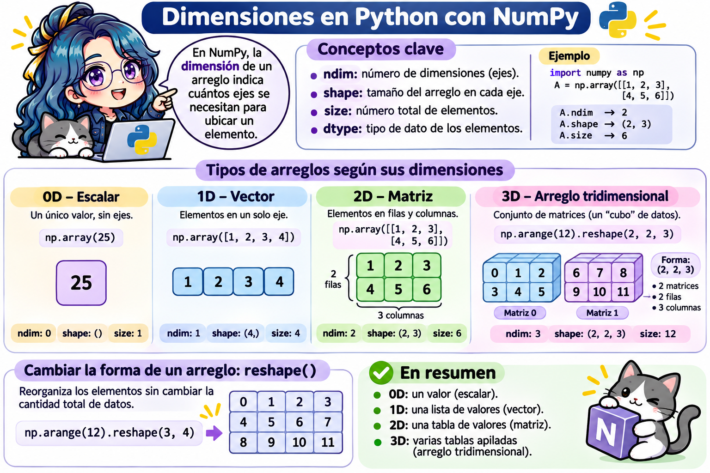
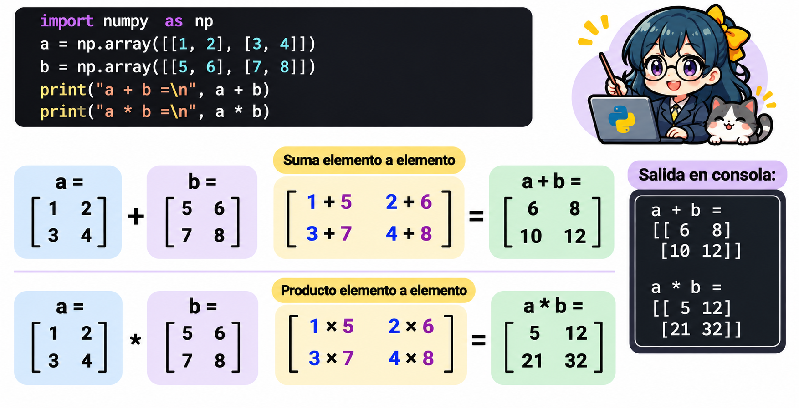
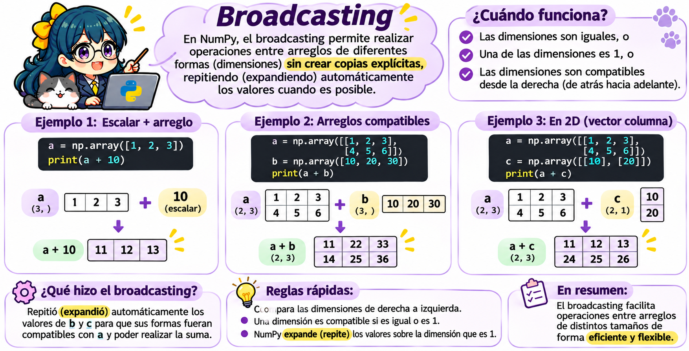
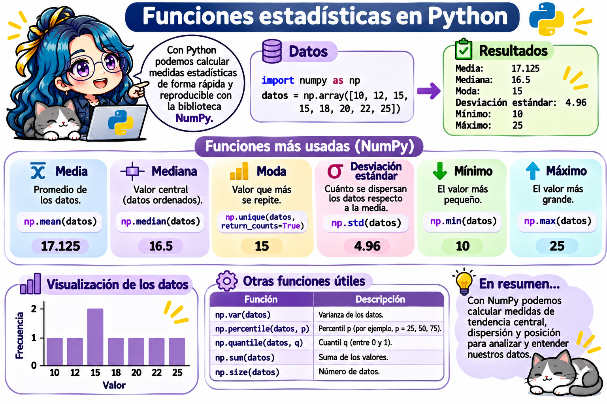
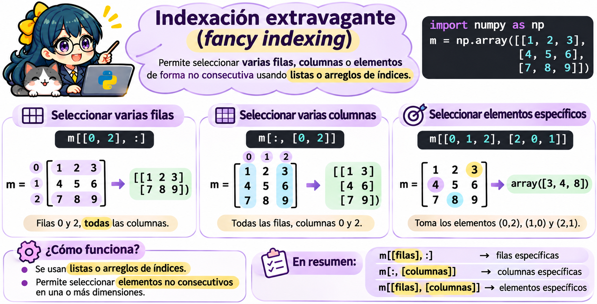
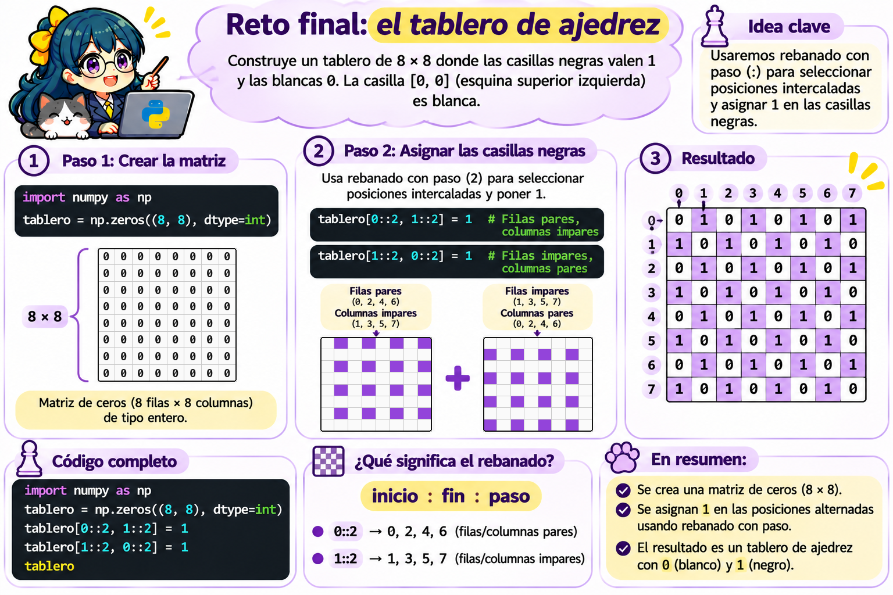

# Introducción a NumPy



```{r}
#| include: false
# Usar el entorno del curso (~/.venvs/quarto-python) si existe, aunque RStudio tenga configurado otro Python.
# Si no existe, reticulate descarga automáticamente las bibliotecas necesarias.
venv_python <- path.expand(c("~/.venvs/quarto-python/bin/python", "~/.venvs/quarto-python/Scripts/python.exe"))
venv_python <- venv_python[file.exists(venv_python)]
if (length(venv_python) > 0) {
  Sys.setenv(RETICULATE_PYTHON = venv_python[1])
} else {
  reticulate::py_require("numpy")
}
```

> **Fecha:** 05 de noviembre, 2026

[NumPy](https://numpy.org/) (*Numerical Python*) es la biblioteca base del cómputo científico en Python. Su objeto principal es el **arreglo** (`ndarray`): una colección de números del **mismo tipo**, organizada en una o más dimensiones, con la que podemos hacer operaciones matemáticas de forma rápida y con muy poco código.

En este capítulo veremos:

- Por qué usar arreglos de NumPy en lugar de listas.
- Cómo crear arreglos y conocer sus **dimensiones** con sus atributos.
- Operaciones elemento a elemento, *broadcasting*, funciones matemáticas y estadísticas.
- Cómo operar con **todo el arreglo a la vez** (vectorización).
- Indexación, rebanado, indexación extravagante y máscaras booleanas.
- Ordenamiento.

## Instalar e importar NumPy

Si trabajas en tu computadora, instala NumPy en tu entorno virtual (consulta el apéndice [Entornos para trabajar con Python](python_entornos.qmd)):

``` bash
source ~/.venvs/quarto-python/bin/activate
python -m pip install numpy
```

En Google Colab y en los editores de esta página **ya está instalado**. Por convención, NumPy se importa con el alias `np`:

```{python}
import numpy as np

print(np.__version__)
```

## Listas vs. arreglos de NumPy

Una lista y un arreglo se parecen, pero se comportan distinto con las operaciones matemáticas:

```{python}
lista = [1, 2, 3, 4]
arreglo = np.array([1, 2, 3, 4])

print("Lista * 2:  ", lista * 2)     # Repite la lista
print("Arreglo * 2:", arreglo * 2)   # Multiplica cada elemento
```

|   | Lista (`list`) | Arreglo de NumPy (`ndarray`) |
|------------------------|------------------------|------------------------|
| Tipos de elementos | Puede mezclar tipos: `[1, "a", True]`. | Todos del **mismo tipo** (`dtype`). |
| `+` | Concatena: `[1, 2] + [3, 4]` → `[1, 2, 3, 4]`. | Suma elemento a elemento: `[4, 6]`. |
| `* 2` | Repite la lista. | Multiplica cada elemento. |
| Dimensiones | Listas dentro de listas. | Atributos `ndim` y `shape`. |
| Velocidad | Más lenta para cálculos numéricos. | Mucho más rápida. |
| Ideal para | Colecciones generales. | Vectores, matrices y cálculo numérico. |

## Crear arreglos

| Función | ¿Qué crea? | Ejemplo | Resultado |
|------------------|------------------|------------------|------------------|
| `np.array()` | Un arreglo a partir de una lista. | `np.array([1, 2, 3])` | `[1 2 3]` |
| `np.arange()` | Una secuencia, como `range()`. | `np.arange(0, 10, 2)` | `[0 2 4 6 8]` |
| `np.linspace()` | `n` valores igualmente espaciados, **incluyendo** el final. | `np.linspace(0, 1, 5)` | `[0. 0.25 0.5 0.75 1.]` |
| `np.zeros()` | Un arreglo lleno de ceros. | `np.zeros((2, 3))` | Matriz 2 × 3 de ceros. |
| `np.ones()` | Un arreglo lleno de unos. | `np.ones(4)` | `[1. 1. 1. 1.]` |
| `np.full()` | Un arreglo lleno de un valor. | `np.full((2, 2), 7)` | Matriz 2 × 2 de sietes. |
| `np.eye()` | La matriz identidad. | `np.eye(3)` | Identidad 3 × 3. |

```{python}
print(np.arange(1, 11))
print(np.linspace(0, 1, 5))
print(np.zeros((2, 3)))
print(np.eye(3))
```

**Números aleatorios:** se generan con un *generador*. Fijar una **semilla** (*seed*) permite obtener siempre los mismos números, lo que hace reproducible un análisis:

```{python}
rng = np.random.default_rng(seed=2026)

print(rng.integers(0, 21, size=10))   # 10 enteros entre 0 y 20
print(rng.random(3))                  # 3 decimales entre 0 y 1
```

## Dimensiones de un arreglo

En NumPy, la **dimensión** de un arreglo indica cuántos **ejes** se necesitan para ubicar un elemento.

{fig-align="center"}

Los atributos de un arreglo (que ya vimos en la [🐍 Actividad 2](python_ejercicio2.qmd)) describen su estructura:

| Atributo | ¿Qué contiene?                  |
|----------|---------------------------------|
| `ndim`   | Número de dimensiones (ejes).   |
| `shape`  | Tamaño del arreglo en cada eje. |
| `size`   | Número total de elementos.      |
| `dtype`  | Tipo de dato de los elementos.  |

```{python}
escalar = np.array(25)
vector = np.array([1, 2, 3, 4])
matriz = np.array([[1, 2, 3],
                   [4, 5, 6]])
cubo = np.arange(12).reshape(2, 2, 3)

print("0D ndim:", escalar.ndim, " shape:", escalar.shape, " size:", escalar.size)
print("1D ndim:", vector.ndim, " shape:", vector.shape, " size:", vector.size)
print("2D ndim:", matriz.ndim, " shape:", matriz.shape, " size:", matriz.size)
print("3D ndim:", cubo.ndim, " shape:", cubo.shape, " size:", cubo.size)
```

```{python}
print(matriz.dtype)
print(np.array([1.5, 2, 3]).dtype)   # Basta un decimal para que todo sea float
```

### Cambiar la forma: `reshape()`

El método `reshape()` reorganiza los elementos **sin cambiar la cantidad total** de datos. El producto de la nueva forma debe ser igual a `size`:

```{python}
a = np.arange(12)
print(a.reshape(3, 4))
print(a.reshape(4, 3))
```

```{python}
a.reshape(5, 3)   # 5 × 3 = 15 ≠ 12: ValueError
```

## Operaciones con arreglos

En esta sección veremos la **aritmética** entre arreglos, el ***broadcasting*** (operar arreglos de formas distintas), las **funciones matemáticas** y las **funciones estadísticas**.

### Operaciones aritméticas: ¿qué podemos hacer con los arreglos?

Las operaciones aritméticas se aplican **elemento a elemento**:

```{python}
a = np.array([[1, 2], [3, 4]])
b = np.array([[5, 6], [7, 8]])

print("a + b =\n", a + b)
print("a * b =\n", a * b)     # Producto elemento a elemento (NO es el producto de matrices)
print("a ** 2 =\n", a ** 2)
```

{fig-align="center"}

**Reglas principales** de las operaciones con arreglos:

1.  **Se opera posición por posición:** el elemento `[i, j]` del resultado se calcula con los elementos `[i, j]` de cada arreglo.
2.  **Los arreglos deben tener la misma forma** (`shape`). Si no coinciden, NumPy da un `ValueError` (salvo los casos de *broadcasting* que veremos a continuación).
3.  **Un escalar se aplica a cada elemento:** `a + 10` suma 10 a todos los elementos.
4.  **El resultado es un arreglo nuevo** con la misma forma; los arreglos originales no cambian.
5.  **El tipo de dato se ajusta:** al mezclar enteros y decimales el resultado es `float`, y la división `/` siempre da `float`.
6.  **`*` no es el producto de matrices:** multiplica elemento a elemento. El producto de matrices (`@`) lo veremos en el capítulo de [Álgebra lineal con NumPy](python_algebra_lineal.qmd).

Todos los operadores aritméticos de Python funcionan elemento a elemento. Por ejemplo, con `x = np.array([7, 8])` y `y = np.array([2, 3])`:

| Operador | Operación        | Ejemplo  | Resultado          |
|----------|------------------|----------|--------------------|
| `+`      | Suma             | `x + y`  | `[ 9 11]`          |
| `-`      | Resta            | `x - y`  | `[5 5]`            |
| `*`      | Producto         | `x * y`  | `[14 24]`          |
| `/`      | División         | `x / y`  | `[3.5 2.66666667]` |
| `//`     | División entera  | `x // y` | `[3 2]`            |
| `%`      | Residuo (módulo) | `x % y`  | `[1 2]`            |
| `**`     | Potencia         | `x ** y` | `[ 49 512]`        |

```{python}
print("a + 10 =\n", a + 10)       # Regla 3: el escalar se suma a cada elemento
print("a / b =\n", a / b)         # Regla 5: la división da float
print("a sigue igual:\n", a)      # Regla 4: el original no cambia
```

```{python}
c = np.array([1, 2, 3])
a + c   # Regla 2: forma (2, 2) y (3,) no coinciden -> ValueError
```

### *Broadcasting*

El *broadcasting* permite operar arreglos de **formas distintas**. NumPy "estira" el arreglo más pequeño para que coincida con el más grande, siguiendo tres reglas:

1.  Si los arreglos tienen distinto número de dimensiones, se agrega una dimensión de tamaño 1 **a la izquierda** de la forma del más pequeño.
2.  Los ejes de tamaño 1 se estiran para coincidir con el otro arreglo.
3.  Si en algún eje los tamaños son distintos y ninguno es 1, se produce un error.

{fig-align="center"}

```{python}
a = np.array([[1, 2, 3],
              [4, 5, 6]])     # forma (2, 3)

print(a + 10)                  # Un escalar se suma a cada elemento

b = np.array([10, 20, 30])    # forma (3,) -> (1, 3) -> (2, 3)
print(a + b)                   # b se suma a cada fila

c = np.array([[10], [20]])    # forma (2, 1) -> (2, 3)
print(a + c)                   # c se suma a cada columna
```

Una columna por una fila genera una **tabla** completa, por ejemplo la tabla de multiplicar sin ciclos:

```{python}
columna = np.arange(1, 6).reshape(5, 1)   # forma (5, 1)
fila = np.arange(1, 6)                     # forma (5,)

print(columna * fila)                      # forma (5, 5)
```

### Funciones matemáticas

Las funciones matemáticas de NumPy (se llaman *funciones universales* o *ufuncs*) se aplican a cada elemento. Si $f$ es la función, `np.f(x)` regresa el arreglo $[f(x_0), f(x_1), \dots, f(x_{n-1})]$ con la **misma forma** que `x`. También aceptan listas o un solo número.

| Función | Notación matemática | Ejemplo | Resultado |
|------------------------|------------------------|------------------------|------------------------|
| `np.sqrt(x)` | $\sqrt{x}$ | `np.sqrt([1, 4, 9])` | `[1. 2. 3.]` |
| `np.exp(x)` | $e^{x}$ | `np.exp([0, 1])` | `[1. 2.71828183]` |
| `np.log(x)` | $\ln x$ (logaritmo natural) | `np.log([1, np.e])` | `[0. 1.]` |
| `np.log10(x)` | $\log_{10} x$ | `np.log10([10, 1000])` | `[1. 3.]` |
| `np.abs(x)` | $\lvert x \rvert$ | `np.abs([-3, 2])` | `[3 2]` |
| `np.sin(x)`, `np.cos(x)`, `np.tan(x)` | $\sin x$, $\cos x$, $\tan x$ (en **radianes**) | `np.cos([0, np.pi])` | `[ 1. -1.]` |
| `np.deg2rad(x)` | Grados → radianes | `np.deg2rad([90, 180])` | `[1.57079633 3.14159265]` |
| `np.floor(x)`, `np.ceil(x)` | $\lfloor x \rfloor$, $\lceil x \rceil$ | `np.floor([2.7, -2.7])` | `[ 2. -3.]` |

NumPy también trae las **constantes** `np.pi` ($\pi$) y `np.e` ($e$).

En el siguiente ejemplo, `x = np.array([0, np.pi / 2, np.pi])` crea un arreglo con **tres ángulos en radianes**: $0$, $\frac{\pi}{2}$ y $\pi$ (es decir, 0°, 90° y 180°). Al aplicar `np.sin(x)` obtenemos el seno de cada ángulo, como en la tabla:

| `x` (radianes) | Grados | $\sin(x)$ esperado |
|----------------|--------|--------------------|
| $0$            | 0°     | $0$                |
| $\pi/2$        | 90°    | $1$                |
| $\pi$          | 180°   | $0$                |

```{python}
x = np.array([0, np.pi / 2, np.pi])   # Tres ángulos: 0, π/2 y π
print(x)

print(np.sin(x))              # sin(π) da 1.2e-16 en lugar de 0
print(np.sin(x).round(3))     # .round(3) redondea a 3 decimales
print(np.sqrt([1, 4, 9, 16]))
print(np.exp([0, 1, 2]).round(3))
```

El resultado `1.2246468e-16` está en **notación científica**: `e-16` significa "por $10^{-16}$", es decir, $1.2246468 \times 10^{-16} = 0.00000000000000012246468$, un número muy cercano a cero. De la misma forma, `3e5` es $3 \times 10^{5} = 300000$.

¿Por qué $\sin(\pi)$ no da exactamente `0`? Porque `np.pi` es una **aproximación** de $\pi$ con 16 dígitos, y la computadora guarda los decimales con precisión limitada:

| Valor        | Dígitos                       |
|--------------|-------------------------------|
| `np.pi`      | `3.141592653589793`           |
| $\pi$ real   | `3.14159265358979323846...`   |

Los 16 dígitos de `np.pi` coinciden con $\pi$, pero el $\pi$ real **continúa** (`...23846...`) sin terminar nunca. Esa diferencia, de aproximadamente $1.2 \times 10^{-16}$, es justo el `1.2e-16` que obtuvimos en $\sin(\pi)$. Por eso usamos `.round()` para mostrar resultados más legibles.

```{python}
print(np.pi)
```

Si un valor está **fuera del dominio** de la función, NumPy no se detiene con un error: muestra una advertencia (`RuntimeWarning`) y regresa un valor especial:

```{python}
print(np.sqrt([-1, 4]))   # nan: "not a number", √-1 no es real
print(np.log([0, 1]))     # -inf: ln(x) → -∞ cuando x → 0
```

### Funciones estadísticas

Resumen un arreglo en uno o varios números:

| Función                      | ¿Qué calcula?                         |
|------------------------------|---------------------------------------|
| `np.sum()`                   | Suma de los elementos.                |
| `np.mean()`                  | Media.                                |
| `np.median()`                | Mediana.                              |
| `np.std()`                   | Desviación estándar.                  |
| `np.min()`, `np.max()`       | Mínimo y máximo.                      |
| `np.argmin()`, `np.argmax()` | **Posición** del mínimo y del máximo. |

{fig-align="center"}

```{python}
datos = np.array([12, 7, 3, 7, 25, 12, 7, 9, 18])

print("Suma:", np.sum(datos))
print("Media:", np.mean(datos).round(2))
print("Mediana:", np.median(datos))
print("Desviación estándar:", np.std(datos).round(2))
print("Posición del máximo:", np.argmax(datos))
```

Muchas de estas funciones también existen como **métodos**: `datos.sum()`, `datos.mean()`, `datos.max()`.

#### El argumento `axis`

{fig-align="center"}

En una matriz, `axis=0` opera **por columnas** (hacia abajo) y `axis=1` **por filas** (hacia la derecha):

```{python}
m = np.array([[1, 2, 3],
              [4, 5, 6]])

print("Suma total:", m.sum())
print("Suma por columnas (axis=0):", m.sum(axis=0))
print("Suma por filas (axis=1):", m.sum(axis=1))
```

## Vectorización: operar con todo el arreglo a la vez

Con NumPy podemos operar sobre **todo el arreglo a la vez**, sin recorrer los elementos uno por uno. A esto se le llama **vectorización**:

```{python}
print("Suma de 1 a 100:", np.arange(1, 101).sum())
print("10! =", np.arange(1, 11).prod())
print("Cuadrados del 1 al 5:", np.arange(1, 6) ** 2)
```

Veamos paso a paso cómo se calcula el **factorial** $10! = 1 \cdot 2 \cdot 3 \cdots 10$:

1.  `np.arange(1, 11)` crea el arreglo `[1 2 3 4 5 6 7 8 9 10]`. Como en `range()`, el final (`11`) **no se incluye**; por eso escribimos `11` para llegar hasta `10`.
2.  `.prod()` **multiplica todos los elementos** del arreglo, así como `.sum()` los suma: $\prod_{k=1}^{10} k$.

```{python}
numeros = np.arange(1, 11)
print("Arreglo:", numeros)
print("Producto:", numeros.prod())   # 1 · 2 · 3 · ... · 10 = 3628800
```

::: callout-warning
Los enteros de NumPy tienen un **límite** (`int64` guarda números hasta $\approx 9.2 \times 10^{18}$). Desde $21!$ el resultado ya no cabe y NumPy da un número **incorrecto, sin avisar**:

```{python}
print("21! con NumPy:", np.arange(1, 22).prod())   # ¡Negativo!
```

Para factoriales grandes usa `math.factorial(21)` del módulo `math`, que trabaja con enteros de Python sin límite de tamaño.
:::

Además de ser corto, el código vectorizado es **muy rápido**, porque NumPy hace los cálculos internamente en el lenguaje C. En el capítulo de [ciclos `for`](python_for.qmd) compararemos la velocidad de un ciclo con la de NumPy.

## Indexación y rebanado

### Arreglos de una dimensión

Funcionan igual que las listas:

```{python}
a = np.array([10, 20, 30, 40, 50])

print(a[0], a[-1])   # Primer y último elemento
print(a[1:4])        # Del índice 1 al 3
print(a[::2])        # De 2 en 2
```

### Arreglos de dos o más dimensiones

Se escribe **un índice por eje**, separados por comas: `m[fila, columna]`.

![Indexación de un arreglo de dos dimensiones: `m[fila, columna]`.](figures/python_numpy_indexacion2d.png){fig-align="center"}

```{python}
m = np.array([[1, 2, 3],
              [4, 5, 6],
              [7, 8, 9]])

print(m[1, 2])       # Fila 1, columna 2 -> 6
print(m[0])          # Fila 0 completa
print(m[:, 1])       # Columna 1 completa
print(m[1:3, 1:3])   # Submatriz: filas 1-2, columnas 1-2
```

El símbolo `:` solo significa "**todos** los elementos de ese eje".

### Indexación extravagante (*fancy indexing*)

Podemos pasar una **lista de índices** para obtener varios elementos a la vez, incluso repetidos:

{fig-align="center"}

```{python}
a = np.arange(0, 100, 10)
print(a)
print(a[[2, 3, 2, 4, 2]])

m = np.array([[1, 2, 3], [4, 5, 6], [7, 8, 9]])
print(m[[0, 2], :])                # Filas 0 y 2, todas las columnas
print(m[:, [0, 2]])                # Todas las filas, columnas 0 y 2
print(m[[0, 1, 2], [2, 0, 1]])     # Elementos (0, 2), (1, 0) y (2, 1) -> [3 4 8]
```

También sirve para **asignar** valores:

```{python}
a[[7, 9]] = -100
print(a)
```

### Máscaras booleanas

Una **comparación** con un arreglo produce un arreglo de `True` y `False` (una **máscara**). Al usarla como índice, obtenemos solo los elementos donde la máscara es `True`; así podemos **filtrar** datos en una sola línea. Usamos los mismos operadores de comparación del capítulo de [condicionales](python_condicionales.qmd) (`==`, `!=`, `>`, `<`, `>=`, `<=`), pero ahora la pregunta se hace a **cada elemento** del arreglo:

```{python}
a = np.array([3, 13, 12, 10, 18, 6, 4, 8, 5])

mascara = a % 3 == 0
print(mascara)
print(a[mascara])        # Solo los múltiplos de 3
print(a[a > 10])         # Directamente, sin guardar la máscara
```

Para combinar condiciones se usan `&` (y), `|` (o) y `~` (no), con **paréntesis** en cada condición:

```{python}
print(a[(a > 5) & (a < 13)])    # Entre 5 y 13
print(a[(a < 5) | (a > 15)])    # Menores que 5 o mayores que 15
```

::: callout-important
En los condicionales combinamos condiciones con `and`, `or` y `not`, pero **con arreglos de NumPy** se usan `&`, `|` y `~`. Si escribes `a > 5 and a < 13` obtendrás un `ValueError`.
:::

Las máscaras también sirven para **modificar** solo algunos elementos:

```{python}
a[a % 3 == 0] = -1
print(a)
```

La función `np.where(condicion, valor_si_verdadero, valor_si_falso)` funciona como un `if`/`else` aplicado a **cada elemento** del arreglo, sin escribir un condicional:

```{python}
calificaciones = np.array([9.5, 5, 7, 4.5, 10])
print(np.where(calificaciones >= 6, "Aprobado", "Reprobado"))
```

## Ordenamiento

Igual que con las listas (`sorted()` vs. `sort()`), en NumPy hay dos formas de ordenar:

| Forma           | ¿Qué hace?                                     |
|-----------------|------------------------------------------------|
| `np.sort(a)`    | Regresa una **copia** ordenada; `a` no cambia. |
| `a.sort()`      | Ordena `a` **en su lugar** (*in-place*).       |
| `np.argsort(a)` | Regresa los **índices** que ordenarían a `a`.  |

```{python}
a = np.array([9, 2, 6, 1, 7])

print(np.sort(a))           # Copia ordenada
print(a)                    # Sin cambios
print(np.argsort(a))        # Posiciones del menor al mayor
print(np.sort(a)[::-1])     # De mayor a menor
```

En una matriz, `np.sort()` ordena **cada fila** por defecto; con `axis=0` ordena **cada columna**:

```{python}
m = np.array([[14, 12, 4],
              [5, 6, 14],
              [14, 13, 8]])

print(np.sort(m))
print(np.sort(m, axis=0))
```

## Ejercicios

Resuelve los ejercicios en los editores interactivos. Recuerda que lo que escribas **no se guarda** al recargar la página. La primera vez que ejecutes un editor, NumPy puede tardar unos segundos en cargar.

### Ejercicio 1. Crear arreglos

1.  Crea un arreglo con los números del 1 al 10 usando `np.arange()`.
2.  Crea una matriz de 3 × 3 con todos sus elementos iguales a 5 usando `np.full()`.
3.  Calcula la suma de todos los elementos de `matriz` y déjala en la **última línea**.

```{pyodide}
#| exercise: np1
import numpy as np

numeros = ______
print(numeros)

cincos = ______
print(cincos)

# Opción 1: declarar los valores directamente
matriz = np.array([[1, 2, 3],
                   [4, 5, 6],
                   [7, 8, 9]])

# Opción 2: generar los valores y reorganizarlos
matriz = np.arange(1, 10).reshape(3, 3)

print(matriz)
______   # Suma de los elementos de matriz
```

```{pyodide}
#| exercise: np1
#| check: true
if result == 45:
    feedback = {"correct": True, "message": "¡Correcto! La suma de los elementos de la matriz es 45."}
else:
    feedback = {"correct": False, "message": "La última línea debe regresar la suma de todos los elementos de matriz (45)."}
feedback
```

:::: {.hint exercise="np1"}
::: {.callout-note collapse="false"}
## Pista

`np.arange(1, 11)` y `np.full((3, 3), 5)`. Para la suma hay tres opciones: `matriz.sum()`, `np.sum(matriz)` o `sum(matriz).sum()`.
:::
::::

:::: {.solution exercise="np1"}
::: {.callout-tip collapse="false"}
## Solución

``` python
import numpy as np

numeros = np.arange(1, 11)
print(numeros)

cincos = np.full((3, 3), 5)
print(cincos)

# Opción 1: declarar los valores directamente
matriz = np.array([[1, 2, 3],
                   [4, 5, 6],
                   [7, 8, 9]])

# Opción 2: generar los valores y reorganizarlos
matriz = np.arange(1, 10).reshape(3, 3)

print(matriz)

# Tres formas de sumar todos los elementos
print("Opción 1:", matriz.sum())          # Método del arreglo
print("Opción 2:", np.sum(matriz))        # Función de NumPy
print("Opción 3:", sum(matriz).sum())     # sum() de Python + método .sum()
matriz.sum()   # 45
```

Las dos opciones crean **la misma matriz**: la primera escribe los valores a mano y la segunda genera `[1 2 ... 9]` con `np.arange(1, 10)` y los acomoda en 3 × 3 con `reshape()`.

En la opción 3, `sum(matriz)` es la función `sum()` de Python: recorre la matriz **fila por fila** y suma las filas, así que da la suma por columnas `[12 15 18]`. Después, `.sum()` suma esos tres números: $12 + 15 + 18 = 45$.
:::
::::

### Ejercicio 2. Dimensiones

1.  Antes de ejecutar, predice `ndim`, `shape` y `size` de `a`, `b` y `c`. Después ejecuta para comprobarlo.
2.  Crea un arreglo `d` de 3 dimensiones con los números del 0 al 23, con forma `(2, 3, 4)`, y déjalo en la **última línea**.

```{pyodide}
#| exercise: np2
import numpy as np

a = np.array([7, 8, 9])
b = np.array([[1, 2], [3, 4], [5, 6]])
c = np.zeros((4, 2, 5))

print("a:", a.ndim, a.shape, a.size)
print("b:", b.ndim, b.shape, b.size)
print("c:", c.ndim, c.shape, c.size)

d = ______
d
```

```{pyodide}
#| exercise: np2
#| check: true
import numpy as np
if not isinstance(result, np.ndarray):
    feedback = {"correct": False, "message": "La última línea debe regresar el arreglo d."}
elif result.shape == (2, 3, 4) and result.ravel().tolist() == list(range(24)):
    feedback = {"correct": True, "message": "¡Correcto! d tiene 2 matrices de 3 filas y 4 columnas: 2 × 3 × 4 = 24 elementos."}
elif result.size == 24:
    feedback = {"correct": False, "message": "Tiene 24 elementos, pero su forma es " + str(result.shape) + ". Debe ser (2, 3, 4)."}
else:
    feedback = {"correct": False, "message": "Usa np.arange(24) y reshape() para obtener la forma (2, 3, 4)."}
feedback
```

:::: {.hint exercise="np2"}
::: {.callout-note collapse="false"}
## Pista

`np.arange(24)` genera los números del 0 al 23 y `.reshape(2, 3, 4)` les da la forma.
:::
::::

:::: {.solution exercise="np2"}
::: {.callout-tip collapse="false"}
## Solución

``` python
import numpy as np

a = np.array([7, 8, 9])                  # ndim 1, shape (3,), size 3
b = np.array([[1, 2], [3, 4], [5, 6]])   # ndim 2, shape (3, 2), size 6
c = np.zeros((4, 2, 5))                  # ndim 3, shape (4, 2, 5), size 40

print("a:", a.ndim, a.shape, a.size)
print("b:", b.ndim, b.shape, b.size)
print("c:", c.ndim, c.shape, c.size)

d = np.arange(24).reshape(2, 3, 4)
d
```
:::
::::

### Ejercicio 3. Estadística con NumPy

En el reto de la [🐍 Actividad 2](python_ejercicio2.qmd) calculamos la media y la mediana de `datos` con funciones integradas. Ahora hazlo con NumPy:

1.  Calcula la **media**, la **mediana** y la **desviación estándar**, redondeadas a 2 decimales.
2.  Obtén la **posición** del dato más grande con `np.argmax()`.
3.  Guarda los resultados en el diccionario `resumen` y déjalo en la **última línea**.

```{pyodide}
#| exercise: np3
import numpy as np

datos = np.array([12, 7, 3, 7, 25, 12, 7, 9, 18])

media = ______
mediana = ______
desviacion = ______
posicion_maximo = ______

resumen = {"media": media, "mediana": mediana, "desviacion": desviacion, "posicion_maximo": posicion_maximo}
resumen
```

```{pyodide}
#| exercise: np3
#| check: true
esperado = {"media": 11.11, "mediana": 9.0, "desviacion": 6.35, "posicion_maximo": 4}
if not isinstance(result, dict):
    feedback = {"correct": False, "message": "La última línea debe regresar el diccionario resumen."}
else:
    incorrectos = []
    for clave in esperado:
        if clave not in result or abs(float(result[clave]) - esperado[clave]) > 1e-9:
            incorrectos.append(clave)
    if not incorrectos:
        feedback = {"correct": True, "message": "¡Correcto! Media 11.11, mediana 9.0, desviación 6.35 y el máximo (25) está en la posición 4."}
    else:
        feedback = {"correct": False, "message": "Revisa: " + ", ".join(incorrectos) + ". Recuerda redondear a 2 decimales."}
feedback
```

:::: {.hint exercise="np3"}
::: {.callout-note collapse="false"}
## Pista

Usa `np.mean(datos)`, `np.median(datos)` y `np.std(datos)`, y redondea con `.round(2)` o con `round(..., 2)`. La posición del máximo es `np.argmax(datos)`.
:::
::::

:::: {.solution exercise="np3"}
::: {.callout-tip collapse="false"}
## Solución

``` python
import numpy as np

datos = np.array([12, 7, 3, 7, 25, 12, 7, 9, 18])

media = np.mean(datos).round(2)          # 11.11
mediana = np.median(datos)               # 9.0
desviacion = np.std(datos).round(2)      # 6.35
posicion_maximo = np.argmax(datos)       # 4

resumen = {"media": media, "mediana": mediana, "desviacion": desviacion, "posicion_maximo": posicion_maximo}
resumen
```

Compara con la Actividad 2: para la mediana ya no necesitamos ordenar la lista ni calcular el índice central, `np.median()` lo hace por nosotros.
:::
::::

### Ejercicio 4. Máscaras booleanas

A partir de la matriz `a`:

1.  Muestra la máscara de los elementos **mayores que 4**.
2.  Obtén con esa máscara el arreglo `[5, 6, 7, 8, 9, 10, 11]` y déjalo en la **última línea**.
3.  **Extra:** obtén los elementos pares **o** múltiplos de 5 combinando dos condiciones con `|`.

```{pyodide}
#| exercise: np4
import numpy as np

a = np.arange(12).reshape(4, 3)
print(a)

mascara = ______
print(mascara)

______   # Elementos mayores que 4
```

```{pyodide}
#| exercise: np4
#| check: true
import numpy as np
if isinstance(result, np.ndarray) and result.tolist() == [5, 6, 7, 8, 9, 10, 11]:
    feedback = {"correct": True, "message": "¡Correcto! Observa que el resultado tiene una sola dimensión, aunque a era una matriz."}
else:
    feedback = {"correct": False, "message": "La última línea debe regresar a[mascara], con los elementos [5, 6, 7, 8, 9, 10, 11]."}
feedback
```

:::: {.hint exercise="np4"}
::: {.callout-note collapse="false"}
## Pista

`mascara = a > 4` y después `a[mascara]`. Para el extra: `a[(a % 2 == 0) | (a % 5 == 0)]`, con paréntesis en cada condición.
:::
::::

:::: {.solution exercise="np4"}
::: {.callout-tip collapse="false"}
## Solución

``` python
import numpy as np

a = np.arange(12).reshape(4, 3)
print(a)

mascara = a > 4
print(mascara)

print(a[(a % 2 == 0) | (a % 5 == 0)])   # Extra: [ 0  2  4  5  6  8 10]

a[mascara]   # [ 5  6  7  8  9 10 11]
```
:::
::::

### Ejercicio 5. Mensajes ocultos con indexación extravagante

La matriz `letras` contiene el abecedario y algunos dígitos. Usa **indexación extravagante** (una lista de filas y una lista de columnas) para formar:

1.  Las letras `O`, `M`, `G`, en ese orden. Déjalas en la **última línea**.
2.  **Extra:** las letras `W`, `O`, `Z`.

```{pyodide}
#| exercise: np5
import numpy as np

letras = np.array(list("ABCDEFGHIJKLMNOPQRSTUVWXYZ1234")).reshape(5, 6)
print(letras)

______   # O, M, G
```

```{pyodide}
#| exercise: np5
#| check: true
import numpy as np
if isinstance(result, np.ndarray) and result.tolist() == ["O", "M", "G"]:
    feedback = {"correct": True, "message": "¡Correcto! O está en (2, 2), M en (2, 0) y G en (1, 0)."}
else:
    feedback = {"correct": False, "message": "Debes obtener el arreglo ['O', 'M', 'G']. Escribe letras[[filas], [columnas]]."}
feedback
```

:::: {.hint exercise="np5"}
::: {.callout-note collapse="false"}
## Pista

Primero ubica la fila y la columna de cada letra en la matriz impresa (recuerda que empiezan en 0). Después escribe `letras[[fila_O, fila_M, fila_G], [col_O, col_M, col_G]]`.
:::
::::

:::: {.solution exercise="np5"}
::: {.callout-tip collapse="false"}
## Solución

``` python
import numpy as np

letras = np.array(list("ABCDEFGHIJKLMNOPQRSTUVWXYZ1234")).reshape(5, 6)
print(letras)

print(letras[[3, 2, 4], [4, 2, 1]])   # Extra: ['W' 'O' 'Z']

letras[[2, 2, 1], [2, 0, 0]]          # ['O' 'M' 'G']
```
:::
::::

## Reto final: el tablero de ajedrez

Construye un tablero de ajedrez de 8 × 8 donde las casillas negras valen `1` y las blancas `0`. La casilla de la esquina superior izquierda (`[0, 0]`) es blanca.

1.  Crea una matriz de ceros de 8 × 8 de tipo entero.
2.  Usa **rebanado con paso** para poner un `1` en las casillas negras: en las filas pares, las columnas impares; en las filas impares, las columnas pares.
3.  Deja el tablero en la **última línea**.

```{pyodide}
#| exercise: reto_np
import numpy as np

tablero = np.zeros((8, 8), dtype=int)

tablero[______] = 1   # Filas pares, columnas impares
tablero[______] = 1   # Filas impares, columnas pares

print(tablero)
print("Casillas negras:", tablero.sum())
tablero
```

```{pyodide}
#| exercise: reto_np
#| check: true
import numpy as np
esperado = (np.indices((8, 8)).sum(axis=0) % 2)
if isinstance(result, np.ndarray) and result.shape == (8, 8) and np.array_equal(result, esperado):
    feedback = {"correct": True, "message": "¡Excelente! El tablero tiene 32 casillas negras. ¿Puedes construirlo en una sola línea con np.indices() o con broadcasting?"}
elif isinstance(result, np.ndarray) and result.shape == (8, 8) and np.array_equal(result, 1 - esperado):
    feedback = {"correct": False, "message": "Casi: tu tablero tiene los colores invertidos. La casilla [0, 0] debe ser 0."}
else:
    feedback = {"correct": False, "message": "Revisa los rebanados: tablero[inicio_filas::2, inicio_columnas::2]."}
feedback
```

:::: {.hint exercise="reto_np"}
::: {.callout-note collapse="false"}
## Pista

`tablero[0::2, 1::2]` selecciona las filas 0, 2, 4, 6 y las columnas 1, 3, 5, 7. ¿Qué rebanado selecciona las filas impares y las columnas pares?
:::
::::

:::: {.solution exercise="reto_np"}
::: {.callout-tip collapse="false"}
## Solución

``` python
import numpy as np

tablero = np.zeros((8, 8), dtype=int)

tablero[0::2, 1::2] = 1   # Filas pares, columnas impares
tablero[1::2, 0::2] = 1   # Filas impares, columnas pares

print(tablero)
print("Casillas negras:", tablero.sum())   # 32
tablero
```

{fig-align="center"}

Con *broadcasting* también se puede hacer en una línea: una casilla es negra si la suma de su fila y su columna es impar.

``` python
filas = np.arange(8).reshape(8, 1)
columnas = np.arange(8)
tablero = (filas + columnas) % 2
```
:::
::::

## Resumen

| Tema | Idea clave |
|------------------------------------|------------------------------------|
| `ndarray` | Arreglo de elementos del mismo tipo, con una o más dimensiones. |
| Crear arreglos | `np.array`, `np.arange`, `np.linspace`, `np.zeros`, `np.ones`, `np.full`, `np.eye`. |
| Atributos | `ndim` (ejes), `shape` (tamaño por eje), `size` (total), `dtype` (tipo). |
| `reshape()` | Cambia la forma sin cambiar el número de elementos. |
| Operaciones | Elemento a elemento: `+`, `-`, `*`, `/`, `**`, `np.sqrt()`, `np.sin()`... |
| *Broadcasting* | Operar arreglos de formas distintas pero compatibles. |
| Estadística | `sum`, `mean`, `median`, `std`, `min`, `max`, `argmax`; `axis=0` columnas, `axis=1` filas. |
| Vectorización | Operar todo el arreglo a la vez, sin recorrer elemento por elemento. |
| Indexación | `m[fila, columna]`, rebanado `m[1:3, ::2]`, extravagante `a[[1, 3]]`, máscaras `a[a > 5]`. |
| Ordenamiento | `np.sort(a)` (copia), `a.sort()` (en su lugar), `np.argsort(a)` (índices). |

## Referencias

- [Sección 4.7 NumPy, Cómputo Científico (Haydeé Peruyero)](https://haydeeperuyero.github.io/Computo_Cientifico/python.html#numpy)
- [NumPy: guía para principiantes absolutos](https://numpy.org/doc/stable/user/absolute_beginners.html)
- [NumPy: indexación de arreglos](https://numpy.org/doc/stable/user/basics.indexing.html)
- [NumPy: broadcasting](https://numpy.org/doc/stable/user/basics.broadcasting.html)
- [Scientific Python Lectures: NumPy](https://lectures.scientific-python.org/intro/numpy/index.html)
