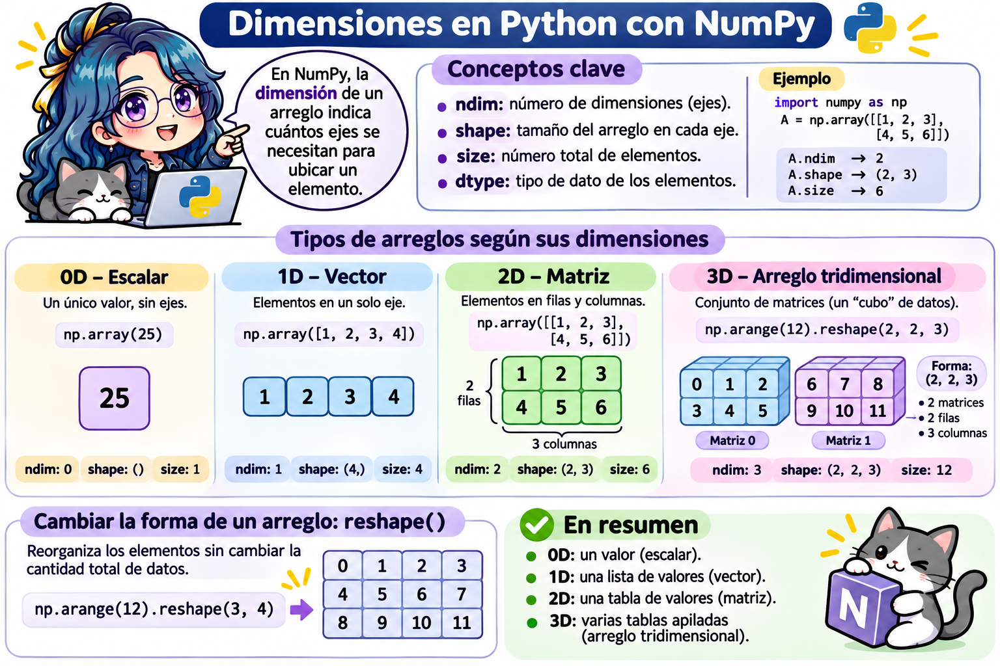

# Introducción a NumPy



```{r}
#| include: false
# Usar el entorno del curso (~/.venvs/quarto-python) si existe, aunque RStudio tenga configurado otro Python.
# Si no existe, reticulate descarga automáticamente las bibliotecas necesarias.
venv_python <- path.expand(c("~/.venvs/quarto-python/bin/python", "~/.venvs/quarto-python/Scripts/python.exe"))
venv_python <- venv_python[file.exists(venv_python)]
if (length(venv_python) > 0) {
  Sys.setenv(RETICULATE_PYTHON = venv_python[1])
} else {
  reticulate::py_require("numpy")
}
```

> **Fecha:** 03 de noviembre, 2026

[NumPy](https://numpy.org/) (*Numerical Python*) es la biblioteca base del cómputo científico en Python. Su objeto principal es el **arreglo** (`ndarray`): una colección de números del **mismo tipo**, organizada en una o más dimensiones, con la que podemos hacer operaciones matemáticas de forma rápida y con muy poco código.

En este capítulo veremos:

- Por qué usar arreglos de NumPy en lugar de listas.
- Cómo crear arreglos y conocer sus **dimensiones** con sus atributos.
- Operaciones elemento a elemento, funciones matemáticas y estadísticas.
- Cómo operar con **todo el arreglo a la vez** (vectorización).
- Indexación, rebanado, indexación extravagante y máscaras booleanas.
- Vistas y copias, ordenamiento, *broadcasting* y álgebra lineal.

## Instalar e importar NumPy

Si trabajas en tu computadora, instala NumPy en tu entorno virtual (consulta el apéndice [Entornos para trabajar con Python](python_entornos.qmd)):

``` bash
source ~/.venvs/quarto-python/bin/activate
python -m pip install numpy
```

En Google Colab y en los editores de esta página **ya está instalado**. Por convención, NumPy se importa con el alias `np`:

```{python}
import numpy as np

print(np.__version__)
```

## Listas vs. arreglos de NumPy

Una lista y un arreglo se parecen, pero se comportan distinto con las operaciones matemáticas:

```{python}
lista = [1, 2, 3, 4]
arreglo = np.array([1, 2, 3, 4])

print("Lista * 2:  ", lista * 2)     # Repite la lista
print("Arreglo * 2:", arreglo * 2)   # Multiplica cada elemento
```

| | Lista (`list`) | Arreglo de NumPy (`ndarray`) |
|----|----|----|
| Tipos de elementos | Puede mezclar tipos: `[1, "a", True]`. | Todos del **mismo tipo** (`dtype`). |
| `+` | Concatena: `[1, 2] + [3, 4]` → `[1, 2, 3, 4]`. | Suma elemento a elemento: `[4, 6]`. |
| `* 2` | Repite la lista. | Multiplica cada elemento. |
| Dimensiones | Listas dentro de listas. | Atributos `ndim` y `shape`. |
| Velocidad | Más lenta para cálculos numéricos. | Mucho más rápida. |
| Ideal para | Colecciones generales. | Vectores, matrices y cálculo numérico. |

## Crear arreglos

| Función | ¿Qué crea? | Ejemplo | Resultado |
|----|----|----|----|
| `np.array()` | Un arreglo a partir de una lista. | `np.array([1, 2, 3])` | `[1 2 3]` |
| `np.arange()` | Una secuencia, como `range()`. | `np.arange(0, 10, 2)` | `[0 2 4 6 8]` |
| `np.linspace()` | `n` valores igualmente espaciados, **incluyendo** el final. | `np.linspace(0, 1, 5)` | `[0. 0.25 0.5 0.75 1.]` |
| `np.zeros()` | Un arreglo lleno de ceros. | `np.zeros((2, 3))` | Matriz 2 × 3 de ceros. |
| `np.ones()` | Un arreglo lleno de unos. | `np.ones(4)` | `[1. 1. 1. 1.]` |
| `np.full()` | Un arreglo lleno de un valor. | `np.full((2, 2), 7)` | Matriz 2 × 2 de sietes. |
| `np.eye()` | La matriz identidad. | `np.eye(3)` | Identidad 3 × 3. |

```{python}
print(np.arange(1, 11))
print(np.linspace(0, 1, 5))
print(np.zeros((2, 3)))
print(np.eye(3))
```

**Números aleatorios:** se generan con un *generador*. Fijar una **semilla** (*seed*) permite obtener siempre los mismos números, lo que hace reproducible un análisis:

```{python}
rng = np.random.default_rng(seed=2026)

print(rng.integers(0, 21, size=10))   # 10 enteros entre 0 y 20
print(rng.random(3))                  # 3 decimales entre 0 y 1
```

## Dimensiones de un arreglo

En NumPy, la **dimensión** de un arreglo indica cuántos **ejes** se necesitan para ubicar un elemento.

{fig-align="center"}

Los atributos de un arreglo (que ya vimos en la [🐍 Actividad 2](python_ejercicio2.qmd)) describen su estructura:

| Atributo | ¿Qué contiene? |
|----|----|
| `ndim` | Número de dimensiones (ejes). |
| `shape` | Tamaño del arreglo en cada eje. |
| `size` | Número total de elementos. |
| `dtype` | Tipo de dato de los elementos. |

```{python}
escalar = np.array(25)
vector = np.array([1, 2, 3, 4])
matriz = np.array([[1, 2, 3],
                   [4, 5, 6]])
cubo = np.arange(12).reshape(2, 2, 3)

print("0D ndim:", escalar.ndim, " shape:", escalar.shape, " size:", escalar.size)
print("1D ndim:", vector.ndim, " shape:", vector.shape, " size:", vector.size)
print("2D ndim:", matriz.ndim, " shape:", matriz.shape, " size:", matriz.size)
print("3D ndim:", cubo.ndim, " shape:", cubo.shape, " size:", cubo.size)
```

```{python}
print(matriz.dtype)
print(np.array([1.5, 2, 3]).dtype)   # Basta un decimal para que todo sea float
```

### Cambiar la forma: `reshape()`

El método `reshape()` reorganiza los elementos **sin cambiar la cantidad total** de datos. El producto de la nueva forma debe ser igual a `size`:

```{python}
a = np.arange(12)
print(a.reshape(3, 4))
print(a.reshape(4, 3))
```

```{python}
a.reshape(5, 3)   # 5 × 3 = 15 ≠ 12: ValueError
```

## Operaciones con arreglos

Las operaciones aritméticas se aplican **elemento a elemento**:

```{python}
a = np.array([[1, 2], [3, 4]])
b = np.array([[5, 6], [7, 8]])

print("a + b =\n", a + b)
print("a * b =\n", a * b)     # Producto elemento a elemento (NO es el producto de matrices)
print("a ** 2 =\n", a ** 2)
```

**Funciones matemáticas** (se llaman *funciones universales*): se aplican a cada elemento.

```{python}
x = np.array([0, np.pi / 2, np.pi])

print(np.sin(x).round(3))
print(np.sqrt([1, 4, 9, 16]))
print(np.exp([0, 1, 2]).round(3))
```

**Funciones estadísticas:**

| Función | ¿Qué calcula? |
|----|----|
| `np.sum()` | Suma de los elementos. |
| `np.mean()` | Media. |
| `np.median()` | Mediana. |
| `np.std()` | Desviación estándar. |
| `np.min()`, `np.max()` | Mínimo y máximo. |
| `np.argmin()`, `np.argmax()` | **Posición** del mínimo y del máximo. |

```{python}
datos = np.array([12, 7, 3, 7, 25, 12, 7, 9, 18])

print("Suma:", np.sum(datos))
print("Media:", np.mean(datos).round(2))
print("Mediana:", np.median(datos))
print("Desviación estándar:", np.std(datos).round(2))
print("Posición del máximo:", np.argmax(datos))
```

Muchas de estas funciones también existen como **métodos**: `datos.sum()`, `datos.mean()`, `datos.max()`.

### El argumento `axis`

En una matriz, `axis=0` opera **por columnas** (hacia abajo) y `axis=1` **por filas** (hacia la derecha):

```{python}
m = np.array([[1, 2, 3],
              [4, 5, 6]])

print("Suma total:", m.sum())
print("Suma por columnas (axis=0):", m.sum(axis=0))
print("Suma por filas (axis=1):", m.sum(axis=1))
```

## Vectorización: operar con todo el arreglo a la vez

Con NumPy podemos operar sobre **todo el arreglo a la vez**, sin recorrer los elementos uno por uno. A esto se le llama **vectorización**:

```{python}
print("Suma de 1 a 100:", np.arange(1, 101).sum())
print("10! =", np.arange(1, 11).prod())
print("Cuadrados del 1 al 5:", np.arange(1, 6) ** 2)
```

Además de ser corto, el código vectorizado es **muy rápido**, porque NumPy hace los cálculos internamente en el lenguaje C. En el capítulo de [ciclos `for`](python_for.qmd) compararemos la velocidad de un ciclo con la de NumPy.

## Indexación y rebanado

### Arreglos de una dimensión

Funcionan igual que las listas:

```{python}
a = np.array([10, 20, 30, 40, 50])

print(a[0], a[-1])   # Primer y último elemento
print(a[1:4])        # Del índice 1 al 3
print(a[::2])        # De 2 en 2
```

### Arreglos de dos o más dimensiones

Se escribe **un índice por eje**, separados por comas: `m[fila, columna]`.

```{python}
m = np.array([[1, 2, 3],
              [4, 5, 6],
              [7, 8, 9]])

print(m[1, 2])       # Fila 1, columna 2 -> 6
print(m[0])          # Fila 0 completa
print(m[:, 1])       # Columna 1 completa
print(m[1:3, 1:3])   # Submatriz: filas 1-2, columnas 1-2
```

El símbolo `:` solo significa "**todos** los elementos de ese eje".

### Indexación extravagante (*fancy indexing*)

Podemos pasar una **lista de índices** para obtener varios elementos a la vez, incluso repetidos:

```{python}
a = np.arange(0, 100, 10)
print(a)
print(a[[2, 3, 2, 4, 2]])

m = np.array([[1, 2, 3], [4, 5, 6], [7, 8, 9]])
print(m[[1, 2], [1, 2]])   # Elementos (1, 1) y (2, 2) -> [5 9]
```

También sirve para **asignar** valores:

```{python}
a[[7, 9]] = -100
print(a)
```

### Máscaras booleanas

Una **comparación** con un arreglo produce un arreglo de `True` y `False` (una **máscara**). Al usarla como índice, obtenemos solo los elementos donde la máscara es `True`; así podemos **filtrar** datos en una sola línea. Usamos los mismos operadores de comparación del capítulo de [condicionales](python_condicionales.qmd) (`==`, `!=`, `>`, `<`, `>=`, `<=`), pero ahora la pregunta se hace a **cada elemento** del arreglo:

```{python}
a = np.array([3, 13, 12, 10, 18, 6, 4, 8, 5])

mascara = a % 3 == 0
print(mascara)
print(a[mascara])        # Solo los múltiplos de 3
print(a[a > 10])         # Directamente, sin guardar la máscara
```

Para combinar condiciones se usan `&` (y), `|` (o) y `~` (no), con **paréntesis** en cada condición:

```{python}
print(a[(a > 5) & (a < 13)])    # Entre 5 y 13
print(a[(a < 5) | (a > 15)])    # Menores que 5 o mayores que 15
```

::: callout-important
En los condicionales combinamos condiciones con `and`, `or` y `not`, pero **con arreglos de NumPy** se usan `&`, `|` y `~`. Si escribes `a > 5 and a < 13` obtendrás un `ValueError`.
:::

Las máscaras también sirven para **modificar** solo algunos elementos:

```{python}
a[a % 3 == 0] = -1
print(a)
```

La función `np.where(condicion, valor_si_verdadero, valor_si_falso)` funciona como un `if`/`else` aplicado a **cada elemento** del arreglo, sin escribir un condicional:

```{python}
calificaciones = np.array([9.5, 5, 7, 4.5, 10])
print(np.where(calificaciones >= 6, "Aprobado", "Reprobado"))
```

## Vistas y copias

Recuerda del capítulo de [variables y objetos](python_ejercicio1.qmd) que dos nombres pueden apuntar al **mismo objeto**. En NumPy ocurre algo parecido con las **vistas**:

| | Vista (*view*) | Copia (*copy*) |
|----|----|----|
| ¿Qué es? | Otra forma de ver los **mismos datos**. | Un arreglo **nuevo** con sus propios datos. |
| ¿Modificarla cambia el original? | **Sí.** | No. |
| ¿Cuándo se produce? | Rebanado (`a[1:3]`), `reshape()`. | Indexación extravagante (`a[[1, 2]]`), máscaras, `.copy()`. |
| Atributo `.base` | El arreglo original. | `None`. |

```{python}
a = np.arange(1, 6)
vista = a[1:3]
vista[0] = 99

print("vista:", vista)
print("a:", a)               # ¡El original también cambió!
print(vista.base is a)       # La vista depende de a
```

```{python}
a = np.arange(1, 6)
copia = a[1:3].copy()
copia[0] = 99

print("copia:", copia)
print("a:", a)               # El original no cambió
print(copia.base is None)    # La copia es independiente
```

## Ordenamiento

Igual que con las listas (`sorted()` vs. `sort()`), en NumPy hay dos formas de ordenar:

| Forma | ¿Qué hace? |
|----|----|
| `np.sort(a)` | Regresa una **copia** ordenada; `a` no cambia. |
| `a.sort()` | Ordena `a` **en su lugar** (*in-place*). |
| `np.argsort(a)` | Regresa los **índices** que ordenarían a `a`. |

```{python}
a = np.array([9, 2, 6, 1, 7])

print(np.sort(a))           # Copia ordenada
print(a)                    # Sin cambios
print(np.argsort(a))        # Posiciones del menor al mayor
print(np.sort(a)[::-1])     # De mayor a menor
```

En una matriz, `np.sort()` ordena **cada fila** por defecto; con `axis=0` ordena **cada columna**:

```{python}
m = np.array([[14, 12, 4],
              [5, 6, 14],
              [14, 13, 8]])

print(np.sort(m))
print(np.sort(m, axis=0))
```

## *Broadcasting*

El *broadcasting* permite operar arreglos de **formas distintas**. NumPy "estira" el arreglo más pequeño para que coincida con el más grande, siguiendo tres reglas:

1.  Si los arreglos tienen distinto número de dimensiones, se agrega una dimensión de tamaño 1 **a la izquierda** de la forma del más pequeño.
2.  Los ejes de tamaño 1 se estiran para coincidir con el otro arreglo.
3.  Si en algún eje los tamaños son distintos y ninguno es 1, se produce un error.

```{python}
a = np.array([[1, 2, 3],
              [4, 5, 6]])     # forma (2, 3)

print(a + 10)                  # Un escalar se suma a cada elemento

b = np.array([10, 20, 30])    # forma (3,) -> (1, 3) -> (2, 3)
print(a + b)                   # b se suma a cada fila
```

Una columna por una fila genera una **tabla** completa, por ejemplo la tabla de multiplicar sin ciclos:

```{python}
columna = np.arange(1, 6).reshape(5, 1)   # forma (5, 1)
fila = np.arange(1, 6)                     # forma (5,)

print(columna * fila)                      # forma (5, 5)
```

## Álgebra lineal

NumPy incluye las operaciones de matrices más comunes:

| Operación | Notación matemática | NumPy |
|----|----|----|
| Producto de matrices | $AB$ | `A @ B` |
| Transpuesta | $A^T$ | `A.T` |
| Determinante | $\det(A)$ | `np.linalg.det(A)` |
| Inversa | $A^{-1}$ | `np.linalg.inv(A)` |
| Resolver $Ax = b$ | $x = A^{-1}b$ | `np.linalg.solve(A, b)` |

```{python}
A = np.array([[2, 1],
              [1, 3]])
B = np.array([[1, 0],
              [2, 1]])

print("A @ B =\n", A @ B)          # Producto de matrices
print("A * B =\n", A * B)          # Producto elemento a elemento (¡diferente!)
print("A^T =\n", A.T)
print("det(A) =", round(np.linalg.det(A), 2))
print("A^-1 =\n", np.linalg.inv(A))
```

::: callout-important
`A * B` multiplica **elemento a elemento**; el producto de matrices que conoces del álgebra lineal es `A @ B`.
:::

## Ejercicios

Resuelve los ejercicios en los editores interactivos. Recuerda que lo que escribas **no se guarda** al recargar la página. La primera vez que ejecutes un editor, NumPy puede tardar unos segundos en cargar.

### Ejercicio 1. Crear arreglos

1.  Crea un arreglo con los números del 1 al 10 usando `np.arange()`.
2.  Crea una matriz de 3 × 3 con todos sus elementos iguales a 5 usando `np.full()`.
3.  Calcula la suma de todos los elementos de `matriz` y déjala en la **última línea**.

```{pyodide}
#| exercise: np1
import numpy as np

numeros = ______
print(numeros)

cincos = ______
print(cincos)

matriz = np.array([[1, 2, 3], [4, 5, 6], [7, 8, 9]])
______   # Suma de los elementos de matriz
```

```{pyodide}
#| exercise: np1
#| check: true
if result == 45:
    feedback = {"correct": True, "message": "¡Correcto! La suma de los elementos de la matriz es 45."}
else:
    feedback = {"correct": False, "message": "La última línea debe regresar la suma de todos los elementos de matriz (45)."}
feedback
```

::: {.hint exercise="np1"}
::: {.callout-note collapse="false"}
## Pista

`np.arange(1, 11)`, `np.full((3, 3), 5)` y `matriz.sum()` (o `np.sum(matriz)`).
:::
:::

::: {.solution exercise="np1"}
::: {.callout-tip collapse="false"}
## Solución

``` python
import numpy as np

numeros = np.arange(1, 11)
print(numeros)

cincos = np.full((3, 3), 5)
print(cincos)

matriz = np.array([[1, 2, 3], [4, 5, 6], [7, 8, 9]])
matriz.sum()   # 45
```
:::
:::

### Ejercicio 2. Dimensiones

1.  Antes de ejecutar, predice `ndim`, `shape` y `size` de `a`, `b` y `c`. Después ejecuta para comprobarlo.
2.  Crea un arreglo `d` de 3 dimensiones con los números del 0 al 23, con forma `(2, 3, 4)`, y déjalo en la **última línea**.

```{pyodide}
#| exercise: np2
import numpy as np

a = np.array([7, 8, 9])
b = np.array([[1, 2], [3, 4], [5, 6]])
c = np.zeros((4, 2, 5))

print("a:", a.ndim, a.shape, a.size)
print("b:", b.ndim, b.shape, b.size)
print("c:", c.ndim, c.shape, c.size)

d = ______
d
```

```{pyodide}
#| exercise: np2
#| check: true
import numpy as np
if not isinstance(result, np.ndarray):
    feedback = {"correct": False, "message": "La última línea debe regresar el arreglo d."}
elif result.shape == (2, 3, 4) and result.ravel().tolist() == list(range(24)):
    feedback = {"correct": True, "message": "¡Correcto! d tiene 2 matrices de 3 filas y 4 columnas: 2 × 3 × 4 = 24 elementos."}
elif result.size == 24:
    feedback = {"correct": False, "message": "Tiene 24 elementos, pero su forma es " + str(result.shape) + ". Debe ser (2, 3, 4)."}
else:
    feedback = {"correct": False, "message": "Usa np.arange(24) y reshape() para obtener la forma (2, 3, 4)."}
feedback
```

::: {.hint exercise="np2"}
::: {.callout-note collapse="false"}
## Pista

`np.arange(24)` genera los números del 0 al 23 y `.reshape(2, 3, 4)` les da la forma.
:::
:::

::: {.solution exercise="np2"}
::: {.callout-tip collapse="false"}
## Solución

``` python
import numpy as np

a = np.array([7, 8, 9])                  # ndim 1, shape (3,), size 3
b = np.array([[1, 2], [3, 4], [5, 6]])   # ndim 2, shape (3, 2), size 6
c = np.zeros((4, 2, 5))                  # ndim 3, shape (4, 2, 5), size 40

print("a:", a.ndim, a.shape, a.size)
print("b:", b.ndim, b.shape, b.size)
print("c:", c.ndim, c.shape, c.size)

d = np.arange(24).reshape(2, 3, 4)
d
```
:::
:::

### Ejercicio 3. Estadística con NumPy

En el reto de la [🐍 Actividad 2](python_ejercicio2.qmd) calculamos la media y la mediana de `datos` con funciones integradas. Ahora hazlo con NumPy:

1.  Calcula la **media**, la **mediana** y la **desviación estándar**, redondeadas a 2 decimales.
2.  Obtén la **posición** del dato más grande con `np.argmax()`.
3.  Guarda los resultados en el diccionario `resumen` y déjalo en la **última línea**.

```{pyodide}
#| exercise: np3
import numpy as np

datos = np.array([12, 7, 3, 7, 25, 12, 7, 9, 18])

media = ______
mediana = ______
desviacion = ______
posicion_maximo = ______

resumen = {"media": media, "mediana": mediana, "desviacion": desviacion, "posicion_maximo": posicion_maximo}
resumen
```

```{pyodide}
#| exercise: np3
#| check: true
esperado = {"media": 11.11, "mediana": 9.0, "desviacion": 6.35, "posicion_maximo": 4}
if not isinstance(result, dict):
    feedback = {"correct": False, "message": "La última línea debe regresar el diccionario resumen."}
else:
    incorrectos = [clave for clave in esperado if clave not in result or abs(float(result[clave]) - esperado[clave]) > 1e-9]
    if not incorrectos:
        feedback = {"correct": True, "message": "¡Correcto! Media 11.11, mediana 9.0, desviación 6.35 y el máximo (25) está en la posición 4."}
    else:
        feedback = {"correct": False, "message": "Revisa: " + ", ".join(incorrectos) + ". Recuerda redondear a 2 decimales."}
feedback
```

::: {.hint exercise="np3"}
::: {.callout-note collapse="false"}
## Pista

Usa `np.mean(datos)`, `np.median(datos)` y `np.std(datos)`, y redondea con `.round(2)` o con `round(..., 2)`. La posición del máximo es `np.argmax(datos)`.
:::
:::

::: {.solution exercise="np3"}
::: {.callout-tip collapse="false"}
## Solución

``` python
import numpy as np

datos = np.array([12, 7, 3, 7, 25, 12, 7, 9, 18])

media = np.mean(datos).round(2)          # 11.11
mediana = np.median(datos)               # 9.0
desviacion = np.std(datos).round(2)      # 6.35
posicion_maximo = np.argmax(datos)       # 4

resumen = {"media": media, "mediana": mediana, "desviacion": desviacion, "posicion_maximo": posicion_maximo}
resumen
```

Compara con la Actividad 2: para la mediana ya no necesitamos ordenar la lista ni calcular el índice central, `np.median()` lo hace por nosotros.
:::
:::

### Ejercicio 4. Máscaras booleanas

A partir de la matriz `a`:

1.  Muestra la máscara de los elementos **mayores que 4**.
2.  Obtén con esa máscara el arreglo `[5, 6, 7, 8, 9, 10, 11]` y déjalo en la **última línea**.
3.  **Extra:** obtén los elementos pares **o** múltiplos de 5 combinando dos condiciones con `|`.

```{pyodide}
#| exercise: np4
import numpy as np

a = np.arange(12).reshape(4, 3)
print(a)

mascara = ______
print(mascara)

______   # Elementos mayores que 4
```

```{pyodide}
#| exercise: np4
#| check: true
import numpy as np
if isinstance(result, np.ndarray) and result.tolist() == [5, 6, 7, 8, 9, 10, 11]:
    feedback = {"correct": True, "message": "¡Correcto! Observa que el resultado tiene una sola dimensión, aunque a era una matriz."}
else:
    feedback = {"correct": False, "message": "La última línea debe regresar a[mascara], con los elementos [5, 6, 7, 8, 9, 10, 11]."}
feedback
```

::: {.hint exercise="np4"}
::: {.callout-note collapse="false"}
## Pista

`mascara = a > 4` y después `a[mascara]`. Para el extra: `a[(a % 2 == 0) | (a % 5 == 0)]`, con paréntesis en cada condición.
:::
:::

::: {.solution exercise="np4"}
::: {.callout-tip collapse="false"}
## Solución

``` python
import numpy as np

a = np.arange(12).reshape(4, 3)
print(a)

mascara = a > 4
print(mascara)

print(a[(a % 2 == 0) | (a % 5 == 0)])   # Extra: [ 0  2  4  5  6  8 10]

a[mascara]   # [ 5  6  7  8  9 10 11]
```
:::
:::

### Ejercicio 5. Mensajes ocultos con indexación extravagante

La matriz `letras` contiene el abecedario y algunos dígitos. Usa **indexación extravagante** (una lista de filas y una lista de columnas) para formar:

1.  Las letras `O`, `M`, `G`, en ese orden. Déjalas en la **última línea**.
2.  **Extra:** las letras `W`, `O`, `Z`.

```{pyodide}
#| exercise: np5
import numpy as np

letras = np.array(list("ABCDEFGHIJKLMNOPQRSTUVWXYZ1234")).reshape(5, 6)
print(letras)

______   # O, M, G
```

```{pyodide}
#| exercise: np5
#| check: true
import numpy as np
if isinstance(result, np.ndarray) and result.tolist() == ["O", "M", "G"]:
    feedback = {"correct": True, "message": "¡Correcto! O está en (2, 2), M en (2, 0) y G en (1, 0)."}
else:
    feedback = {"correct": False, "message": "Debes obtener el arreglo ['O', 'M', 'G']. Escribe letras[[filas], [columnas]]."}
feedback
```

::: {.hint exercise="np5"}
::: {.callout-note collapse="false"}
## Pista

Primero ubica la fila y la columna de cada letra en la matriz impresa (recuerda que empiezan en 0). Después escribe `letras[[fila_O, fila_M, fila_G], [col_O, col_M, col_G]]`.
:::
:::

::: {.solution exercise="np5"}
::: {.callout-tip collapse="false"}
## Solución

``` python
import numpy as np

letras = np.array(list("ABCDEFGHIJKLMNOPQRSTUVWXYZ1234")).reshape(5, 6)
print(letras)

print(letras[[3, 2, 4], [4, 2, 1]])   # Extra: ['W' 'O' 'Z']

letras[[2, 2, 1], [2, 0, 0]]          # ['O' 'M' 'G']
```
:::
:::

### Ejercicio 6. Vista o copia

Ejecuta el código: al modificar `parte`, **también cambió** `original`. Corrígelo para que `parte` sea una **copia** independiente y `original` conserve sus valores. Deja `original` en la **última línea**.

```{pyodide}
#| exercise: np6
import numpy as np

original = np.arange(1, 6)
parte = original[1:4]
parte[0] = 100

print("parte:", parte)
print("original:", original)
print("¿parte depende de original?", parte.base is original)
original
```

```{pyodide}
#| exercise: np6
#| check: true
import numpy as np
if isinstance(result, np.ndarray) and result.tolist() == [1, 2, 3, 4, 5]:
    feedback = {"correct": True, "message": "¡Correcto! Con .copy(), parte es un arreglo nuevo y original no cambia."}
else:
    feedback = {"correct": False, "message": "original debe seguir siendo [1, 2, 3, 4, 5]. El rebanado crea una vista: conviértela en copia."}
feedback
```

::: {.hint exercise="np6"}
::: {.callout-note collapse="false"}
## Pista

El rebanado `original[1:4]` crea una **vista**. Agrega `.copy()` al final de esa línea.
:::
:::

::: {.solution exercise="np6"}
::: {.callout-tip collapse="false"}
## Solución

``` python
import numpy as np

original = np.arange(1, 6)
parte = original[1:4].copy()
parte[0] = 100

print("parte:", parte)                                     # [100   3   4]
print("original:", original)                               # [1 2 3 4 5]
print("¿parte depende de original?", parte.base is original)  # False
original
```
:::
:::

### Ejercicio 7. Sistema de ecuaciones

Resuelve el sistema de ecuaciones:

$$
\begin{cases}
2x + y - z = 3 \\
x - y + 2z = 5 \\
3x + 2y + z = 10
\end{cases}
$$

1.  Escribe la matriz de coeficientes `A` y el vector de términos independientes `b`.
2.  Verifica que el sistema tiene solución única calculando $\det(A) \neq 0$.
3.  Resuelve el sistema con `np.linalg.solve()` y deja la solución en la **última línea**.
4.  Comprueba la solución calculando `A @ solucion`, que debe ser igual a `b`.

```{pyodide}
#| exercise: np7
import numpy as np

A = np.array(______)
b = np.array(______)

print("det(A) =", np.linalg.det(A))

solucion = ______
print("Solución:", solucion)
print("Comprobación A @ solución:", ______)
solucion
```

```{pyodide}
#| exercise: np7
#| check: true
import numpy as np
if isinstance(result, np.ndarray) and result.shape == (3,) and np.allclose(result, [2, 1, 2]):
    feedback = {"correct": True, "message": "¡Correcto! x = 2, y = 1, z = 2."}
else:
    feedback = {"correct": False, "message": "Revisa A (una fila por ecuación, con los coeficientes de x, y, z) y b (los términos de la derecha)."}
feedback
```

::: {.hint exercise="np7"}
::: {.callout-note collapse="false"}
## Pista

Cada fila de `A` contiene los coeficientes de una ecuación: la primera es `[2, 1, -1]`. El vector `b` es `[3, 5, 10]`. Después usa `np.linalg.solve(A, b)`.
:::
:::

::: {.solution exercise="np7"}
::: {.callout-tip collapse="false"}
## Solución

``` python
import numpy as np

A = np.array([[2, 1, -1],
              [1, -1, 2],
              [3, 2, 1]])
b = np.array([3, 5, 10])

print("det(A) =", np.linalg.det(A))   # -10.0 (aprox.), distinto de 0

solucion = np.linalg.solve(A, b)
print("Solución:", solucion)           # [2. 1. 2.]
print("Comprobación A @ solución:", A @ solucion)
solucion
```
:::
:::

## Reto final: el tablero de ajedrez

Construye un tablero de ajedrez de 8 × 8 donde las casillas negras valen `1` y las blancas `0`. La casilla de la esquina superior izquierda (`[0, 0]`) es blanca.

1.  Crea una matriz de ceros de 8 × 8 de tipo entero.
2.  Usa **rebanado con paso** para poner un `1` en las casillas negras: en las filas pares, las columnas impares; en las filas impares, las columnas pares.
3.  Deja el tablero en la **última línea**.

```{pyodide}
#| exercise: reto_np
import numpy as np

tablero = np.zeros((8, 8), dtype=int)

tablero[______] = 1   # Filas pares, columnas impares
tablero[______] = 1   # Filas impares, columnas pares

print(tablero)
print("Casillas negras:", tablero.sum())
tablero
```

```{pyodide}
#| exercise: reto_np
#| check: true
import numpy as np
esperado = (np.indices((8, 8)).sum(axis=0) % 2)
if isinstance(result, np.ndarray) and result.shape == (8, 8) and np.array_equal(result, esperado):
    feedback = {"correct": True, "message": "¡Excelente! El tablero tiene 32 casillas negras. ¿Puedes construirlo en una sola línea con np.indices() o con broadcasting?"}
elif isinstance(result, np.ndarray) and result.shape == (8, 8) and np.array_equal(result, 1 - esperado):
    feedback = {"correct": False, "message": "Casi: tu tablero tiene los colores invertidos. La casilla [0, 0] debe ser 0."}
else:
    feedback = {"correct": False, "message": "Revisa los rebanados: tablero[inicio_filas::2, inicio_columnas::2]."}
feedback
```

::: {.hint exercise="reto_np"}
::: {.callout-note collapse="false"}
## Pista

`tablero[0::2, 1::2]` selecciona las filas 0, 2, 4, 6 y las columnas 1, 3, 5, 7. ¿Qué rebanado selecciona las filas impares y las columnas pares?
:::
:::

::: {.solution exercise="reto_np"}
::: {.callout-tip collapse="false"}
## Solución

``` python
import numpy as np

tablero = np.zeros((8, 8), dtype=int)

tablero[0::2, 1::2] = 1   # Filas pares, columnas impares
tablero[1::2, 0::2] = 1   # Filas impares, columnas pares

print(tablero)
print("Casillas negras:", tablero.sum())   # 32
tablero
```

Con *broadcasting* también se puede hacer en una línea: una casilla es negra si la suma de su fila y su columna es impar.

``` python
filas = np.arange(8).reshape(8, 1)
columnas = np.arange(8)
tablero = (filas + columnas) % 2
```
:::
:::

## Resumen

| Tema | Idea clave |
|----|----|
| `ndarray` | Arreglo de elementos del mismo tipo, con una o más dimensiones. |
| Crear arreglos | `np.array`, `np.arange`, `np.linspace`, `np.zeros`, `np.ones`, `np.full`, `np.eye`. |
| Atributos | `ndim` (ejes), `shape` (tamaño por eje), `size` (total), `dtype` (tipo). |
| `reshape()` | Cambia la forma sin cambiar el número de elementos. |
| Operaciones | Elemento a elemento: `+`, `-`, `*`, `/`, `**`, `np.sqrt()`, `np.sin()`... |
| Estadística | `sum`, `mean`, `median`, `std`, `min`, `max`, `argmax`; `axis=0` columnas, `axis=1` filas. |
| Vectorización | Operar todo el arreglo a la vez, sin recorrer elemento por elemento. |
| Indexación | `m[fila, columna]`, rebanado `m[1:3, ::2]`, extravagante `a[[1, 3]]`, máscaras `a[a > 5]`. |
| Vistas y copias | El rebanado crea vistas (comparten datos); `.copy()` crea un arreglo independiente. |
| Ordenamiento | `np.sort(a)` (copia), `a.sort()` (en su lugar), `np.argsort(a)` (índices). |
| *Broadcasting* | Operar arreglos de formas distintas pero compatibles. |
| Álgebra lineal | `A @ B`, `A.T`, `np.linalg.det`, `np.linalg.inv`, `np.linalg.solve`. |

## Referencias

- [Sección 4.7 NumPy, Cómputo Científico (Haydeé Peruyero)](https://haydeeperuyero.github.io/Computo_Cientifico/python.html#numpy)
- [NumPy: guía para principiantes absolutos](https://numpy.org/doc/stable/user/absolute_beginners.html)
- [NumPy: indexación de arreglos](https://numpy.org/doc/stable/user/basics.indexing.html)
- [NumPy: broadcasting](https://numpy.org/doc/stable/user/basics.broadcasting.html)
- [Scientific Python Lectures: NumPy](https://lectures.scientific-python.org/intro/numpy/index.html)
