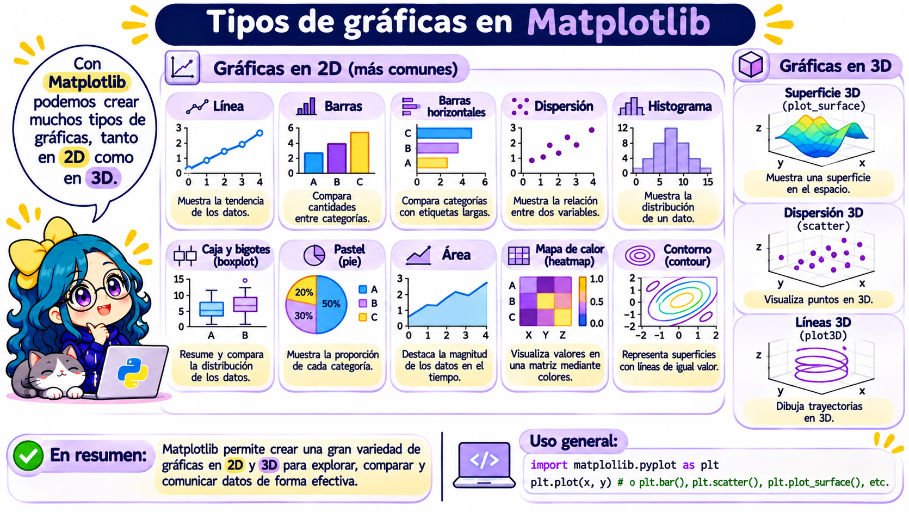
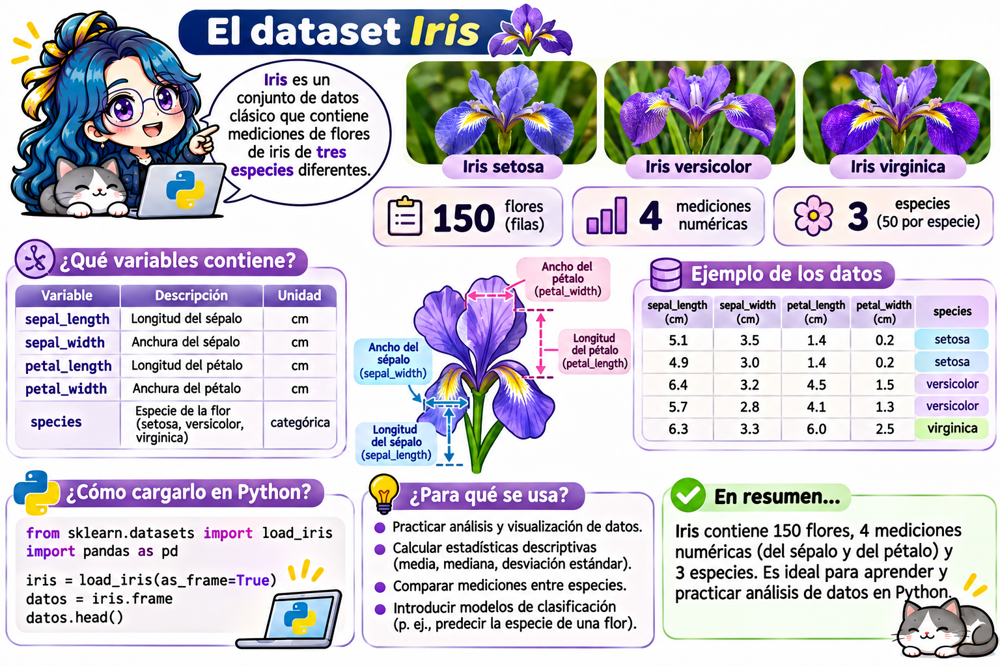
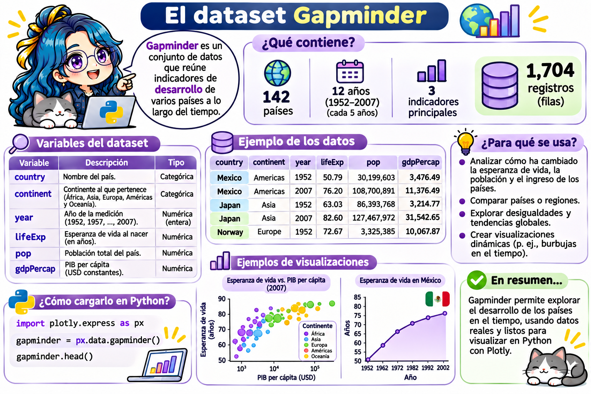

# Visualización de datos con Matplotlib y Plotly



```{r}
#| include: false
# Mostrar solo el resultado de la última línea de cada bloque de Python (como en Jupyter)
knitr::opts_chunk$set(jupyter_compat = TRUE)
# Usar el entorno del curso (~/.venvs/quarto-python) si existe, aunque RStudio tenga configurado otro Python.
# Si no existe, reticulate descarga automáticamente las bibliotecas necesarias.
venv_python <- path.expand(c("~/.venvs/quarto-python/bin/python", "~/.venvs/quarto-python/Scripts/python.exe"))
venv_python <- venv_python[file.exists(venv_python)]
if (length(venv_python) > 0) {
  Sys.setenv(RETICULATE_PYTHON = venv_python[1])
} else {
  reticulate::py_require(c("numpy", "pandas", "matplotlib", "sympy", "plotly"))
}
```

```{python}
#| include: false
# Hace que fig.show() muestre las figuras de Plotly dentro del libro
# (en Jupyter, Colab o Quarto con jupyter: python3, fig.show() funciona sin esta configuración).
import plotly.graph_objects as go
_primera_figura = True
def _mostrar_en_libro(self, *args, **kwargs):
    global _primera_figura
    html = self.to_html(include_plotlyjs="cdn" if _primera_figura else False, full_html=False)
    print("```{=html}\n" + html + "\n```")   # Bloque de HTML puro para que Quarto no lo modifique
    _primera_figura = False
go.Figure.show = _mostrar_en_libro
```

> **Fecha:** 24 de noviembre, 2026

Una buena gráfica permite ver en segundos lo que en una tabla de números tardaríamos mucho en descubrir: tendencias, relaciones, valores atípicos o el comportamiento de una función.

En este capítulo usaremos dos bibliotecas:

|   | Matplotlib | Plotly |
|----|----|----|
| Tipo de gráfica | **Estática** (imagen). | **Interactiva** (zoom, desplazamiento, información al pasar el ratón). |
| Ideal para | Artículos, tesis, reportes en PDF. | Páginas web, exploración de datos, presentaciones. |
| Formato de salida | PNG, PDF, SVG. | HTML. |
| Estilo de código | Se construye paso a paso (ejes, líneas, etiquetas). | Una función crea la gráfica completa. |

## Antes de empezar

Este capítulo usa cinco bibliotecas: `numpy`, `pandas`, `matplotlib`, `plotly` y `sympy`. Si seguiste el capítulo [Configuraciones para usar Quarto con Python](quarto_python.qmd), ya están instaladas en tu entorno `quarto-python`. Primero **comprueba** que RStudio las encuentra y, solo si falta alguna, **instálala**.

::: callout-note
En **Google Colab** y en los **editores interactivos** de esta página las bibliotecas **ya están disponibles**: puedes saltar directamente a [Importar las bibliotecas](#importar-las-bibliotecas).
:::

### Paso 1. Comprobar si ya están instaladas

En la pestaña **Console** de RStudio (indicador `>`):

```{r, eval=FALSE}
library(reticulate)
py_config()                          # La línea python: debe mostrar .../.venvs/quarto-python/...

py_module_available("numpy")         # TRUE
py_module_available("pandas")        # TRUE
py_module_available("matplotlib")    # TRUE
py_module_available("plotly")        # TRUE
py_module_available("sympy")         # TRUE
```

- Si todas dicen `TRUE`, ya está todo listo: continúa en [Importar las bibliotecas](#importar-las-bibliotecas).
- Si alguna dice `FALSE`, instálala con el paso 2.
- Si la línea `python:` **no** muestra `.venvs/quarto-python`, RStudio está usando otro Python: revisa el [Paso 4 de la configuración](quarto_python.qmd#paso-4.-indicar-a-quarto-y-a-rstudio-qué-python-usar) antes de instalar nada.

### Paso 2. Instalar los paquetes desde RStudio

Puedes instalarlos de **dos formas**; ambas instalan los paquetes **dentro** del entorno `quarto-python`. Usa solo una.

#### Opción A. Desde la Terminal de RStudio (con `pip`)

Abre la pestaña **Terminal** (indicador `$` o `%`; si no la ves, **Tools \> Terminal \> New Terminal**). Primero **activa el entorno** y después instala:

::: panel-tabset
## macOS y Linux

``` bash
# 1. Activar el entorno (debe aparecer (quarto-python) al inicio de la línea)
source ~/.venvs/quarto-python/bin/activate

# 2. Instalar los paquetes del capítulo
python -m pip install numpy pandas matplotlib plotly sympy

# 3. Comprobar la instalación
python -c "import numpy, pandas, matplotlib, plotly, sympy; print('Todo correcto')"
```

## Windows (Git Bash)

``` bash
# 1. Activar el entorno (debe aparecer (quarto-python) al inicio de la línea)
source ~/.venvs/quarto-python/Scripts/activate

# 2. Instalar los paquetes del capítulo
python -m pip install numpy pandas matplotlib plotly sympy

# 3. Comprobar la instalación
python -c "import numpy, pandas, matplotlib, plotly, sympy; print('Todo correcto')"
```
:::

Al final de la instalación debe aparecer `Successfully installed ...` (o `Requirement already satisfied` si ya estaban), y la comprobación debe imprimir `Todo correcto`.

#### Opción B. Desde la Console de R (con `reticulate`)

Sin salir de R, `reticulate` puede instalar los paquetes en el entorno por ti:

```{r, eval=FALSE}
library(reticulate)

# Instalar los paquetes en el entorno quarto-python
virtualenv_install(
  envname  = path.expand("~/.venvs/quarto-python"),
  packages = c("numpy", "pandas", "matplotlib", "plotly", "sympy")
)

# Comprobar
py_module_available("matplotlib")    # TRUE
py_module_available("plotly")        # TRUE
```

::: callout-important
- Escribe los comandos de **Bash** (`source`, `python -m pip`) en la **Terminal**, y los de **R** (`library()`, `virtualenv_install()`) en la **Console**. Es el error más común.
- Los paquetes se instalan **una sola vez**: quedan guardados en el entorno y no necesitas reinstalarlos cada vez que abras RStudio.
- Si después de instalar sigue apareciendo `ModuleNotFoundError: No module named 'matplotlib'`, ve a **Session \> Restart R** y vuelve a intentarlo. Si el error continúa, consulta la [solución de problemas](quarto_python.qmd#modulenotfounderror-al-ejecutar-o-renderizar-desde-rstudio).
:::

### Importar las bibliotecas {#importar-las-bibliotecas}

Por convención, al inicio de cada documento o *notebook* se importan así:

```{python}
import numpy as np
import matplotlib.pyplot as plt
import plotly.express as px
```

## Partes de una gráfica en Matplotlib

Antes de dibujar, conviene conocer **cómo está construida** una gráfica. Cada elemento que ves (título, ejes, líneas, leyenda...) es una **pieza** que podemos agregar y personalizar por separado:

{fig-align="center"}

### Una gráfica se construye por capas

Matplotlib trabaja como si dibujáramos sobre **hojas transparentes encimadas**: cada instrucción agrega una **capa** encima de las anteriores, y al final `plt.show()` muestra el resultado completo.

1.  **La figura** (`Figure`): el **lienzo** completo, la "hoja" donde va todo. Define el tamaño.
2.  **Los ejes** (`Axes`): el **área de la gráfica** dentro de la figura, con su eje $x$, su eje $y$, sus marcas y sus bordes. Una figura puede tener **varios** ejes (lo veremos en [`subplots()`](#varias-gráficas-en-una-figura-subplots)).
3.  **Los datos**: líneas (`plot`), puntos (`scatter`), barras (`bar`), etc., dibujados **dentro** de los ejes.
4.  **Los textos y adornos**: título, etiquetas de los ejes, leyenda, cuadrícula, anotaciones.

Veamos las capas una por una con un ejemplo: ¿quién crece más rápido, $n^2$ o $2^n$?

```{python}
n = np.arange(0, 9)                                  # n = 0, 1, ..., 8

# Capa 1: la figura (lienzo) y los ejes (área de la gráfica)
fig, ax = plt.subplots(figsize=(6, 4))

# Capa 2: los datos (línea + marcadores)
ax.plot(n, n**2, marker="o", label="$n^2$")
ax.plot(n, 2**n, marker="s", label="$2^n$")

# Capa 3: los textos
ax.set_title("¿Quién crece más rápido?")             # Título
ax.set_xlabel("n")                                   # Etiqueta del eje x
ax.set_ylabel("valor")                               # Etiqueta del eje y

# Capa 4: las marcas de los ejes (ticks)
ax.set_xticks(range(0, 9))                           # Una marca en cada entero

# Capa 5: la cuadrícula
ax.grid(True, linestyle="--", alpha=0.5)

# Capa 6: la leyenda (usa el label de cada línea)
ax.legend()

# Capa 7: los bordes (spines): quitamos el de arriba y el de la derecha
ax.spines["top"].set_visible(False)
ax.spines["right"].set_visible(False)

plt.show()
```

¿Ves dónde se cruzan? $n^2 = 2^n$ en $n = 2$ y $n = 4$; a partir de ahí, $2^n$ crece mucho más rápido.

::: callout-note
## El orden de las capas importa

Lo que se dibuja **después** queda **encima**. Si un punto queda tapado por una línea, puedes cambiar el orden de las instrucciones o usar el argumento `zorder`: entre mayor sea, más arriba se dibuja (por ejemplo, `plt.scatter(..., zorder=3)`).
:::

### Dos formas de escribir lo mismo: `plt` y `ax` {#dos-formas-de-escribir-lo-mismo-plt-y-ax}

Matplotlib tiene **dos estilos** para construir una gráfica:

- **Estilo `plt`** (*pyplot*): cada función actúa sobre la gráfica "actual". Es corto y cómodo para gráficas sencillas: `plt.plot()`, `plt.title()`.
- **Estilo `ax`** (orientado a objetos): primero creamos la figura y los ejes con `fig, ax = plt.subplots()` y luego llamamos los **métodos** de `ax`: `ax.plot()`, `ax.set_title()`. Es el estilo de la imagen y el más claro cuando hay **varias** gráficas en una figura.

Casi todas las funciones existen en los dos estilos; la diferencia más común es que en el estilo `ax` los nombres empiezan con `set_`:

| Parte de la gráfica | Estilo `plt` | Estilo `ax` | ¿Qué hace? |
|----|----|----|----|
| Figura | `plt.figure(figsize=(ancho, alto))` | `fig, ax = plt.subplots(figsize=(ancho, alto))` | Crea el lienzo (tamaño en pulgadas). |
| Línea | `plt.plot(x, y)` | `ax.plot(x, y)` | Dibuja una línea que une los puntos. |
| Marcadores | `plt.scatter(x, y)` | `ax.scatter(x, y)` | Dibuja puntos sin unirlos (o usa `marker="o"` en `plot`). |
| Título | `plt.title()` | `ax.set_title()` | Describe qué muestra la gráfica. |
| Etiquetas de los ejes | `plt.xlabel()`, `plt.ylabel()` | `ax.set_xlabel()`, `ax.set_ylabel()` | Nombre (y unidades) de cada eje. |
| Límites de los ejes | `plt.xlim()`, `plt.ylim()` | `ax.set_xlim()`, `ax.set_ylim()` | Rango visible de cada eje. |
| Marcas (*ticks*) | `plt.xticks()`, `plt.yticks()` | `ax.set_xticks()`, `ax.set_yticks()` | Valores que aparecen sobre los ejes. |
| Cuadrícula | `plt.grid(True)` | `ax.grid(True)` | Líneas de referencia que facilitan la lectura. |
| Leyenda | `plt.legend()` | `ax.legend()` | Identifica cada serie (usa el argumento `label`). |
| Texto | `plt.text(x, y, "texto")` | `ax.text(x, y, "texto")` | Escribe un texto en la coordenada $(x, y)$. |
| Bordes (*spines*) | — | `ax.spines["top"].set_visible(False)` | Muestra u oculta el marco de la gráfica. |
| Guardar | `plt.savefig("archivo.png", dpi=300)` | `fig.savefig("archivo.png", dpi=300)` | Guarda la figura en un archivo. |
| Mostrar | `plt.show()` | `plt.show()` | Muestra la figura. |

::: callout-tip
No mezcles los dos estilos en la misma gráfica mientras aprendes. En este capítulo usaremos el estilo `plt` para gráficas sencillas y el estilo `ax` cuando haya varias gráficas en una figura.
:::

## Coordenadas: colocar puntos en una gráfica

Antes de graficar funciones, empecemos por lo más básico del plano cartesiano: **colocar un punto** $(x, y)$. Toda gráfica, por complicada que sea, está hecha de puntos.

### Un punto

Para dibujar el punto $A(2, 3)$ usamos `plt.scatter(x, y)`. Agregamos los ejes $x$ y $y$ con `plt.axhline()` y `plt.axvline()`, y una etiqueta con `plt.text()`:

```{python}
plt.figure(figsize=(5, 5))

plt.scatter(2, 3, color="tab:red", s=60)        # Paso 1: el punto A(2, 3); s es el tamaño
plt.text(2.2, 3.2, "A(2, 3)")                   # Paso 2: etiqueta un poco arriba a la derecha

plt.axhline(0, color="black", linewidth=0.8)    # Paso 3: eje x (la recta y = 0)
plt.axvline(0, color="black", linewidth=0.8)    #         eje y (la recta x = 0)

plt.xlim(-5, 5)                                 # Paso 4: mostrar de -5 a 5 en ambos ejes
plt.ylim(-5, 5)
plt.grid(True)
plt.xlabel("x")
plt.ylabel("y")
plt.title("Un punto en el plano cartesiano")
plt.show()
```

| Función | ¿Qué hace? |
|----|----|
| `plt.scatter(x, y)` | Dibuja un **punto** (o varios) en la coordenada $(x, y)$. |
| `plt.text(x, y, "texto")` | Escribe un texto con su esquina inferior izquierda en $(x, y)$. |
| `plt.axhline(0)` | Dibuja una recta **horizontal** en $y = 0$: el eje $x$. |
| `plt.axvline(0)` | Dibuja una recta **vertical** en $x = 0$: el eje $y$. |
| `plt.xlim(a, b)`, `plt.ylim(a, b)` | Fijan el rango visible de cada eje. |

::: callout-tip
Ponemos la etiqueta en `(2.2, 3.2)` y no en `(2, 3)` para que el texto no tape el punto.
:::

### Varios puntos

`plt.scatter()` **no** recibe parejas $(x, y)$, sino **dos listas**: una con todas las coordenadas $x$ y otra con todas las coordenadas $y$. El primer punto es `(xs[0], ys[0])`, el segundo `(xs[1], ys[1])`, y así sucesivamente.

Coloquemos un punto en cada cuadrante:

```{python}
nombres = ["A", "B", "C", "D"]
xs = [2, -3, -1, 4]        # Coordenadas x de A, B, C, D
ys = [3, 1, -4, -2]        # Coordenadas y de A, B, C, D

plt.figure(figsize=(5, 5))
plt.scatter(xs, ys, color="tab:blue", s=60)

# Etiquetar cada punto: zip() recorre las tres listas en paralelo
for nombre, x, y in zip(nombres, xs, ys):
    plt.text(x + 0.2, y + 0.2, nombre + "(" + str(x) + ", " + str(y) + ")")

plt.axhline(0, color="black", linewidth=0.8)
plt.axvline(0, color="black", linewidth=0.8)
plt.xlim(-5, 5)
plt.ylim(-5, 5)
plt.grid(True)
plt.xlabel("x")
plt.ylabel("y")
plt.title("Un punto en cada cuadrante")
plt.show()
```

### Unir puntos con líneas

Si en lugar de `plt.scatter()` usamos `plt.plot()`, Matplotlib **une los puntos en orden** con segmentos de recta. Para cerrar una figura, repetimos el primer punto al final. Por ejemplo, el triángulo con vértices $A(-2, -1)$, $B(3, -1)$ y $C(1, 3)$:

```{python}
xs = [-2, 3, 1, -2]        # A, B, C y otra vez A para cerrar el triángulo
ys = [-1, -1, 3, -1]

plt.figure(figsize=(5, 5))
plt.plot(xs, ys, marker="o", color="tab:green")   # marker="o" marca cada vértice
plt.axhline(0, color="black", linewidth=0.8)
plt.axvline(0, color="black", linewidth=0.8)
plt.xlim(-5, 5)
plt.ylim(-5, 5)
plt.grid(True)
plt.title("Triángulo ABC")
plt.show()
```

### De puntos a la gráfica de una función

La gráfica de una función $f(x)$ es el conjunto de puntos $(x, f(x))$. Si calculamos **pocos** puntos de $f(x) = x^2$ y los unimos, la curva se ve "quebrada"; con **muchos** puntos (usando `np.linspace()`) se ve suave:

```{python}
x_pocos = np.array([-2, -1, 0, 1, 2])
x_muchos = np.linspace(-2, 2, 100)            # 100 puntos entre -2 y 2

plt.figure(figsize=(6, 4))
plt.plot(x_muchos, x_muchos**2, color="tab:gray", label="100 puntos")
plt.plot(x_pocos, x_pocos**2, marker="o", color="tab:red", label="5 puntos")
plt.xlabel("x")
plt.ylabel("y")
plt.title("$f(x) = x^2$ a partir de sus puntos")
plt.legend()
plt.grid(True)
plt.show()
```

Esta es la idea detrás de todas las gráficas de las siguientes secciones. En [Visualización II](python_visualizacion2.qmd) prepararemos un plano cartesiano "matemático" más completo: ejes centrados en el origen y la misma escala en $x$ y $y$.

## Graficar funciones con Matplotlib

Con las partes de una gráfica y la idea de "muchos puntos unidos" ya podemos graficar funciones. Este ejemplo usa el estilo `plt` y las funciones de la [tabla de partes de una gráfica](#dos-formas-de-escribir-lo-mismo-plt-y-ax):

```{python}
x = np.linspace(-3, 3, 100)        # 100 puntos entre -3 y 3

plt.figure(figsize=(6, 4))          # Tamaño de la figura en pulgadas
plt.plot(x, x**2, label="$f(x) = x^2$")
plt.plot(x, -x**2 + 5, label="$g(x) = -x^2 + 5$", linestyle="--")
plt.xlabel("x")
plt.ylabel("y")
plt.title("Dos parábolas")
plt.legend()
plt.grid(True)
plt.show()
```

Los textos entre signos de dólar, como `"$f(x) = x^2$"`, se escriben en **LaTeX**, igual que en Markdown.

### Personalizar líneas y marcadores

| Argumento   | Valores comunes                                             |
|-------------|-------------------------------------------------------------|
| `color`     | `"red"`, `"tab:blue"`, `"#007f99"`                          |
| `linestyle` | `"-"` (continua), `"--"` (guiones), `":"` (puntos), `"-."`  |
| `linewidth` | Grosor de la línea, por ejemplo `2`.                        |
| `marker`    | `"o"` (círculo), `"s"` (cuadrado), `"^"` (triángulo), `"x"` |
| `alpha`     | Transparencia entre `0` y `1`.                              |

### Anotaciones

`plt.annotate()` agrega un texto con una flecha que señala un punto. Por ejemplo, el máximo de $g(x) = -x^2 + 5$:

```{python}
plt.figure(figsize=(6, 4))
plt.plot(x, -x**2 + 5, color="tab:orange")
plt.scatter([0], [5], color="black", zorder=3)
plt.annotate("Máximo (0, 5)", xy=(0, 5), xytext=(1, 5.5),
             arrowprops=dict(arrowstyle="->"))
plt.ylim(-5, 7)
plt.title("$g(x) = -x^2 + 5$")
plt.show()
```

### Área entre curvas

```{python}
x = np.linspace(0, 2 * np.pi, 200)

plt.figure(figsize=(6, 4))
plt.plot(x, np.sin(x), label="sen(x)")
plt.plot(x, np.cos(x), label="cos(x)")
plt.fill_between(x, np.sin(x), np.cos(x), alpha=0.3)
plt.legend()
plt.title("Área entre sen(x) y cos(x)")
plt.show()
```

## Varias gráficas en una figura: `subplots()` {#varias-gráficas-en-una-figura-subplots}

Con `plt.subplots(filas, columnas)` creamos una cuadrícula de gráficas. Esta forma de trabajar se llama **orientada a objetos**: cada gráfica es un objeto `ax` con sus propios **métodos**.

```{python}
x = np.linspace(0.1, 2 * np.pi, 200)

fig, axs = plt.subplots(2, 2, figsize=(8, 6))

axs[0, 0].plot(x, np.sin(x))
axs[0, 0].set_title("sen(x)")

axs[0, 1].plot(x, np.cos(x), color="tab:orange")
axs[0, 1].set_title("cos(x)")

axs[1, 0].plot(x, np.exp(-x), color="tab:green")
axs[1, 0].set_title("$e^{-x}$")

axs[1, 1].plot(x, np.log(x), color="tab:red")
axs[1, 1].set_title("ln(x)")

fig.tight_layout()   # Evita que se encimen los títulos
plt.show()
```

| Estilo `plt`   | Estilo orientado a objetos (`ax`) |
|----------------|-----------------------------------|
| `plt.plot()`   | `ax.plot()`                       |
| `plt.title()`  | `ax.set_title()`                  |
| `plt.xlabel()` | `ax.set_xlabel()`                 |
| `plt.xlim()`   | `ax.set_xlim()`                   |
| `plt.legend()` | `ax.legend()`                     |

Observa que `axs` es un **arreglo de NumPy** de 2 × 2, por eso usamos `axs[fila, columna]`.

## Tipos de gráficas

{fig-align="center"}

| Gráfica | ¿Para qué sirve? | Matplotlib | Plotly |
|----|----|----|----|
| **Gráficas en 2D** |  |  |  |
| Línea | Funciones, tendencias en el tiempo. | `plt.plot()` | `px.line()` |
| Barras | Comparar cantidades entre categorías. | `plt.bar()` | `px.bar()` |
| Barras horizontales | Comparar categorías con etiquetas largas. | `plt.barh()` | `px.bar(..., orientation="h")` |
| Dispersión | Relación entre dos variables. | `plt.scatter()` | `px.scatter()` |
| Histograma | Distribución de una variable. | `plt.hist()` | `px.histogram()` |
| Caja y bigotes (*boxplot*) | Mediana, cuartiles y valores atípicos; comparar distribuciones. | `plt.boxplot()` | `px.box()` |
| Pastel (*pie*) | Proporciones de un total (pocas categorías). | `plt.pie()` | `px.pie()` |
| Área | Destacar la magnitud acumulada bajo una curva. | `plt.fill_between()` | `px.area()` |
| Mapa de calor (*heatmap*) | Valores de una matriz representados con colores. | `plt.imshow()` | `px.imshow()` |
| Contorno o curvas de nivel (*contour*) | Funciones de dos variables $f(x, y)$: líneas donde $f$ tiene el mismo valor. | `plt.contour()`, `plt.contourf()` (relleno) | `go.Contour()` |
| **Gráficas en 3D** |  |  |  |
| Superficie 3D | Funciones $z = f(x, y)$. | `ax.plot_surface()` | `go.Surface()` |
| Dispersión 3D | Puntos $(x, y, z)$ en el espacio. | `ax.scatter(x, y, z)` | `px.scatter_3d()` |
| Líneas 3D | Trayectorias y curvas en el espacio, como una hélice. | `ax.plot(x, y, z)` | `px.line_3d()` |

Las gráficas en 3D de Matplotlib se dibujan sobre ejes 3D, `ax = plt.figure().add_subplot(projection="3d")`, por eso se escriben con `ax.` y no con `plt.`. Las veremos en [Visualización III: gráficas en 3D](python_visualizacion3d.qmd).

### ¿Qué gráfica elegir para explicar algo?

Una gráfica es una **respuesta visual a una pregunta**. Antes de escribir código, pregúntate: **¿qué quiero que el lector vea?** La pregunta decide la gráfica:

| Quiero mostrar... | Pregunta que responde | Mejor opción | Ejemplo matemático | Evita |
|----|----|----|----|----|
| **Cambio o tendencia** de una variable continua | ¿Cómo cambia $y$ cuando $x$ crece? | **Línea** | La gráfica de $f(x) = \sin x$; una sucesión que converge. | Barras: sugieren categorías separadas. |
| **Relación** entre dos variables numéricas | ¿Están relacionadas $x$ y $y$? ¿Hay un patrón? | **Dispersión** | Puntos $(x, y)$ aleatorios; $n$ contra el número de divisores de $n$. | Unir los puntos con líneas si el orden no importa. |
| **Comparar** cantidades entre categorías | ¿Cuál es mayor? ¿Por cuánto? | **Barras** | Cuántos primos terminan en 1, 3, 7 y 9. | Pastel con muchas categorías. |
| **Distribución** de una variable | ¿Qué valores son más frecuentes? ¿Es simétrica? | **Histograma** | Los resultados de lanzar dos dados 1000 veces. | Barras de cada valor individual si hay muchos. |
| **Comparar distribuciones** entre grupos | ¿Qué grupo tiene mayor mediana o más dispersión? ¿Hay valores atípicos? | **Caja** (*boxplot*) | Calificaciones de tres grupos. | Solo mostrar los promedios. |
| **Partes de un todo** | ¿Qué fracción del total es cada parte? | **Pastel** (máximo 4 o 5 partes) o **barras** | Proporción de pares e impares. | Pastel con partes de tamaño parecido. |
| Una función de **dos variables** | ¿Dónde están los máximos, mínimos y puntos silla? | **Curvas de nivel** o **mapa de calor** | $f(x, y) = x^2 - y^2$. | 3D si una vista 2D basta. |
| La **forma** de una superficie | ¿Cómo se ve $z = f(x, y)$? | **Superficie 3D** (mejor interactiva, con Plotly) | Un paraboloide. | 3D estática si oculta partes importantes. |

#### Ejemplo: el mismo dato, dos gráficas

Contemos en qué dígito terminan los números primos menores que 1000. Con una **gráfica de pastel** es difícil decidir qué rebanada es mayor, porque el ojo compara **ángulos** con poca precisión. Con **barras** comparamos **alturas** sobre una misma base, y la respuesta salta a la vista:

```{python}
# Paso 1: contar en qué dígito terminan los primos menores que 1000
conteo = [0] * 10                               # CONTADORES: uno por cada dígito 0, 1, ..., 9
for n in range(2, 1000):                        # Revisar cada número del 2 al 999
    es_primo = True                             # Suponemos que n es primo...
    for d in range(2, int(n ** 0.5) + 1):       # ...y probamos divisores hasta √n
        if n % d == 0:                          # Si d divide a n,
            es_primo = False                    #   n no es primo
            break                               #   y dejamos de buscar
    if es_primo:
        conteo[n % 10] += 1                     # n % 10 es el último dígito de n: sumamos 1 a su contador

# Paso 2: quedarnos solo con los dígitos en los que termina algún primo (1, 2, 3, 5, 7, 9)
etiquetas = [str(d) for d in range(10) if conteo[d] > 0]     # Los dígitos como texto: "1", "2", ...
cantidades = [conteo[d] for d in range(10) if conteo[d] > 0] # Cuántos primos terminan en cada uno

# Paso 3: una figura con dos gráficas lado a lado (1 fila, 2 columnas)
fig, axs = plt.subplots(1, 2, figsize=(10, 4))

# Paso 4: la gráfica de la izquierda, axs[0], es un pastel
axs[0].pie(cantidades, labels=etiquetas)                     # ❌ Difícil de comparar ángulos
axs[0].set_title("Pastel: ¿cuál es mayor?")

# Paso 5: la gráfica de la derecha, axs[1], es de barras
axs[1].bar(etiquetas, cantidades, color="tab:blue")          # ✅ Fácil de comparar alturas
axs[1].set_title("Barras: el 7 gana")
axs[1].set_xlabel("Último dígito del primo")
axs[1].set_ylabel("Cantidad de primos")

# Paso 6: ajustar los espacios para que los textos no se encimen, y mostrar
plt.tight_layout()
plt.show()

# Paso 7: imprimir los conteos para comprobar lo que vemos en la gráfica
for digito, cantidad in zip(etiquetas, cantidades):
    print("Terminan en", digito, ":", cantidad, "primos")
```

Con barras se ve de inmediato que el 7 es el más frecuente, que 1, 3 y 9 están muy parejos (entre 38 y 42), y que solo **un** primo termina en 2 (el 2) y solo uno en 5 (el 5). En el pastel, esas diferencias casi no se notan.

::: callout-tip
## Tres preguntas antes de graficar

1.  **¿Qué pregunta responde mi gráfica?** Si no puedes decirla en una frase, la gráfica no será clara.
2.  **¿Qué tipo de datos tengo?** Categorías → barras; números continuos → línea, dispersión o histograma.
3.  **¿Se entiende sin leer el código?** Título, ejes con etiquetas (y unidades) y leyenda. Revisa también las [buenas prácticas de visualización](#buenas-prácticas-de-visualización).
:::

### Dispersión con mapa de colores

```{python}
# Paso 1: generar 300 puntos aleatorios (x, y)
rng = np.random.default_rng(seed=2026)          # Generador con semilla: siempre los mismos números
puntos_x = rng.normal(size=300)                 # 300 coordenadas x (distribución normal)
puntos_y = rng.normal(size=300)                 # 300 coordenadas y

# Paso 2: calcular el ángulo de cada punto respecto al eje x (entre -π y π)
angulo = np.arctan2(puntos_y, puntos_x)

# Paso 3: dibujar los puntos, coloreados según su ángulo
plt.figure(figsize=(5, 4))
plt.scatter(puntos_x, puntos_y,
            c=angulo,                           # c: el valor que decide el color de cada punto
            cmap="viridis",                     # cmap: la paleta de colores
            alpha=0.8)                          # alpha: un poco transparentes para ver los encimados

# Paso 4: agregar la barra de colores, el título y la misma escala en ambos ejes
plt.colorbar(label="Ángulo (radianes)")         # Explica qué valor representa cada color
plt.title("Puntos aleatorios coloreados por su ángulo")
plt.axis("equal")                               # Una unidad en x mide lo mismo que en y
plt.show()
```

### Datos para los ejemplos

Para las siguientes gráficas usaremos calificaciones **simuladas** con números aleatorios de NumPy (con semilla, para obtener siempre los mismos datos):

```{python}
rng = np.random.default_rng(seed=2026)          # Generador con semilla: siempre los mismos datos

# Datos por CATEGORÍA (para barras y pastel)
niveles = ["MB", "B", "S", "NA"]                # Muy bien, Bien, Suficiente, No acreditado
estudiantes_por_nivel = [28, 45, 35, 12]        # Cuántos estudiantes hay en cada nivel

# Datos NUMÉRICOS (para histograma y caja)
calificaciones = np.clip(rng.normal(7.8, 1.3, 120), 0, 10)   # 120 calificaciones (media 7.8) recortadas entre 0 y 10
grupo_a = rng.normal(7.5, 1.0, 40)              # 40 calificaciones: media 7.5, desviación 1.0
grupo_b = rng.normal(8.2, 0.8, 40)              # 40 calificaciones: media 8.2, desviación 0.8
grupo_c = rng.normal(6.9, 1.4, 40)              # 40 calificaciones: media 6.9, desviación 1.4
```

`rng.normal(media, desviacion, n)` genera `n` números con distribución normal, y `np.clip(datos, 0, 10)` recorta los valores para que queden entre 0 y 10.

### Gráfica de barras: `plt.bar()`

Una gráfica de barras **compara cantidades entre categorías**. Recibe las categorías (eje $x$) y la altura de cada barra (eje $y$):

```{python}
plt.figure(figsize=(6, 4))                                  # Paso 1: crear la figura (6 × 4 pulgadas)
plt.bar(niveles, estudiantes_por_nivel, color="tab:blue")   # Paso 2: una barra por nivel; su altura es el número de estudiantes
plt.xlabel("Nivel")                                         # Paso 3: etiquetas de los ejes y título
plt.ylabel("Número de estudiantes")
plt.title("Estudiantes por nivel")
plt.show()                                                  # Paso 4: mostrar la gráfica
```

Para barras horizontales usa `plt.barh()`, útil cuando los nombres de las categorías son largos.

### Histograma: `plt.hist()`

Un histograma muestra la **distribución** de una variable numérica: divide el rango de los datos en intervalos (*bins*) y cuenta cuántos datos caen en cada uno.

```{python}
plt.figure(figsize=(6, 4))                          # Paso 1: crear la figura

# Paso 2: el histograma: divide las calificaciones en 15 intervalos y cuenta cuántas caen en cada uno
plt.hist(calificaciones, bins=15,
         color="tab:green",
         edgecolor="white")                         # Borde blanco para separar las barras

# Paso 3: una línea vertical punteada en la media de las calificaciones
plt.axvline(calificaciones.mean(), color="black", linestyle="--", label="Media")

# Paso 4: etiquetas, título y leyenda (la leyenda usa el label de axvline)
plt.xlabel("Calificación")
plt.ylabel("Número de estudiantes")
plt.title("Histograma de calificaciones")
plt.legend()
plt.show()                                          # Paso 5: mostrar la gráfica
```

- `bins` es el número de intervalos: pocos *bins* ocultan detalles y demasiados producen una gráfica "con ruido".
- `plt.axvline(valor)` dibuja una línea **vertical**; `plt.axhline(valor)`, una **horizontal**.

::: callout-note
No confundas un histograma con una gráfica de barras: las barras comparan **categorías** (MB, B, S, NA), mientras que el histograma agrupa **valores numéricos** en intervalos.
:::

### Diagrama de caja: `plt.boxplot()`

Un diagrama de caja (*boxplot*) resume una distribución con cinco valores y permite **comparar varios grupos**:

```{python}
plt.figure(figsize=(6, 4))                                  # Paso 1: crear la figura
plt.boxplot([grupo_a, grupo_b, grupo_c])                    # Paso 2: una caja por grupo (se dibujan en x = 1, 2, 3)
plt.xticks([1, 2, 3], ["Grupo A", "Grupo B", "Grupo C"])    # Paso 3: cambiar las marcas 1, 2, 3 por el nombre del grupo
plt.ylabel("Calificación")                                  # Paso 4: etiqueta y título
plt.title("Calificaciones por grupo")
plt.show()                                                  # Paso 5: mostrar la gráfica
```

| Parte de la caja | ¿Qué representa? |
|----|----|
| Línea dentro de la caja | La **mediana**. |
| Borde inferior y superior de la caja | Primer y tercer **cuartil** (el 50 % central de los datos). |
| "Bigotes" | El rango de los datos sin contar valores atípicos. |
| Puntos aislados | **Valores atípicos** (muy alejados del resto). |

### Gráfica de pastel: `plt.pie()`

Una gráfica de pastel muestra la **proporción** de cada categoría respecto al total:

```{python}
plt.figure(figsize=(5, 5))                          # Paso 1: figura cuadrada, para que el pastel sea un círculo
plt.pie(estudiantes_por_nivel,                      # Paso 2: el tamaño de cada rebanada es proporcional a su valor
        labels=niveles,                             #   nombre de cada rebanada
        autopct="%1.0f%%")                          #   porcentaje dentro de cada rebanada, sin decimales
plt.title("Proporción de estudiantes por nivel")    # Paso 3: título
plt.show()                                          # Paso 4: mostrar la gráfica
```

`autopct="%1.0f%%"` muestra el porcentaje de cada rebanada sin decimales. Úsala solo con **pocas** categorías; si hay muchas, una gráfica de barras se lee mejor.

### Las cuatro gráficas en una sola figura

Ahora que conocemos cada gráfica, podemos reunirlas en una figura de 2 × 2 con `plt.subplots()`. Observa que el código de cada gráfica es el mismo, pero ahora usamos los **métodos** de cada `ax` (`axs[0, 0].bar()`, `axs[0, 0].set_title()`...) en lugar de `plt.bar()` y `plt.title()`:

```{python}
# Paso 1: una figura con 2 filas y 2 columnas de gráficas; axs[fila, columna] es cada una
fig, axs = plt.subplots(2, 2, figsize=(9, 7))

# Paso 2: arriba a la izquierda (fila 0, columna 0): barras
axs[0, 0].bar(niveles, estudiantes_por_nivel, color="tab:blue")
axs[0, 0].set_title("Barras: estudiantes por nivel")
axs[0, 0].set_ylabel("Número de estudiantes")

# Paso 3: arriba a la derecha (fila 0, columna 1): histograma con la media
axs[0, 1].hist(calificaciones, bins=15, color="tab:green", edgecolor="white")
axs[0, 1].axvline(calificaciones.mean(), color="black", linestyle="--", label="Media")
axs[0, 1].set_title("Histograma de calificaciones")
axs[0, 1].legend()

# Paso 4: abajo a la izquierda (fila 1, columna 0): diagrama de caja
axs[1, 0].boxplot([grupo_a, grupo_b, grupo_c])
axs[1, 0].set_xticks([1, 2, 3], ["Grupo A", "Grupo B", "Grupo C"])   # Nombres en lugar de 1, 2, 3
axs[1, 0].set_title("Caja: calificaciones por grupo")

# Paso 5: abajo a la derecha (fila 1, columna 1): pastel
axs[1, 1].pie(estudiantes_por_nivel, labels=niveles, autopct="%1.0f%%")
axs[1, 1].set_title("Pastel: proporción por nivel")

# Paso 6: ajustar los espacios entre gráficas para que no se encimen, y mostrar
fig.tight_layout()
plt.show()
```

## Funciones de dos variables

Para graficar una función de dos variables, por ejemplo $f(x, y) = \sin(x)\cos(y)$, seguimos tres pasos: crear una **malla** de puntos, **evaluar** la función en la malla y **graficar** el resultado.

### Paso 1. Crear una malla con `np.meshgrid()`

Para graficar $f(x)$ basta un vector de valores de $x$. Para $f(x, y)$ necesitamos **todas las combinaciones** de valores de $x$ y de $y$. `np.meshgrid()` construye esas combinaciones a partir de dos vectores. Veámoslo con pocos puntos:

```{python}
x_chico = np.array([0, 1, 2])
y_chico = np.array([10, 20])

X_chico, Y_chico = np.meshgrid(x_chico, y_chico)
print("X =\n", X_chico)
print("Y =\n", Y_chico)
```

Cada posición `[i, j]` de las matrices `X` y `Y` corresponde a un punto $(x, y)$ de la malla: por ejemplo, `X[1, 2]` y `Y[1, 2]` forman el punto $(2, 20)$.

### Paso 2. Evaluar la función en la malla

Como `X` y `Y` son arreglos de NumPy, la función se evalúa en **todos** los puntos a la vez:

```{python}
x = np.linspace(-2 * np.pi, 2 * np.pi, 200)
y = np.linspace(-2 * np.pi, 2 * np.pi, 200)
X, Y = np.meshgrid(x, y)
Z = np.sin(X) * np.cos(Y)

print("Forma de la malla:", X.shape)   # 200 × 200 = 40 000 puntos
print("Forma de Z:", Z.shape)
```

### Paso 3a. Mapa de calor: `plt.imshow()`

Un mapa de calor pinta cada valor de `Z` con un color según su magnitud:

```{python}
plt.figure(figsize=(5, 4))
plt.imshow(Z, extent=[x.min(), x.max(), y.min(), y.max()], origin="lower", cmap="RdBu")
plt.colorbar(label="f(x, y)")
plt.xlabel("x")
plt.ylabel("y")
plt.title("Mapa de calor de sen(x)·cos(y)")
plt.show()
```

- `extent` indica los valores de $x$ y $y$ en los bordes de la imagen (si no, los ejes mostrarían las posiciones de la matriz).
- `origin="lower"` coloca la fila 0 abajo, como en un plano cartesiano.
- `cmap` es la **paleta de colores**; `"RdBu"` va de rojo (negativos) a azul (positivos).

### Paso 3b. Curvas de nivel: `plt.contour()`

Las curvas de nivel unen los puntos donde la función tiene **el mismo valor**, como en un mapa topográfico:

```{python}
plt.figure(figsize=(5, 4))
curvas = plt.contour(X, Y, Z, levels=8, cmap="RdBu")
plt.clabel(curvas, fontsize=7)        # Escribe el valor de cada curva
plt.xlabel("x")
plt.ylabel("y")
plt.title("Curvas de nivel de sen(x)·cos(y)")
plt.show()
```

`levels` indica cuántas curvas dibujar. Con `plt.contourf()` (con *f* de *filled*) se rellenan las regiones entre curvas.

### Las dos gráficas juntas

Finalmente, comparamos ambas representaciones lado a lado con `plt.subplots(1, 2)`:

```{python}
fig, axs = plt.subplots(1, 2, figsize=(10, 4))

imagen = axs[0].imshow(Z, extent=[x.min(), x.max(), y.min(), y.max()], origin="lower", cmap="RdBu")
fig.colorbar(imagen, ax=axs[0])
axs[0].set_title("Mapa de calor (imshow)")

curvas = axs[1].contour(X, Y, Z, levels=8, cmap="RdBu")
axs[1].clabel(curvas, fontsize=7)
axs[1].set_title("Curvas de nivel (contour)")

fig.tight_layout()
plt.show()
```

## De SymPy a una gráfica

En el capítulo de [SymPy](python_sympy.qmd) vimos que `sp.lambdify()` convierte una expresión simbólica en una función de NumPy. Así podemos graficar una función junto con su derivada:

```{python}
import sympy as sp

s = sp.symbols("x")
f = s**3 - 3*s
derivada = sp.diff(f, s)

f_np = sp.lambdify(s, f, "numpy")
d_np = sp.lambdify(s, derivada, "numpy")

x = np.linspace(-2.5, 2.5, 200)
plt.figure(figsize=(6, 4))
plt.plot(x, f_np(x), label=f"$f(x) = {sp.latex(f)}$")
plt.plot(x, d_np(x), label=f"$f'(x) = {sp.latex(derivada)}$")
plt.axhline(0, color="gray", linewidth=0.8)
plt.legend()
plt.title("Una función y su derivada")
plt.show()
```

Observa que los máximos y mínimos de $f$ ocurren donde la derivada vale cero.

## Plotly: gráficas interactivas

[Plotly Express](https://plotly.com/python/plotly-express/) crea una gráfica completa con **una sola función**. Las gráficas son interactivas: pasa el ratón sobre los puntos, haz zoom seleccionando un área y da doble clic para regresar a la vista original.

Toda gráfica de Plotly sigue los mismos tres pasos:

``` python
import plotly.express as px                      # 1. Importar

fig = px.scatter(datos, x="columna_x", y="columna_y")   # 2. Crear la figura (se guarda en la variable fig)

fig.show()                                       # 3. Mostrar la figura
```

::: callout-note
## ¿Qué hace `fig.show()`?

Crear la figura (`fig = px.scatter(...)`) **no** la dibuja: solo la guarda en la variable `fig`. Para verla hay que llamar al método `fig.show()`, igual que con `plt.show()` en Matplotlib. Funciona igual en Jupyter Notebook, Google Colab, en un documento de Quarto y en este libro.
:::

### Datos de ejemplo: `px.data`

`px.data` es un **módulo de Plotly que incluye conjuntos de datos reales para practicar**. Vienen dentro de la biblioteca, así que **no necesitas descargar archivos** ni tener internet. Cada función de `px.data` regresa los datos como una **tabla** de pandas (un `DataFrame`):

| Función | Contenido | Filas |
|----|----|----|
| `px.data.iris()` | Medidas de flores de tres especies de iris. | 150 |
| `px.data.gapminder()` | Esperanza de vida, PIB y población de 142 países (1952-2007). | 1704 |
| `px.data.tips()` | Cuentas y propinas en un restaurante. | 244 |
| `px.data.stocks()` | Precio de acciones de seis empresas (2018-2019). | 105 |
| `px.data.wind()` | Dirección e intensidad del viento. | 128 |
| `px.data.medals_long()` | Medallas olímpicas de patinaje por país. | 9 |

Un `DataFrame` es como una hoja de cálculo: tiene **filas** (cada observación) y **columnas** con nombre (cada variable). Veamos el conjunto *iris*, con las medidas en centímetros de 150 flores:

```{python}
iris = px.data.iris()

print(iris.head())                  # Primeras 5 filas
print("Forma:", iris.shape)         # (filas, columnas), igual que en NumPy
print("Columnas:", list(iris.columns))
```

| Columna | Contenido |
|----|----|
| `sepal_length`, `sepal_width` | Largo y ancho del **sépalo** (cm). |
| `petal_length`, `petal_width` | Largo y ancho del **pétalo** (cm). |
| `species` | Especie: *setosa*, *versicolor* o *virginica*. |
| `species_id` | Número de la especie (1, 2 o 3). |

{fig-align="center"}

En las funciones de **Plotly Express**, el primer argumento es el `DataFrame` y los demás indican **qué columna** usar en cada parte de la gráfica, escribiendo su nombre como texto: `x="sepal_length"`.

### Una mini historia del conjunto *iris*

::: {.callout-tip icon="false"}
## 🌸 En pocas palabras

El conjunto *iris* nació de una **pregunta biológica**: ¿podemos distinguir especies de flores utilizando **únicamente sus características físicas**? En 1936, Fisher demostró que **las matemáticas podían ayudarnos a responderla**. Hoy, casi 90 años después, seguimos utilizando esos mismos datos para aprender **estadística, programación e inteligencia artificial**.
:::

**El botánico que midió las flores.** A mediados de la década de 1930, el botánico estadounidense **Edgar Anderson** quería entender cómo se diferencian y evolucionan las especies de plantas. Para ello midió con cuidado el sépalo y el pétalo de cientos de flores de iris; gran parte de ellas las recolectó en la **península de Gaspé**, en Quebec, Canadá. Anderson tomó 50 flores de cada una de tres especies: *Iris setosa*, *Iris versicolor* e *Iris virginica*.

**El estadístico que lo hizo famoso.** En 1936, el estadístico y matemático británico **Ronald A. Fisher** usó las mediciones de Anderson en el artículo *"The use of multiple measurements in taxonomic problems"* (El uso de mediciones múltiples en problemas taxonómicos). Ahí presentó el **análisis discriminante lineal**: un método para encontrar la **combinación lineal** de las cuatro mediciones que mejor separa a las especies. Por eso el conjunto también se conoce como el ***iris*** **de Fisher** o el ***iris*** **de Anderson**.

**¿Por qué sigue siendo tan usado casi 90 años después?** Porque es pequeño (150 filas), no tiene datos faltantes, sus variables son fáciles de entender y tiene una estructura interesante: *setosa* se separa claramente de las otras dos especies, mientras que *versicolor* y *virginica* se **traslapan** un poco. Eso lo hace perfecto para probar métodos y verificar si funcionan. Lo verás en las gráficas de este capítulo.

| Área | ¿Para qué se usa el conjunto *iris*? |
|----|----|
| **Botánica y taxonomía** | Su origen: estudiar cómo se distinguen las especies a partir de mediciones. |
| **Estadística** | Estadística descriptiva, pruebas de hipótesis y análisis multivariado, como el análisis discriminante lineal de Fisher. |
| **Álgebra lineal** | Ejemplo clásico de **proyecciones**: el análisis de componentes principales (PCA) y el análisis discriminante reducen las 4 dimensiones a 2 que se pueden graficar. |
| **Aprendizaje automático** (*machine learning*) | Primer ejemplo de **clasificación** (predecir la especie a partir de las medidas) y de **agrupamiento** (encontrar grupos sin conocer la especie, por ejemplo con *k-means*). Es uno de los conjuntos más descargados del [repositorio de aprendizaje automático de UCI](https://archive.ics.uci.edu/dataset/53/iris), donde está disponible desde 1988. |
| **Visualización de datos** | Ejemplo estándar para enseñar gráficas de dispersión, histogramas, diagramas de caja y matrices de gráficas. |
| **Programación y software** | Viene incluido en muchas herramientas: en R (`iris`), en Python con `plotly.express`, `seaborn` y `scikit-learn`. Se usa para probar que un programa funciona. |

Como ya lo conoces de R, puedes compararlo: en la **Console** de R, `head(iris)` muestra las mismas primeras filas, con las columnas `Sepal.Length`, `Sepal.Width`, `Petal.Length`, `Petal.Width` y `Species`.

::: callout-note
## Un dato para reflexionar

Fisher hizo aportaciones fundamentales a la estadística, pero también promovió la **eugenesia**, una ideología hoy rechazada, y publicó este trabajo en la revista *Annals of Eugenics*. Por eso, algunos docentes prefieren usar conjuntos alternativos, como [*Palmer penguins*](https://allisonhorst.github.io/palmerpenguins/) (medidas de pingüinos de la Antártida, publicado en 2020), que tiene una estructura parecida. Conocer el origen de los datos también es parte de analizarlos con responsabilidad.
:::

### Dispersión

```{python}
#| output: asis
fig = px.scatter(iris, x="sepal_length", y="sepal_width", color="species",
                 title="Iris: largo vs. ancho del sépalo",
                 labels={"sepal_length": "Largo del sépalo (cm)",
                         "sepal_width": "Ancho del sépalo (cm)",
                         "species": "Especie"})
fig.show()
```

Con el argumento `color`, Plotly asigna un color a cada especie y crea la leyenda automáticamente. Da clic en una especie de la leyenda para ocultarla. El argumento `labels` cambia los nombres de las columnas por textos más claros en los ejes y la leyenda.

### Línea

Plotly Express también acepta arreglos de NumPy en lugar de un `DataFrame`:

```{python}
#| output: asis
x = np.linspace(0, 4 * np.pi, 200)
fig = px.line(x=x, y=np.sin(x) * np.exp(-x / 5),
              labels={"x": "x", "y": "f(x)"},
              title="Oscilación amortiguada: f(x) = sen(x)·e^(-x/5)")
fig.show()
```

### Histograma y caja

```{python}
#| output: asis
fig = px.histogram(iris, x="petal_length", color="species", nbins=30,
                   marginal="box", title="Largo del pétalo por especie",
                   labels={"petal_length": "Largo del pétalo (cm)", "species": "Especie"})
fig.show()
```

El argumento `marginal="box"` agrega un diagrama de caja arriba del histograma.

### Superficie en 3D

Plotly Express no tiene una función para superficies, así que usamos el módulo `plotly.graph_objects` (abreviado `go`), que permite construir gráficas más elaboradas pieza por pieza. La malla se construye con `np.meshgrid()`, igual que en Matplotlib:

```{python}
#| output: asis
import plotly.graph_objects as go

# 1. Crear la malla y evaluar la función
x = np.linspace(-2 * np.pi, 2 * np.pi, 80)
y = np.linspace(-2 * np.pi, 2 * np.pi, 80)
X, Y = np.meshgrid(x, y)
Z = np.sin(X) * np.cos(Y)

# 2. Crear la figura con una superficie
fig = go.Figure(go.Surface(x=X, y=Y, z=Z, colorscale="RdBu"))

# 3. Agregar título y tamaño
fig.update_layout(title="z = sen(x)·cos(y)", width=650, height=550)

# 4. Mostrar
fig.show()
```

Gira la superficie arrastrando con el ratón y acércate con la rueda del ratón.

| Parte | ¿Qué hace? |
|----|----|
| `go.Surface(x=X, y=Y, z=Z)` | Crea la **superficie** a partir de la malla. |
| `colorscale="RdBu"` | Paleta de colores (como `cmap` en Matplotlib). |
| `go.Figure(...)` | Crea la **figura** que contiene la superficie. |
| `fig.update_layout(...)` | Modifica el diseño: título, tamaño, ejes. |
| `fig.show()` | Muestra la figura. |

### Animaciones

{fig-align="center"}

El conjunto *gapminder* contiene la esperanza de vida, el PIB per cápita y la población de 142 países entre 1952 y 2007, cada 5 años. Primero veamos sus columnas:

```{python}
gapminder = px.data.gapminder()
print(gapminder.head())
```

Con el argumento `animation_frame`, Plotly crea **un cuadro por cada valor** de una columna (aquí, uno por año) y agrega un botón ▶ y una barra deslizante para recorrerlos:

```{python}
#| output: asis
fig = px.scatter(
    gapminder,                    # 1. Datos
    x="gdpPercap",                # 2. Eje x: PIB per cápita
    y="lifeExp",                  #    Eje y: esperanza de vida
    size="pop",                   # 3. Tamaño del punto: población
    color="continent",            #    Color del punto: continente
    hover_name="country",         # 4. Nombre que aparece al pasar el ratón
    animation_frame="year",       # 5. Un cuadro de la animación por cada año
    log_x=True,                   # 6. Escala logarítmica en el eje x
    size_max=50,                  #    Tamaño máximo de los puntos
    range_y=[25, 90],             #    Rango fijo del eje y en todos los cuadros
    labels={"gdpPercap": "PIB per cápita (escala log)", "lifeExp": "Esperanza de vida",
            "continent": "Continente", "year": "Año", "pop": "Población"},   # 7. Textos
    title="Esperanza de vida vs. PIB per cápita"
)
fig.show()                        # 8. Mostrar
```

El código se divide en estas partes:

| Parte | Argumentos | ¿Qué hace? |
|----|----|----|
| 1\. Datos | `gapminder` | El `DataFrame` con la información. Cada fila es un país en un año. |
| 2\. Ejes | `x="gdpPercap"`, `y="lifeExp"` | Qué columnas se grafican en cada eje. |
| 3\. Tamaño y color | `size="pop"`, `color="continent"` | Cada punto es más grande si el país tiene más población y tiene el color de su continente. Así una sola gráfica muestra **cuatro** variables. |
| 4\. Información al pasar el ratón | `hover_name="country"` | Muestra el nombre del país en la etiqueta emergente. |
| 5\. Animación | `animation_frame="year"` | Separa los datos por año: cada año es un cuadro de la animación. |
| 6\. Ajustes de los ejes | `log_x=True`, `size_max=50`, `range_y=[25, 90]` | La escala logarítmica evita que los países ricos aplasten a los demás; `range_y` mantiene el eje fijo para que los cuadros sean comparables. |
| 7\. Textos | `labels`, `title` | Nombres claros en español para ejes, leyenda y título. |
| 8\. Mostrar | `fig.show()` | Dibuja la gráfica con sus controles de animación. |

Presiona ▶ para ver cómo cambian los países con el tiempo, o mueve la barra deslizante para elegir un año. Pasa el ratón sobre un punto para ver de qué país se trata.

### Guardar una gráfica de Plotly

``` python
fig.write_html("mi_grafica.html")   # Archivo HTML interactivo (se abre en el navegador)
fig.write_image("mi_grafica.png")   # Imagen estática (requiere el paquete kaleido)
```

## Buenas prácticas de visualización {#buenas-prácticas-de-visualización}

| Práctica | ¿Por qué? |
|----|----|
| Etiqueta **siempre** los ejes, con unidades. | Una gráfica sin etiquetas no se puede interpretar. |
| Usa un título que diga **qué** muestra la gráfica. | El lector debe entenderla sin leer el código. |
| Elige el tipo de gráfica según la **pregunta**. | Comparar → barras; distribución → histograma; relación → dispersión. |
| Evita las gráficas de pastel con muchas categorías. | Es difícil comparar ángulos; mejor usa barras. |
| Inicia los ejes de las barras en **cero**. | Si no, las diferencias parecen mayores de lo que son. |
| Usa paletas aptas para daltonismo, como `viridis`. | Aproximadamente 1 de cada 12 hombres tiene alguna forma de daltonismo. |
| No sobrecargues la gráfica. | Demasiadas líneas o colores ocultan el mensaje principal. |

## Ejercicios

Resuelve los ejercicios en los editores interactivos. Recuerda que lo que escribas **no se guarda** al recargar la página. La primera vez que ejecutes un editor, las bibliotecas pueden tardar unos segundos en cargar.

Como en estos ejercicios el resultado es una gráfica, no hay revisión automática: compara tu gráfica con la de la solución.

### Ejercicio 1. Dos parábolas y sus intersecciones

1.  Grafica $f(x) = x^2$ y $g(x) = -x^2 + 5$ en el intervalo $[-3, 3]$, con leyenda, etiquetas y cuadrícula.
2.  Las parábolas se cortan donde $x^2 = -x^2 + 5$, es decir, en $x = \pm\sqrt{5/2}$. Marca esos dos puntos con `plt.scatter()`.

```{pyodide}
#| exercise: vis1
import numpy as np
import matplotlib.pyplot as plt

x = np.linspace(-3, 3, 100)

plt.plot(x, ______, label="f(x) = x²")
plt.plot(x, ______, label="g(x) = -x² + 5")

xi = np.array([-np.sqrt(5 / 2), np.sqrt(5 / 2)])
plt.scatter(______, ______, color="black", zorder=3, label="Intersecciones")

plt.xlabel("x")
plt.ylabel("y")
plt.legend()
plt.grid(True)
plt.show()
```

:::: {.hint exercise="vis1"}
::: {.callout-note collapse="false"}
## Pista

Las funciones son `x**2` y `-x**2 + 5`. Los puntos de intersección tienen coordenadas `xi` y `xi**2`.
:::
::::

:::: {.solution exercise="vis1"}
::: {.callout-tip collapse="false"}
## Solución

``` python
import numpy as np
import matplotlib.pyplot as plt

x = np.linspace(-3, 3, 100)

plt.plot(x, x**2, label="f(x) = x²")
plt.plot(x, -x**2 + 5, label="g(x) = -x² + 5")

xi = np.array([-np.sqrt(5 / 2), np.sqrt(5 / 2)])
plt.scatter(xi, xi**2, color="black", zorder=3, label="Intersecciones")

plt.xlabel("x")
plt.ylabel("y")
plt.legend()
plt.grid(True)
plt.show()
```
:::
::::

### Ejercicio 2. Histograma de una distribución normal

1.  Genera 1000 números aleatorios con distribución normal de media 170 y desviación estándar 8 (estaturas en centímetros), con la semilla `2026`.
2.  Haz un histograma con 30 barras.
3.  Agrega una línea vertical en la media con `plt.axvline()`.

```{pyodide}
#| exercise: vis2
import numpy as np
import matplotlib.pyplot as plt

rng = np.random.default_rng(seed=2026)
estaturas = rng.normal(______, ______, size=______)

plt.hist(estaturas, bins=______, color="tab:blue", edgecolor="white")
plt.axvline(______, color="red", linestyle="--", label="Media")

plt.xlabel("Estatura (cm)")
plt.ylabel("Frecuencia")
plt.title("Distribución de estaturas simuladas")
plt.legend()
plt.show()
```

:::: {.hint exercise="vis2"}
::: {.callout-note collapse="false"}
## Pista

`rng.normal(170, 8, size=1000)`. La media se calcula con `estaturas.mean()`.
:::
::::

:::: {.solution exercise="vis2"}
::: {.callout-tip collapse="false"}
## Solución

``` python
import numpy as np
import matplotlib.pyplot as plt

rng = np.random.default_rng(seed=2026)
estaturas = rng.normal(170, 8, size=1000)

plt.hist(estaturas, bins=30, color="tab:blue", edgecolor="white")
plt.axvline(estaturas.mean(), color="red", linestyle="--", label="Media")

plt.xlabel("Estatura (cm)")
plt.ylabel("Frecuencia")
plt.title("Distribución de estaturas simuladas")
plt.legend()
plt.show()
```
:::
::::

### Ejercicio 3. Cuatro funciones en una figura

Crea una figura de 2 × 2 con `plt.subplots()` y grafica en el intervalo $[-2, 2]$: $x$, $x^2$, $x^3$ y $|x|$. Cada gráfica debe tener su título.

```{pyodide}
#| exercise: vis3
import numpy as np
import matplotlib.pyplot as plt

x = np.linspace(-2, 2, 100)

fig, axs = plt.subplots(______, ______, figsize=(7, 6))

axs[0, 0].plot(x, x)
axs[0, 0].set_title("y = x")

# Completa las otras tres gráficas


fig.tight_layout()
plt.show()
```

:::: {.hint exercise="vis3"}
::: {.callout-note collapse="false"}
## Pista

`plt.subplots(2, 2)`. Las otras posiciones son `axs[0, 1]`, `axs[1, 0]` y `axs[1, 1]`. El valor absoluto es `np.abs(x)`.
:::
::::

:::: {.solution exercise="vis3"}
::: {.callout-tip collapse="false"}
## Solución

``` python
import numpy as np
import matplotlib.pyplot as plt

x = np.linspace(-2, 2, 100)

fig, axs = plt.subplots(2, 2, figsize=(7, 6))

axs[0, 0].plot(x, x)
axs[0, 0].set_title("y = x")

axs[0, 1].plot(x, x**2)
axs[0, 1].set_title("y = x²")

axs[1, 0].plot(x, x**3)
axs[1, 0].set_title("y = x³")

axs[1, 1].plot(x, np.abs(x))
axs[1, 1].set_title("y = |x|")

fig.tight_layout()
plt.show()
```
:::
::::

### Ejercicio 4. Curvas de nivel

Grafica las curvas de nivel del paraboloide $f(x, y) = x^2 + y^2$ en $[-3, 3] \times [-3, 3]$. ¿Qué forma tienen las curvas? ¿Por qué?

```{pyodide}
#| exercise: vis4
import numpy as np
import matplotlib.pyplot as plt

x = np.linspace(-3, 3, 100)
y = np.linspace(-3, 3, 100)
X, Y = ______
Z = ______

curvas = plt.contour(X, Y, Z, levels=10, cmap="viridis")
plt.clabel(curvas, fontsize=8)
plt.axis("equal")
plt.title("Curvas de nivel de f(x, y) = x² + y²")
plt.show()
```

:::: {.hint exercise="vis4"}
::: {.callout-note collapse="false"}
## Pista

`X, Y = np.meshgrid(x, y)` y `Z = X**2 + Y**2`.
:::
::::

:::: {.solution exercise="vis4"}
::: {.callout-tip collapse="false"}
## Solución

``` python
import numpy as np
import matplotlib.pyplot as plt

x = np.linspace(-3, 3, 100)
y = np.linspace(-3, 3, 100)
X, Y = np.meshgrid(x, y)
Z = X**2 + Y**2

curvas = plt.contour(X, Y, Z, levels=10, cmap="viridis")
plt.clabel(curvas, fontsize=8)
plt.axis("equal")
plt.title("Curvas de nivel de f(x, y) = x² + y²")
plt.show()
```

Las curvas son **circunferencias** centradas en el origen: $x^2 + y^2 = c$ es la ecuación de una circunferencia de radio $\sqrt{c}$.
:::
::::

### Ejercicio 5. Una gráfica interactiva con Plotly

Para usar Plotly en los editores de esta página, las primeras líneas del código lo instalan en el navegador y preparan `fig.show()` para que muestre la gráfica. **No las modifiques.** En Jupyter o Colab no las necesitas.

::: callout-note
La primera vez que ejecutes un editor con Plotly, la instalación tarda entre 15 y 20 segundos. Ejecuta **un editor de Plotly a la vez** y espera a que aparezca la gráfica antes de ejecutar el siguiente.
:::

Con los datos `iris`, crea una gráfica de dispersión del **largo** (`petal_length`) contra el **ancho** (`petal_width`) del pétalo, con un color por especie (`species`). Pasa el ratón sobre los puntos.

```{pyodide}
#| exercise: vis5
# --- Preparar Plotly en el navegador (no modificar) ---
import micropip
await micropip.install("plotly")
import pandas
import plotly.graph_objects as go
from IPython.display import display, HTML
go.Figure.show = lambda fig, *args, **kwargs: display(HTML(fig.to_html(include_plotlyjs="cdn", full_html=False)))
# -------------------------------------------------------

import plotly.express as px

iris = px.data.iris()

fig = px.scatter(iris, x=______, y=______, color=______,
                 title="Iris: largo vs. ancho del pétalo")
fig.show()
```

:::: {.hint exercise="vis5"}
::: {.callout-note collapse="false"}
## Pista

Los nombres de las columnas se escriben como texto: `x="petal_length"`, `y="petal_width"` y `color="species"`.
:::
::::

:::: {.solution exercise="vis5"}
::: {.callout-tip collapse="false"}
## Solución

``` python
import plotly.express as px

iris = px.data.iris()

fig = px.scatter(iris, x="petal_length", y="petal_width", color="species",
                 title="Iris: largo vs. ancho del pétalo")
fig.show()
```

Observa que con las medidas del pétalo las especies se separan muy bien, sobre todo *setosa*.
:::
::::

### Ejercicio 6. Superficie 3D con Plotly

Grafica la superficie de la **silla de montar** $z = x^2 - y^2$ en $[-2, 2] \times [-2, 2]$ con `go.Surface()`. Gírala con el ratón: ¿por qué crees que se llama así?

```{pyodide}
#| exercise: vis6
# --- Preparar Plotly en el navegador (no modificar) ---
import micropip
await micropip.install("plotly")
import pandas
import plotly.graph_objects as go
from IPython.display import display, HTML
go.Figure.show = lambda fig, *args, **kwargs: display(HTML(fig.to_html(include_plotlyjs="cdn", full_html=False)))
# -------------------------------------------------------

import numpy as np
import plotly.graph_objects as go

x = np.linspace(-2, 2, 60)
y = np.linspace(-2, 2, 60)
X, Y = np.meshgrid(x, y)
Z = ______

fig = go.Figure(go.Surface(x=X, y=Y, z=Z, colorscale="Viridis"))
fig.update_layout(title="Silla de montar: z = x² - y²", width=600, height=500)
fig.show()
```

:::: {.hint exercise="vis6"}
::: {.callout-note collapse="false"}
## Pista

`Z = X**2 - Y**2`.
:::
::::

:::: {.solution exercise="vis6"}
::: {.callout-tip collapse="false"}
## Solución

``` python
import numpy as np
import plotly.graph_objects as go

x = np.linspace(-2, 2, 60)
y = np.linspace(-2, 2, 60)
X, Y = np.meshgrid(x, y)
Z = X**2 - Y**2

fig = go.Figure(go.Surface(x=X, y=Y, z=Z, colorscale="Viridis"))
fig.update_layout(title="Silla de montar: z = x² - y²", width=600, height=500)
fig.show()
```

El origen es un **punto silla**: es un mínimo en la dirección de $x$ y un máximo en la dirección de $y$.
:::
::::

## Reto final: visualizar la convergencia de una serie

En el capítulo de ciclos `for` aproximamos $\pi$ con la serie de Leibniz. Ahora **visualiza** cómo se acerca a $\pi$:

1.  Con NumPy, calcula los primeros 200 términos $4 \cdot \frac{(-1)^k}{2k + 1}$.
2.  Con `np.cumsum()` obtén las **sumas parciales** (la suma acumulada hasta cada término).
3.  Grafica las sumas parciales contra el número de términos y agrega una línea horizontal en $\pi$ con `plt.axhline()`.

```{pyodide}
#| exercise: reto_vis
import numpy as np
import matplotlib.pyplot as plt

k = np.arange(200)
terminos = ______
sumas_parciales = ______

plt.figure(figsize=(7, 4))
plt.plot(k + 1, sumas_parciales, marker=".", linewidth=0.8, label="Sumas parciales")
plt.axhline(______, color="red", linestyle="--", label="π")
plt.ylim(2.8, 3.5)
plt.xlabel("Número de términos")
plt.ylabel("Aproximación")
plt.title("Convergencia de la serie de Leibniz")
plt.legend()
plt.show()
```

:::: {.hint exercise="reto_vis"}
::: {.callout-note collapse="false"}
## Pista

`terminos = 4 * (-1.0) ** k / (2 * k + 1)`, `sumas_parciales = np.cumsum(terminos)` y la línea horizontal en `np.pi`.
:::
::::

:::: {.solution exercise="reto_vis"}
::: {.callout-tip collapse="false"}
## Solución

``` python
import numpy as np
import matplotlib.pyplot as plt

k = np.arange(200)
terminos = 4 * (-1.0) ** k / (2 * k + 1)
sumas_parciales = np.cumsum(terminos)

plt.figure(figsize=(7, 4))
plt.plot(k + 1, sumas_parciales, marker=".", linewidth=0.8, label="Sumas parciales")
plt.axhline(np.pi, color="red", linestyle="--", label="π")
plt.ylim(2.8, 3.5)
plt.xlabel("Número de términos")
plt.ylabel("Aproximación")
plt.title("Convergencia de la serie de Leibniz")
plt.legend()
plt.show()
```

Las sumas parciales **oscilan** alrededor de $\pi$: quedan por arriba cuando el último término es positivo y por debajo cuando es negativo, y cada vez se acercan más. **Extra:** haz la misma gráfica con `px.line()` para poder hacer zoom en las primeras sumas.
:::
::::

## Resumen

| Tema | Idea clave |
|----|----|
| Matplotlib | Gráficas estáticas: `plt.plot`, `plt.scatter`, `plt.bar`, `plt.hist`, `plt.boxplot`, `plt.pie`. |
| Elementos de una gráfica | `xlabel`, `ylabel`, `title`, `legend`, `grid`, `annotate`, `savefig`. |
| Varias gráficas | `fig, axs = plt.subplots(filas, columnas)` y los métodos `ax.set_title()`, `ax.set_xlabel()`... |
| Funciones $f(x, y)$ | `np.meshgrid()` + `plt.contour()` o `plt.imshow()`. |
| SymPy + Matplotlib | `sp.lambdify()` convierte una expresión en una función de NumPy para graficarla. |
| Plotly Express | Gráficas interactivas con una función: `px.scatter`, `px.line`, `px.histogram`, `px.box`. |
| Plotly Graph Objects | Gráficas avanzadas, como superficies: `go.Surface()`. |
| Mostrar y guardar | `fig.show()`, `fig.write_html()`; en Matplotlib, `plt.show()` y `plt.savefig()`. |

## Referencias

- [Sección 4.8 Visualización de datos, Cómputo Científico (Haydeé Peruyero)](https://haydeeperuyero.github.io/Computo_Cientifico/python.html)
- [Matplotlib: guía de inicio rápido](https://matplotlib.org/stable/users/explain/quick_start.html)
- [Matplotlib: galería de ejemplos](https://matplotlib.org/stable/gallery/index.html)
- [Plotly Express en Python](https://plotly.com/python/plotly-express/)
- [Plotly: galería de gráficas en Python](https://plotly.com/python/)
- [Scientific Python Lectures: Matplotlib](https://lectures.scientific-python.org/intro/matplotlib/index.html)
