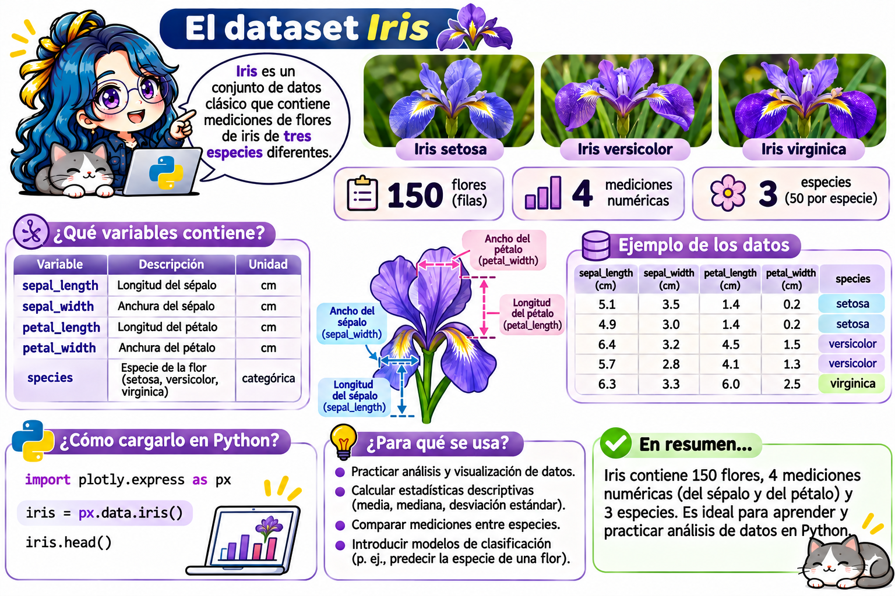
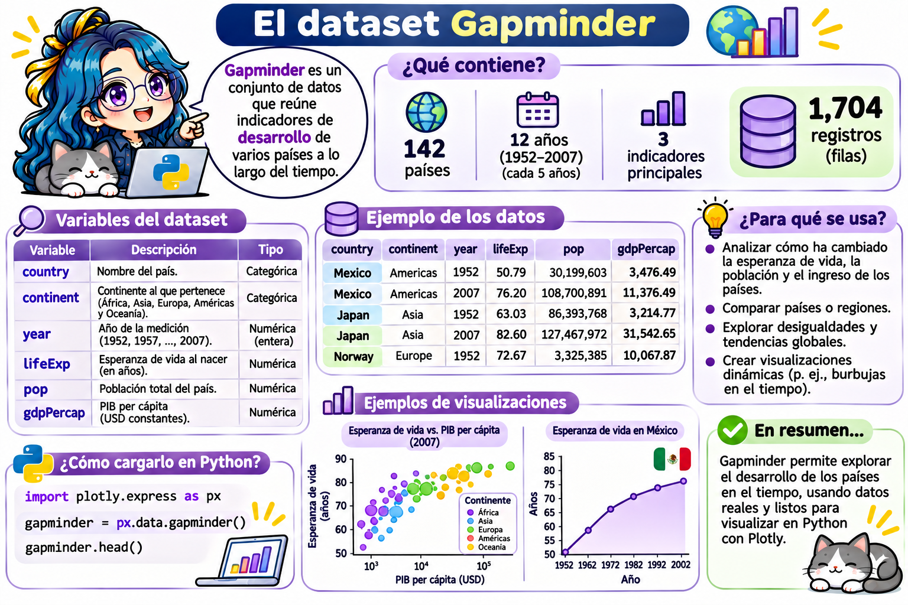

# Visualización de datos con Matplotlib y Plotly



```{r}
#| include: false
# Usar el entorno del curso (~/.venvs/quarto-python) si existe, aunque RStudio tenga configurado otro Python.
# Si no existe, reticulate descarga automáticamente las bibliotecas necesarias.
venv_python <- path.expand(c("~/.venvs/quarto-python/bin/python", "~/.venvs/quarto-python/Scripts/python.exe"))
venv_python <- venv_python[file.exists(venv_python)]
if (length(venv_python) > 0) {
  Sys.setenv(RETICULATE_PYTHON = venv_python[1])
} else {
  reticulate::py_require(c("numpy", "pandas", "matplotlib", "sympy", "plotly"))
}
```

```{python}
#| include: false
# Hace que fig.show() muestre las figuras de Plotly dentro del libro
# (en Jupyter, Colab o Quarto con jupyter: python3, fig.show() funciona sin esta configuración).
import plotly.graph_objects as go
_primera_figura = True
def _mostrar_en_libro(self, *args, **kwargs):
    global _primera_figura
    html = self.to_html(include_plotlyjs="cdn" if _primera_figura else False, full_html=False)
    print("```{=html}\n" + html + "\n```")   # Bloque de HTML puro para que Quarto no lo modifique
    _primera_figura = False
go.Figure.show = _mostrar_en_libro
```

> **Fecha:** 03 de noviembre, 2026

Una buena gráfica permite ver en segundos lo que en una tabla de números tardaríamos mucho en descubrir: tendencias, relaciones, valores atípicos o el comportamiento de una función.

En este capítulo usaremos dos bibliotecas:

|   | Matplotlib | Plotly |
|------------------------|------------------------|------------------------|
| Tipo de gráfica | **Estática** (imagen). | **Interactiva** (zoom, desplazamiento, información al pasar el ratón). |
| Ideal para | Artículos, tesis, reportes en PDF. | Páginas web, exploración de datos, presentaciones. |
| Formato de salida | PNG, PDF, SVG. | HTML. |
| Estilo de código | Se construye paso a paso (ejes, líneas, etiquetas). | Una función crea la gráfica completa. |

## Antes de empezar

Las bibliotecas de este capítulo (`numpy`, `pandas`, `matplotlib`, `plotly` y `sympy`) ya las instalaste en tu entorno `quarto-python` en el capítulo [Configuraciones para usar Quarto con Python](quarto_python.qmd). Si necesitas repasar algo, consulta ahí:

| Si necesitas... | Consulta |
|------------------------------------|------------------------------------|
| Instalar las bibliotecas | [Paso 3. Instalar todos los paquetes del curso](quarto_python.qmd#paso-3.-instalar-todos-los-paquetes-del-curso) |
| Comprobar que RStudio usa tu entorno | [Paso 6. Verificar que todo funciona](quarto_python.qmd#paso-6.-verificar-que-todo-funciona) |
| Resolver `ModuleNotFoundError: No module named 'matplotlib'` (o `'plotly'`) | [Solución de problemas: `ModuleNotFoundError` al ejecutar o renderizar desde RStudio](quarto_python.qmd#modulenotfounderror-al-ejecutar-o-renderizar-desde-rstudio) |

En Google Colab y en los editores de esta página las bibliotecas **ya están disponibles**. Por convención se importan así:

```{python}
import numpy as np
import matplotlib.pyplot as plt
import plotly.express as px
```

## Matplotlib: la estructura de una gráfica

Toda gráfica de Matplotlib se compone de una **figura** (`Figure`, el lienzo completo) que contiene uno o más **ejes** (`Axes`, cada gráfica con sus ejes $x$ y $y$).

```{python}
x = np.linspace(-3, 3, 100)        # 100 puntos entre -3 y 3

plt.figure(figsize=(6, 4))          # Tamaño de la figura en pulgadas
plt.plot(x, x**2, label="$f(x) = x^2$")
plt.plot(x, -x**2 + 5, label="$g(x) = -x^2 + 5$", linestyle="--")
plt.xlabel("x")
plt.ylabel("y")
plt.title("Dos parábolas")
plt.legend()
plt.grid(True)
plt.show()
```

| Función | ¿Qué hace? |
|------------------------------------|------------------------------------|
| `plt.figure(figsize=(ancho, alto))` | Crea una figura nueva del tamaño indicado. |
| `plt.plot(x, y)` | Dibuja una línea que une los puntos. |
| `plt.xlabel()`, `plt.ylabel()` | Etiquetas de los ejes. |
| `plt.title()` | Título. |
| `plt.legend()` | Muestra la leyenda (usa el argumento `label` de cada línea). |
| `plt.grid(True)` | Agrega una cuadrícula. |
| `plt.xlim()`, `plt.ylim()` | Límites de los ejes. |
| `plt.savefig("archivo.png", dpi=300)` | Guarda la figura en un archivo. |
| `plt.show()` | Muestra la figura. |

Los textos entre signos de dólar, como `"$f(x) = x^2$"`, se escriben en **LaTeX**, igual que en Markdown.

### Personalizar líneas y marcadores

| Argumento   | Valores comunes                                             |
|------------------------------------|------------------------------------|
| `color`     | `"red"`, `"tab:blue"`, `"#007f99"`                          |
| `linestyle` | `"-"` (continua), `"--"` (guiones), `":"` (puntos), `"-."`  |
| `linewidth` | Grosor de la línea, por ejemplo `2`.                        |
| `marker`    | `"o"` (círculo), `"s"` (cuadrado), `"^"` (triángulo), `"x"` |
| `alpha`     | Transparencia entre `0` y `1`.                              |

### Anotaciones

`plt.annotate()` agrega un texto con una flecha que señala un punto. Por ejemplo, el máximo de $g(x) = -x^2 + 5$:

```{python}
plt.figure(figsize=(6, 4))
plt.plot(x, -x**2 + 5, color="tab:orange")
plt.scatter([0], [5], color="black", zorder=3)
plt.annotate("Máximo (0, 5)", xy=(0, 5), xytext=(1, 5.5),
             arrowprops=dict(arrowstyle="->"))
plt.ylim(-5, 7)
plt.title("$g(x) = -x^2 + 5$")
plt.show()
```

### Área entre curvas

```{python}
x = np.linspace(0, 2 * np.pi, 200)

plt.figure(figsize=(6, 4))
plt.plot(x, np.sin(x), label="sen(x)")
plt.plot(x, np.cos(x), label="cos(x)")
plt.fill_between(x, np.sin(x), np.cos(x), alpha=0.3)
plt.legend()
plt.title("Área entre sen(x) y cos(x)")
plt.show()
```

## Varias gráficas en una figura: `subplots()`

Con `plt.subplots(filas, columnas)` creamos una cuadrícula de gráficas. Esta forma de trabajar se llama **orientada a objetos**: cada gráfica es un objeto `ax` con sus propios **métodos**.

```{python}
x = np.linspace(0.1, 2 * np.pi, 200)

fig, axs = plt.subplots(2, 2, figsize=(8, 6))

axs[0, 0].plot(x, np.sin(x))
axs[0, 0].set_title("sen(x)")

axs[0, 1].plot(x, np.cos(x), color="tab:orange")
axs[0, 1].set_title("cos(x)")

axs[1, 0].plot(x, np.exp(-x), color="tab:green")
axs[1, 0].set_title("$e^{-x}$")

axs[1, 1].plot(x, np.log(x), color="tab:red")
axs[1, 1].set_title("ln(x)")

fig.tight_layout()   # Evita que se encimen los títulos
plt.show()
```

| Estilo `plt`   | Estilo orientado a objetos (`ax`) |
|----------------|-----------------------------------|
| `plt.plot()`   | `ax.plot()`                       |
| `plt.title()`  | `ax.set_title()`                  |
| `plt.xlabel()` | `ax.set_xlabel()`                 |
| `plt.xlim()`   | `ax.set_xlim()`                   |
| `plt.legend()` | `ax.legend()`                     |

Observa que `axs` es un **arreglo de NumPy** de 2 × 2, por eso usamos `axs[fila, columna]`.

## Tipos de gráficas

| Gráfica | ¿Para qué sirve? | Matplotlib | Plotly Express |
|------------------|------------------|------------------|------------------|
| Línea | Funciones, tendencias en el tiempo. | `plt.plot()` | `px.line()` |
| Dispersión | Relación entre dos variables. | `plt.scatter()` | `px.scatter()` |
| Barras | Comparar categorías. | `plt.bar()` | `px.bar()` |
| Histograma | Distribución de una variable. | `plt.hist()` | `px.histogram()` |
| Caja (*boxplot*) | Mediana, cuartiles y valores atípicos. | `plt.boxplot()` | `px.box()` |
| Pastel | Proporciones de un total (pocas categorías). | `plt.pie()` | `px.pie()` |
| Curvas de nivel | Funciones de dos variables $f(x, y)$. | `plt.contour()` | `go.Contour()` |
| Mapa de calor | Matrices de valores. | `plt.imshow()` | `px.imshow()` |
| Superficie 3D | Funciones $z = f(x, y)$. | `ax.plot_surface()` | `go.Surface()` |

### Dispersión con mapa de colores

```{python}
rng = np.random.default_rng(seed=2026)
puntos_x = rng.normal(size=300)
puntos_y = rng.normal(size=300)
angulo = np.arctan2(puntos_y, puntos_x)

plt.figure(figsize=(5, 4))
plt.scatter(puntos_x, puntos_y, c=angulo, cmap="viridis", alpha=0.8)
plt.colorbar(label="Ángulo (radianes)")
plt.title("Puntos aleatorios coloreados por su ángulo")
plt.axis("equal")
plt.show()
```

### Datos para los ejemplos

Para las siguientes gráficas usaremos calificaciones **simuladas** con números aleatorios de NumPy (con semilla, para obtener siempre los mismos datos):

```{python}
rng = np.random.default_rng(seed=2026)

niveles = ["MB", "B", "S", "NA"]
estudiantes_por_nivel = [28, 45, 35, 12]

calificaciones = np.clip(rng.normal(7.8, 1.3, 120), 0, 10)   # 120 calificaciones entre 0 y 10
grupo_a = rng.normal(7.5, 1.0, 40)
grupo_b = rng.normal(8.2, 0.8, 40)
grupo_c = rng.normal(6.9, 1.4, 40)
```

`rng.normal(media, desviacion, n)` genera `n` números con distribución normal, y `np.clip(datos, 0, 10)` recorta los valores para que queden entre 0 y 10.

### Gráfica de barras: `plt.bar()`

Una gráfica de barras **compara cantidades entre categorías**. Recibe las categorías (eje $x$) y la altura de cada barra (eje $y$):

```{python}
plt.figure(figsize=(6, 4))
plt.bar(niveles, estudiantes_por_nivel, color="tab:blue")
plt.xlabel("Nivel")
plt.ylabel("Número de estudiantes")
plt.title("Estudiantes por nivel")
plt.show()
```

Para barras horizontales usa `plt.barh()`, útil cuando los nombres de las categorías son largos.

### Histograma: `plt.hist()`

Un histograma muestra la **distribución** de una variable numérica: divide el rango de los datos en intervalos (*bins*) y cuenta cuántos datos caen en cada uno.

```{python}
plt.figure(figsize=(6, 4))
plt.hist(calificaciones, bins=15, color="tab:green", edgecolor="white")
plt.axvline(calificaciones.mean(), color="black", linestyle="--", label="Media")
plt.xlabel("Calificación")
plt.ylabel("Número de estudiantes")
plt.title("Histograma de calificaciones")
plt.legend()
plt.show()
```

- `bins` es el número de intervalos: pocos *bins* ocultan detalles y demasiados producen una gráfica "con ruido".
- `plt.axvline(valor)` dibuja una línea **vertical**; `plt.axhline(valor)`, una **horizontal**.

::: callout-note
No confundas un histograma con una gráfica de barras: las barras comparan **categorías** (MB, B, S, NA), mientras que el histograma agrupa **valores numéricos** en intervalos.
:::

### Diagrama de caja: `plt.boxplot()`

Un diagrama de caja (*boxplot*) resume una distribución con cinco valores y permite **comparar varios grupos**:

```{python}
plt.figure(figsize=(6, 4))
plt.boxplot([grupo_a, grupo_b, grupo_c])
plt.xticks([1, 2, 3], ["Grupo A", "Grupo B", "Grupo C"])
plt.ylabel("Calificación")
plt.title("Calificaciones por grupo")
plt.show()
```

| Parte de la caja | ¿Qué representa? |
|------------------------------------|------------------------------------|
| Línea dentro de la caja | La **mediana**. |
| Borde inferior y superior de la caja | Primer y tercer **cuartil** (el 50 % central de los datos). |
| "Bigotes" | El rango de los datos sin contar valores atípicos. |
| Puntos aislados | **Valores atípicos** (muy alejados del resto). |

### Gráfica de pastel: `plt.pie()`

Una gráfica de pastel muestra la **proporción** de cada categoría respecto al total:

```{python}
plt.figure(figsize=(5, 5))
plt.pie(estudiantes_por_nivel, labels=niveles, autopct="%1.0f%%")
plt.title("Proporción de estudiantes por nivel")
plt.show()
```

`autopct="%1.0f%%"` muestra el porcentaje de cada rebanada sin decimales. Úsala solo con **pocas** categorías; si hay muchas, una gráfica de barras se lee mejor.

### Las cuatro gráficas en una sola figura

Ahora que conocemos cada gráfica, podemos reunirlas en una figura de 2 × 2 con `plt.subplots()`. Observa que el código de cada gráfica es el mismo, pero ahora usamos los **métodos** de cada `ax` (`axs[0, 0].bar()`, `axs[0, 0].set_title()`...) en lugar de `plt.bar()` y `plt.title()`:

```{python}
fig, axs = plt.subplots(2, 2, figsize=(9, 7))

axs[0, 0].bar(niveles, estudiantes_por_nivel, color="tab:blue")
axs[0, 0].set_title("Barras: estudiantes por nivel")
axs[0, 0].set_ylabel("Número de estudiantes")

axs[0, 1].hist(calificaciones, bins=15, color="tab:green", edgecolor="white")
axs[0, 1].axvline(calificaciones.mean(), color="black", linestyle="--", label="Media")
axs[0, 1].set_title("Histograma de calificaciones")
axs[0, 1].legend()

axs[1, 0].boxplot([grupo_a, grupo_b, grupo_c])
axs[1, 0].set_xticks([1, 2, 3], ["Grupo A", "Grupo B", "Grupo C"])
axs[1, 0].set_title("Caja: calificaciones por grupo")

axs[1, 1].pie(estudiantes_por_nivel, labels=niveles, autopct="%1.0f%%")
axs[1, 1].set_title("Pastel: proporción por nivel")

fig.tight_layout()
plt.show()
```

## Funciones de dos variables

Para graficar una función de dos variables, por ejemplo $f(x, y) = \sin(x)\cos(y)$, seguimos tres pasos: crear una **malla** de puntos, **evaluar** la función en la malla y **graficar** el resultado.

### Paso 1. Crear una malla con `np.meshgrid()`

Para graficar $f(x)$ basta un vector de valores de $x$. Para $f(x, y)$ necesitamos **todas las combinaciones** de valores de $x$ y de $y$. `np.meshgrid()` construye esas combinaciones a partir de dos vectores. Veámoslo con pocos puntos:

```{python}
x_chico = np.array([0, 1, 2])
y_chico = np.array([10, 20])

X_chico, Y_chico = np.meshgrid(x_chico, y_chico)
print("X =\n", X_chico)
print("Y =\n", Y_chico)
```

Cada posición `[i, j]` de las matrices `X` y `Y` corresponde a un punto $(x, y)$ de la malla: por ejemplo, `X[1, 2]` y `Y[1, 2]` forman el punto $(2, 20)$.

### Paso 2. Evaluar la función en la malla

Como `X` y `Y` son arreglos de NumPy, la función se evalúa en **todos** los puntos a la vez:

```{python}
x = np.linspace(-2 * np.pi, 2 * np.pi, 200)
y = np.linspace(-2 * np.pi, 2 * np.pi, 200)
X, Y = np.meshgrid(x, y)
Z = np.sin(X) * np.cos(Y)

print("Forma de la malla:", X.shape)   # 200 × 200 = 40 000 puntos
print("Forma de Z:", Z.shape)
```

### Paso 3a. Mapa de calor: `plt.imshow()`

Un mapa de calor pinta cada valor de `Z` con un color según su magnitud:

```{python}
plt.figure(figsize=(5, 4))
plt.imshow(Z, extent=[x.min(), x.max(), y.min(), y.max()], origin="lower", cmap="RdBu")
plt.colorbar(label="f(x, y)")
plt.xlabel("x")
plt.ylabel("y")
plt.title("Mapa de calor de sen(x)·cos(y)")
plt.show()
```

- `extent` indica los valores de $x$ y $y$ en los bordes de la imagen (si no, los ejes mostrarían las posiciones de la matriz).
- `origin="lower"` coloca la fila 0 abajo, como en un plano cartesiano.
- `cmap` es la **paleta de colores**; `"RdBu"` va de rojo (negativos) a azul (positivos).

### Paso 3b. Curvas de nivel: `plt.contour()`

Las curvas de nivel unen los puntos donde la función tiene **el mismo valor**, como en un mapa topográfico:

```{python}
plt.figure(figsize=(5, 4))
curvas = plt.contour(X, Y, Z, levels=8, cmap="RdBu")
plt.clabel(curvas, fontsize=7)        # Escribe el valor de cada curva
plt.xlabel("x")
plt.ylabel("y")
plt.title("Curvas de nivel de sen(x)·cos(y)")
plt.show()
```

`levels` indica cuántas curvas dibujar. Con `plt.contourf()` (con *f* de *filled*) se rellenan las regiones entre curvas.

### Las dos gráficas juntas

Finalmente, comparamos ambas representaciones lado a lado con `plt.subplots(1, 2)`:

```{python}
fig, axs = plt.subplots(1, 2, figsize=(10, 4))

imagen = axs[0].imshow(Z, extent=[x.min(), x.max(), y.min(), y.max()], origin="lower", cmap="RdBu")
fig.colorbar(imagen, ax=axs[0])
axs[0].set_title("Mapa de calor (imshow)")

curvas = axs[1].contour(X, Y, Z, levels=8, cmap="RdBu")
axs[1].clabel(curvas, fontsize=7)
axs[1].set_title("Curvas de nivel (contour)")

fig.tight_layout()
plt.show()
```

## De SymPy a una gráfica

En el capítulo de [SymPy](python_sympy.qmd) vimos que `sp.lambdify()` convierte una expresión simbólica en una función de NumPy. Así podemos graficar una función junto con su derivada:

```{python}
import sympy as sp

s = sp.symbols("x")
f = s**3 - 3*s
derivada = sp.diff(f, s)

f_np = sp.lambdify(s, f, "numpy")
d_np = sp.lambdify(s, derivada, "numpy")

x = np.linspace(-2.5, 2.5, 200)
plt.figure(figsize=(6, 4))
plt.plot(x, f_np(x), label=f"$f(x) = {sp.latex(f)}$")
plt.plot(x, d_np(x), label=f"$f'(x) = {sp.latex(derivada)}$")
plt.axhline(0, color="gray", linewidth=0.8)
plt.legend()
plt.title("Una función y su derivada")
plt.show()
```

Observa que los máximos y mínimos de $f$ ocurren donde la derivada vale cero.

## Plotly: gráficas interactivas

[Plotly Express](https://plotly.com/python/plotly-express/) crea una gráfica completa con **una sola función**. Las gráficas son interactivas: pasa el ratón sobre los puntos, haz zoom seleccionando un área y da doble clic para regresar a la vista original.

Toda gráfica de Plotly sigue los mismos tres pasos:

``` python
import plotly.express as px                      # 1. Importar

fig = px.scatter(datos, x="columna_x", y="columna_y")   # 2. Crear la figura (se guarda en la variable fig)

fig.show()                                       # 3. Mostrar la figura
```

::: callout-note
## ¿Qué hace `fig.show()`?

Crear la figura (`fig = px.scatter(...)`) **no** la dibuja: solo la guarda en la variable `fig`. Para verla hay que llamar al método `fig.show()`, igual que con `plt.show()` en Matplotlib. Funciona igual en Jupyter Notebook, Google Colab, en un documento de Quarto y en este libro.
:::

### Datos de ejemplo: `px.data`

`px.data` es un **módulo de Plotly que incluye conjuntos de datos reales para practicar**. Vienen dentro de la biblioteca, así que **no necesitas descargar archivos** ni tener internet. Cada función de `px.data` regresa los datos como una **tabla** de pandas (un `DataFrame`):

| Función | Contenido | Filas |
|------------------------|------------------------|------------------------|
| `px.data.iris()` | Medidas de flores de tres especies de iris. | 150 |
| `px.data.gapminder()` | Esperanza de vida, PIB y población de 142 países (1952-2007). | 1704 |
| `px.data.tips()` | Cuentas y propinas en un restaurante. | 244 |
| `px.data.stocks()` | Precio de acciones de seis empresas (2018-2019). | 105 |
| `px.data.wind()` | Dirección e intensidad del viento. | 128 |
| `px.data.medals_long()` | Medallas olímpicas de patinaje por país. | 9 |

Un `DataFrame` es como una hoja de cálculo: tiene **filas** (cada observación) y **columnas** con nombre (cada variable). Veamos el conjunto *iris*, con las medidas en centímetros de 150 flores:

```{python}
iris = px.data.iris()

print(iris.head())                  # Primeras 5 filas
print("Forma:", iris.shape)         # (filas, columnas), igual que en NumPy
print("Columnas:", list(iris.columns))
```

| Columna | Contenido |
|----|----|
| `sepal_length`, `sepal_width` | Largo y ancho del **sépalo** (cm). |
| `petal_length`, `petal_width` | Largo y ancho del **pétalo** (cm). |
| `species` | Especie: *setosa*, *versicolor* o *virginica*. |
| `species_id` | Número de la especie (1, 2 o 3). |

{fig-align="center"}

En las funciones de **Plotly Express**, el primer argumento es el `DataFrame` y los demás indican **qué columna** usar en cada parte de la gráfica, escribiendo su nombre como texto: `x="sepal_length"`.

### Una mini historia del conjunto *iris*

::: {.callout-tip icon="false"}
## 🌸 En pocas palabras

El conjunto *iris* nació de una **pregunta biológica**: ¿podemos distinguir especies de flores utilizando **únicamente sus características físicas**? En 1936, Fisher demostró que **las matemáticas podían ayudarnos a responderla**. Hoy, casi 90 años después, seguimos utilizando esos mismos datos para aprender **estadística, programación e inteligencia artificial**.
:::

**El botánico que midió las flores.** A mediados de la década de 1930, el botánico estadounidense **Edgar Anderson** quería entender cómo se diferencian y evolucionan las especies de plantas. Para ello midió con cuidado el sépalo y el pétalo de cientos de flores de iris; gran parte de ellas las recolectó en la **península de Gaspé**, en Quebec, Canadá. Anderson tomó 50 flores de cada una de tres especies: *Iris setosa*, *Iris versicolor* e *Iris virginica*.

**El estadístico que lo hizo famoso.** En 1936, el estadístico y matemático británico **Ronald A. Fisher** usó las mediciones de Anderson en el artículo *"The use of multiple measurements in taxonomic problems"* (El uso de mediciones múltiples en problemas taxonómicos). Ahí presentó el **análisis discriminante lineal**: un método para encontrar la **combinación lineal** de las cuatro mediciones que mejor separa a las especies. Por eso el conjunto también se conoce como el ***iris*** **de Fisher** o el ***iris*** **de Anderson**.

**¿Por qué sigue siendo tan usado casi 90 años después?** Porque es pequeño (150 filas), no tiene datos faltantes, sus variables son fáciles de entender y tiene una estructura interesante: *setosa* se separa claramente de las otras dos especies, mientras que *versicolor* y *virginica* se **traslapan** un poco. Eso lo hace perfecto para probar métodos y verificar si funcionan. Lo verás en las gráficas de este capítulo.

| Área | ¿Para qué se usa el conjunto *iris*? |
|------------------------------------|------------------------------------|
| **Botánica y taxonomía** | Su origen: estudiar cómo se distinguen las especies a partir de mediciones. |
| **Estadística** | Estadística descriptiva, pruebas de hipótesis y análisis multivariado, como el análisis discriminante lineal de Fisher. |
| **Álgebra lineal** | Ejemplo clásico de **proyecciones**: el análisis de componentes principales (PCA) y el análisis discriminante reducen las 4 dimensiones a 2 que se pueden graficar. |
| **Aprendizaje automático** (*machine learning*) | Primer ejemplo de **clasificación** (predecir la especie a partir de las medidas) y de **agrupamiento** (encontrar grupos sin conocer la especie, por ejemplo con *k-means*). Es uno de los conjuntos más descargados del [repositorio de aprendizaje automático de UCI](https://archive.ics.uci.edu/dataset/53/iris), donde está disponible desde 1988. |
| **Visualización de datos** | Ejemplo estándar para enseñar gráficas de dispersión, histogramas, diagramas de caja y matrices de gráficas. |
| **Programación y software** | Viene incluido en muchas herramientas: en R (`iris`), en Python con `plotly.express`, `seaborn` y `scikit-learn`. Se usa para probar que un programa funciona. |

Como ya lo conoces de R, puedes compararlo: en la **Console** de R, `head(iris)` muestra las mismas primeras filas, con las columnas `Sepal.Length`, `Sepal.Width`, `Petal.Length`, `Petal.Width` y `Species`.

::: callout-note
## Un dato para reflexionar

Fisher hizo aportaciones fundamentales a la estadística, pero también promovió la **eugenesia**, una ideología hoy rechazada, y publicó este trabajo en la revista *Annals of Eugenics*. Por eso, algunos docentes prefieren usar conjuntos alternativos, como [*Palmer penguins*](https://allisonhorst.github.io/palmerpenguins/) (medidas de pingüinos de la Antártida, publicado en 2020), que tiene una estructura parecida. Conocer el origen de los datos también es parte de analizarlos con responsabilidad.
:::

### Dispersión

```{python}
#| output: asis
fig = px.scatter(iris, x="sepal_length", y="sepal_width", color="species",
                 title="Iris: largo vs. ancho del sépalo",
                 labels={"sepal_length": "Largo del sépalo (cm)",
                         "sepal_width": "Ancho del sépalo (cm)",
                         "species": "Especie"})
fig.show()
```

Con el argumento `color`, Plotly asigna un color a cada especie y crea la leyenda automáticamente. Da clic en una especie de la leyenda para ocultarla. El argumento `labels` cambia los nombres de las columnas por textos más claros en los ejes y la leyenda.

### Línea

Plotly Express también acepta arreglos de NumPy en lugar de un `DataFrame`:

```{python}
#| output: asis
x = np.linspace(0, 4 * np.pi, 200)
fig = px.line(x=x, y=np.sin(x) * np.exp(-x / 5),
              labels={"x": "x", "y": "f(x)"},
              title="Oscilación amortiguada: f(x) = sen(x)·e^(-x/5)")
fig.show()
```

### Histograma y caja

```{python}
#| output: asis
fig = px.histogram(iris, x="petal_length", color="species", nbins=30,
                   marginal="box", title="Largo del pétalo por especie",
                   labels={"petal_length": "Largo del pétalo (cm)", "species": "Especie"})
fig.show()
```

El argumento `marginal="box"` agrega un diagrama de caja arriba del histograma.

### Superficie en 3D

Plotly Express no tiene una función para superficies, así que usamos el módulo `plotly.graph_objects` (abreviado `go`), que permite construir gráficas más elaboradas pieza por pieza. La malla se construye con `np.meshgrid()`, igual que en Matplotlib:

```{python}
#| output: asis
import plotly.graph_objects as go

# 1. Crear la malla y evaluar la función
x = np.linspace(-2 * np.pi, 2 * np.pi, 80)
y = np.linspace(-2 * np.pi, 2 * np.pi, 80)
X, Y = np.meshgrid(x, y)
Z = np.sin(X) * np.cos(Y)

# 2. Crear la figura con una superficie
fig = go.Figure(go.Surface(x=X, y=Y, z=Z, colorscale="RdBu"))

# 3. Agregar título y tamaño
fig.update_layout(title="z = sen(x)·cos(y)", width=650, height=550)

# 4. Mostrar
fig.show()
```

Gira la superficie arrastrando con el ratón y acércate con la rueda del ratón.

| Parte | ¿Qué hace? |
|------------------------------------|------------------------------------|
| `go.Surface(x=X, y=Y, z=Z)` | Crea la **superficie** a partir de la malla. |
| `colorscale="RdBu"` | Paleta de colores (como `cmap` en Matplotlib). |
| `go.Figure(...)` | Crea la **figura** que contiene la superficie. |
| `fig.update_layout(...)` | Modifica el diseño: título, tamaño, ejes. |
| `fig.show()` | Muestra la figura. |

### Animaciones

{fig-align="center"}

El conjunto *gapminder* contiene la esperanza de vida, el PIB per cápita y la población de 142 países entre 1952 y 2007, cada 5 años. Primero veamos sus columnas:

```{python}
gapminder = px.data.gapminder()
print(gapminder.head())
```

Con el argumento `animation_frame`, Plotly crea **un cuadro por cada valor** de una columna (aquí, uno por año) y agrega un botón ▶ y una barra deslizante para recorrerlos:

```{python}
#| output: asis
fig = px.scatter(
    gapminder,                    # 1. Datos
    x="gdpPercap",                # 2. Eje x: PIB per cápita
    y="lifeExp",                  #    Eje y: esperanza de vida
    size="pop",                   # 3. Tamaño del punto: población
    color="continent",            #    Color del punto: continente
    hover_name="country",         # 4. Nombre que aparece al pasar el ratón
    animation_frame="year",       # 5. Un cuadro de la animación por cada año
    log_x=True,                   # 6. Escala logarítmica en el eje x
    size_max=50,                  #    Tamaño máximo de los puntos
    range_y=[25, 90],             #    Rango fijo del eje y en todos los cuadros
    labels={"gdpPercap": "PIB per cápita (escala log)", "lifeExp": "Esperanza de vida",
            "continent": "Continente", "year": "Año", "pop": "Población"},   # 7. Textos
    title="Esperanza de vida vs. PIB per cápita"
)
fig.show()                        # 8. Mostrar
```

El código se divide en estas partes:

| Parte | Argumentos | ¿Qué hace? |
|------------------------|------------------------|------------------------|
| 1\. Datos | `gapminder` | El `DataFrame` con la información. Cada fila es un país en un año. |
| 2\. Ejes | `x="gdpPercap"`, `y="lifeExp"` | Qué columnas se grafican en cada eje. |
| 3\. Tamaño y color | `size="pop"`, `color="continent"` | Cada punto es más grande si el país tiene más población y tiene el color de su continente. Así una sola gráfica muestra **cuatro** variables. |
| 4\. Información al pasar el ratón | `hover_name="country"` | Muestra el nombre del país en la etiqueta emergente. |
| 5\. Animación | `animation_frame="year"` | Separa los datos por año: cada año es un cuadro de la animación. |
| 6\. Ajustes de los ejes | `log_x=True`, `size_max=50`, `range_y=[25, 90]` | La escala logarítmica evita que los países ricos aplasten a los demás; `range_y` mantiene el eje fijo para que los cuadros sean comparables. |
| 7\. Textos | `labels`, `title` | Nombres claros en español para ejes, leyenda y título. |
| 8\. Mostrar | `fig.show()` | Dibuja la gráfica con sus controles de animación. |

Presiona ▶ para ver cómo cambian los países con el tiempo, o mueve la barra deslizante para elegir un año. Pasa el ratón sobre un punto para ver de qué país se trata.

### Guardar una gráfica de Plotly

``` python
fig.write_html("mi_grafica.html")   # Archivo HTML interactivo (se abre en el navegador)
fig.write_image("mi_grafica.png")   # Imagen estática (requiere el paquete kaleido)
```

## Buenas prácticas de visualización

| Práctica | ¿Por qué? |
|------------------------------------|------------------------------------|
| Etiqueta **siempre** los ejes, con unidades. | Una gráfica sin etiquetas no se puede interpretar. |
| Usa un título que diga **qué** muestra la gráfica. | El lector debe entenderla sin leer el código. |
| Elige el tipo de gráfica según la **pregunta**. | Comparar → barras; distribución → histograma; relación → dispersión. |
| Evita las gráficas de pastel con muchas categorías. | Es difícil comparar ángulos; mejor usa barras. |
| Inicia los ejes de las barras en **cero**. | Si no, las diferencias parecen mayores de lo que son. |
| Usa paletas aptas para daltonismo, como `viridis`. | Aproximadamente 1 de cada 12 hombres tiene alguna forma de daltonismo. |
| No sobrecargues la gráfica. | Demasiadas líneas o colores ocultan el mensaje principal. |

## Ejercicios

Resuelve los ejercicios en los editores interactivos. Recuerda que lo que escribas **no se guarda** al recargar la página. La primera vez que ejecutes un editor, las bibliotecas pueden tardar unos segundos en cargar.

Como en estos ejercicios el resultado es una gráfica, no hay revisión automática: compara tu gráfica con la de la solución.

### Ejercicio 1. Dos parábolas y sus intersecciones

1.  Grafica $f(x) = x^2$ y $g(x) = -x^2 + 5$ en el intervalo $[-3, 3]$, con leyenda, etiquetas y cuadrícula.
2.  Las parábolas se cortan donde $x^2 = -x^2 + 5$, es decir, en $x = \pm\sqrt{5/2}$. Marca esos dos puntos con `plt.scatter()`.

```{pyodide}
#| exercise: vis1
import numpy as np
import matplotlib.pyplot as plt

x = np.linspace(-3, 3, 100)

plt.plot(x, ______, label="f(x) = x²")
plt.plot(x, ______, label="g(x) = -x² + 5")

xi = np.array([-np.sqrt(5 / 2), np.sqrt(5 / 2)])
plt.scatter(______, ______, color="black", zorder=3, label="Intersecciones")

plt.xlabel("x")
plt.ylabel("y")
plt.legend()
plt.grid(True)
plt.show()
```

:::: {.hint exercise="vis1"}
::: {.callout-note collapse="false"}
## Pista

Las funciones son `x**2` y `-x**2 + 5`. Los puntos de intersección tienen coordenadas `xi` y `xi**2`.
:::
::::

:::: {.solution exercise="vis1"}
::: {.callout-tip collapse="false"}
## Solución

``` python
import numpy as np
import matplotlib.pyplot as plt

x = np.linspace(-3, 3, 100)

plt.plot(x, x**2, label="f(x) = x²")
plt.plot(x, -x**2 + 5, label="g(x) = -x² + 5")

xi = np.array([-np.sqrt(5 / 2), np.sqrt(5 / 2)])
plt.scatter(xi, xi**2, color="black", zorder=3, label="Intersecciones")

plt.xlabel("x")
plt.ylabel("y")
plt.legend()
plt.grid(True)
plt.show()
```
:::
::::

### Ejercicio 2. Histograma de una distribución normal

1.  Genera 1000 números aleatorios con distribución normal de media 170 y desviación estándar 8 (estaturas en centímetros), con la semilla `2026`.
2.  Haz un histograma con 30 barras.
3.  Agrega una línea vertical en la media con `plt.axvline()`.

```{pyodide}
#| exercise: vis2
import numpy as np
import matplotlib.pyplot as plt

rng = np.random.default_rng(seed=2026)
estaturas = rng.normal(______, ______, size=______)

plt.hist(estaturas, bins=______, color="tab:blue", edgecolor="white")
plt.axvline(______, color="red", linestyle="--", label="Media")

plt.xlabel("Estatura (cm)")
plt.ylabel("Frecuencia")
plt.title("Distribución de estaturas simuladas")
plt.legend()
plt.show()
```

:::: {.hint exercise="vis2"}
::: {.callout-note collapse="false"}
## Pista

`rng.normal(170, 8, size=1000)`. La media se calcula con `estaturas.mean()`.
:::
::::

:::: {.solution exercise="vis2"}
::: {.callout-tip collapse="false"}
## Solución

``` python
import numpy as np
import matplotlib.pyplot as plt

rng = np.random.default_rng(seed=2026)
estaturas = rng.normal(170, 8, size=1000)

plt.hist(estaturas, bins=30, color="tab:blue", edgecolor="white")
plt.axvline(estaturas.mean(), color="red", linestyle="--", label="Media")

plt.xlabel("Estatura (cm)")
plt.ylabel("Frecuencia")
plt.title("Distribución de estaturas simuladas")
plt.legend()
plt.show()
```
:::
::::

### Ejercicio 3. Cuatro funciones en una figura

Crea una figura de 2 × 2 con `plt.subplots()` y grafica en el intervalo $[-2, 2]$: $x$, $x^2$, $x^3$ y $|x|$. Cada gráfica debe tener su título.

```{pyodide}
#| exercise: vis3
import numpy as np
import matplotlib.pyplot as plt

x = np.linspace(-2, 2, 100)

fig, axs = plt.subplots(______, ______, figsize=(7, 6))

axs[0, 0].plot(x, x)
axs[0, 0].set_title("y = x")

# Completa las otras tres gráficas


fig.tight_layout()
plt.show()
```

:::: {.hint exercise="vis3"}
::: {.callout-note collapse="false"}
## Pista

`plt.subplots(2, 2)`. Las otras posiciones son `axs[0, 1]`, `axs[1, 0]` y `axs[1, 1]`. El valor absoluto es `np.abs(x)`.
:::
::::

:::: {.solution exercise="vis3"}
::: {.callout-tip collapse="false"}
## Solución

``` python
import numpy as np
import matplotlib.pyplot as plt

x = np.linspace(-2, 2, 100)

fig, axs = plt.subplots(2, 2, figsize=(7, 6))

axs[0, 0].plot(x, x)
axs[0, 0].set_title("y = x")

axs[0, 1].plot(x, x**2)
axs[0, 1].set_title("y = x²")

axs[1, 0].plot(x, x**3)
axs[1, 0].set_title("y = x³")

axs[1, 1].plot(x, np.abs(x))
axs[1, 1].set_title("y = |x|")

fig.tight_layout()
plt.show()
```
:::
::::

### Ejercicio 4. Curvas de nivel

Grafica las curvas de nivel del paraboloide $f(x, y) = x^2 + y^2$ en $[-3, 3] \times [-3, 3]$. ¿Qué forma tienen las curvas? ¿Por qué?

```{pyodide}
#| exercise: vis4
import numpy as np
import matplotlib.pyplot as plt

x = np.linspace(-3, 3, 100)
y = np.linspace(-3, 3, 100)
X, Y = ______
Z = ______

curvas = plt.contour(X, Y, Z, levels=10, cmap="viridis")
plt.clabel(curvas, fontsize=8)
plt.axis("equal")
plt.title("Curvas de nivel de f(x, y) = x² + y²")
plt.show()
```

:::: {.hint exercise="vis4"}
::: {.callout-note collapse="false"}
## Pista

`X, Y = np.meshgrid(x, y)` y `Z = X**2 + Y**2`.
:::
::::

:::: {.solution exercise="vis4"}
::: {.callout-tip collapse="false"}
## Solución

``` python
import numpy as np
import matplotlib.pyplot as plt

x = np.linspace(-3, 3, 100)
y = np.linspace(-3, 3, 100)
X, Y = np.meshgrid(x, y)
Z = X**2 + Y**2

curvas = plt.contour(X, Y, Z, levels=10, cmap="viridis")
plt.clabel(curvas, fontsize=8)
plt.axis("equal")
plt.title("Curvas de nivel de f(x, y) = x² + y²")
plt.show()
```

Las curvas son **circunferencias** centradas en el origen: $x^2 + y^2 = c$ es la ecuación de una circunferencia de radio $\sqrt{c}$.
:::
::::

### Ejercicio 5. Una gráfica interactiva con Plotly

Para usar Plotly en los editores de esta página, las primeras líneas del código lo instalan en el navegador y preparan `fig.show()` para que muestre la gráfica. **No las modifiques.** En Jupyter o Colab no las necesitas.

::: callout-note
La primera vez que ejecutes un editor con Plotly, la instalación tarda entre 15 y 20 segundos. Ejecuta **un editor de Plotly a la vez** y espera a que aparezca la gráfica antes de ejecutar el siguiente.
:::

Con los datos `iris`, crea una gráfica de dispersión del **largo** (`petal_length`) contra el **ancho** (`petal_width`) del pétalo, con un color por especie (`species`). Pasa el ratón sobre los puntos.

```{pyodide}
#| exercise: vis5
# --- Preparar Plotly en el navegador (no modificar) ---
import micropip
await micropip.install("plotly")
import pandas
import plotly.graph_objects as go
from IPython.display import display, HTML
go.Figure.show = lambda fig, *args, **kwargs: display(HTML(fig.to_html(include_plotlyjs="cdn", full_html=False)))
# -------------------------------------------------------

import plotly.express as px

iris = px.data.iris()

fig = px.scatter(iris, x=______, y=______, color=______,
                 title="Iris: largo vs. ancho del pétalo")
fig.show()
```

:::: {.hint exercise="vis5"}
::: {.callout-note collapse="false"}
## Pista

Los nombres de las columnas se escriben como texto: `x="petal_length"`, `y="petal_width"` y `color="species"`.
:::
::::

:::: {.solution exercise="vis5"}
::: {.callout-tip collapse="false"}
## Solución

``` python
import plotly.express as px

iris = px.data.iris()

fig = px.scatter(iris, x="petal_length", y="petal_width", color="species",
                 title="Iris: largo vs. ancho del pétalo")
fig.show()
```

Observa que con las medidas del pétalo las especies se separan muy bien, sobre todo *setosa*.
:::
::::

### Ejercicio 6. Superficie 3D con Plotly

Grafica la superficie de la **silla de montar** $z = x^2 - y^2$ en $[-2, 2] \times [-2, 2]$ con `go.Surface()`. Gírala con el ratón: ¿por qué crees que se llama así?

```{pyodide}
#| exercise: vis6
# --- Preparar Plotly en el navegador (no modificar) ---
import micropip
await micropip.install("plotly")
import pandas
import plotly.graph_objects as go
from IPython.display import display, HTML
go.Figure.show = lambda fig, *args, **kwargs: display(HTML(fig.to_html(include_plotlyjs="cdn", full_html=False)))
# -------------------------------------------------------

import numpy as np
import plotly.graph_objects as go

x = np.linspace(-2, 2, 60)
y = np.linspace(-2, 2, 60)
X, Y = np.meshgrid(x, y)
Z = ______

fig = go.Figure(go.Surface(x=X, y=Y, z=Z, colorscale="Viridis"))
fig.update_layout(title="Silla de montar: z = x² - y²", width=600, height=500)
fig.show()
```

:::: {.hint exercise="vis6"}
::: {.callout-note collapse="false"}
## Pista

`Z = X**2 - Y**2`.
:::
::::

:::: {.solution exercise="vis6"}
::: {.callout-tip collapse="false"}
## Solución

``` python
import numpy as np
import plotly.graph_objects as go

x = np.linspace(-2, 2, 60)
y = np.linspace(-2, 2, 60)
X, Y = np.meshgrid(x, y)
Z = X**2 - Y**2

fig = go.Figure(go.Surface(x=X, y=Y, z=Z, colorscale="Viridis"))
fig.update_layout(title="Silla de montar: z = x² - y²", width=600, height=500)
fig.show()
```

El origen es un **punto silla**: es un mínimo en la dirección de $x$ y un máximo en la dirección de $y$.
:::
::::

## Reto final: visualizar la convergencia de una serie

En el capítulo de ciclos `for` aproximamos $\pi$ con la serie de Leibniz. Ahora **visualiza** cómo se acerca a $\pi$:

1.  Con NumPy, calcula los primeros 200 términos $4 \cdot \frac{(-1)^k}{2k + 1}$.
2.  Con `np.cumsum()` obtén las **sumas parciales** (la suma acumulada hasta cada término).
3.  Grafica las sumas parciales contra el número de términos y agrega una línea horizontal en $\pi$ con `plt.axhline()`.

```{pyodide}
#| exercise: reto_vis
import numpy as np
import matplotlib.pyplot as plt

k = np.arange(200)
terminos = ______
sumas_parciales = ______

plt.figure(figsize=(7, 4))
plt.plot(k + 1, sumas_parciales, marker=".", linewidth=0.8, label="Sumas parciales")
plt.axhline(______, color="red", linestyle="--", label="π")
plt.ylim(2.8, 3.5)
plt.xlabel("Número de términos")
plt.ylabel("Aproximación")
plt.title("Convergencia de la serie de Leibniz")
plt.legend()
plt.show()
```

:::: {.hint exercise="reto_vis"}
::: {.callout-note collapse="false"}
## Pista

`terminos = 4 * (-1.0) ** k / (2 * k + 1)`, `sumas_parciales = np.cumsum(terminos)` y la línea horizontal en `np.pi`.
:::
::::

:::: {.solution exercise="reto_vis"}
::: {.callout-tip collapse="false"}
## Solución

``` python
import numpy as np
import matplotlib.pyplot as plt

k = np.arange(200)
terminos = 4 * (-1.0) ** k / (2 * k + 1)
sumas_parciales = np.cumsum(terminos)

plt.figure(figsize=(7, 4))
plt.plot(k + 1, sumas_parciales, marker=".", linewidth=0.8, label="Sumas parciales")
plt.axhline(np.pi, color="red", linestyle="--", label="π")
plt.ylim(2.8, 3.5)
plt.xlabel("Número de términos")
plt.ylabel("Aproximación")
plt.title("Convergencia de la serie de Leibniz")
plt.legend()
plt.show()
```

Las sumas parciales **oscilan** alrededor de $\pi$: quedan por arriba cuando el último término es positivo y por debajo cuando es negativo, y cada vez se acercan más. **Extra:** haz la misma gráfica con `px.line()` para poder hacer zoom en las primeras sumas.
:::
::::

## Resumen

| Tema | Idea clave |
|------------------------------------|------------------------------------|
| Matplotlib | Gráficas estáticas: `plt.plot`, `plt.scatter`, `plt.bar`, `plt.hist`, `plt.boxplot`, `plt.pie`. |
| Elementos de una gráfica | `xlabel`, `ylabel`, `title`, `legend`, `grid`, `annotate`, `savefig`. |
| Varias gráficas | `fig, axs = plt.subplots(filas, columnas)` y los métodos `ax.set_title()`, `ax.set_xlabel()`... |
| Funciones $f(x, y)$ | `np.meshgrid()` + `plt.contour()` o `plt.imshow()`. |
| SymPy + Matplotlib | `sp.lambdify()` convierte una expresión en una función de NumPy para graficarla. |
| Plotly Express | Gráficas interactivas con una función: `px.scatter`, `px.line`, `px.histogram`, `px.box`. |
| Plotly Graph Objects | Gráficas avanzadas, como superficies: `go.Surface()`. |
| Mostrar y guardar | `fig.show()`, `fig.write_html()`; en Matplotlib, `plt.show()` y `plt.savefig()`. |

## Referencias

- [Sección 4.8 Visualización de datos, Cómputo Científico (Haydeé Peruyero)](https://haydeeperuyero.github.io/Computo_Cientifico/python.html)
- [Matplotlib: guía de inicio rápido](https://matplotlib.org/stable/users/explain/quick_start.html)
- [Matplotlib: galería de ejemplos](https://matplotlib.org/stable/gallery/index.html)
- [Plotly Express en Python](https://plotly.com/python/plotly-express/)
- [Plotly: galería de gráficas en Python](https://plotly.com/python/)
- [Scientific Python Lectures: Matplotlib](https://lectures.scientific-python.org/intro/matplotlib/index.html)
