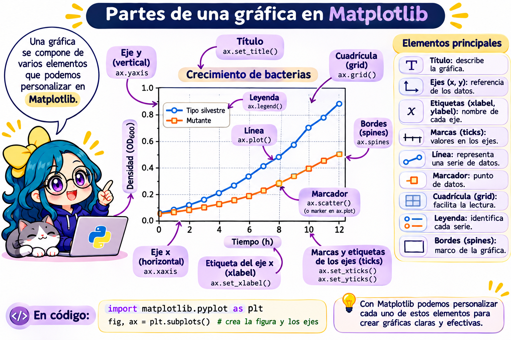
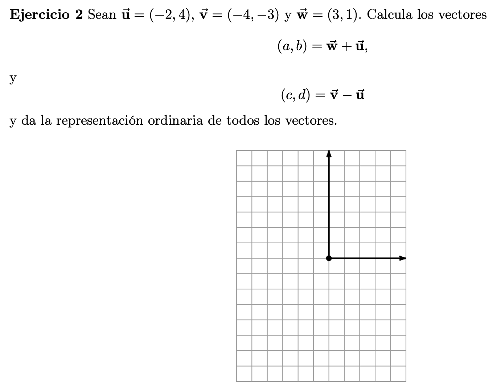

# Visualización de datos con Matplotlib



```{r}
#| include: false
# Mostrar solo el resultado de la última línea de cada bloque de Python (como en Jupyter)
knitr::opts_chunk$set(jupyter_compat = TRUE)
# Usar el entorno del curso (~/.venvs/quarto-python) si existe, aunque RStudio tenga configurado otro Python.
# Si no existe, reticulate descarga automáticamente las bibliotecas necesarias.
venv_python <- path.expand(c("~/.venvs/quarto-python/bin/python", "~/.venvs/quarto-python/Scripts/python.exe"))
venv_python <- venv_python[file.exists(venv_python)]
if (length(venv_python) > 0) {
  Sys.setenv(RETICULATE_PYTHON = venv_python[1])
} else {
  reticulate::py_require(c("numpy", "pandas", "matplotlib", "sympy", "plotly"))
}
```

> **Fecha:** 24 de noviembre, 2026

Una buena gráfica permite ver en segundos lo que en una tabla de números tardaríamos mucho en descubrir: tendencias, relaciones, valores atípicos o el comportamiento de una función.

En este capítulo y en el siguiente usaremos dos bibliotecas:

|   | Matplotlib | Plotly |
|----|----|----|
| Tipo de gráfica | **Estática** (imagen). | **Interactiva** (zoom, desplazamiento, información al pasar el ratón). |
| Ideal para | Artículos, tesis, reportes en PDF. | Páginas web, exploración de datos, presentaciones. |
| Formato de salida | PNG, PDF, SVG. | HTML. |
| Estilo de código | Se construye paso a paso (ejes, líneas, etiquetas). | Una función crea la gráfica completa. |

En este capítulo aprenderemos a construir gráficas con **Matplotlib**, una gráfica por figura. En el siguiente, [Varias gráficas en una figura y gráficas interactivas con Plotly](python_visualizacion_plotly.qmd), reuniremos varias gráficas en una sola figura y haremos gráficas interactivas con **Plotly**.

## Antes de empezar

Este capítulo y el siguiente usan cinco bibliotecas: `numpy`, `pandas`, `matplotlib`, `plotly` y `sympy`. Si seguiste el capítulo [Configuraciones para usar Quarto con Python](quarto_python.qmd), ya están instaladas en tu entorno `quarto-python`. Primero **comprueba** que RStudio las encuentra y, solo si falta alguna, **instálala**.

::: callout-note
En **Google Colab** y en los **editores interactivos** de esta página las bibliotecas **ya están disponibles**: puedes saltar directamente a [Importar las bibliotecas](#importar-las-bibliotecas).
:::

### Paso 1. Comprobar si ya están instaladas

En la pestaña **Console** de RStudio (indicador `>`):

```{r, eval=FALSE}
library(reticulate)
py_config()                          # La línea python: debe mostrar .../.venvs/quarto-python/...

py_module_available("numpy")         # TRUE
py_module_available("pandas")        # TRUE
py_module_available("matplotlib")    # TRUE
py_module_available("plotly")        # TRUE
py_module_available("sympy")         # TRUE
```

- Si todas dicen `TRUE`, ya está todo listo: continúa en [Importar las bibliotecas](#importar-las-bibliotecas).
- Si alguna dice `FALSE`, instálala con el paso 2.
- Si la línea `python:` **no** muestra `.venvs/quarto-python`, RStudio está usando otro Python: revisa el [Paso 4 de la configuración](quarto_python.qmd#paso-4.-indicar-a-quarto-y-a-rstudio-qué-python-usar) antes de instalar nada.

### Paso 2. Instalar los paquetes desde RStudio

Puedes instalarlos de **dos formas**; ambas instalan los paquetes **dentro** del entorno `quarto-python`. Usa solo una.

#### Opción A. Desde la Terminal de RStudio (con `pip`)

Abre la pestaña **Terminal** (indicador `$` o `%`; si no la ves, **Tools \> Terminal \> New Terminal**). Primero **activa el entorno** y después instala:

::: panel-tabset
## macOS y Linux

``` bash
# 1. Activar el entorno (debe aparecer (quarto-python) al inicio de la línea)
source ~/.venvs/quarto-python/bin/activate

# 2. Instalar los paquetes del capítulo
python -m pip install numpy pandas matplotlib plotly sympy

# 3. Comprobar la instalación
python -c "import numpy, pandas, matplotlib, plotly, sympy; print('Todo correcto')"
```

## Windows (Git Bash)

``` bash
# 1. Activar el entorno (debe aparecer (quarto-python) al inicio de la línea)
source ~/.venvs/quarto-python/Scripts/activate

# 2. Instalar los paquetes del capítulo
python -m pip install numpy pandas matplotlib plotly sympy

# 3. Comprobar la instalación
python -c "import numpy, pandas, matplotlib, plotly, sympy; print('Todo correcto')"
```
:::

Al final de la instalación debe aparecer `Successfully installed ...` (o `Requirement already satisfied` si ya estaban), y la comprobación debe imprimir `Todo correcto`.

#### Opción B. Desde la Console de R (con `reticulate`)

Sin salir de R, `reticulate` puede instalar los paquetes en el entorno por ti:

```{r, eval=FALSE}
library(reticulate)

# Instalar los paquetes en el entorno quarto-python
virtualenv_install(
  envname  = path.expand("~/.venvs/quarto-python"),
  packages = c("numpy", "pandas", "matplotlib", "plotly", "sympy")
)

# Comprobar
py_module_available("matplotlib")    # TRUE
py_module_available("plotly")        # TRUE
```

::: callout-important
- Escribe los comandos de **Bash** (`source`, `python -m pip`) en la **Terminal**, y los de **R** (`library()`, `virtualenv_install()`) en la **Console**. Es el error más común.
- Los paquetes se instalan **una sola vez**: quedan guardados en el entorno y no necesitas reinstalarlos cada vez que abras RStudio.
- Si después de instalar sigue apareciendo `ModuleNotFoundError: No module named 'matplotlib'`, ve a **Session \> Restart R** y vuelve a intentarlo. Si el error continúa, consulta la [solución de problemas](quarto_python.qmd#modulenotfounderror-al-ejecutar-o-renderizar-desde-rstudio).
:::

### Importar las bibliotecas {#importar-las-bibliotecas}

Por convención, al inicio de cada documento o *notebook* se importan así:

```{python}
import numpy as np
import matplotlib.pyplot as plt
```

## Partes de una gráfica en Matplotlib

Antes de dibujar, conviene conocer **cómo está construida** una gráfica. Cada elemento que ves (título, ejes, líneas, leyenda...) es una **pieza** que podemos agregar y personalizar por separado:

{fig-align="center"}

### Una gráfica se construye por capas

Matplotlib trabaja como si dibujáramos sobre **hojas transparentes encimadas**: cada instrucción agrega una **capa** encima de las anteriores, y al final `plt.show()` muestra el resultado completo.

1.  **La figura** (`Figure`): el **lienzo** completo, la "hoja" donde va todo. Define el tamaño.
2.  **Los ejes** (`Axes`): el **área de la gráfica** dentro de la figura, con su eje $x$, su eje $y$, sus marcas y sus bordes. Una figura puede tener **varios** ejes (lo veremos en [`subplots()`](python_visualizacion_plotly.qmd#varias-gráficas-en-una-figura-subplots)).
3.  **Los datos**: líneas (`plot`), puntos (`scatter`), barras (`bar`), etc., dibujados **dentro** de los ejes.
4.  **Los textos y adornos**: título, etiquetas de los ejes, leyenda, cuadrícula, anotaciones.

Veamos las capas una por una con un ejemplo: ¿quién crece más rápido, $n^2$ o $2^n$?

```{python}
n = np.arange(0, 9)                                  # n = 0, 1, ..., 8

# Capa 1: la figura (lienzo) y los ejes (área de la gráfica)
fig, ax = plt.subplots(figsize=(6, 4))

# Capa 2: los datos (línea + marcadores)
ax.plot(n, n**2, marker="o", label="$n^2$")
ax.plot(n, 2**n, marker="s", label="$2^n$")

# Capa 3: los textos
ax.set_title("¿Quién crece más rápido?")             # Título
ax.set_xlabel("n")                                   # Etiqueta del eje x
ax.set_ylabel("valor")                               # Etiqueta del eje y

# Capa 4: las marcas de los ejes (ticks)
ax.set_xticks(range(0, 9))                           # Una marca en cada entero

# Capa 5: la cuadrícula
ax.grid(True, linestyle="--", alpha=0.5)

# Capa 6: la leyenda (usa el label de cada línea)
ax.legend()

# Capa 7: los bordes (spines): quitamos el de arriba y el de la derecha
ax.spines["top"].set_visible(False)
ax.spines["right"].set_visible(False)

plt.show()
```

¿Ves dónde se cruzan? $n^2 = 2^n$ en $n = 2$ y $n = 4$; a partir de ahí, $2^n$ crece mucho más rápido.

::: callout-note
## El orden de las capas importa

Lo que se dibuja **después** queda **encima**. Si un punto queda tapado por una línea, puedes cambiar el orden de las instrucciones o usar el argumento `zorder`: entre mayor sea, más arriba se dibuja (por ejemplo, `plt.scatter(..., zorder=3)`).
:::

### Dos formas de escribir lo mismo: `plt` y `ax` {#dos-formas-de-escribir-lo-mismo-plt-y-ax}

Matplotlib tiene **dos estilos** para construir una gráfica:

- **Estilo `plt`** (*pyplot*): cada función actúa sobre la gráfica "actual". Es corto y cómodo para gráficas sencillas: `plt.plot()`, `plt.title()`.
- **Estilo `ax`** (orientado a objetos): primero creamos la figura y los ejes con `fig, ax = plt.subplots()` y luego llamamos los **métodos** de `ax`: `ax.plot()`, `ax.set_title()`. Es el estilo de la imagen y el más claro cuando hay **varias** gráficas en una figura.

Casi todas las funciones existen en los dos estilos; la diferencia más común es que en el estilo `ax` los nombres empiezan con `set_`:

| Parte de la gráfica | Estilo `plt` | Estilo `ax` | ¿Qué hace? |
|----|----|----|----|
| Figura | `plt.figure(figsize=(ancho, alto))` | `fig, ax = plt.subplots(figsize=(ancho, alto))` | Crea el lienzo (tamaño en pulgadas). |
| Línea | `plt.plot(x, y)` | `ax.plot(x, y)` | Dibuja una línea que une los puntos. |
| Marcadores | `plt.scatter(x, y)` | `ax.scatter(x, y)` | Dibuja puntos sin unirlos (o usa `marker="o"` en `plot`). |
| Título | `plt.title()` | `ax.set_title()` | Describe qué muestra la gráfica. |
| Etiquetas de los ejes | `plt.xlabel()`, `plt.ylabel()` | `ax.set_xlabel()`, `ax.set_ylabel()` | Nombre (y unidades) de cada eje. |
| Límites de los ejes | `plt.xlim()`, `plt.ylim()` | `ax.set_xlim()`, `ax.set_ylim()` | Rango visible de cada eje. |
| Marcas (*ticks*) | `plt.xticks()`, `plt.yticks()` | `ax.set_xticks()`, `ax.set_yticks()` | Valores que aparecen sobre los ejes. |
| Cuadrícula | `plt.grid(True)` | `ax.grid(True)` | Líneas de referencia que facilitan la lectura. |
| Leyenda | `plt.legend()` | `ax.legend()` | Identifica cada serie (usa el argumento `label`). |
| Texto | `plt.text(x, y, "texto")` | `ax.text(x, y, "texto")` | Escribe un texto en la coordenada $(x, y)$. |
| Bordes (*spines*) | — | `ax.spines["top"].set_visible(False)` | Muestra u oculta el marco de la gráfica. |
| Guardar | `plt.savefig("archivo.png", dpi=300)` | `fig.savefig("archivo.png", dpi=300)` | Guarda la figura en un archivo. |
| Mostrar | `plt.show()` | `plt.show()` | Muestra la figura. |

::: callout-tip
No mezcles los dos estilos en la misma gráfica mientras aprendes. En este capítulo usaremos el estilo `plt`, salvo cuando una función configure los ejes por nosotros (como `plano_cartesiano(ax)`, en la parte de geometría analítica). En el [siguiente capítulo](python_visualizacion_plotly.qmd#varias-gráficas-en-una-figura-subplots) usaremos el estilo `ax` para poner varias gráficas en una figura.
:::

## Coordenadas: colocar puntos en una gráfica

Antes de graficar funciones, empecemos por lo más básico del plano cartesiano: **colocar un punto** $(x, y)$. Toda gráfica, por complicada que sea, está hecha de puntos.

### Un punto

Para dibujar el punto $A(2, 3)$ usamos `plt.scatter(x, y)`. Agregamos los ejes $x$ y $y$ con `plt.axhline()` y `plt.axvline()`, y una etiqueta con `plt.text()`:

```{python}
plt.figure(figsize=(5, 5))

plt.scatter(2, 3, color="tab:red", s=60)        # Paso 1: el punto A(2, 3); s es el tamaño
plt.text(2.2, 3.2, "A(2, 3)")                   # Paso 2: etiqueta un poco arriba a la derecha

plt.axhline(0, color="black", linewidth=0.8)    # Paso 3: eje x (la recta y = 0)
plt.axvline(0, color="black", linewidth=0.8)    #         eje y (la recta x = 0)

plt.xlim(-5, 5)                                 # Paso 4: mostrar de -5 a 5 en ambos ejes
plt.ylim(-5, 5)
plt.grid(True)
plt.xlabel("x")
plt.ylabel("y")
plt.title("Un punto en el plano cartesiano")
plt.show()
```

| Función | ¿Qué hace? |
|----|----|
| `plt.scatter(x, y)` | Dibuja un **punto** (o varios) en la coordenada $(x, y)$. |
| `plt.text(x, y, "texto")` | Escribe un texto con su esquina inferior izquierda en $(x, y)$. |
| `plt.axhline(0)` | Dibuja una recta **horizontal** en $y = 0$: el eje $x$. |
| `plt.axvline(0)` | Dibuja una recta **vertical** en $x = 0$: el eje $y$. |
| `plt.xlim(a, b)`, `plt.ylim(a, b)` | Fijan el rango visible de cada eje. |

::: callout-tip
Ponemos la etiqueta en `(2.2, 3.2)` y no en `(2, 3)` para que el texto no tape el punto.
:::

### Varios puntos

`plt.scatter()` **no** recibe parejas $(x, y)$, sino **dos listas**: una con todas las coordenadas $x$ y otra con todas las coordenadas $y$. El primer punto es `(xs[0], ys[0])`, el segundo `(xs[1], ys[1])`, y así sucesivamente.

Coloquemos un punto en cada cuadrante:

```{python}
nombres = ["A", "B", "C", "D"]
xs = [2, -3, -1, 4]        # Coordenadas x de A, B, C, D
ys = [3, 1, -4, -2]        # Coordenadas y de A, B, C, D

plt.figure(figsize=(5, 5))
plt.scatter(xs, ys, color="tab:blue", s=60)

# Etiquetar cada punto: zip() recorre las tres listas en paralelo
for nombre, x, y in zip(nombres, xs, ys):
    plt.text(x + 0.2, y + 0.2, nombre + "(" + str(x) + ", " + str(y) + ")")

plt.axhline(0, color="black", linewidth=0.8)
plt.axvline(0, color="black", linewidth=0.8)
plt.xlim(-5, 5)
plt.ylim(-5, 5)
plt.grid(True)
plt.xlabel("x")
plt.ylabel("y")
plt.title("Un punto en cada cuadrante")
plt.show()
```

### Un ejercicio de Geometría Analítica, ahora en Python {#un-ejercicio-de-geometría-analítica-ahora-en-python}

Con puntos, segmentos y flechas ya podemos resolver un ejercicio de un examen de **Geometría Analítica**. En papel se resuelve en dos pasos: hacer las operaciones y dibujar los vectores en la cuadrícula. Hagamos lo mismo con Python.

{fig-align="center" width="75%"}

La **representación ordinaria** de un vector $(a, b)$ es la flecha que sale del **origen** y llega al punto $(a, b)$. Además de `plt.scatter()`, necesitamos dos funciones nuevas:

| Función | ¿Qué hace? |
|----|----|
| `plt.plot([x1, x2], [y1, y2])` | **Une los puntos** $(x_1, y_1)$ y $(x_2, y_2)$ con un segmento de recta. Con más puntos, los une en orden. |
| `plt.annotate("", xy=punta, xytext=(0, 0), arrowprops=dict(arrowstyle="->"))` | Dibuja una **flecha** de `xytext` (el origen) a `xy` (la punta). El texto vacío `""` hace que solo aparezca la flecha; veremos más usos en [Anotaciones](#anotaciones). |

**Paso 1. Las operaciones.** Con arreglos de NumPy, la suma y la resta de vectores se hacen entrada por entrada, como en el pizarrón:

```{python}
u = np.array([-2, 4])
v = np.array([-4, -3])
w = np.array([3, 1])

ab = w + u      # (3 + (-2), 1 + 4)     = (1, 5)
cd = v - u      # (-4 - (-2), -3 - 4)   = (-2, -7)

print("(a, b) = w + u =", ab)
print("(c, d) = v - u =", cd)
```

**Paso 2. La gráfica.** Dibujamos los cinco vectores desde el origen sobre una cuadrícula como la del examen. Agregamos dos ayudas visuales:

- Las líneas **discontinuas** moradas cierran el **paralelogramo** de $\mathbf{w} + \mathbf{u}$.
- La flecha **punteada** roja va de la punta de $\mathbf{u}$ a la punta de $\mathbf{v}$: es el mismo vector $\mathbf{v} - \mathbf{u}$, pero trasladado. Por eso $\mathbf{u} + (\mathbf{v} - \mathbf{u}) = \mathbf{v}$.

```{python}
#| fig-height: 8
vectores = [u, v, w, ab, cd]
nombres = ["u", "v", "w", "w + u", "v - u"]
colores = ["tab:blue", "tab:orange", "tab:green", "tab:purple", "tab:red"]

plt.figure(figsize=(6, 8))

# Cada vector: una flecha desde el origen y su nombre con sus coordenadas
# zip() recorre las tres listas en paralelo, como en "Varios puntos"
for vec, nombre, color in zip(vectores, nombres, colores):
    plt.annotate("", xy=vec, xytext=(0, 0),
                 arrowprops=dict(arrowstyle="->", color=color, linewidth=2))
    plt.text(vec[0] + 0.2, vec[1] + 0.2, nombre + " = (" + str(vec[0]) + ", " + str(vec[1]) + ")", color=color)

# Paralelogramo de w + u: plt.plot() une dos puntos con un segmento; "--" lo hace discontinuo
plt.plot([w[0], ab[0]], [w[1], ab[1]], "--", color="tab:purple", linewidth=1)
plt.plot([u[0], ab[0]], [u[1], ab[1]], "--", color="tab:purple", linewidth=1)

# v - u trasladado: de la punta de u a la punta de v
plt.annotate("", xy=v, xytext=u,
             arrowprops=dict(arrowstyle="->", color="tab:red", linestyle=":", linewidth=1.5))

# Cuadrícula como la del examen: de -6 a 5 en x y de -8 a 7 en y
plt.axhline(0, color="black", linewidth=1)
plt.axvline(0, color="black", linewidth=1)
plt.xticks(range(-6, 6))
plt.yticks(range(-8, 8))
plt.xlim(-6, 5)
plt.ylim(-8, 7)
plt.gca().set_aspect("equal")               # Misma escala en x y y, como en papel cuadriculado
plt.grid(True, color="lightgray")
plt.title("Ejercicio 2: representación ordinaria de los vectores")
plt.show()
```

::: callout-tip
Usa Python para **comprobar** lo que resolviste a mano, no para reemplazarlo: si tu flecha en papel no coincide con la de la gráfica, revisa los signos de la resta.
:::

### De puntos a la gráfica de una función

La gráfica de una función $f(x)$ es el conjunto de puntos $(x, f(x))$. Si calculamos **pocos** puntos de $f(x) = x^2$ y los unimos, la curva se ve "quebrada"; con **muchos** puntos (usando `np.linspace()`) se ve suave:

```{python}
x_pocos = np.array([-2, -1, 0, 1, 2])
x_muchos = np.linspace(-2, 2, 100)            # 100 puntos entre -2 y 2

plt.figure(figsize=(6, 4))
plt.plot(x_muchos, x_muchos**2, color="tab:gray", label="100 puntos")
plt.plot(x_pocos, x_pocos**2, marker="o", color="tab:red", label="5 puntos")
plt.xlabel("x")
plt.ylabel("y")
plt.title("$f(x) = x^2$ a partir de sus puntos")
plt.legend()
plt.grid(True)
plt.show()
```

Esta es la idea detrás de todas las gráficas de las siguientes secciones. Más adelante, en [Un plano cartesiano para geometría analítica](#un-plano-cartesiano-para-geometría-analítica), prepararemos un plano cartesiano "matemático" más completo: ejes centrados en el origen y la misma escala en $x$ y $y$.

## Graficar funciones con Matplotlib

Con las partes de una gráfica y la idea de "muchos puntos unidos" ya podemos graficar funciones. Este ejemplo usa el estilo `plt` y las funciones de la [tabla de partes de una gráfica](#dos-formas-de-escribir-lo-mismo-plt-y-ax):

```{python}
x = np.linspace(-3, 3, 100)        # 100 puntos entre -3 y 3

plt.figure(figsize=(6, 4))          # Tamaño de la figura en pulgadas
plt.plot(x, x**2, label="$f(x) = x^2$")
plt.plot(x, -x**2 + 5, label="$g(x) = -x^2 + 5$", linestyle="--")
plt.xlabel("x")
plt.ylabel("y")
plt.title("Dos parábolas")
plt.legend()
plt.grid(True)
plt.show()
```

Los textos entre signos de dólar, como `"$f(x) = x^2$"`, se escriben en **LaTeX**, igual que en Markdown.

### Personalizar líneas y marcadores

| Argumento   | Valores comunes                                             |
|-------------|-------------------------------------------------------------|
| `color`     | `"red"`, `"tab:blue"`, `"#007f99"`                          |
| `linestyle` | `"-"` (continua), `"--"` (guiones), `":"` (puntos), `"-."`  |
| `linewidth` | Grosor de la línea, por ejemplo `2`.                        |
| `marker`    | `"o"` (círculo), `"s"` (cuadrado), `"^"` (triángulo), `"x"` |
| `alpha`     | Transparencia entre `0` y `1`.                              |

### Anotaciones {#anotaciones}

`plt.annotate()` agrega un texto con una flecha que señala un punto. Por ejemplo, el máximo de $g(x) = -x^2 + 5$:

```{python}
plt.figure(figsize=(6, 4))
plt.plot(x, -x**2 + 5, color="tab:orange")
plt.scatter([0], [5], color="black", zorder=3)
plt.annotate("Máximo (0, 5)", xy=(0, 5), xytext=(1, 5.5),
             arrowprops=dict(arrowstyle="->"))
plt.ylim(-5, 7)
plt.title("$g(x) = -x^2 + 5$")
plt.show()
```

### Área entre curvas

```{python}
x = np.linspace(0, 2 * np.pi, 200)

plt.figure(figsize=(6, 4))
plt.plot(x, np.sin(x), label="sen(x)")
plt.plot(x, np.cos(x), label="cos(x)")
plt.fill_between(x, np.sin(x), np.cos(x), alpha=0.3)
plt.legend()
plt.title("Área entre sen(x) y cos(x)")
plt.show()
```

## Tipos de gráficas

{fig-align="center"}

| Gráfica | ¿Para qué sirve? | Matplotlib | Plotly |
|----|----|----|----|
| **Gráficas en 2D** |  |  |  |
| Línea | Funciones, tendencias en el tiempo. | `plt.plot()` | `px.line()` |
| Barras | Comparar cantidades entre categorías. | `plt.bar()` | `px.bar()` |
| Barras horizontales | Comparar categorías con etiquetas largas. | `plt.barh()` | `px.bar(..., orientation="h")` |
| Dispersión | Relación entre dos variables. | `plt.scatter()` | `px.scatter()` |
| Histograma | Distribución de una variable. | `plt.hist()` | `px.histogram()` |
| Caja y bigotes (*boxplot*) | Mediana, cuartiles y valores atípicos; comparar distribuciones. | `plt.boxplot()` | `px.box()` |
| Pastel (*pie*) | Proporciones de un total (pocas categorías). | `plt.pie()` | `px.pie()` |
| Área | Destacar la magnitud acumulada bajo una curva. | `plt.fill_between()` | `px.area()` |
| Mapa de calor (*heatmap*) | Valores de una matriz representados con colores. | `plt.imshow()` | `px.imshow()` |
| Contorno o curvas de nivel (*contour*) | Funciones de dos variables $f(x, y)$: líneas donde $f$ tiene el mismo valor. | `plt.contour()`, `plt.contourf()` (relleno) | `go.Contour()` |
| **Gráficas en 3D** |  |  |  |
| Superficie 3D | Funciones $z = f(x, y)$. | `ax.plot_surface()` | `go.Surface()` |
| Dispersión 3D | Puntos $(x, y, z)$ en el espacio. | `ax.scatter(x, y, z)` | `px.scatter_3d()` |
| Líneas 3D | Trayectorias y curvas en el espacio, como una hélice. | `ax.plot(x, y, z)` | `px.line_3d()` |

Las gráficas en 3D de Matplotlib se dibujan sobre ejes 3D, `ax = plt.figure().add_subplot(projection="3d")`, por eso se escriben con `ax.` y no con `plt.`. Las veremos en [Visualización III: gráficas en 3D](python_visualizacion3d.qmd).

### ¿Qué gráfica elegir para explicar algo?

Una gráfica es una **respuesta visual a una pregunta**. Antes de escribir código, pregúntate: **¿qué quiero que el lector vea?** La pregunta decide la gráfica:

| Quiero mostrar... | Pregunta que responde | Mejor opción | Ejemplo matemático | Evita |
|----|----|----|----|----|
| **Cambio o tendencia** de una variable continua | ¿Cómo cambia $y$ cuando $x$ crece? | **Línea** | La gráfica de $f(x) = \sin x$; una sucesión que converge. | Barras: sugieren categorías separadas. |
| **Relación** entre dos variables numéricas | ¿Están relacionadas $x$ y $y$? ¿Hay un patrón? | **Dispersión** | Puntos $(x, y)$ aleatorios; $n$ contra el número de divisores de $n$. | Unir los puntos con líneas si el orden no importa. |
| **Comparar** cantidades entre categorías | ¿Cuál es mayor? ¿Por cuánto? | **Barras** | Cuántos primos terminan en 1, 3, 7 y 9. | Pastel con muchas categorías. |
| **Distribución** de una variable | ¿Qué valores son más frecuentes? ¿Es simétrica? | **Histograma** | Los resultados de lanzar dos dados 1000 veces. | Barras de cada valor individual si hay muchos. |
| **Comparar distribuciones** entre grupos | ¿Qué grupo tiene mayor mediana o más dispersión? ¿Hay valores atípicos? | **Caja** (*boxplot*) | Calificaciones de tres grupos. | Solo mostrar los promedios. |
| **Partes de un todo** | ¿Qué fracción del total es cada parte? | **Pastel** (máximo 4 o 5 partes) o **barras** | Proporción de pares e impares. | Pastel con partes de tamaño parecido. |
| Una función de **dos variables** | ¿Dónde están los máximos, mínimos y puntos silla? | **Curvas de nivel** o **mapa de calor** | $f(x, y) = x^2 - y^2$. | 3D si una vista 2D basta. |
| La **forma** de una superficie | ¿Cómo se ve $z = f(x, y)$? | **Superficie 3D** (mejor interactiva, con Plotly) | Un paraboloide. | 3D estática si oculta partes importantes. |

En el siguiente capítulo veremos [el mismo dato en dos gráficas](python_visualizacion_plotly.qmd#el-mismo-dato-dos-gráficas): un pastel y unas barras **lado a lado**, para comparar cuál se lee mejor.

::: callout-tip
## Tres preguntas antes de graficar

1.  **¿Qué pregunta responde mi gráfica?** Si no puedes decirla en una frase, la gráfica no será clara.
2.  **¿Qué tipo de datos tengo?** Categorías → barras; números continuos → línea, dispersión o histograma.
3.  **¿Se entiende sin leer el código?** Título, ejes con etiquetas (y unidades) y leyenda. Revisa también las [buenas prácticas de visualización](#buenas-prácticas-de-visualización).
:::

### Dispersión con mapa de colores

```{python}
# Paso 1: generar 300 puntos aleatorios (x, y)
rng = np.random.default_rng(seed=2026)          # Generador con semilla: siempre los mismos números
puntos_x = rng.normal(size=300)                 # 300 coordenadas x (distribución normal)
puntos_y = rng.normal(size=300)                 # 300 coordenadas y

# Paso 2: calcular el ángulo de cada punto respecto al eje x (entre -π y π)
angulo = np.arctan2(puntos_y, puntos_x)

# Paso 3: dibujar los puntos, coloreados según su ángulo
plt.figure(figsize=(5, 4))
plt.scatter(puntos_x, puntos_y,
            c=angulo,                           # c: el valor que decide el color de cada punto
            cmap="viridis",                     # cmap: la paleta de colores
            alpha=0.8)                          # alpha: un poco transparentes para ver los encimados

# Paso 4: agregar la barra de colores, el título y la misma escala en ambos ejes
plt.colorbar(label="Ángulo (radianes)")         # Explica qué valor representa cada color
plt.title("Puntos aleatorios coloreados por su ángulo")
plt.axis("equal")                               # Una unidad en x mide lo mismo que en y
plt.show()
```

### Datos para los ejemplos

Para las siguientes gráficas usaremos calificaciones **simuladas** con números aleatorios de NumPy (con semilla, para obtener siempre los mismos datos):

```{python}
rng = np.random.default_rng(seed=2026)          # Generador con semilla: siempre los mismos datos

# Datos por CATEGORÍA (para barras y pastel)
niveles = ["MB", "B", "S", "NA"]                # Muy bien, Bien, Suficiente, No acreditado
estudiantes_por_nivel = [28, 45, 35, 12]        # Cuántos estudiantes hay en cada nivel

# Datos NUMÉRICOS (para histograma y caja)
calificaciones = np.clip(rng.normal(7.8, 1.3, 120), 0, 10)   # 120 calificaciones (media 7.8) recortadas entre 0 y 10
grupo_a = rng.normal(7.5, 1.0, 40)              # 40 calificaciones: media 7.5, desviación 1.0
grupo_b = rng.normal(8.2, 0.8, 40)              # 40 calificaciones: media 8.2, desviación 0.8
grupo_c = rng.normal(6.9, 1.4, 40)              # 40 calificaciones: media 6.9, desviación 1.4
```

`rng.normal(media, desviacion, n)` genera `n` números con distribución normal, y `np.clip(datos, 0, 10)` recorta los valores para que queden entre 0 y 10.

### Gráfica de barras: `plt.bar()`

Una gráfica de barras **compara cantidades entre categorías**. Recibe las categorías (eje $x$) y la altura de cada barra (eje $y$):

```{python}
plt.figure(figsize=(6, 4))                                  # Paso 1: crear la figura (6 × 4 pulgadas)
plt.bar(niveles, estudiantes_por_nivel, color="tab:blue")   # Paso 2: una barra por nivel; su altura es el número de estudiantes
plt.xlabel("Nivel")                                         # Paso 3: etiquetas de los ejes y título
plt.ylabel("Número de estudiantes")
plt.title("Estudiantes por nivel")
plt.show()                                                  # Paso 4: mostrar la gráfica
```

Para barras horizontales usa `plt.barh()`, útil cuando los nombres de las categorías son largos.

### Histograma: `plt.hist()`

Un histograma muestra la **distribución** de una variable numérica: divide el rango de los datos en intervalos (*bins*) y cuenta cuántos datos caen en cada uno.

```{python}
plt.figure(figsize=(6, 4))                          # Paso 1: crear la figura

# Paso 2: el histograma: divide las calificaciones en 15 intervalos y cuenta cuántas caen en cada uno
plt.hist(calificaciones, bins=15,
         color="tab:green",
         edgecolor="white")                         # Borde blanco para separar las barras

# Paso 3: una línea vertical punteada en la media de las calificaciones
plt.axvline(calificaciones.mean(), color="black", linestyle="--", label="Media")

# Paso 4: etiquetas, título y leyenda (la leyenda usa el label de axvline)
plt.xlabel("Calificación")
plt.ylabel("Número de estudiantes")
plt.title("Histograma de calificaciones")
plt.legend()
plt.show()                                          # Paso 5: mostrar la gráfica
```

- `bins` es el número de intervalos: pocos *bins* ocultan detalles y demasiados producen una gráfica "con ruido".
- `plt.axvline(valor)` dibuja una línea **vertical**; `plt.axhline(valor)`, una **horizontal**.

::: callout-note
No confundas un histograma con una gráfica de barras: las barras comparan **categorías** (MB, B, S, NA), mientras que el histograma agrupa **valores numéricos** en intervalos.
:::

### Diagrama de caja: `plt.boxplot()`

Un diagrama de caja (*boxplot*) resume una distribución con cinco valores y permite **comparar varios grupos**:

```{python}
plt.figure(figsize=(6, 4))                                  # Paso 1: crear la figura
plt.boxplot([grupo_a, grupo_b, grupo_c])                    # Paso 2: una caja por grupo (se dibujan en x = 1, 2, 3)
plt.xticks([1, 2, 3], ["Grupo A", "Grupo B", "Grupo C"])    # Paso 3: cambiar las marcas 1, 2, 3 por el nombre del grupo
plt.ylabel("Calificación")                                  # Paso 4: etiqueta y título
plt.title("Calificaciones por grupo")
plt.show()                                                  # Paso 5: mostrar la gráfica
```

| Parte de la caja | ¿Qué representa? |
|----|----|
| Línea dentro de la caja | La **mediana**. |
| Borde inferior y superior de la caja | Primer y tercer **cuartil** (el 50 % central de los datos). |
| "Bigotes" | El rango de los datos sin contar valores atípicos. |
| Puntos aislados | **Valores atípicos** (muy alejados del resto). |

### Gráfica de pastel: `plt.pie()`

Una gráfica de pastel muestra la **proporción** de cada categoría respecto al total:

```{python}
plt.figure(figsize=(5, 5))                          # Paso 1: figura cuadrada, para que el pastel sea un círculo
plt.pie(estudiantes_por_nivel,                      # Paso 2: el tamaño de cada rebanada es proporcional a su valor
        labels=niveles,                             #   nombre de cada rebanada
        autopct="%1.0f%%")                          #   porcentaje dentro de cada rebanada, sin decimales
plt.title("Proporción de estudiantes por nivel")    # Paso 3: título
plt.show()                                          # Paso 4: mostrar la gráfica
```

`autopct="%1.0f%%"` muestra el porcentaje de cada rebanada sin decimales. Úsala solo con **pocas** categorías; si hay muchas, una gráfica de barras se lee mejor.

En el siguiente capítulo reuniremos [las cuatro gráficas en una sola figura](python_visualizacion_plotly.qmd#las-cuatro-gráficas-en-una-sola-figura).

## Funciones de dos variables

Para graficar una función de dos variables, por ejemplo $f(x, y) = \sin(x)\cos(y)$, seguimos tres pasos: crear una **malla** de puntos, **evaluar** la función en la malla y **graficar** el resultado.

### Paso 1. Crear una malla con `np.meshgrid()`

Para graficar $f(x)$ basta un vector de valores de $x$. Para $f(x, y)$ necesitamos **todas las combinaciones** de valores de $x$ y de $y$. `np.meshgrid()` construye esas combinaciones a partir de dos vectores. Veámoslo con pocos puntos:

```{python}
x_chico = np.array([0, 1, 2])
y_chico = np.array([10, 20])

X_chico, Y_chico = np.meshgrid(x_chico, y_chico)
print("X =\n", X_chico)
print("Y =\n", Y_chico)
```

Cada posición `[i, j]` de las matrices `X` y `Y` corresponde a un punto $(x, y)$ de la malla: por ejemplo, `X[1, 2]` y `Y[1, 2]` forman el punto $(2, 20)$.

### Paso 2. Evaluar la función en la malla

Como `X` y `Y` son arreglos de NumPy, la función se evalúa en **todos** los puntos a la vez:

```{python}
x = np.linspace(-2 * np.pi, 2 * np.pi, 200)
y = np.linspace(-2 * np.pi, 2 * np.pi, 200)
X, Y = np.meshgrid(x, y)
Z = np.sin(X) * np.cos(Y)

print("Forma de la malla:", X.shape)   # 200 × 200 = 40 000 puntos
print("Forma de Z:", Z.shape)
```

### Paso 3a. Mapa de calor: `plt.imshow()`

Un mapa de calor pinta cada valor de `Z` con un color según su magnitud:

```{python}
plt.figure(figsize=(5, 4))
plt.imshow(Z, extent=[x.min(), x.max(), y.min(), y.max()], origin="lower", cmap="RdBu")
plt.colorbar(label="f(x, y)")
plt.xlabel("x")
plt.ylabel("y")
plt.title("Mapa de calor de sen(x)·cos(y)")
plt.show()
```

- `extent` indica los valores de $x$ y $y$ en los bordes de la imagen (si no, los ejes mostrarían las posiciones de la matriz).
- `origin="lower"` coloca la fila 0 abajo, como en un plano cartesiano.
- `cmap` es la **paleta de colores**; `"RdBu"` va de rojo (negativos) a azul (positivos).

### Paso 3b. Curvas de nivel: `plt.contour()`

Las curvas de nivel unen los puntos donde la función tiene **el mismo valor**, como en un mapa topográfico:

```{python}
plt.figure(figsize=(5, 4))
curvas = plt.contour(X, Y, Z, levels=8, cmap="RdBu")
plt.clabel(curvas, fontsize=7)        # Escribe el valor de cada curva
plt.xlabel("x")
plt.ylabel("y")
plt.title("Curvas de nivel de sen(x)·cos(y)")
plt.show()
```

`levels` indica cuántas curvas dibujar. Con `plt.contourf()` (con *f* de *filled*) se rellenan las regiones entre curvas.

En el siguiente capítulo pondremos [las dos gráficas juntas](python_visualizacion_plotly.qmd#las-dos-gráficas-juntas) para compararlas.

## De SymPy a una gráfica

En el capítulo de [SymPy](python_sympy.qmd) vimos que `sp.lambdify()` convierte una expresión simbólica en una función de NumPy. Así podemos graficar una función junto con su derivada:

```{python}
import sympy as sp

s = sp.symbols("x")
f = s**3 - 3*s
derivada = sp.diff(f, s)

f_np = sp.lambdify(s, f, "numpy")
d_np = sp.lambdify(s, derivada, "numpy")

x = np.linspace(-2.5, 2.5, 200)
plt.figure(figsize=(6, 4))
plt.plot(x, f_np(x), label=f"$f(x) = {sp.latex(f)}$")
plt.plot(x, d_np(x), label=f"$f'(x) = {sp.latex(derivada)}$")
plt.axhline(0, color="gray", linewidth=0.8)
plt.legend()
plt.title("Una función y su derivada")
plt.show()
```

Observa que los máximos y mínimos de $f$ ocurren donde la derivada vale cero.

## Geometría analítica en el plano: curvas y lugares geométricos

En el curso de **Geometría Analítica** estudian curvas y lugares geométricos. Con lo que ya sabemos (las [curvas de nivel](#funciones-de-dos-variables) de `contour()`, [SymPy](#de-sympy-a-una-gráfica) y las funciones de Python) podemos discutirlas y graficarlas. Los ejemplos y ejercicios están basados en la hoja **Ejercicios: Curvas y Lugares Geométricos** de Geometría Analítica.

### Un plano cartesiano para geometría analítica

Las gráficas de Matplotlib tienen, por defecto, los ejes en los bordes y escalas distintas en $x$ y en $y$: una circunferencia se vería como una elipse. Para geometría analítica conviene **centrar los ejes** en el origen y usar la **misma escala**. Como lo haremos muchas veces, escribimos una **función** (capítulo de [funciones](python_funciones.qmd)). La función recibe los **ejes** `ax`, así que en esta sección usamos el [estilo `ax`](#dos-formas-de-escribir-lo-mismo-plt-y-ax) con **una sola** gráfica: `fig, ax = plt.subplots()`.

```{python}
def plano_cartesiano(ax, limite=5):
    """Configura ax como un plano cartesiano: ejes en el origen, misma escala y cuadrícula."""
    ax.spines["left"].set_position("zero")      # Eje y en x = 0
    ax.spines["bottom"].set_position("zero")    # Eje x en y = 0
    ax.spines["right"].set_visible(False)
    ax.spines["top"].set_visible(False)
    ax.set_xlim(-limite, limite)
    ax.set_ylim(-limite, limite)
    ax.set_aspect("equal")                      # Misma escala en ambos ejes
    ax.grid(True, alpha=0.3)
    return ax

fig, ax = plt.subplots(figsize=(5, 5))
plano_cartesiano(ax)
ax.set_title("Plano cartesiano")
plt.show()
```

| Instrucción | ¿Qué hace? |
|------------------------------------|------------------------------------|
| `ax.spines["left"].set_position("zero")` | Mueve el eje vertical a $x = 0$. |
| `ax.spines["bottom"].set_position("zero")` | Mueve el eje horizontal a $y = 0$. |
| `ax.spines["right"].set_visible(False)` | Oculta el borde derecho (y lo mismo con `"top"`). |
| `ax.set_aspect("equal")` | Una unidad mide lo mismo en ambos ejes. |

### Cuatro formas de describir una curva

| Forma | Ejemplo (circunferencia de radio 3) | ¿Cómo se grafica? |
|------------------------|------------------------|------------------------|
| **Explícita** $y = f(x)$ | $y = \pm\sqrt{9 - x^2}$ (dos funciones) | `ax.plot(x, f(x))` |
| **Implícita** $F(x, y) = 0$ | $x^2 + y^2 - 9 = 0$ | `ax.contour(X, Y, F, levels=[0])` |
| **Paramétrica** $(x(t), y(t))$ | $x = 3\cos t,\ y = 3\sin t$ | `ax.plot(x(t), y(t))` |
| **Polar** $r = r(\theta)$ | $r = 3$ | `x = r cos θ`, `y = r sin θ` |

#### Curvas implícitas: la curva de nivel cero

Muchas curvas de geometría analítica están dadas en forma **implícita**, como $x^2 + y^2 = 9$ o $xy = 4$, y no siempre es fácil despejar $y$. El truco es graficar la **curva de nivel 0** de $F(x, y)$, con `contour()` (lo vimos en [funciones de dos variables](#funciones-de-dos-variables)):

```{python}
x = np.linspace(-5, 5, 400)
y = np.linspace(-5, 5, 400)
X, Y = np.meshgrid(x, y)

fig, ax = plt.subplots(figsize=(5, 5))
plano_cartesiano(ax)
ax.contour(X, Y, X**2 + Y**2 - 9, levels=[0], colors="tab:blue")    # x² + y² = 9
ax.contour(X, Y, X * Y - 4, levels=[0], colors="tab:red")           # xy = 4
ax.set_title("$x^2 + y^2 = 9$ (azul) y $xy = 4$ (rojo)")
plt.show()
```

`levels=[0]` dibuja **solo** los puntos donde $F(x, y) = 0$, es decir, la curva.

#### Curvas paramétricas y polares

```{python}
t = np.linspace(0, 2 * np.pi, 400)

# Paramétrica: una elipse x = 4 cos t, y = 2 sin t
fig, ax = plt.subplots(figsize=(5, 5))
plano_cartesiano(ax)
ax.plot(4 * np.cos(t), 2 * np.sin(t))
ax.set_title("Paramétrica: $x = 4\\cos t$, $y = 2\\sin t$")
plt.show()
```

En forma **polar**, cada punto se calcula con $x = r\cos\theta$ y $y = r\sin\theta$:

```{python}
# Polar: una rosa de 4 pétalos r = 4 cos(2θ)
r = 4 * np.cos(2 * t)

fig, ax = plt.subplots(figsize=(5, 5))
plano_cartesiano(ax)
ax.plot(r * np.cos(t), r * np.sin(t), color="tab:purple")
ax.set_title("Polar: $r = 4\\cos(2\\theta)$")
plt.show()
```

### Discutir una curva con SymPy y Matplotlib

**Discutir** una curva es analizar sus intersecciones con los ejes, simetrías, extensión y asíntotas **antes** de bosquejarla. SymPy hace los cálculos y Matplotlib la gráfica. Tomemos el ejercicio 1a) de la hoja: $xy - x - 2y = 0$.

```{python}
x, y = sp.symbols("x y", real=True)
F = x*y - x - 2*y
```

**1. Intersecciones con los ejes.** Con el eje $x$ ($y = 0$) y con el eje $y$ ($x = 0$):

```{python}
print("Con el eje x:", sp.solve(F.subs(y, 0), x))
print("Con el eje y:", sp.solve(F.subs(x, 0), y))
```

La curva pasa por el **origen**.

**2. Simetrías.** Una curva $F(x, y) = 0$ es simétrica respecto al eje $x$ si al cambiar $y$ por $-y$ la ecuación no cambia; respecto al eje $y$ si al cambiar $x$ por $-x$ no cambia; y respecto al origen si al cambiar ambos no cambia:

```{python}
def es_simetrica(F, sustitucion):
    """Regresa True si F no cambia al aplicar la sustitución."""
    return sp.expand(F.subs(sustitucion, simultaneous=True) - F) == 0

print("Eje x:  ", es_simetrica(F, {y: -y}))
print("Eje y:  ", es_simetrica(F, {x: -x}))
print("Origen: ", es_simetrica(F, {x: -x, y: -y}))
```

No es simétrica respecto a los ejes ni al origen.

**3. Extensión y asíntotas.** Despejamos $y$:

```{python}
y_despejada = sp.solve(F, y)[0]
print("y =", y_despejada)
print("Límite cuando x → ∞:", sp.limit(y_despejada, x, sp.oo))
print("Límite cuando x → 2⁺:", sp.limit(y_despejada, x, 2, "+"))
```

Como $y = \frac{x}{x - 2}$, la curva no está definida en $x = 2$ (**asíntota vertical**), y $y \to 1$ cuando $x \to \pm\infty$ (**asíntota horizontal** $y = 1$). Por eso la extensión es $x \neq 2$, $y \neq 1$.

**4. La gráfica.** Reunimos todo: la curva, sus asíntotas punteadas y el punto de corte con los ejes:

```{python}
fig, ax = plt.subplots(figsize=(6, 6))
plano_cartesiano(ax, limite=6)

xs = np.linspace(-6, 6, 1001)          # 1001 puntos: así x = 2 no está en la malla
ys = xs / (xs - 2)
ys[np.abs(xs - 2) < 0.02] = np.nan        # Evita una línea falsa que una las dos ramas

ax.plot(xs, ys, color="tab:blue", label="$xy - x - 2y = 0$")
ax.axvline(2, color="gray", linestyle="--", label="Asíntota $x = 2$")
ax.axhline(1, color="gray", linestyle=":", label="Asíntota $y = 1$")
ax.scatter([0], [0], color="black", zorder=3, label="Corte con los ejes $(0, 0)$")
ax.legend(loc="lower left", fontsize=8)
plt.show()
```

::: callout-tip
Cerca de una asíntota vertical, `plt.plot()` une el último punto de una rama con el primero de la otra y dibuja una línea vertical **falsa**. Cambiar esos valores por `np.nan` ("no es un número") corta la línea.
:::

### Dónde existen puntos reales

En $y^2 = x - 1$ (ejercicio 2a), $y$ solo es real cuando $x - 1 \geq 0$. SymPy encuentra ese conjunto con `solveset()`, y podemos **sombrear** en la gráfica la región donde existe la curva:

```{python}
x = sp.symbols("x", real=True)
print("2a) y² = x - 1:     ", sp.solveset(x - 1 >= 0, x, sp.S.Reals))
print("2b) y² = x(x - 2):  ", sp.solveset(x * (x - 2) >= 0, x, sp.S.Reals))
```

```{python}
X, Y = np.meshgrid(np.linspace(-4, 6, 400), np.linspace(-5, 5, 400))

fig, ax = plt.subplots(figsize=(5, 5))
plano_cartesiano(ax)
ax.axvspan(1, 5, color="tab:green", alpha=0.15, label="$x \\geq 1$")
ax.contour(X, Y, Y**2 - (X - 1), levels=[0], colors="tab:green")
ax.set_title("2a) $y^2 = x - 1$")
ax.legend(loc="lower left")
plt.show()
```

```{python}
fig, ax = plt.subplots(figsize=(5, 5))
plano_cartesiano(ax)
ax.axvspan(-5, 0, color="tab:orange", alpha=0.15, label="$x \\leq 0$ o $x \\geq 2$")
ax.axvspan(2, 5, color="tab:orange", alpha=0.15)
ax.contour(X, Y, Y**2 - X * (X - 2), levels=[0], colors="tab:orange")
ax.set_title("2b) $y^2 = x(x - 2)$")
ax.legend(loc="lower left")
plt.show()
```

`ax.axvspan(a, b)` sombrea la franja vertical entre $x = a$ y $x = b$.

### Intersecciones entre curvas

Para el ejercicio 3a), las intersecciones de $x^2 + y^2 = 5$ y $y = x + 1$ son las soluciones del **sistema**:

```{python}
x, y = sp.symbols("x y", real=True)
puntos = sp.solve([x**2 + y**2 - 5, y - (x + 1)], [x, y])
print("Intersecciones:", puntos)

X, Y = np.meshgrid(np.linspace(-4, 4, 400), np.linspace(-4, 4, 400))
fig, ax = plt.subplots(figsize=(5, 5))
plano_cartesiano(ax, limite=4)
ax.contour(X, Y, X**2 + Y**2 - 5, levels=[0], colors="tab:blue")
xs = np.linspace(-4, 4, 100)
ax.plot(xs, xs + 1, color="tab:red")
for px_, py_ in puntos:
    ax.scatter(float(px_), float(py_), color="black", zorder=3)
    ax.annotate(f"({px_}, {py_})", (float(px_), float(py_)), xytext=(8, -12), textcoords="offset points")
ax.set_title("$x^2 + y^2 = 5$ y $y = x + 1$")
plt.show()
```

En el ejercicio 3b), `sp.solve([x**2 + y**2 - 1, y - 2], [x, y])` regresa `[]`: la recta $y = 2$ queda **fuera** de la circunferencia de radio 1 y no hay intersección.

### Curvas que se factorizan

Si una ecuación se puede **factorizar**, su gráfica es la **unión** de las gráficas de cada factor, porque un producto es cero cuando alguno de sus factores es cero. Para el ejercicio 4a):

```{python}
print(sp.factor(x**2 + x*y - 2*y**2))
```

$x^2 + xy - 2y^2 = (x - y)(x + 2y) = 0$ es la unión de las rectas $y = x$ y $y = -\frac{x}{2}$. Para el ejercicio 4b), $(x^2 + y^2 - 4)(y - x) = 0$ es la unión de una circunferencia de radio 2 y la recta $y = x$:

```{python}
X, Y = np.meshgrid(np.linspace(-4, 4, 400), np.linspace(-4, 4, 400))

fig, ax = plt.subplots(figsize=(5, 5))
plano_cartesiano(ax, limite=4)
ax.contour(X, Y, X**2 + X * Y - 2 * Y**2, levels=[0], colors="tab:blue")
ax.set_title("4a) $x^2 + xy - 2y^2 = 0$")
plt.show()
```

```{python}
fig, ax = plt.subplots(figsize=(5, 5))
plano_cartesiano(ax, limite=4)
ax.contour(X, Y, (X**2 + Y**2 - 4) * (Y - X), levels=[0], colors="tab:purple")
ax.set_title("4b) $(x^2 + y^2 - 4)(y - x) = 0$")
plt.show()
```

¡No necesitamos factorizar para graficar! `contour()` con `levels=[0]` dibuja directamente la unión de las curvas.

### Lugares geométricos

Un **lugar geométrico** es el conjunto de **todos** los puntos $P(x, y)$ que cumplen una condición. El método siempre es el mismo:

1.  Escribir la condición con la **fórmula de la distancia**: $d(P, A) = \sqrt{(x - x_A)^2 + (y - y_A)^2}$.
2.  **Simplificar** con SymPy hasta obtener una ecuación en $x$ y $y$.
3.  **Graficar** la ecuación junto con los puntos de la condición, para interpretarla.

Para no repetir la fórmula, la guardamos en una función. Usamos el **cuadrado** de la distancia, que no tiene raíz y es más fácil de simplificar:

```{python}
def distancia2(P, Q):
    """Regresa el cuadrado de la distancia entre los puntos P y Q."""
    return (P[0] - Q[0])**2 + (P[1] - Q[1])**2

x, y = sp.symbols("x y", real=True)
P = (x, y)
```

#### Ejemplo: la mediatriz (ejercicio 5)

Los puntos que **equidistan** de $A = (-2, 1)$ y $B = (4, 3)$ cumplen $d(P, A)^2 = d(P, B)^2$:

```{python}
A, B = (-2, 1), (4, 3)
ecuacion = sp.expand(distancia2(P, A) - distancia2(P, B))
print(ecuacion, "= 0")
print("Simplificada:", sp.factor(ecuacion), "= 0")
```

La ecuación $3x + y - 5 = 0$ es una **recta**: la **mediatriz** del segmento $AB$, que pasa por el punto medio del segmento y es perpendicular a él.

```{python}
fig, ax = plt.subplots(figsize=(5, 5))
plano_cartesiano(ax, limite=6)
xs = np.linspace(-6, 6, 100)
ax.plot(xs, 5 - 3 * xs, label="Mediatriz $3x + y - 5 = 0$")
ax.plot([A[0], B[0]], [A[1], B[1]], "k--", label="Segmento $AB$")
ax.scatter(*zip(A, B), color="black", zorder=3)
ax.scatter([1], [2], color="tab:red", zorder=3, label="Punto medio $(1, 2)$")
ax.annotate("A", A, xytext=(-14, 4), textcoords="offset points")
ax.annotate("B", B, xytext=(6, 4), textcoords="offset points")
ax.legend(loc="lower left", fontsize=8)
plt.show()
```

#### Ejemplo: la parábola (ejercicio 6)

Los puntos cuya distancia al **eje** $x$ (que es $|y|$) es igual a su distancia al punto $F = (0, 4)$ cumplen $y^2 = d(P, F)^2$:

```{python}
F_ = (0, 4)
ecuacion = sp.expand(y**2 - distancia2(P, F_))
print(ecuacion, "= 0")
print("y =", sp.solve(ecuacion, y)[0])
```

Es la **parábola** $y = \frac{x^2}{8} + 2$, con **foco** en $F = (0, 4)$ y **directriz** el eje $x$. Verifiquemos la propiedad con un punto cualquiera de la curva:

```{python}
fig, ax = plt.subplots(figsize=(6, 5))
plano_cartesiano(ax, limite=8)
ax.set_ylim(-1, 9)
xs = np.linspace(-8, 8, 200)
ax.plot(xs, xs**2 / 8 + 2, label="$y = x^2/8 + 2$")
ax.scatter(*F_, color="tab:red", zorder=3, label="Foco $F = (0, 4)$")
ax.axhline(0, color="tab:green", linewidth=2, label="Directriz: eje $x$")

px0 = 4
py0 = px0**2 / 8 + 2                                      # Un punto de la parábola: (4, 4)
ax.plot([px0, F_[0]], [py0, F_[1]], "r--")               # Distancia al foco
ax.plot([px0, px0], [py0, 0], "g--")                     # Distancia a la directriz
ax.scatter([px0], [py0], color="black", zorder=3)
ax.legend(loc="upper left", fontsize=8)
ax.set_title(f"En P = ({px0}, {py0:.0f}): distancia al foco = distancia al eje x = {py0:.0f}")
plt.show()
```

## Del álgebra lineal a la gráfica

En el capítulo de [álgebra lineal](python_algebra_lineal.qmd) resolvimos sistemas de ecuaciones y operamos vectores solo con números. Con Matplotlib podemos **ver** lo que calculamos.

### Un sistema de ecuaciones es un cruce de rectas

Cada ecuación del sistema

$$\begin{cases}
2x + y = 5 \\
x + 3y = 10
\end{cases}$$

es una **recta**. Despejando $y$ en cada una podemos graficarlas, y la solución que da `np.linalg.solve()` debe ser el punto donde se **cruzan**:

```{python}
A = np.array([[2, 1],
              [1, 3]])
b = np.array([5, 10])
sol = np.linalg.solve(A, b)          # [1. 3.]

x = np.linspace(-1, 4, 100)
y1 = 5 - 2 * x                       # 2x + y = 5   ->  y = 5 - 2x
y2 = (10 - x) / 3                    # x + 3y = 10  ->  y = (10 - x) / 3

plt.figure(figsize=(6, 4))
plt.plot(x, y1, label="$2x + y = 5$")
plt.plot(x, y2, label="$x + 3y = 10$", linestyle="--")
plt.scatter(sol[0], sol[1], color="black", zorder=3)
plt.annotate(f"Solución ({sol[0]:.0f}, {sol[1]:.0f})", xy=sol, xytext=(1.8, 4.5),
             arrowprops=dict(arrowstyle="->"))
plt.axhline(0, color="black", linewidth=0.8)
plt.axvline(0, color="black", linewidth=0.8)
plt.xlabel("x")
plt.ylabel("y")
plt.title("Un sistema de ecuaciones es un cruce de rectas")
plt.legend()
plt.grid(True)
plt.show()
```

Si $\det(A) = 0$, las rectas son **paralelas** (o la misma recta): no se cruzan en un solo punto, y por eso `np.linalg.solve()` da error.

### Vectores como flechas

Un vector $(a, b)$ se dibuja como una flecha que sale del origen y llega al punto $(a, b)$. Con `plt.annotate()` sin texto obtenemos solo la flecha, como en el [ejercicio de Geometría Analítica](#un-ejercicio-de-geometría-analítica-ahora-en-python). La suma $\mathbf{u} + \mathbf{v}$ es la diagonal del **paralelogramo** que forman $\mathbf{u}$ y $\mathbf{v}$:

```{python}
u = np.array([3, 1])
v = np.array([1, 2])

plt.figure(figsize=(5, 5))
for vec, nombre, color in [(u, "u", "tab:blue"), (v, "v", "tab:orange"), (u + v, "u + v", "tab:green")]:
    plt.annotate("", xy=vec, xytext=(0, 0),
                 arrowprops=dict(arrowstyle="->", color=color, linewidth=2))
    plt.text(vec[0] + 0.1, vec[1] + 0.1, nombre, color=color)

# Lados que cierran el paralelogramo
plt.plot([u[0], (u + v)[0]], [u[1], (u + v)[1]], ":", color="gray")
plt.plot([v[0], (u + v)[0]], [v[1], (u + v)[1]], ":", color="gray")

plt.xlim(-0.5, 5)
plt.ylim(-0.5, 5)
plt.gca().set_aspect("equal")        # Misma escala en x y y: los ángulos se ven reales
plt.grid(True)
plt.title("Suma de vectores: regla del paralelogramo")
plt.show()
```

En el espacio, los vectores nos sirven para describir **rectas y planos**. Lo veremos en [Geometría analítica en el espacio con Python: rectas y planos](python_geometria_espacio.qmd), con ejercicios de la Unidad 2 de Geometría Analítica.

## Buenas prácticas de visualización {#buenas-prácticas-de-visualización}

| Práctica | ¿Por qué? |
|----|----|
| Etiqueta **siempre** los ejes, con unidades. | Una gráfica sin etiquetas no se puede interpretar. |
| Usa un título que diga **qué** muestra la gráfica. | El lector debe entenderla sin leer el código. |
| Elige el tipo de gráfica según la **pregunta**. | Comparar → barras; distribución → histograma; relación → dispersión. |
| Evita las gráficas de pastel con muchas categorías. | Es difícil comparar ángulos; mejor usa barras. |
| Inicia los ejes de las barras en **cero**. | Si no, las diferencias parecen mayores de lo que son. |
| Usa paletas aptas para daltonismo, como `viridis`. | Aproximadamente 1 de cada 12 hombres tiene alguna forma de daltonismo. |
| No sobrecargues la gráfica. | Demasiadas líneas o colores ocultan el mensaje principal. |

## Ejercicios

Resuelve los ejercicios en los editores interactivos. Recuerda que lo que escribas **no se guarda** al recargar la página. La primera vez que ejecutes un editor, las bibliotecas pueden tardar unos segundos en cargar.

Cuando el resultado es solo una gráfica no hay revisión automática: compara tu gráfica con la de la solución. Los ejercicios que dejan un valor en la **última línea** sí se revisan. Los editores de geometría analítica incluyen las funciones `plano_cartesiano()`, `es_simetrica()` o `distancia2()` que necesitan.

### Ejercicio 1. Dos parábolas y sus intersecciones

1.  Grafica $f(x) = x^2$ y $g(x) = -x^2 + 5$ en el intervalo $[-3, 3]$, con leyenda, etiquetas y cuadrícula.
2.  Las parábolas se cortan donde $x^2 = -x^2 + 5$, es decir, en $x = \pm\sqrt{5/2}$. Marca esos dos puntos con `plt.scatter()`.

```{pyodide}
#| exercise: vis1
import numpy as np
import matplotlib.pyplot as plt

x = np.linspace(-3, 3, 100)

plt.plot(x, ______, label="f(x) = x²")
plt.plot(x, ______, label="g(x) = -x² + 5")

xi = np.array([-np.sqrt(5 / 2), np.sqrt(5 / 2)])
plt.scatter(______, ______, color="black", zorder=3, label="Intersecciones")

plt.xlabel("x")
plt.ylabel("y")
plt.legend()
plt.grid(True)
plt.show()
```

:::: {.hint exercise="vis1"}
::: {.callout-note collapse="false"}
## Pista

Las funciones son `x**2` y `-x**2 + 5`. Los puntos de intersección tienen coordenadas `xi` y `xi**2`.
:::
::::

:::: {.solution exercise="vis1"}
::: {.callout-tip collapse="false"}
## Solución

``` python
import numpy as np
import matplotlib.pyplot as plt

x = np.linspace(-3, 3, 100)

plt.plot(x, x**2, label="f(x) = x²")
plt.plot(x, -x**2 + 5, label="g(x) = -x² + 5")

xi = np.array([-np.sqrt(5 / 2), np.sqrt(5 / 2)])
plt.scatter(xi, xi**2, color="black", zorder=3, label="Intersecciones")

plt.xlabel("x")
plt.ylabel("y")
plt.legend()
plt.grid(True)
plt.show()
```
:::
::::

### Ejercicio 2. Visualizar la convergencia de una serie

En el capítulo de ciclos `for` aproximamos $\pi$ con la serie de Leibniz. Ahora **visualiza** cómo se acerca a $\pi$:

1.  Con NumPy, calcula los primeros 200 términos $4 \cdot \frac{(-1)^k}{2k + 1}$.
2.  Con `np.cumsum()` obtén las **sumas parciales** (la suma acumulada hasta cada término).
3.  Grafica las sumas parciales contra el número de términos y agrega una línea horizontal en $\pi$ con `plt.axhline()`.

```{pyodide}
#| exercise: reto_vis
import numpy as np
import matplotlib.pyplot as plt

k = np.arange(200)
terminos = ______
sumas_parciales = ______

plt.figure(figsize=(7, 4))
plt.plot(k + 1, sumas_parciales, marker=".", linewidth=0.8, label="Sumas parciales")
plt.axhline(______, color="red", linestyle="--", label="π")
plt.ylim(2.8, 3.5)
plt.xlabel("Número de términos")
plt.ylabel("Aproximación")
plt.title("Convergencia de la serie de Leibniz")
plt.legend()
plt.show()
```

:::: {.hint exercise="reto_vis"}
::: {.callout-note collapse="false"}
## Pista

`terminos = 4 * (-1.0) ** k / (2 * k + 1)`, `sumas_parciales = np.cumsum(terminos)` y la línea horizontal en `np.pi`.
:::
::::

:::: {.solution exercise="reto_vis"}
::: {.callout-tip collapse="false"}
## Solución

``` python
import numpy as np
import matplotlib.pyplot as plt

k = np.arange(200)
terminos = 4 * (-1.0) ** k / (2 * k + 1)
sumas_parciales = np.cumsum(terminos)

plt.figure(figsize=(7, 4))
plt.plot(k + 1, sumas_parciales, marker=".", linewidth=0.8, label="Sumas parciales")
plt.axhline(np.pi, color="red", linestyle="--", label="π")
plt.ylim(2.8, 3.5)
plt.xlabel("Número de términos")
plt.ylabel("Aproximación")
plt.title("Convergencia de la serie de Leibniz")
plt.legend()
plt.show()
```

Las sumas parciales **oscilan** alrededor de $\pi$: quedan por arriba cuando el último término es positivo y por debajo cuando es negativo, y cada vez se acercan más. **Extra:** cuando conozcas [Plotly](python_visualizacion_plotly.qmd#plotly-gráficas-interactivas), haz la misma gráfica con `px.line()` para poder hacer zoom en las primeras sumas.
:::
::::

### Ejercicio 3. Histograma de una distribución normal

1.  Genera 1000 números aleatorios con distribución normal de media 170 y desviación estándar 8 (estaturas en centímetros), con la semilla `2026`.
2.  Haz un histograma con 30 barras.
3.  Agrega una línea vertical en la media con `plt.axvline()`.

```{pyodide}
#| exercise: vis2
import numpy as np
import matplotlib.pyplot as plt

rng = np.random.default_rng(seed=2026)
estaturas = rng.normal(______, ______, size=______)

plt.hist(estaturas, bins=______, color="tab:blue", edgecolor="white")
plt.axvline(______, color="red", linestyle="--", label="Media")

plt.xlabel("Estatura (cm)")
plt.ylabel("Frecuencia")
plt.title("Distribución de estaturas simuladas")
plt.legend()
plt.show()
```

:::: {.hint exercise="vis2"}
::: {.callout-note collapse="false"}
## Pista

`rng.normal(170, 8, size=1000)`. La media se calcula con `estaturas.mean()`.
:::
::::

:::: {.solution exercise="vis2"}
::: {.callout-tip collapse="false"}
## Solución

``` python
import numpy as np
import matplotlib.pyplot as plt

rng = np.random.default_rng(seed=2026)
estaturas = rng.normal(170, 8, size=1000)

plt.hist(estaturas, bins=30, color="tab:blue", edgecolor="white")
plt.axvline(estaturas.mean(), color="red", linestyle="--", label="Media")

plt.xlabel("Estatura (cm)")
plt.ylabel("Frecuencia")
plt.title("Distribución de estaturas simuladas")
plt.legend()
plt.show()
```
:::
::::

### Ejercicio 4. Curvas de nivel

Grafica las curvas de nivel del paraboloide $f(x, y) = x^2 + y^2$ en $[-3, 3] \times [-3, 3]$. ¿Qué forma tienen las curvas? ¿Por qué?

```{pyodide}
#| exercise: vis4
import numpy as np
import matplotlib.pyplot as plt

x = np.linspace(-3, 3, 100)
y = np.linspace(-3, 3, 100)
X, Y = ______
Z = ______

curvas = plt.contour(X, Y, Z, levels=10, cmap="viridis")
plt.clabel(curvas, fontsize=8)
plt.axis("equal")
plt.title("Curvas de nivel de f(x, y) = x² + y²")
plt.show()
```

:::: {.hint exercise="vis4"}
::: {.callout-note collapse="false"}
## Pista

`X, Y = np.meshgrid(x, y)` y `Z = X**2 + Y**2`.
:::
::::

:::: {.solution exercise="vis4"}
::: {.callout-tip collapse="false"}
## Solución

``` python
import numpy as np
import matplotlib.pyplot as plt

x = np.linspace(-3, 3, 100)
y = np.linspace(-3, 3, 100)
X, Y = np.meshgrid(x, y)
Z = X**2 + Y**2

curvas = plt.contour(X, Y, Z, levels=10, cmap="viridis")
plt.clabel(curvas, fontsize=8)
plt.axis("equal")
plt.title("Curvas de nivel de f(x, y) = x² + y²")
plt.show()
```

Las curvas son **circunferencias** centradas en el origen: $x^2 + y^2 = c$ es la ecuación de una circunferencia de radio $\sqrt{c}$.
:::
::::

### Ejercicio 5. Discutir $xy = 4$ (ejercicio 1c)

1.  Usa la función `es_simetrica()` para averiguar si $xy = 4$ es simétrica respecto al eje $x$, al eje $y$, al origen y a la recta $y = x$ (sustitución `{x: y, y: x}`).
2.  Grafica la curva con `contour()` y sus asíntotas (los ejes).
3.  En la última línea deja la tupla `(eje_x, eje_y, origen, recta_y_x)` con tus cuatro resultados.

```{pyodide}
#| exercise: vis2_1
import numpy as np
import matplotlib.pyplot as plt
import sympy as sp

def plano_cartesiano(ax, limite=5):
    ax.spines["left"].set_position("zero"); ax.spines["bottom"].set_position("zero")
    ax.spines["right"].set_visible(False); ax.spines["top"].set_visible(False)
    ax.set_xlim(-limite, limite); ax.set_ylim(-limite, limite)
    ax.set_aspect("equal"); ax.grid(True, alpha=0.3)

def es_simetrica(F, sustitucion):
    return sp.expand(F.subs(sustitucion, simultaneous=True) - F) == 0

x, y = sp.symbols("x y", real=True)
F = x*y - 4

eje_x = es_simetrica(F, ______)
eje_y = es_simetrica(F, ______)
origen = es_simetrica(F, ______)
recta_y_x = es_simetrica(F, ______)

X, Y = np.meshgrid(np.linspace(-5, 5, 400), np.linspace(-5, 5, 400))
fig, ax = plt.subplots(figsize=(5, 5))
plano_cartesiano(ax)
ax.contour(X, Y, ______, levels=[0], colors="tab:red")
ax.set_title("xy = 4")
plt.show()

(eje_x, eje_y, origen, recta_y_x)
```

```{pyodide}
#| exercise: vis2_1
#| check: true
if result == (False, False, True, True):
    feedback = {"correct": True, "message": "¡Correcto! La hipérbola xy = 4 es simétrica respecto al origen y a las rectas y = x y y = -x, pero no a los ejes."}
else:
    feedback = {"correct": False, "message": "Revisa las sustituciones: eje x {y: -y}, eje y {x: -x}, origen {x: -x, y: -y}, recta y = x {x: y, y: x}."}
feedback
```

:::: {.hint exercise="vis2_1"}
::: {.callout-note collapse="false"}
## Pista

Las sustituciones son diccionarios: `{y: -y}`, `{x: -x}`, `{x: -x, y: -y}` y `{x: y, y: x}`. Para la gráfica, la función en la malla es `X * Y - 4`.
:::
::::

:::: {.solution exercise="vis2_1"}
::: {.callout-tip collapse="false"}
## Solución

``` python
eje_x = es_simetrica(F, {y: -y})            # False
eje_y = es_simetrica(F, {x: -x})            # False
origen = es_simetrica(F, {x: -x, y: -y})    # True
recta_y_x = es_simetrica(F, {x: y, y: x})   # True

X, Y = np.meshgrid(np.linspace(-5, 5, 400), np.linspace(-5, 5, 400))
fig, ax = plt.subplots(figsize=(5, 5))
plano_cartesiano(ax)
ax.contour(X, Y, X * Y - 4, levels=[0], colors="tab:red")
ax.set_title("xy = 4")
plt.show()

(eje_x, eje_y, origen, recta_y_x)
```

Las asíntotas son los propios ejes: cuando $x \to \infty$, $y = 4/x \to 0$.
:::
::::

### Ejercicio 6. Intersección de una circunferencia y una recta

Encuentra con SymPy las intersecciones de la circunferencia $x^2 + y^2 = 25$ y la recta $x + y = 7$. Grafica ambas curvas y marca los puntos. Deja la lista de puntos en la **última línea**.

```{pyodide}
#| exercise: vis2_2
import numpy as np
import matplotlib.pyplot as plt
import sympy as sp

def plano_cartesiano(ax, limite=5):
    ax.spines["left"].set_position("zero"); ax.spines["bottom"].set_position("zero")
    ax.spines["right"].set_visible(False); ax.spines["top"].set_visible(False)
    ax.set_xlim(-limite, limite); ax.set_ylim(-limite, limite)
    ax.set_aspect("equal"); ax.grid(True, alpha=0.3)

x, y = sp.symbols("x y", real=True)
puntos = sp.solve([______, ______], [x, y])
print(puntos)

X, Y = np.meshgrid(np.linspace(-8, 8, 400), np.linspace(-8, 8, 400))
fig, ax = plt.subplots(figsize=(5, 5))
plano_cartesiano(ax, limite=8)
ax.contour(X, Y, X**2 + Y**2 - 25, levels=[0], colors="tab:blue")
ax.contour(X, Y, X + Y - 7, levels=[0], colors="tab:red")
for punto in puntos:
    ax.scatter(float(punto[0]), float(punto[1]), color="black", zorder=3)
plt.show()

puntos
```

```{pyodide}
#| exercise: vis2_2
#| check: true
if isinstance(result, list) and sorted(result) == [(3, 4), (4, 3)]:
    feedback = {"correct": True, "message": "¡Correcto! Se cortan en (3, 4) y (4, 3): ¡dos ternas pitagóricas!"}
elif isinstance(result, list) and len(result) == 0:
    feedback = {"correct": False, "message": "No hay soluciones: revisa que escribiste bien las dos ecuaciones (igualadas a cero)."}
else:
    feedback = {"correct": False, "message": "Escribe las ecuaciones igualadas a cero: x**2 + y**2 - 25 y x + y - 7."}
feedback
```

:::: {.hint exercise="vis2_2"}
::: {.callout-note collapse="false"}
## Pista

`sp.solve()` supone que cada expresión está igualada a cero: escribe `x**2 + y**2 - 25` y `x + y - 7`.
:::
::::

:::: {.solution exercise="vis2_2"}
::: {.callout-tip collapse="false"}
## Solución

``` python
puntos = sp.solve([x**2 + y**2 - 25, x + y - 7], [x, y])
print(puntos)   # [(3, 4), (4, 3)]
```
:::
::::

### Ejercicio 7. Lugar geométrico: equidistancia (ejercicio 7)

Obtén la ecuación del lugar geométrico de los puntos $P(x, y)$ que equidistan de $A(1, -2)$ y $B(5, 4)$. Grafícalo junto con los puntos $A$ y $B$. Deja la ecuación simplificada (la expresión igualada a cero) en la **última línea**.

```{pyodide}
#| exercise: vis2_3
import numpy as np
import matplotlib.pyplot as plt
import sympy as sp

def distancia2(P, Q):
    return (P[0] - Q[0])**2 + (P[1] - Q[1])**2

x, y = sp.symbols("x y", real=True)
P = (x, y)
A, B = (1, -2), (5, 4)

ecuacion = sp.expand(______)
print(sp.factor(ecuacion), "= 0")

xs = np.linspace(-2, 8, 100)
plt.plot(xs, (9 - 2 * xs) / 3, label="Lugar geométrico")
plt.scatter([1, 5], [-2, 4], color="black")
plt.gca().set_aspect("equal")
plt.grid(True)
plt.legend()
plt.show()

ecuacion
```

```{pyodide}
#| exercise: vis2_3
#| check: true
import sympy as sp
x, y = sp.symbols("x y", real=True)
if not isinstance(result, sp.Basic):
    feedback = {"correct": False, "message": "La última línea debe regresar la ecuación (una expresión de SymPy)."}
else:
    cociente = sp.simplify(result / (2*x + 3*y - 9))
    if cociente.is_number and cociente != 0:
        feedback = {"correct": True, "message": "¡Correcto! Es la recta 2x + 3y - 9 = 0: la mediatriz del segmento AB."}
    else:
        feedback = {"correct": False, "message": "Revisa la condición: distancia2(P, A) - distancia2(P, B)."}
feedback
```

:::: {.hint exercise="vis2_3"}
::: {.callout-note collapse="false"}
## Pista

La condición $d(P, A) = d(P, B)$ es equivalente a $d(P, A)^2 - d(P, B)^2 = 0$: escribe `distancia2(P, A) - distancia2(P, B)`.
:::
::::

:::: {.solution exercise="vis2_3"}
::: {.callout-tip collapse="false"}
## Solución

``` python
ecuacion = sp.expand(distancia2(P, A) - distancia2(P, B))
print(sp.factor(ecuacion), "= 0")   # 4*(2*x + 3*y - 9) = 0

ecuacion
```

Es la recta $2x + 3y - 9 = 0$, la **mediatriz** del segmento $AB$, igual que en el ejemplo del ejercicio 5.
:::
::::

### Ejercicio 8. Lugar geométrico: una circunferencia escondida (ejercicio 8)

El cuadrado de la distancia de $P(x, y)$ a $A(4, 1)$ es igual a su distancia al eje $Y$, que es $|x|$. Para los puntos con $x \geq 0$, la condición es $d(P, A)^2 = x$.

1.  Obtén la ecuación con SymPy.
2.  Encuentra el **centro** de la curva: el punto donde las derivadas de la ecuación respecto a $x$ y a $y$ valen cero (así se "completa el cuadrado" con cálculo).
3.  Grafica la curva con `contour()`.
4.  Deja el centro como tupla `(cx, cy)` en la **última línea**.

```{pyodide}
#| exercise: vis2_4
import numpy as np
import matplotlib.pyplot as plt
import sympy as sp

def distancia2(P, Q):
    return (P[0] - Q[0])**2 + (P[1] - Q[1])**2

x, y = sp.symbols("x y", real=True)
P = (x, y)

ecuacion = sp.expand(distancia2(P, (4, 1)) - x)
print(ecuacion, "= 0")

centro = sp.solve([sp.diff(ecuacion, x), ______], [x, y])
cx, cy = centro[x], centro[y]
radio = sp.sqrt(-ecuacion.subs({x: cx, y: cy}))
print("Centro:", (cx, cy), " Radio:", radio)

X, Y = np.meshgrid(np.linspace(0, 8, 400), np.linspace(-3, 5, 400))
plt.contour(X, Y, (X - 4)**2 + (Y - 1)**2 - X, levels=[0], colors="tab:purple")
plt.scatter([float(cx)], [float(cy)], color="black")
plt.gca().set_aspect("equal")
plt.grid(True)
plt.show()

(cx, cy)
```

```{pyodide}
#| exercise: vis2_4
#| check: true
import sympy as sp
if result == (sp.Rational(9, 2), 1):
    feedback = {"correct": True, "message": "¡Correcto! Es la circunferencia de centro (9/2, 1) y radio √17/2."}
else:
    feedback = {"correct": False, "message": "El segundo elemento de la lista es la derivada respecto a y: sp.diff(ecuacion, y)."}
feedback
```

:::: {.hint exercise="vis2_4"}
::: {.callout-note collapse="false"}
## Pista

El sistema es la derivada respecto a `x` **y** la derivada respecto a `y`: `sp.diff(ecuacion, y)`.
:::
::::

:::: {.solution exercise="vis2_4"}
::: {.callout-tip collapse="false"}
## Solución

``` python
centro = sp.solve([sp.diff(ecuacion, x), sp.diff(ecuacion, y)], [x, y])
cx, cy = centro[x], centro[y]
radio = sp.sqrt(-ecuacion.subs({x: cx, y: cy}))
print("Centro:", (cx, cy), " Radio:", radio)   # Centro: (9/2, 1)  Radio: sqrt(17)/2
```

La ecuación $x^2 - 9x + y^2 - 2y + 17 = 0$ es equivalente a $\left(x - \frac{9}{2}\right)^2 + (y - 1)^2 = \frac{17}{4}$. Todos sus puntos tienen $x > 0$, así que el caso $x < 0$ no aporta puntos.
:::
::::

### Ejercicio 9. La elipse de los jardineros (ejercicio 9)

Los puntos cuya **suma** de distancias a $A(3, 0)$ y $B(-3, 0)$ es 8 forman una **elipse** con focos $A$ y $B$. Si clavas dos estacas en los focos, atas una cuerda de longitud 8 y la mantienes tensa con un lápiz, ¡dibujas esta elipse!

Para una elipse con centro en el origen: el **semieje mayor** es $a = \frac{8}{2}$, la distancia del centro a cada foco es $c = 3$ y el **semieje menor** cumple $b^2 = a^2 - c^2$.

1.  Calcula `a`, `c` y `b`.
2.  Grafica la curva $d(P, A) + d(P, B) = 8$ con `contour()` y compárala con la paramétrica $x = a\cos t$, $y = b\sin t$.
3.  Deja la tupla `(a, b**2, c)` en la **última línea**.

```{pyodide}
#| exercise: vis2_5
import numpy as np
import matplotlib.pyplot as plt

a = ______
c = ______
b = ______

X, Y = np.meshgrid(np.linspace(-5, 5, 400), np.linspace(-5, 5, 400))
suma = np.sqrt((X - 3)**2 + Y**2) + np.sqrt((X + 3)**2 + Y**2)
plt.contour(X, Y, suma, levels=[8], colors="tab:blue", linewidths=4)

t = np.linspace(0, 2 * np.pi, 200)
plt.plot(a * np.cos(t), b * np.sin(t), "y--", label="Paramétrica")
plt.scatter([3, -3], [0, 0], color="red", label="Focos")
plt.gca().set_aspect("equal")
plt.legend()
plt.show()

(a, b**2, c)
```

```{pyodide}
#| exercise: vis2_5
#| check: true
import math
if isinstance(result, tuple) and len(result) == 3 and math.isclose(result[0], 4) and math.isclose(result[1], 7) and math.isclose(result[2], 3):
    feedback = {"correct": True, "message": "¡Correcto! La elipse es x²/16 + y²/7 = 1: la curva de nivel y la paramétrica coinciden."}
else:
    feedback = {"correct": False, "message": "Revisa: a = 8 / 2, c = 3 y b = (a**2 - c**2) ** 0.5."}
feedback
```

:::: {.hint exercise="vis2_5"}
::: {.callout-note collapse="false"}
## Pista

`a = 8 / 2`, `c = 3` y `b = (a**2 - c**2) ** 0.5`.
:::
::::

:::: {.solution exercise="vis2_5"}
::: {.callout-tip collapse="false"}
## Solución

``` python
a = 8 / 2                      # 4.0
c = 3
b = (a**2 - c**2) ** 0.5       # √7 ≈ 2.6458
```

La ecuación es $\frac{x^2}{16} + \frac{y^2}{7} = 1$. La curva de nivel (gruesa) y la paramétrica (punteada) coinciden.
:::
::::

### Ejercicio 10. El ángulo entre dos vectores

En el capítulo de [álgebra lineal](python_algebra_lineal.qmd#ángulo-entre-vectores) calculamos que el ángulo entre $\mathbf{a} = (1, 0)$ y $\mathbf{b} = (1, 1)$ es de 45°. Dibuja los dos vectores como flechas y escribe el ángulo en el título. ¿Se ve de 45°? Prueba quitando `plt.gca().set_aspect("equal")`: ¿qué cambia?

```{pyodide}
#| exercise: vis_al
import numpy as np
import matplotlib.pyplot as plt

a = np.array([1, 0])
b = np.array([1, 1])

cos_theta = ______
theta = np.rad2deg(np.arccos(cos_theta))

plt.figure(figsize=(5, 5))
plt.annotate("", xy=______, xytext=(0, 0), arrowprops=dict(arrowstyle="->", color="tab:blue", linewidth=2))
plt.annotate("", xy=______, xytext=(0, 0), arrowprops=dict(arrowstyle="->", color="tab:orange", linewidth=2))
plt.text(1.05, 0.05, "a", color="tab:blue")
plt.text(1.05, 1.05, "b", color="tab:orange")
plt.xlim(-0.5, 1.5)
plt.ylim(-0.5, 1.5)
plt.gca().set_aspect("equal")
plt.grid(True)
plt.title(f"Ángulo entre a y b: {theta:.0f}°")
plt.show()
```

:::: {.hint exercise="vis_al"}
::: {.callout-note collapse="false"}
## Pista

$\cos \theta = \dfrac{\mathbf{a} \cdot \mathbf{b}}{\lVert \mathbf{a} \rVert \, \lVert \mathbf{b} \rVert}$: `(a @ b) / (np.linalg.norm(a) * np.linalg.norm(b))`. Cada flecha llega a su vector: `xy=a` y `xy=b`.
:::
::::

:::: {.solution exercise="vis_al"}
::: {.callout-tip collapse="false"}
## Solución

``` python
import numpy as np
import matplotlib.pyplot as plt

a = np.array([1, 0])
b = np.array([1, 1])

cos_theta = (a @ b) / (np.linalg.norm(a) * np.linalg.norm(b))
theta = np.rad2deg(np.arccos(cos_theta))

plt.figure(figsize=(5, 5))
plt.annotate("", xy=a, xytext=(0, 0), arrowprops=dict(arrowstyle="->", color="tab:blue", linewidth=2))
plt.annotate("", xy=b, xytext=(0, 0), arrowprops=dict(arrowstyle="->", color="tab:orange", linewidth=2))
plt.text(1.05, 0.05, "a", color="tab:blue")
plt.text(1.05, 1.05, "b", color="tab:orange")
plt.xlim(-0.5, 1.5)
plt.ylim(-0.5, 1.5)
plt.gca().set_aspect("equal")
plt.grid(True)
plt.title(f"Ángulo entre a y b: {theta:.0f}°")
plt.show()
```

Sin `set_aspect("equal")`, una unidad en $x$ puede medir distinto que una unidad en $y$, y el ángulo **se ve** deformado aunque siga midiendo 45°.
:::
::::

## Reto final: discute la curva completa

Discute la curva $y^2 = x(x - 2)$ (ejercicio 2b) en un solo programa:

1.  Intersecciones con los ejes.
2.  Simetrías respecto al eje $x$, al eje $y$ y al origen.
3.  Valores de $x$ para los que existen puntos reales.
4.  Su gráfica con la región de existencia sombreada.
5.  Deja en la **última línea** la tupla `(cortes_eje_x, simetrica_eje_x)` con la lista de cortes con el eje $x$ ordenada y si es simétrica respecto al eje $x$.

```{pyodide}
#| exercise: reto_vis2
import numpy as np
import matplotlib.pyplot as plt
import sympy as sp

x, y = sp.symbols("x y", real=True)
F = y**2 - x*(x - 2)

cortes_eje_x = sorted(sp.solve(F.subs(y, 0), x))
cortes_eje_y = sp.solve(F.subs(x, 0), y)
simetrica_eje_x = ______
simetrica_eje_y = ______
existencia = sp.solveset(______ >= 0, x, sp.S.Reals)

print("Cortes con el eje x:", cortes_eje_x, " con el eje y:", cortes_eje_y)
print("Simétrica eje x:", simetrica_eje_x, " eje y:", simetrica_eje_y)
print("Existe para x en:", existencia)

X, Y = np.meshgrid(np.linspace(-4, 6, 400), np.linspace(-5, 5, 400))
plt.axvspan(-4, 0, color="orange", alpha=0.15)
plt.axvspan(2, 6, color="orange", alpha=0.15)
plt.contour(X, Y, Y**2 - X * (X - 2), levels=[0], colors="tab:orange")
plt.axhline(0, color="black", linewidth=0.8)
plt.axvline(0, color="black", linewidth=0.8)
plt.gca().set_aspect("equal")
plt.show()

(cortes_eje_x, simetrica_eje_x)
```

```{pyodide}
#| exercise: reto_vis2
#| check: true
if result == ([0, 2], True):
    feedback = {"correct": True, "message": "¡Excelente! Corta al eje x en 0 y 2, es simétrica respecto al eje x y existe para x ≤ 0 o x ≥ 2: es una hipérbola."}
elif isinstance(result, tuple) and result[0] == [0, 2]:
    feedback = {"correct": False, "message": "Los cortes son correctos. Revisa la simetría: compara F con F al cambiar y por -y."}
else:
    feedback = {"correct": False, "message": "La última línea debe ser (cortes_eje_x, simetrica_eje_x)."}
feedback
```

:::: {.hint exercise="reto_vis2"}
::: {.callout-note collapse="false"}
## Pista

Para la simetría respecto al eje $x$: `sp.expand(F.subs(y, -y) - F) == 0`. La condición de existencia es que el lado derecho no sea negativo: `x*(x - 2) >= 0`.
:::
::::

:::: {.solution exercise="reto_vis2"}
::: {.callout-tip collapse="false"}
## Solución

``` python
simetrica_eje_x = sp.expand(F.subs(y, -y) - F) == 0     # True
simetrica_eje_y = sp.expand(F.subs(x, -x) - F) == 0     # False
existencia = sp.solveset(x*(x - 2) >= 0, x, sp.S.Reals) # (-oo, 0] ∪ [2, oo)
```

Completando el cuadrado, $y^2 = x^2 - 2x$ es $(x - 1)^2 - y^2 = 1$: una **hipérbola** con centro en $(1, 0)$.
:::
::::

## Resumen

| Tema | Idea clave |
|----|----|
| Matplotlib | Gráficas estáticas: `plt.plot`, `plt.scatter`, `plt.bar`, `plt.hist`, `plt.boxplot`, `plt.pie`. |
| Elementos de una gráfica | `xlabel`, `ylabel`, `title`, `legend`, `grid`, `annotate`, `savefig`. |
| Funciones $f(x, y)$ | `np.meshgrid()` + `plt.contour()` o `plt.imshow()`. |
| SymPy + Matplotlib | `sp.lambdify()` convierte una expresión en una función de NumPy para graficarla. |
| Plano cartesiano | `ax.spines[...].set_position("zero")` y `ax.set_aspect("equal")` |
| Curvas implícitas | `ax.contour(X, Y, F, levels=[0])` |
| Paramétricas y polares | `ax.plot(x(t), y(t))`, con `x = r cos θ`, `y = r sin θ` |
| Discutir una curva | SymPy: `solve` (cortes), `subs` (simetrías), `limit` (asíntotas), `solveset` (extensión) |
| Asíntotas | `ax.axvline()`, `ax.axhline()` y `np.nan` para cortar la línea |
| Regiones | `ax.axvspan()` |
| Lugares geométricos | Distancia al cuadrado + `sp.expand()` / `sp.factor()` + gráfica |
| Álgebra lineal + Matplotlib | Un sistema de $2 \times 2$ es el cruce de dos rectas; un vector es una flecha (`plt.annotate()`). |
| Mostrar y guardar | `plt.show()` y `plt.savefig()`. |

## Referencias

- [Sección 4.8 Visualización de datos, Cómputo Científico (Haydeé Peruyero)](https://haydeeperuyero.github.io/Computo_Cientifico/python.html)
- [Matplotlib: guía de inicio rápido](https://matplotlib.org/stable/users/explain/quick_start.html)
- [Matplotlib: galería de ejemplos](https://matplotlib.org/stable/gallery/index.html)
- [Matplotlib: posición de los ejes (*spines*)](https://matplotlib.org/stable/gallery/spines/spine_placement_demo.html)
- [Matplotlib: `contour`](https://matplotlib.org/stable/api/_as_gen/matplotlib.pyplot.contour.html)
- [Scientific Python Lectures: Matplotlib](https://lectures.scientific-python.org/intro/matplotlib/index.html)
- Hoja de ejercicios *Curvas y Lugares Geométricos*, Geometría Analítica, semestre 2027-1.
