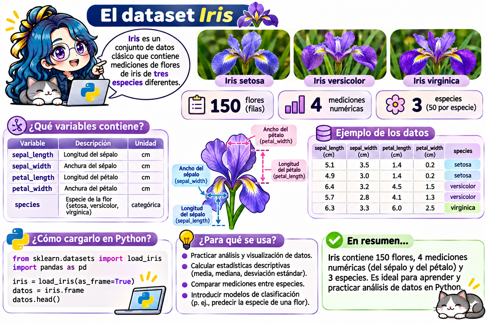
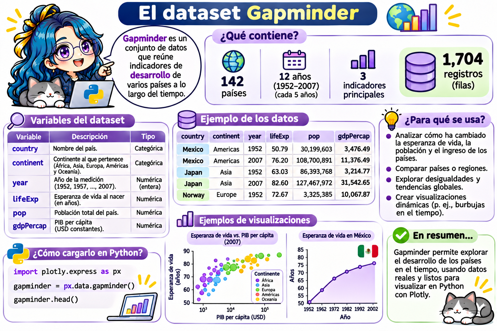

# Varias gráficas en una figura y gráficas interactivas con Plotly



```{r}
#| include: false
# Mostrar solo el resultado de la última línea de cada bloque de Python (como en Jupyter)
knitr::opts_chunk$set(jupyter_compat = TRUE)
# Usar el entorno del curso (~/.venvs/quarto-python) si existe, aunque RStudio tenga configurado otro Python.
# Si no existe, reticulate descarga automáticamente las bibliotecas necesarias.
venv_python <- path.expand(c("~/.venvs/quarto-python/bin/python", "~/.venvs/quarto-python/Scripts/python.exe"))
venv_python <- venv_python[file.exists(venv_python)]
if (length(venv_python) > 0) {
  Sys.setenv(RETICULATE_PYTHON = venv_python[1])
} else {
  reticulate::py_require(c("numpy", "pandas", "matplotlib", "sympy", "plotly"))
}
```

```{python}
#| include: false
# Hace que fig.show() muestre las figuras de Plotly dentro del libro
# (en Jupyter, Colab o Quarto con jupyter: python3, fig.show() funciona sin esta configuración).
import plotly.graph_objects as go
_primera_figura = True
def _mostrar_en_libro(self, *args, **kwargs):
    global _primera_figura
    html = self.to_html(include_plotlyjs="cdn" if _primera_figura else False, full_html=False)
    print("```{=html}\n" + html + "\n```")   # Bloque de HTML puro para que Quarto no lo modifique
    _primera_figura = False
go.Figure.show = _mostrar_en_libro
```

En el capítulo [Visualización de datos con Matplotlib](python_visualizacion.qmd) hicimos **una gráfica por figura** con Matplotlib. En este capítulo veremos dos cosas nuevas:

- Reunir **varias gráficas en una sola figura** con `plt.subplots()`, para compararlas lado a lado.
- Hacer **gráficas interactivas** con **Plotly**: zoom, desplazamiento e información al pasar el ratón.

Las bibliotecas son las mismas del capítulo anterior; si aún no las instalas, sigue los pasos de [Antes de empezar](python_visualizacion.qmd#antes-de-empezar).

```{python}
import numpy as np
import matplotlib.pyplot as plt
import plotly.express as px
```

## Varias gráficas en una figura: `subplots()` {#varias-gráficas-en-una-figura-subplots}

Con `plt.subplots(filas, columnas)` creamos una cuadrícula de gráficas. Esta forma de trabajar se llama **orientada a objetos**: cada gráfica es un objeto `ax` con sus propios **métodos**.

```{python}
x = np.linspace(0.1, 2 * np.pi, 200)

fig, axs = plt.subplots(2, 2, figsize=(8, 6))

axs[0, 0].plot(x, np.sin(x))
axs[0, 0].set_title("sen(x)")

axs[0, 1].plot(x, np.cos(x), color="tab:orange")
axs[0, 1].set_title("cos(x)")

axs[1, 0].plot(x, np.exp(-x), color="tab:green")
axs[1, 0].set_title("$e^{-x}$")

axs[1, 1].plot(x, np.log(x), color="tab:red")
axs[1, 1].set_title("ln(x)")

fig.tight_layout()   # Evita que se encimen los títulos
plt.show()
```

| Estilo `plt`   | Estilo orientado a objetos (`ax`) |
|----------------|-----------------------------------|
| `plt.plot()`   | `ax.plot()`                       |
| `plt.title()`  | `ax.set_title()`                  |
| `plt.xlabel()` | `ax.set_xlabel()`                 |
| `plt.xlim()`   | `ax.set_xlim()`                   |
| `plt.legend()` | `ax.legend()`                     |

Observa que `axs` es un **arreglo de NumPy** de 2 × 2, por eso usamos `axs[fila, columna]`.

### El mismo dato, dos gráficas

En el capítulo anterior vimos [qué gráfica elegir](python_visualizacion.qmd#qué-gráfica-elegir-para-explicar-algo) según la pregunta. Con `subplots()` podemos comprobarlo poniendo dos gráficas lado a lado. Contemos en qué dígito terminan los números primos menores que 1000. Con una **gráfica de pastel** es difícil decidir qué rebanada es mayor, porque el ojo compara **ángulos** con poca precisión. Con **barras** comparamos **alturas** sobre una misma base, y la respuesta salta a la vista:

```{python}
# Paso 1: contar en qué dígito terminan los primos menores que 1000
conteo = [0] * 10                               # CONTADORES: uno por cada dígito 0, 1, ..., 9
for n in range(2, 1000):                        # Revisar cada número del 2 al 999
    es_primo = True                             # Suponemos que n es primo...
    for d in range(2, int(n ** 0.5) + 1):       # ...y probamos divisores hasta √n
        if n % d == 0:                          # Si d divide a n,
            es_primo = False                    #   n no es primo
            break                               #   y dejamos de buscar
    if es_primo:
        conteo[n % 10] += 1                     # n % 10 es el último dígito de n: sumamos 1 a su contador

# Paso 2: quedarnos solo con los dígitos en los que termina algún primo (1, 2, 3, 5, 7, 9)
etiquetas = [str(d) for d in range(10) if conteo[d] > 0]     # Los dígitos como texto: "1", "2", ...
cantidades = [conteo[d] for d in range(10) if conteo[d] > 0] # Cuántos primos terminan en cada uno

# Paso 3: una figura con dos gráficas lado a lado (1 fila, 2 columnas)
fig, axs = plt.subplots(1, 2, figsize=(10, 4))

# Paso 4: la gráfica de la izquierda, axs[0], es un pastel
axs[0].pie(cantidades, labels=etiquetas)                     # ❌ Difícil de comparar ángulos
axs[0].set_title("Pastel: ¿cuál es mayor?")

# Paso 5: la gráfica de la derecha, axs[1], es de barras
axs[1].bar(etiquetas, cantidades, color="tab:blue")          # ✅ Fácil de comparar alturas
axs[1].set_title("Barras: el 7 gana")
axs[1].set_xlabel("Último dígito del primo")
axs[1].set_ylabel("Cantidad de primos")

# Paso 6: ajustar los espacios para que los textos no se encimen, y mostrar
plt.tight_layout()
plt.show()

# Paso 7: imprimir los conteos para comprobar lo que vemos en la gráfica
for digito, cantidad in zip(etiquetas, cantidades):
    print("Terminan en", digito, ":", cantidad, "primos")
```

Con barras se ve de inmediato que el 7 es el más frecuente, que 1, 3 y 9 están muy parejos (entre 38 y 42), y que solo **un** primo termina en 2 (el 2) y solo uno en 5 (el 5). En el pastel, esas diferencias casi no se notan.

### Las cuatro gráficas en una sola figura

En el capítulo anterior hicimos [cada gráfica por separado](python_visualizacion.qmd#datos-para-los-ejemplos): barras, histograma, caja y pastel. Ahora podemos reunirlas en una figura de 2 × 2 con `plt.subplots()`. Observa que el código de cada gráfica es el mismo, pero ahora usamos los **métodos** de cada `ax` (`axs[0, 0].bar()`, `axs[0, 0].set_title()`...) en lugar de `plt.bar()` y `plt.title()`:

Primero volvemos a crear los mismos datos simulados:

```{python}
rng = np.random.default_rng(seed=2026)          # Generador con semilla: siempre los mismos datos

# Datos por CATEGORÍA (para barras y pastel)
niveles = ["MB", "B", "S", "NA"]                # Muy bien, Bien, Suficiente, No acreditado
estudiantes_por_nivel = [28, 45, 35, 12]        # Cuántos estudiantes hay en cada nivel

# Datos NUMÉRICOS (para histograma y caja)
calificaciones = np.clip(rng.normal(7.8, 1.3, 120), 0, 10)   # 120 calificaciones (media 7.8) recortadas entre 0 y 10
grupo_a = rng.normal(7.5, 1.0, 40)              # 40 calificaciones: media 7.5, desviación 1.0
grupo_b = rng.normal(8.2, 0.8, 40)              # 40 calificaciones: media 8.2, desviación 0.8
grupo_c = rng.normal(6.9, 1.4, 40)              # 40 calificaciones: media 6.9, desviación 1.4
```

```{python}
# Paso 1: una figura con 2 filas y 2 columnas de gráficas; axs[fila, columna] es cada una
fig, axs = plt.subplots(2, 2, figsize=(9, 7))

# Paso 2: arriba a la izquierda (fila 0, columna 0): barras
axs[0, 0].bar(niveles, estudiantes_por_nivel, color="tab:blue")
axs[0, 0].set_title("Barras: estudiantes por nivel")
axs[0, 0].set_ylabel("Número de estudiantes")

# Paso 3: arriba a la derecha (fila 0, columna 1): histograma con la media
axs[0, 1].hist(calificaciones, bins=15, color="tab:green", edgecolor="white")
axs[0, 1].axvline(calificaciones.mean(), color="black", linestyle="--", label="Media")
axs[0, 1].set_title("Histograma de calificaciones")
axs[0, 1].legend()

# Paso 4: abajo a la izquierda (fila 1, columna 0): diagrama de caja
axs[1, 0].boxplot([grupo_a, grupo_b, grupo_c])
axs[1, 0].set_xticks([1, 2, 3], ["Grupo A", "Grupo B", "Grupo C"])   # Nombres en lugar de 1, 2, 3
axs[1, 0].set_title("Caja: calificaciones por grupo")

# Paso 5: abajo a la derecha (fila 1, columna 1): pastel
axs[1, 1].pie(estudiantes_por_nivel, labels=niveles, autopct="%1.0f%%")
axs[1, 1].set_title("Pastel: proporción por nivel")

# Paso 6: ajustar los espacios entre gráficas para que no se encimen, y mostrar
fig.tight_layout()
plt.show()
```

### Las dos gráficas juntas

En el capítulo anterior graficamos $f(x, y) = \sin(x)\cos(y)$ como [mapa de calor y como curvas de nivel](python_visualizacion.qmd#funciones-de-dos-variables), cada uno en su figura. Comparemos ambas representaciones lado a lado con `plt.subplots(1, 2)`:

```{python}
x = np.linspace(-2 * np.pi, 2 * np.pi, 200)
y = np.linspace(-2 * np.pi, 2 * np.pi, 200)
X, Y = np.meshgrid(x, y)
Z = np.sin(X) * np.cos(Y)

fig, axs = plt.subplots(1, 2, figsize=(10, 4))

imagen = axs[0].imshow(Z, extent=[x.min(), x.max(), y.min(), y.max()], origin="lower", cmap="RdBu")
fig.colorbar(imagen, ax=axs[0])
axs[0].set_title("Mapa de calor (imshow)")

curvas = axs[1].contour(X, Y, Z, levels=8, cmap="RdBu")
axs[1].clabel(curvas, fontsize=7)
axs[1].set_title("Curvas de nivel (contour)")

fig.tight_layout()
plt.show()
```

## Plotly: gráficas interactivas

[Plotly Express](https://plotly.com/python/plotly-express/) crea una gráfica completa con **una sola función**. Las gráficas son interactivas: pasa el ratón sobre los puntos, haz zoom seleccionando un área y da doble clic para regresar a la vista original.

Toda gráfica de Plotly sigue los mismos tres pasos:

``` python
import plotly.express as px                      # 1. Importar

fig = px.scatter(datos, x="columna_x", y="columna_y")   # 2. Crear la figura (se guarda en la variable fig)

fig.show()                                       # 3. Mostrar la figura
```

::: callout-note
## ¿Qué hace `fig.show()`?

Crear la figura (`fig = px.scatter(...)`) **no** la dibuja: solo la guarda en la variable `fig`. Para verla hay que llamar al método `fig.show()`, igual que con `plt.show()` en Matplotlib. Funciona igual en Jupyter Notebook, Google Colab, en un documento de Quarto y en este libro.
:::

### Datos de ejemplo: `px.data`

`px.data` es un **módulo de Plotly que incluye conjuntos de datos reales para practicar**. Vienen dentro de la biblioteca, así que **no necesitas descargar archivos** ni tener internet. Cada función de `px.data` regresa los datos como una **tabla** de pandas (un `DataFrame`):

| Función | Contenido | Filas |
|----|----|----|
| `px.data.iris()` | Medidas de flores de tres especies de iris. | 150 |
| `px.data.gapminder()` | Esperanza de vida, PIB y población de 142 países (1952-2007). | 1704 |
| `px.data.tips()` | Cuentas y propinas en un restaurante. | 244 |
| `px.data.stocks()` | Precio de acciones de seis empresas (2018-2019). | 105 |
| `px.data.wind()` | Dirección e intensidad del viento. | 128 |
| `px.data.medals_long()` | Medallas olímpicas de patinaje por país. | 9 |

Un `DataFrame` es como una hoja de cálculo: tiene **filas** (cada observación) y **columnas** con nombre (cada variable). Veamos el conjunto *iris*, con las medidas en centímetros de 150 flores:

```{python}
iris = px.data.iris()

print(iris.head())                  # Primeras 5 filas
print("Forma:", iris.shape)         # (filas, columnas), igual que en NumPy
print("Columnas:", list(iris.columns))
```

| Columna | Contenido |
|----|----|
| `sepal_length`, `sepal_width` | Largo y ancho del **sépalo** (cm). |
| `petal_length`, `petal_width` | Largo y ancho del **pétalo** (cm). |
| `species` | Especie: *setosa*, *versicolor* o *virginica*. |
| `species_id` | Número de la especie (1, 2 o 3). |

{fig-align="center"}

En las funciones de **Plotly Express**, el primer argumento es el `DataFrame` y los demás indican **qué columna** usar en cada parte de la gráfica, escribiendo su nombre como texto: `x="sepal_length"`.

### Una mini historia del conjunto *iris*

::: {.callout-tip icon="false"}
## 🌸 En pocas palabras

El conjunto *iris* nació de una **pregunta biológica**: ¿podemos distinguir especies de flores utilizando **únicamente sus características físicas**? En 1936, Fisher demostró que **las matemáticas podían ayudarnos a responderla**. Hoy, casi 90 años después, seguimos utilizando esos mismos datos para aprender **estadística, programación e inteligencia artificial**.
:::

**El botánico que midió las flores.** A mediados de la década de 1930, el botánico estadounidense **Edgar Anderson** quería entender cómo se diferencian y evolucionan las especies de plantas. Para ello midió con cuidado el sépalo y el pétalo de cientos de flores de iris; gran parte de ellas las recolectó en la **península de Gaspé**, en Quebec, Canadá. Anderson tomó 50 flores de cada una de tres especies: *Iris setosa*, *Iris versicolor* e *Iris virginica*.

**El estadístico que lo hizo famoso.** En 1936, el estadístico y matemático británico **Ronald A. Fisher** usó las mediciones de Anderson en el artículo *"The use of multiple measurements in taxonomic problems"* (El uso de mediciones múltiples en problemas taxonómicos). Ahí presentó el **análisis discriminante lineal**: un método para encontrar la **combinación lineal** de las cuatro mediciones que mejor separa a las especies. Por eso el conjunto también se conoce como el ***iris*** **de Fisher** o el ***iris*** **de Anderson**.

**¿Por qué sigue siendo tan usado casi 90 años después?** Porque es pequeño (150 filas), no tiene datos faltantes, sus variables son fáciles de entender y tiene una estructura interesante: *setosa* se separa claramente de las otras dos especies, mientras que *versicolor* y *virginica* se **traslapan** un poco. Eso lo hace perfecto para probar métodos y verificar si funcionan. Lo verás en las gráficas de este capítulo.

| Área | ¿Para qué se usa el conjunto *iris*? |
|----|----|
| **Botánica y taxonomía** | Su origen: estudiar cómo se distinguen las especies a partir de mediciones. |
| **Estadística** | Estadística descriptiva, pruebas de hipótesis y análisis multivariado, como el análisis discriminante lineal de Fisher. |
| **Álgebra lineal** | Ejemplo clásico de **proyecciones**: el análisis de componentes principales (PCA) y el análisis discriminante reducen las 4 dimensiones a 2 que se pueden graficar. |
| **Aprendizaje automático** (*machine learning*) | Primer ejemplo de **clasificación** (predecir la especie a partir de las medidas) y de **agrupamiento** (encontrar grupos sin conocer la especie, por ejemplo con *k-means*). Es uno de los conjuntos más descargados del [repositorio de aprendizaje automático de UCI](https://archive.ics.uci.edu/dataset/53/iris), donde está disponible desde 1988. |
| **Visualización de datos** | Ejemplo estándar para enseñar gráficas de dispersión, histogramas, diagramas de caja y matrices de gráficas. |
| **Programación y software** | Viene incluido en muchas herramientas: en R (`iris`), en Python con `plotly.express`, `seaborn` y `scikit-learn`. Se usa para probar que un programa funciona. |

Como ya lo conoces de R, puedes compararlo: en la **Console** de R, `head(iris)` muestra las mismas primeras filas, con las columnas `Sepal.Length`, `Sepal.Width`, `Petal.Length`, `Petal.Width` y `Species`.

::: callout-note
## Un dato para reflexionar

Fisher hizo aportaciones fundamentales a la estadística, pero también promovió la **eugenesia**, una ideología hoy rechazada, y publicó este trabajo en la revista *Annals of Eugenics*. Por eso, algunos docentes prefieren usar conjuntos alternativos, como [*Palmer penguins*](https://allisonhorst.github.io/palmerpenguins/) (medidas de pingüinos de la Antártida, publicado en 2020), que tiene una estructura parecida. Conocer el origen de los datos también es parte de analizarlos con responsabilidad.
:::

### Dispersión

```{python}
#| output: asis
fig = px.scatter(iris, x="sepal_length", y="sepal_width", color="species",
                 title="Iris: largo vs. ancho del sépalo",
                 labels={"sepal_length": "Largo del sépalo (cm)",
                         "sepal_width": "Ancho del sépalo (cm)",
                         "species": "Especie"})
fig.show()
```

Con el argumento `color`, Plotly asigna un color a cada especie y crea la leyenda automáticamente. Da clic en una especie de la leyenda para ocultarla. El argumento `labels` cambia los nombres de las columnas por textos más claros en los ejes y la leyenda.

### Línea

Plotly Express también acepta arreglos de NumPy en lugar de un `DataFrame`:

```{python}
#| output: asis
x = np.linspace(0, 4 * np.pi, 200)
fig = px.line(x=x, y=np.sin(x) * np.exp(-x / 5),
              labels={"x": "x", "y": "f(x)"},
              title="Oscilación amortiguada: f(x) = sen(x)·e^(-x/5)")
fig.show()
```

### Histograma y caja

```{python}
#| output: asis
fig = px.histogram(iris, x="petal_length", color="species", nbins=30,
                   marginal="box", title="Largo del pétalo por especie",
                   labels={"petal_length": "Largo del pétalo (cm)", "species": "Especie"})
fig.show()
```

El argumento `marginal="box"` agrega un diagrama de caja arriba del histograma.

### Superficie en 3D

Plotly Express no tiene una función para superficies, así que usamos el módulo `plotly.graph_objects` (abreviado `go`), que permite construir gráficas más elaboradas pieza por pieza. La malla se construye con `np.meshgrid()`, igual que en Matplotlib:

```{python}
#| output: asis
import plotly.graph_objects as go

# 1. Crear la malla y evaluar la función
x = np.linspace(-2 * np.pi, 2 * np.pi, 80)
y = np.linspace(-2 * np.pi, 2 * np.pi, 80)
X, Y = np.meshgrid(x, y)
Z = np.sin(X) * np.cos(Y)

# 2. Crear la figura con una superficie
fig = go.Figure(go.Surface(x=X, y=Y, z=Z, colorscale="RdBu"))

# 3. Agregar título y tamaño
fig.update_layout(title="z = sen(x)·cos(y)", width=650, height=550)

# 4. Mostrar
fig.show()
```

Gira la superficie arrastrando con el ratón y acércate con la rueda del ratón.

| Parte | ¿Qué hace? |
|----|----|
| `go.Surface(x=X, y=Y, z=Z)` | Crea la **superficie** a partir de la malla. |
| `colorscale="RdBu"` | Paleta de colores (como `cmap` en Matplotlib). |
| `go.Figure(...)` | Crea la **figura** que contiene la superficie. |
| `fig.update_layout(...)` | Modifica el diseño: título, tamaño, ejes. |
| `fig.show()` | Muestra la figura. |

### Animaciones

{fig-align="center"}

El conjunto *gapminder* contiene la esperanza de vida, el PIB per cápita y la población de 142 países entre 1952 y 2007, cada 5 años. Primero veamos sus columnas:

```{python}
gapminder = px.data.gapminder()
print(gapminder.head())
```

Con el argumento `animation_frame`, Plotly crea **un cuadro por cada valor** de una columna (aquí, uno por año) y agrega un botón ▶ y una barra deslizante para recorrerlos:

```{python}
#| output: asis
fig = px.scatter(
    gapminder,                    # 1. Datos
    x="gdpPercap",                # 2. Eje x: PIB per cápita
    y="lifeExp",                  #    Eje y: esperanza de vida
    size="pop",                   # 3. Tamaño del punto: población
    color="continent",            #    Color del punto: continente
    hover_name="country",         # 4. Nombre que aparece al pasar el ratón
    animation_frame="year",       # 5. Un cuadro de la animación por cada año
    log_x=True,                   # 6. Escala logarítmica en el eje x
    size_max=50,                  #    Tamaño máximo de los puntos
    range_y=[25, 90],             #    Rango fijo del eje y en todos los cuadros
    labels={"gdpPercap": "PIB per cápita (escala log)", "lifeExp": "Esperanza de vida",
            "continent": "Continente", "year": "Año", "pop": "Población"},   # 7. Textos
    title="Esperanza de vida vs. PIB per cápita"
)
fig.show()                        # 8. Mostrar
```

El código se divide en estas partes:

| Parte | Argumentos | ¿Qué hace? |
|----|----|----|
| 1\. Datos | `gapminder` | El `DataFrame` con la información. Cada fila es un país en un año. |
| 2\. Ejes | `x="gdpPercap"`, `y="lifeExp"` | Qué columnas se grafican en cada eje. |
| 3\. Tamaño y color | `size="pop"`, `color="continent"` | Cada punto es más grande si el país tiene más población y tiene el color de su continente. Así una sola gráfica muestra **cuatro** variables. |
| 4\. Información al pasar el ratón | `hover_name="country"` | Muestra el nombre del país en la etiqueta emergente. |
| 5\. Animación | `animation_frame="year"` | Separa los datos por año: cada año es un cuadro de la animación. |
| 6\. Ajustes de los ejes | `log_x=True`, `size_max=50`, `range_y=[25, 90]` | La escala logarítmica evita que los países ricos aplasten a los demás; `range_y` mantiene el eje fijo para que los cuadros sean comparables. |
| 7\. Textos | `labels`, `title` | Nombres claros en español para ejes, leyenda y título. |
| 8\. Mostrar | `fig.show()` | Dibuja la gráfica con sus controles de animación. |

Presiona ▶ para ver cómo cambian los países con el tiempo, o mueve la barra deslizante para elegir un año. Pasa el ratón sobre un punto para ver de qué país se trata.

### Guardar una gráfica de Plotly

``` python
fig.write_html("mi_grafica.html")   # Archivo HTML interactivo (se abre en el navegador)
fig.write_image("mi_grafica.png")   # Imagen estática (requiere el paquete kaleido)
```

## Ejercicios

Resuelve los ejercicios en los editores interactivos. Recuerda que lo que escribas **no se guarda** al recargar la página. La primera vez que ejecutes un editor, las bibliotecas pueden tardar unos segundos en cargar.

Como en estos ejercicios el resultado es una gráfica, no hay revisión automática: compara tu gráfica con la de la solución.

### Ejercicio 1. Cuatro funciones en una figura

Crea una figura de 2 × 2 con `plt.subplots()` y grafica en el intervalo $[-2, 2]$: $x$, $x^2$, $x^3$ y $|x|$. Cada gráfica debe tener su título.

```{pyodide}
#| exercise: vis3
import numpy as np
import matplotlib.pyplot as plt

x = np.linspace(-2, 2, 100)

fig, axs = plt.subplots(______, ______, figsize=(7, 6))

axs[0, 0].plot(x, x)
axs[0, 0].set_title("y = x")

# Completa las otras tres gráficas


fig.tight_layout()
plt.show()
```

:::: {.hint exercise="vis3"}
::: {.callout-note collapse="false"}
## Pista

`plt.subplots(2, 2)`. Las otras posiciones son `axs[0, 1]`, `axs[1, 0]` y `axs[1, 1]`. El valor absoluto es `np.abs(x)`.
:::
::::

:::: {.solution exercise="vis3"}
::: {.callout-tip collapse="false"}
## Solución

``` python
import numpy as np
import matplotlib.pyplot as plt

x = np.linspace(-2, 2, 100)

fig, axs = plt.subplots(2, 2, figsize=(7, 6))

axs[0, 0].plot(x, x)
axs[0, 0].set_title("y = x")

axs[0, 1].plot(x, x**2)
axs[0, 1].set_title("y = x²")

axs[1, 0].plot(x, x**3)
axs[1, 0].set_title("y = x³")

axs[1, 1].plot(x, np.abs(x))
axs[1, 1].set_title("y = |x|")

fig.tight_layout()
plt.show()
```
:::
::::

### Ejercicio 2. Una gráfica interactiva con Plotly

Para usar Plotly en los editores de esta página, las primeras líneas del código lo instalan en el navegador y preparan `fig.show()` para que muestre la gráfica. **No las modifiques.** En Jupyter o Colab no las necesitas.

::: callout-note
La primera vez que ejecutes un editor con Plotly, la instalación tarda entre 15 y 20 segundos. Ejecuta **un editor de Plotly a la vez** y espera a que aparezca la gráfica antes de ejecutar el siguiente.
:::

Con los datos `iris`, crea una gráfica de dispersión del **largo** (`petal_length`) contra el **ancho** (`petal_width`) del pétalo, con un color por especie (`species`). Pasa el ratón sobre los puntos.

```{pyodide}
#| exercise: vis5
# --- Preparar Plotly en el navegador (no modificar) ---
import micropip
await micropip.install("plotly")
import pandas
import plotly.graph_objects as go
from IPython.display import display, HTML
go.Figure.show = lambda fig, *args, **kwargs: display(HTML(fig.to_html(include_plotlyjs="cdn", full_html=False)))
# -------------------------------------------------------

import plotly.express as px

iris = px.data.iris()

fig = px.scatter(iris, x=______, y=______, color=______,
                 title="Iris: largo vs. ancho del pétalo")
fig.show()
```

:::: {.hint exercise="vis5"}
::: {.callout-note collapse="false"}
## Pista

Los nombres de las columnas se escriben como texto: `x="petal_length"`, `y="petal_width"` y `color="species"`.
:::
::::

:::: {.solution exercise="vis5"}
::: {.callout-tip collapse="false"}
## Solución

``` python
import plotly.express as px

iris = px.data.iris()

fig = px.scatter(iris, x="petal_length", y="petal_width", color="species",
                 title="Iris: largo vs. ancho del pétalo")
fig.show()
```

Observa que con las medidas del pétalo las especies se separan muy bien, sobre todo *setosa*.
:::
::::

### Ejercicio 3. Superficie 3D con Plotly

Grafica la superficie de la **silla de montar** $z = x^2 - y^2$ en $[-2, 2] \times [-2, 2]$ con `go.Surface()`. Gírala con el ratón: ¿por qué crees que se llama así?

```{pyodide}
#| exercise: vis6
# --- Preparar Plotly en el navegador (no modificar) ---
import micropip
await micropip.install("plotly")
import pandas
import plotly.graph_objects as go
from IPython.display import display, HTML
go.Figure.show = lambda fig, *args, **kwargs: display(HTML(fig.to_html(include_plotlyjs="cdn", full_html=False)))
# -------------------------------------------------------

import numpy as np
import plotly.graph_objects as go

x = np.linspace(-2, 2, 60)
y = np.linspace(-2, 2, 60)
X, Y = np.meshgrid(x, y)
Z = ______

fig = go.Figure(go.Surface(x=X, y=Y, z=Z, colorscale="Viridis"))
fig.update_layout(title="Silla de montar: z = x² - y²", width=600, height=500)
fig.show()
```

:::: {.hint exercise="vis6"}
::: {.callout-note collapse="false"}
## Pista

`Z = X**2 - Y**2`.
:::
::::

:::: {.solution exercise="vis6"}
::: {.callout-tip collapse="false"}
## Solución

``` python
import numpy as np
import plotly.graph_objects as go

x = np.linspace(-2, 2, 60)
y = np.linspace(-2, 2, 60)
X, Y = np.meshgrid(x, y)
Z = X**2 - Y**2

fig = go.Figure(go.Surface(x=X, y=Y, z=Z, colorscale="Viridis"))
fig.update_layout(title="Silla de montar: z = x² - y²", width=600, height=500)
fig.show()
```

El origen es un **punto silla**: es un mínimo en la dirección de $x$ y un máximo en la dirección de $y$.
:::
::::

## Resumen

| Tema | Idea clave |
|----|----|
| Varias gráficas | `fig, axs = plt.subplots(filas, columnas)` y los métodos `ax.set_title()`, `ax.set_xlabel()`... |
| Comparar gráficas | Lado a lado con `plt.subplots(1, 2)`; `fig.tight_layout()` evita que se encimen los textos. |
| Plotly Express | Gráficas interactivas con una función: `px.scatter`, `px.line`, `px.histogram`, `px.box`. |
| Plotly Graph Objects | Gráficas avanzadas, como superficies: `go.Surface()`. |
| Mostrar y guardar | `fig.show()`, `fig.write_html()`. |

## Referencias

- [Matplotlib: varias gráficas con `subplots()`](https://matplotlib.org/stable/gallery/subplots_axes_and_figures/subplots_demo.html)
- [Plotly Express en Python](https://plotly.com/python/plotly-express/)
- [Plotly: galería de gráficas en Python](https://plotly.com/python/)
